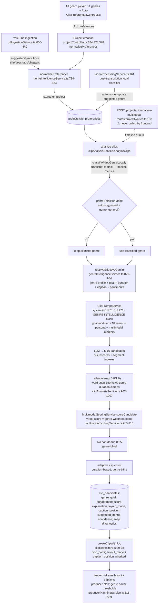

# VireoClip Genre Intelligence Engine — Audit

**Date:** 2026-10-24 · **Mode:** Read-only (no code, test, prompt, config, or data modifications)
**Scope:** Genre intelligence and clip-selection backend only (classification → interpretation → scoring → segmentation → ranking → clip conversion). Render-path and job-lifecycle findings are in `CLIPPING_ENGINE_PRODUCTION_AUDIT.md`.
**Working tree:** 61 pre-existing modified/untracked entries preserved untouched (earlier UI + phases 1–6 work).

---

## 1. Executive Verdict

**Partially competitive.**

The genre architecture is real and unusually deep for this product category: 11 genre profiles each carry genuinely different prompt rubrics, duration windows, hard constraint clamps, scoring weights, reframing defaults, caption placements, and producer edit rules — and those parameters verifiably execute (not just decorate prompts). The intent layer (content goals) is a separate orthogonal dimension, and natural-language search parsing (Hinglish-aware) mirrors Opus ClipAnything's signature feature.

It is held back by three verified facts: (1) the **multimodal half of the genre brain is dormant** — the timeline analysis that powers silence-snapping, face-in-hook bonuses, dynamic audio energy, OCR bonuses, and richer auto-classification is an opt-in API endpoint the frontend never calls; (2) **scores are uncalibrated heuristics presented as "Viral"** in the main clip-selection UI; (3) **zero measured evidence** exists that genre selection improves outcomes — no benchmark, no ablation, no human ratings. Additionally, a dead fixed-weight scoring function (`computeHybridScore`) misdocuments the actual live scoring path.

---

## 2. Verified Architecture (genre choice → exported clip)

### Answers to the Part-1 questions (evidence)

1. **Defined/validated:** `GENRE_PROFILES` registry, `genreIntelligenceService.ts:33-440`; `ContentGenre` union type `types/index.ts:302+`. Normalization at every creation path (`projectController.ts:184,275,378`) and ingestion (`urlIngestionService.ts:1007`).
2. **Supported vs selectable:** 11 registry genres = 11 UI-selectable genres (ClipPreferencesControl `GENRE_OPTIONS`) + Auto. Full parity, no dark genres.
3. **Stable IDs:** yes — registry-key snake_case IDs validated via `genre in GENRE_PROFILES` (`genreIntelligenceService.ts:446,766,790`). Legacy bracketed-note genres re-validated (765-768).
4. **Missing/misspelled/unknown:** silently falls back to `general` (`getGenreProfile`, 445-450) and `normalizePreferences` coerces to `general` (789-792) — **no warning logged, no diagnostic recorded**. Not a crash risk, but a silent quality degradation the user can't see.
5. **Persistence:** preferences stored on the project at creation; re-analysis re-reads them (`clipAnalysisService.ts:726-730`); candidates persist `genre`, `content_goal`, `engagement_score`, full metadata (`clipAnalysisService.ts:1040-1062`); clip creation inherits layout/caption from candidate metadata; retries/re-render use the clip record. Genre survives the full lifecycle. ✔
6. **Execution branches that change with genre (verified):** LLM system+user prompt rubric; duration constraints sent to the LLM (`clipPromptService.ts:158,244-266`) AND hard clamps applied post-hoc (`clipAnalysisService.ts:984-1007`); scoring weights in `vireo_score` (`multimodalScoringService.ts:210`); recommended reframe layout + caption placement → clip records (`clipRepository.ts:29-38`) → render; producer pause-cut rules incl. hard no-cut for comedy/sports (`producerPlanningService.ts:515-533`, enforced and tested); default content goal; caption style default (`resolveEffectiveConfig:864-876`).
7. **Affects more than the prompt?** Yes — verified above. Exceptions: dedup (0.25 fixed), adaptive clip count (duration-only), and the word-snap 150 ms guard itself are genre-blind (genre enters only via duration limits).
8. **Rubrics meaningfully different?** Yes — read side-by-side, the 11 profiles differ in objective, arc, safeguard semantics (e.g., news: "never truncate counter-arguments"; comedy/sports: pause-cut prohibition; podcast: "never start on an isolated response"), weights (gaming hook 0.40/audio 0.20 vs education standalone 0.35/insight 0.30), duration windows (15–45 gaming vs 45–90 storytelling), layouts (split/screencast/blur/track), and caption defaults.
9. **Hidden overrides:** `resolveEffectiveConfig` precedence is explicit (user > creator profile > genre > general) and tested. One inconsistency: `normalizePreferences` defaults `genreSelectionMode` to `'manual'` (line 806) while the UI default is `'auto'` — direct API clients omitting the field silently skip auto-detection. Also `parseAIResponse` injects **70 defaults for missing LLM subscores** (`clipAnalysisService.ts:568-572`) — a hidden mid-scale prior.
10. **Diagnostics:** good — candidate metadata records genre, suggested genre + confidence, layout, caption position, snap diagnostics, and an explanation array (`multimodalScoringService.ts:226-258`). No secrets exposed.

---

## 3. Taxonomy Assessment

The 11-genre registry maps to real content families with defensible boundaries, but has verifiable overlaps and gaps vs the content-family list:

| Current genre | Verdict | Notes |
|---|---|---|
| podcast_interview | Keep | Overlaps storytelling (anecdotes inside interviews) — acceptable, goal layer disambiguates |
| education_tutorial | Keep | Screen-share definitive signal exists but never fires (see finding F4) |
| motivation | Keep | |
| business_finance | Keep | Overlaps product_marketing (founder content) |
| gaming | Keep | Audio/visual weights (0.35 combined) presuppose multimodal data that is dormant |
| sports | Keep | Hard no-jump-cut safeguard + blur layout are genuinely differentiating |
| news_politics | Keep | Context-integrity safeguard is a real editorial differentiator |
| comedy_entertainment | Keep | Pause-preservation safeguard verified in registry, producer rules, and tests |
| storytelling | Keep | |
| product_marketing | Merge candidate | Overlaps business_finance + education demo content |
| general | Keep | Honest baseline |

**Missing families from the brief:** vlogs/travel, documentary, cooking/DIY, debate/panel (folded into podcast), music-led/low-dialogue (the exact family Vizard Spark targets — currently unrepresentable except via `general`).

**Recommended hierarchy** (representable without breaking compatibility — the dimensions already exist as separate fields): **Content family** (registry genre) × **Format** (new field; interview/solo/tutorial/livestream/montage — `recommendedLayoutMode` is already a proto-format) × **Clip intent** (`ContentGoal` — already exists) × **Audience** (creatorProfile — already exists) × **Selection preferences** (ClipPreferences — already exists). Backward compatible: every new dimension defaults to unset with genre-profile fallbacks.

---

## 4. What Is Genuinely Genre-Specific vs Generic (with evidence)

**Genuinely genre-specific (executes):**
- Prompt rubric injection (objective/arc/safeguard) — `clipPromptService.ts:45-55,151-160`; tested in `phaseACGenreIntelligence.test.ts` ("injects genre objectives...").
- Duration windows: LLM-constrained AND hard-enforced (`clipAnalysisService.ts:984-1007`).
- Scoring weights in the live ranking score (`multimodalScoringService.ts:210-213`).
- Reframe layout + caption placement defaults → clip records → render (`clipRepository.ts:29-38`; render parity fixed in `CLIPPING_ENGINE_IMPLEMENTATION_ROADMAP.md` Phase 2 work).
- Producer pause-cut thresholds + comedy/sports no-cut enforcement (`producerPlanningService.ts:515-533`; tested).
- Default goal per genre; duration-goal overrides (`resolveEffectiveConfig:854-862`).

**Generic (genre-blind):** overlap dedup (0.25), adaptive clip count, word-snap guard (150 ms), silence-snap tolerances, the five LLM subscore *definitions* (identical text for all genres — genre changes which moments the LLM picks, not what the dimensions mean).

**Nominally supported (exists but dormant or starved):** see findings F1/F4 below.

---

## 5. Confirmed Findings (severity-ranked)

**F1 — HIGH · Multimodal intelligence is dormant.** `POST /projects/:id/analyze-multimodal` (`routes/projectRoutes.ts:108`) is the only producer of the multimodal timeline; **no frontend code references it** (verified: zero matches for `analyze-multimodal` in `src/`). Consequently, in the shipped product: silence-based boundary snapping never runs at scoring time (`multimodalScoringService.ts:63-88` gated on `timeline`), face-in-hook/visual/OCR bonuses never apply, dynamic audio energy is replaced by constant defaults (visual=60, audio=70, lines 99-101), prompt multimodal markers (`[HIGH_ACTIVITY]/[SCENE_CUT]/[OCR]`, `clipPromptService.ts:76-124`) never appear, and auto-classification runs on transcript text alone. All genre-weighted visual/audio scoring executes on constants. User impact: genre differentiation for visual/audio content (gaming, sports, cooking) is theoretical.

**F2 — HIGH · Score presentation overstates.** `ClipWorkspace.tsx:679` still labels the heuristic `{score} Viral` (the same misrepresentation fixed on HistoryPage in the earlier roadmap Phase 1). `engagement_score` is a genre-weighted blend of five LLM-claimed subscores + constant multimodal defaults + platform fit — never validated against outcomes; missing subscores silently become 70 (`clipAnalysisService.ts:568-572`); auto-genre `confidence` is a clamped heuristic (0.50–0.96, `genreIntelligenceService.ts:714`), not a probability.

**F3 — MEDIUM · Dead scoring path misdocuments the live one.** `computeHybridScore` (fixed 25/20/20/15/10/10 weights, `clipAnalysisService.ts:351-372`) and `filterWithAutoRelaxation` (465+) have **zero callers** (verified repo-wide). The live score is `vireo_score` with per-genre weights. Drift/confusion risk — it misled the earlier production audit's score description.

**F4 — MEDIUM · Auto-classifier inputs starved.** `classifyVideoGenreLocally` accepts `audioPeakEnergyDb`, `visualMotionScore`, `audienceLaughterDetected` (+0.55 comedy), `screenShareDetected` (+0.55 education) — none of the three call sites pass them (`videoProcessingService.ts:161-167`: transcript+wpm+questions; `urlIngestionService.ts:615`: metadata text; `clipAnalysisService.ts:715-724`: timeline metrics only when timeline exists — i.e., never in the shipped flow per F1). The definitive comedy/education signals never fire.

**F5 — MEDIUM · Genre-blind diversity and count.** Dedup is a fixed 0.25 overlap ratio (`clipAnalysisService.ts:1066-1068`); clip count is duration-derived (`wordSnappingUtils.ts:217-242`). No genre-specific redundancy policy (storytelling tolerates less repetition than gaming highlights) — a ranking-quality gap competitors address with "top-N by score" plus variety.

**F6 — LOW · Silent unknown-genre fallback.** Invalid genre strings fall back to `general` with no log or user-visible note (`genreIntelligenceService.ts:445-450,789-792`).

**F7 — LOW · genreSelectionMode default mismatch.** Server default `'manual'` (`genreIntelligenceService.ts:806`) vs UI default `'auto'` — API clients omitting the field skip auto-detection silently.

---

## 6. Competitive Comparison Matrix

Sources: [opus.pro](https://www.opus.pro/), [Opus ClipAnything docs](https://help.opus.pro/docs/article/how-to-use-clipanything), [riverside.com/magic-clips](https://riverside.com/magic-clips) + [2026 review](https://blitzcutai.com/blog/riverside-magic-clips-review-2026) + [feisworld walkthrough](https://www.feisworld.com/blog/riverside-magic-clips-youtube-shorts), [Vizard API docs](https://docs.vizard.ai/docs/introduction) + [advanced options](https://docs.vizard.ai/docs/advanced) + [Spark 1.0](https://help.vizard.ai/en/articles/9905409-what-is-spark-1-0), [HL-CLIP (CVPR 2024W)](https://openaccess.thecvf.com/content/CVPR2024W/ELVM/html/Han_Unleash_the_Potential_of_CLIP_for_Video_Highlight_Detection_CVPRW_2024_paper.html). Public claims ≠ measured capabilities for all competitors.

| Capability | Public evidence | VireoClip implementation | Evidence level | Gap | Proposed evaluation |
|---|---|---|---|---|---|
| Genre/content coverage | Riverside: speaker+topic selection; Vizard Spark: podcasts, sports, streams, vlogs | 11-genre registry w/ rubrics, weights, layouts | Code-verified (VC) vs vendor claims | Vlog/doc/cooking/low-dialogue families missing | Family coverage audit on corpus |
| Natural-language clip instructions | Opus ClipAnything prompt-based clipping (official docs); Vizard `keywords` param | `parseNaturalLanguageSearchIntent` incl. Hinglish → directive + focus keywords | VC | Comparable; adherence unmeasured | Prompt-adherence rate vs references |
| Semantic/contextual selection | Claimed universally; Vizard clip_v2 "more complete clips" | Prompt rubrics + safeguards + standalone guardrails | VC (prompt) / NOT MEASURED (outcome) | No evidence either side | Human completeness ratings |
| Visual/audio/multimodal understanding | Spark: visual+audio+sentiment, works on little/no dialogue; HL-CLIP: CLIP-based highlight SOTA on QVHighlights | Full multimodal scoring built — **dormant** (F1) | VC | No-dialogue content unsupported in practice | Enable + benchmark vs transcript-only |
| Speaker/subject awareness | Riverside Active Speaker View | Haar+mouth-motion reframe (verified in prior audit); split layout for podcasts | VC | Reframe ≠ selection signal (no speaker-diary in scoring) | Two-person corpus framing tests |
| Duration/topic controls | Vizard `maxClipNumber`, `ratioOfClip`, `preferLength`; Opus <30s/30–60s | 4 duration bands (genre-aware windows), 4 ratios, keywords, target count | VC | Parity | — |
| Scoring + explanations | Opus & Vizard "virality score" ranked (methods undocumented) | Genre-weighted score + explanation array + per-dimension subscores | VC | Uncalibrated; "Viral" label overstates (F2) | Rank agreement vs human ranking; calibration |
| Duplicate suppression/diversity | Not documented by competitors | 0.25 overlap dedup, genre-blind | VC | No diversity-aware selection | Redundancy rate metric |
| Low-dialogue content | Spark explicitly targets it | Not supported in practice (F1) | VC | Material | Spark-comparable corpus test post-F1 |
| Boundary integrity | Not documented publicly | 150ms word-snap + silence-snap (dormant) + duration clamps; tested | VC | Silence path dormant | Boundary error vs references |
| Reprocessing/iteration | Spark re-prompting (10 prompts/project) | Re-analyze endpoint + NL intent; chunked long-transcript windows | VC | Weaker iteration UX | — |

**Three largest competitive gaps:** (1) multimodal/low-dialogue understanding is built but unreachable (Spark's headline differentiator); (2) no measured selection-quality evidence while marketing-leading rivals publish model tiers ("clip_v2"); (3) score honesty/calibration — presenting an unvalidated heuristic as "Viral" in the primary selection UI.

---

## 7. Score & Confidence Audit

| Field | Computed by | Nature | Range | Issues |
|---|---|---|---|---|
| engagement_score | MultimodalScoringService `vireo_score` | Genre-weighted blend of 5 LLM subscores + constants (60/70) + platform fit | 0–100 int | Uncalibrated; constants when timeline absent; mislabeled "Viral" in ClipWorkspace |
| hook/standalone/insight/emotion/platform scores | LLM (prompt-defined) | Model-claimed | 0–100 | Missing → silent 70 default; identical dimension definitions across genres |
| genre confidence | `classifyVideoGenreLocally` | Clamped heuristic of keyword/signal score | 0.50–0.96 | Not a probability; inputs starved (F4) |
| duration quality score | `calculateDurationScore` (rule) | Deterministic | 0–100 | Only used by dead `computeHybridScore` (F3) |

No fabricated UI fallbacks remain on HistoryPage (fixed earlier); **confirmed residual: `ClipWorkspace.tsx:652` and `:1117` use `?? 94`** — unscored candidates render "94 Viral" in the primary selection UI. Recommendation (not implemented): rename to "AI Rank", publish dimension breakdown (already stored in metadata.explanation), drop the 70-default in favor of null + score recomputation.

## 8. Test Coverage

Executed this audit: `phaseACGenreIntelligence.test.ts` — **12/12 pass** (~2.0s; unit + prompt-content assertions; no DB/network). Coverage: registry validity (11 genres, weights sum 1.0), comedy/sports pause safeguards, classifier cases (gaming/business/education/sports/general), legacy-notes normalization, precedence chain, dynamic audio energy (not hardcoded), prompt injection of genre/goal/multimodal markers. Limitations: no end-to-end LLM tests (all prompt assertions are string-content checks), no calibration/ablation tests, no test that the multimodal endpoint integrates with analysis in the real flow (it doesn't — F1).

## 9. Benchmark & Ablation Status

**NOT MEASURED.** Design delivered in `GENRE_INTELLIGENCE_ROADMAP.md` Phase 0 (corpus, reference moments, metrics: Precision/Recall@K, completeness ratings, truncation/dead-air rates, boundary error, rank correlation, latency/cost) and Phase 6 (genre ablation: correct vs incorrect vs none vs genre+intent on identical sources; mixed-genre; low-dialogue; repeat-run stability). No numbers exist; none are claimed anywhere in this report.

## 10. Confidence & Unresolved Questions

Confirmed: F1–F7 with file:line evidence; all "genuinely genre-specific" claims; the `?? 94` score fallback at `ClipWorkspace.tsx:652,1117` (upgraded from suspected during this audit). Unverified: actual LLM adherence to genre rubrics (no end-to-end evidence); quality of the local classifier on real transcripts (heuristic, Hinglish-tilted lexicons); whether Vizard's clip_v2/Spark claims translate to measured superiority. Open decisions for the owner: whether to enable multimodal analysis by default (cost), whether to rename/rescale the public score, and whether to adopt the family×format hierarchy now or post-benchmark.
