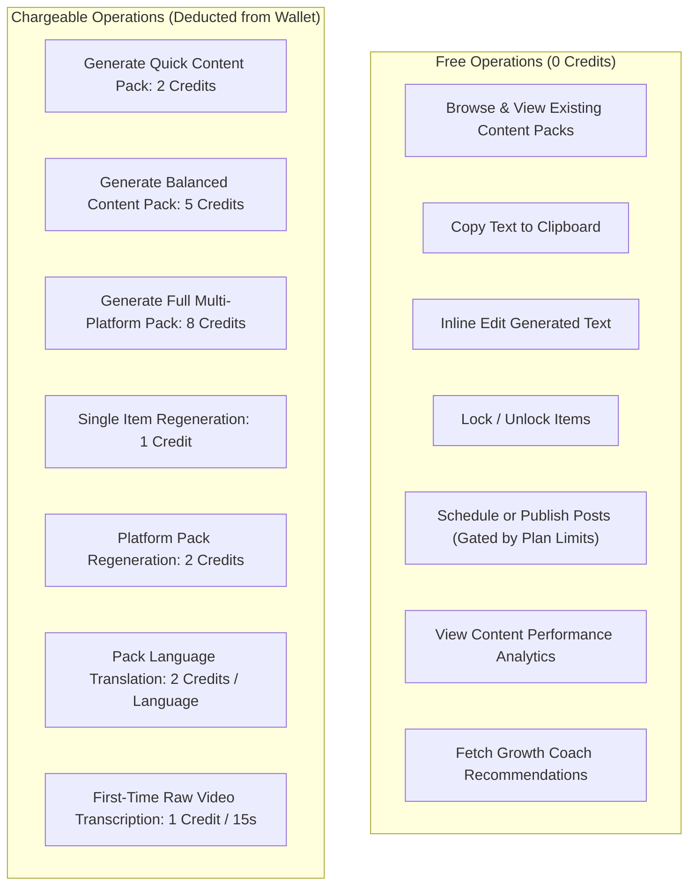
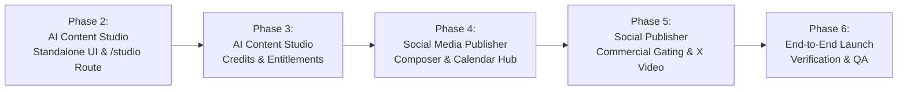

# VireoClip — 4-Core Feature Expansion: Phase 1 Audit & Architecture Assessment

**Repository:** https://github.com/Mayur0785/VireoClip  
**Auditor:** Antigravity AI Engineering Team  
**Date:** November 5, 2026  
**Status:** Complete Architectural Audit & Blueprint (Strictly Read-Only / Zero Code Changes)  
**Target Architecture:** Expansion from 2 Core Features (AI Video Clipping, Subtitle Studio) to 4 Core Features (+ AI Content Studio, + Social Media Publisher)

---

## 1. Executive Summary

### 1.1 Product Vision & Strategic Objective
VireoClip is evolving from a specialized AI video clipping and subtitle tool into a **complete AI-powered video content creation and social media distribution platform**. Under the unified vision, creators, agencies, and enterprises operate within a single, cohesive workflow:
1. **AI Video Clipping (Core Feature 1 — Existing & Production Ready):** Ingest long-form video (URLs or uploads), transcribe, analyze virality, perform AI face-tracking/reframe, apply styling recipes, duck audio, and export multi-aspect ratio viral clips.
2. **Subtitle Studio (Core Feature 2 — Existing & Production Ready):** Standalone transcript editor with kinetic caption animations, multi-language translation, ASS subtitle compilation, audio ducking, and commercial watermark enforcement.
3. **AI Content Studio (Core Feature 3 — New Core Feature):** Source-grounded content intelligence generating multi-angle titles, scroll-stopping hooks, short and long-form captions, semantic descriptions, platform-optimized hashtags, keyword clouds, textual thumbnail direction, alt-text, and platform packs (YouTube, Shorts, Instagram, TikTok, LinkedIn, X).
4. **Social Media Publisher (Core Feature 4 — New Core Feature):** Native multi-platform distribution engine supporting direct publishing, intelligent scheduling, cryptographic OAuth token management, retry-safe background queue execution, evidence-grounded performance analytics, and growth coaching.

### 1.2 Audit Scope & Rules Compliance
In strict compliance with instructions:
- **Zero application code has been modified.** No routes, controllers, schemas, frontend components, or configuration files were changed.
- The entire codebase (backend services, workers, controllers, repositories, frontend pages, components, and types) was inspected down to the line-item level.
- No commercial payment providers (Paddle/Razorpay) were activated, and no pricing values were altered.

### 1.3 Key Architectural Findings Overview

| Dimension | AI Video Clipping (F1) | Subtitle Studio (F2) | AI Content Studio (F3) | Social Media Publisher (F4) | Social Analytics |
| :--- | :--- | :--- | :--- | :--- | :--- |
| **Backend Engine** | Complete (Phase A-F) | Complete (Phase E-F) | **Complete (90%)** (`ContentPackService`, OpenRouter `gpt-4o-mini`) | **Complete (85%)** (`PublishingService`, 5 OAuth providers) | **Complete (95%)** (`AnalyticsSyncService`, 5 Providers) |
| **Credit Wallet** | Unified & Settle/Release | Unified & Settle/Release | **Missing (0%)** — Currently uncharged | **Missing (0%)** — Free operations / limits unenforced | N/A (Included with platform) |
| **Plan Entitlements** | Enforced | Enforced | **Missing (0%)** — No mode or template limits | **Partial (25%)** — Limits in types, unenforced in API | Tier-based sync frequency needed |
| **Frontend UI** | Full Home & Review UI | Full Subtitle Studio Page | **Embedded Modal Only** — Dead `#studio` link | **Partial** — History list & project modal; no calendar | **Complete** — Evidence-based, zero mock data |
| **Launch Readiness** | **Production Ready** | **Production Ready** | **High Backend / Needs UI & Credits** | **High Backend / Needs UI & Gating** | **Production Ready & Evidence-Backed** |

---

## 2. Feature 3: AI Content Studio — Comprehensive Deep-Dive Audit

### 2.1 Existing Implementation Inventory

The backend contains a sophisticated, production-grade content generation engine anchored primarily in:
- **Service:** `server/src/services/contentPackService.ts` (1,066 lines)
- **Validator & Claim Guard:** `server/src/services/contentPackValidator.ts` (337 lines)
- **Controller:** `server/src/controllers/contentPackController.ts` (247 lines)
- **Routes:** `server/src/routes/contentPackRoutes.ts` (33 lines)
- **Provider:** `server/src/services/aiProviderClient.ts` (`OpenRouterContentProvider` calling `openai/gpt-4o-mini`)
- **Frontend Modal:** `src/components/contentPack/ContentPackWorkspace.tsx` (987 lines)

#### Content Output Capabilities (Already Implemented)
1. **Primary Titles & Multi-Angle Variations:**
   - 1 Primary Title (< 80 characters, strictly transcript-grounded).
   - 5 Categorized Alternate Titles based on proven copywriting frameworks:
     - `DIRECT`: Factual, high-clarity summary.
     - `CURIOSITY`: Open loop driving click intention.
     - `BENEFIT`: Value-first angle highlighting viewer takeaway.
     - `QUESTION`: Interrogative title sparking viewer debate.
     - `CONTRARIAN`: Pattern-interrupt challenging conventional wisdom.
2. **Scroll-Stopping Hooks:**
   - Generates 3+ punchy, spoken-word hook variants aligned with first 3 seconds of video energy.
3. **Short & Long Captions:**
   - `SHORT_CAPTION`: Snappy, punchy social copy (< 300 characters) formatted for vertical video (Shorts, Reels, TikTok).
   - `LONG_CAPTION`: Structured, storytelling prose with line breaks, value points, and commentary for LinkedIn and expanded posts.
4. **Semantic Descriptions:**
   - `SHORT_DESCRIPTION`: 1–2 sentence semantic summary.
   - `LONG_DESCRIPTION`: Multi-line breakdown of key takeaways and video chapters.
5. **Calls to Action (CTAs):**
   - Context-aware CTA variants (e.g., conversation starter, comment trigger, bookmark prompt).
6. **Hashtag Clouds & SEO Keywords:**
   - Categorized niche, broad, and platform-specific hashtags.
   - Extracted semantic keyword tags for search indexing.
7. **Textual Thumbnail Direction & Copy:**
   - Visual composition brief (framing, subject facial expression, background lighting, mood).
   - 3-word bold thumbnail text overlays optimized for mobile screens.
8. **Accessibility & Engagement Enhancers:**
   - Screen-reader compliant `ALT_TEXT`.
   - Conversation-stimulating `PINNED_COMMENT`.
9. **Platform-Optimized Delivery Packs:**
   - Dedicated tailored payloads for:
     - **YouTube:** Title, description with chapters placeholder, video tags.
     - **YouTube Shorts:** Character-bounded title, short caption, Shorts hashtags.
     - **Instagram:** Reels caption with whitespace formatting, 3-5 high-relevance hashtags, cover overlay prompt.
     - **TikTok:** Concise viral caption, trending hashtag structure, comment bait.
     - **LinkedIn:** Thought-leadership structure, hook line, whitespace, professional CTA.
     - **X (Twitter):** Punchy statement under 250 characters, 1-2 hashtags.

### 2.2 Quality & Reliability Safeguards (Already Implemented)
- **Conservative Claim Guard (`ContentPackValidator.checkClaimGuard`):** Scans generated output using strict regular expressions for numerical figures, percentages (`\d+%`), multipliers (`10x`), currency values (`$`, `€`, `£`, `₹`), rankings (`#1`, `top 1%`), and absolute guarantees (`guaranteed`, `no risk`). If any quantitative claim is detected that is NOT present in the source transcript, the validator flags the item as an ungrounded claim.
- **Jaccard Token Similarity De-duplication (`ContentPackValidator.checkDuplicates`):** Calculates token intersection over union across generated title variants with a 0.85 similarity threshold to guarantee that the 5 alternate angles are genuinely distinct rather than minor phrasing variations.
- **Item Locking & Non-Destructive Regeneration:** Individual items have a `locked: boolean` attribute. When a user requests regeneration of a platform pack or full pack, locked items are preserved while unlocked items are refreshed.
- **Inline Editing & Translation:** Full inline edit persistence (`PATCH /:id/items/:itemId`) and multi-language translation support (`POST /:id/translate`).

### 2.3 Critical Architectural Deficiencies & Missing Capabilities
Despite high backend algorithm maturity, the AI Content Studio currently suffers from four major architectural deficiencies:

1. **No Standalone Page or Route:**
   - In `src/layouts/DashboardLayout.tsx` line 52: `{ to: '/dashboard#studio', label: 'Content Studio', icon: Sparkles }` merely navigates to `/dashboard` with an unhandled hash anchor.
   - There is NO `/studio` or `/content-studio` route in `src/App.tsx`.
   - The UI exists solely as a modal (`ContentPackWorkspace`) rendered conditionally inside `ClipWorkspace.tsx` and `EditorShell.tsx` when viewing an approved clip.
2. **Rigid Source Dependency (Tied Strictly to Clip ID):**
   - `ContentPackController.generateContentPack` strictly enforces:
     ```typescript
     if (!projectId || !clipId) {
       throw new AppError('Project ID and Clip ID are required.', 400, 'INVALID_INPUT');
     }
     ```
   - A user cannot generate content from an entire source video project, a raw video URL, an uploaded audio/video file, or a full project transcript without first cutting and rendering an individual clip.
3. **Zero Credit Wallet Integration:**
   - `ContentPackService` generates content via OpenRouter (`openai/gpt-4o-mini`) with **zero credit checking, zero reservation, and zero ledger deduction**. Users on any plan can repeatedly generate, regenerate, and translate packs at unlimited cost to the platform.
4. **Zero Plan Entitlement Enforcement:**
   - `EntitlementService` is never invoked in `contentPackController.ts`. Free plan users have unrestricted access to all generation modes (`QUICK`, `BALANCED`, `FULL`), all 7 templates, and unlimited regenerations.
5. **No Direct Writing Tone Dropdowns in UI:**
   - The backend accepts an `activeTone` via `BrandBrain`, but the frontend `ContentPackWorkspace` only exposes `generationMode` (`QUICK`, `BALANCED`, `FULL`) and `template` (`Creator`, `Podcast`, `Education`, etc.), omitting explicit tone controls (e.g., Casual, Provocative, Professional, Humorous, Educational).

---

## 3. Feature 4: Social Media Publisher — Comprehensive Deep-Dive Audit

### 3.1 Existing Implementation Inventory

The backend houses a robust, modular social distribution architecture:
- **Service:** `server/src/services/publishingService.ts` (721 lines)
- **Controller:** `server/src/controllers/publishingController.ts` (221 lines)
- **Routes:** `server/src/routes/publishingRoutes.ts` (36 lines)
- **Background Worker:** `server/src/services/publishing/publishingWorker.ts` (46 lines)
- **Registry:** `server/src/services/publishing/socialPublishingRegistry.ts`
- **Social OAuth Service:** `server/src/services/socialService.ts` (384 lines)
- **Social Controller & Routes:** `server/src/controllers/socialController.ts` & `server/src/routes/socialRoutes.ts`
- **Frontend Pages & Modals:**
  - `src/pages/PublishingHistoryPage.tsx` (293 lines)
  - `src/components/PublishModal.tsx` (438 lines)
  - `src/services/publishingService.ts` & `src/services/socialService.ts`

### 3.2 Platform-by-Platform OAuth & Publishing Verification

Our audit verified the exact API implementations across all 5 supported social networks:

| Platform | OAuth Protocol & Scopes | Publishing API / Mechanism | Implementation Status | App Review / External Prerequisite |
| :--- | :--- | :--- | :--- | :--- |
| **YouTube** | Google OAuth 2.0<br>Scopes: `youtube.upload`, `youtube.readonly` | Official YouTube Data API v3 Resumable Upload protocol (`https://www.googleapis.com/upload/youtube/v3/videos?uploadType=resumable`). Streams binary file directly. | **Real & Fully Functional** | Google Cloud Console project verification required for quota > 10,000 units/day. Unverified projects limit uploads to private/unlisted. |
| **Instagram** | Meta Graph API v19.0/v21.0<br>Scopes: `instagram_basic`, `instagram_content_publish`, `pages_show_list` | 3-step Meta Container Flow:<br>1. POST `/{ig_user}/media` (`media_type=REELS`, `video_url=signedR2Url`)<br>2. Poll status until `FINISHED`<br>3. POST `/{ig_user}/media_publish` | **Real & Fully Functional** | Requires Instagram Professional (Business/Creator) account linked to a Facebook Page. Production use requires Meta App Review for `instagram_content_publish`. |
| **TikTok** | TikTok Login Kit v2<br>Scopes: `user.info.basic`, `video.upload` | TikTok Content Posting API v2 (`https://open.tiktokapis.com/v2/post/publish/video/init/`) with `PULL_FROM_URL` pointing to R2 signed media URL. | **Real & Fully Functional** | Requires TikTok Developer Portal app approval and Content Posting API scope enablement. |
| **LinkedIn** | LinkedIn OAuth 2.0<br>Scopes: `openid`, `profile`, `w_member_social` | LinkedIn REST / UGC API (`https://api.linkedin.com/v2/ugcPosts`) creating Member Network Visibility shares. | **Real & Functional (Text & Link)** | Standard LinkedIn Developer Portal app. Note: Video binary chunk upload (`/v2/assets?action=registerUpload`) is needed for direct video embedding. |
| **X (Twitter)**| OAuth 2.0 with PKCE<br>Scopes: `tweet.read`, `tweet.write`, `users.read`, `offline.access` | Twitter API v2 Manage Tweets (`https://api.twitter.com/2/tweets`). | **Real (Text Only)** | Currently posts text. Attaching video requires X API v1.1 chunked media upload (`upload.twitter.com/1.1/media/upload.json`). Requires Basic/Pro developer tier. |

### 3.3 Security, Multi-Tenant Isolation & Credential Protection
1. **AES-256-GCM Token Encryption:**
   - Implemented in `server/src/utils/tokenEncryption.ts`.
   - Access tokens and refresh tokens are stored in MongoDB collection `social_account_connections` as serialized payloads containing 12-byte IV, 16-byte auth tag, and ciphertext.
   - Master encryption key is derived via HKDF/SHA-256 from `SESSION_SECRET`.
2. **Safe Connection Projection:**
   - Frontend endpoint `GET /api/social/accounts` maps records via `toSafeConnectionRecord()`, returning only provider, username, display name, avatar, and active status. Tokens, secrets, and auth tags never leave the server boundary.
3. **OAuth CSRF & State Tampering Guard:**
   - Generates 32-byte cryptographically secure random state tokens.
   - Stores `state_hash: sha256(rawState)` in MongoDB collection `oauth_states` with a 10-minute TTL.
   - Callback consumption uses atomic `findOneAndUpdate({ consumed_at: null, expires_at: { $gt: now } })`, strictly preventing replay attacks.
4. **Deterministic Fingerprint & Replay Defense:**
   - Every publish request computes a SHA-256 hash:
     ```
     sha256(userId :: connectionId :: clipId :: title :: caption :: description :: scheduledFor)
     ```
   - Duplicate submissions within the publishing window are rejected with `409 Conflict`.
5. **Worker Reliability & Recovery:**
   - Background worker (`publishingWorker.ts`) runs every 15 seconds.
   - Atomic job locking prevents race conditions across multi-instance clusters.
   - Stale lock timeout (5 minutes) automatically resets hung jobs.
   - Exponential backoff via `JobReliabilityService.computeBackoffDelayMs` (base: 30s, max: 5m, up to 3 retry attempts) for transient 5xx or rate limit errors.
   - Guaranteed cleanup of temporary download buffers in `finally` blocks.

### 3.4 Missing Capabilities in Social Media Publisher
1. **No Standalone Creation Flow / Post Composer:**
   - Publishing can currently only be initiated from `ProjectDetailPage.tsx` or `ContentPackWorkspace.tsx` via `PublishModal.tsx`. There is no dedicated composer page where a user can select any media asset from their library or write a multi-platform post from scratch.
2. **No Visual Calendar / Editorial Planner:**
   - `PublishingHistoryPage.tsx` provides a list/table filterable by status (`scheduled`, `publishing`, `published`, `failed`, `cancelled`), but lacks a visual monthly/weekly drag-and-drop scheduling calendar.
3. **X (Twitter) & LinkedIn Video Attachment Limitation:**
   - X provider posts text tweets; it does not yet call `upload.twitter.com/1.1/media/upload.json` (INIT, APPEND, FINALIZE) to attach MP4 video clips.
   - LinkedIn provider creates UGC text/commentary shares; it does not yet execute the two-phase video asset registration flow.
4. **Limits & Gating Unenforced:**
   - `PlanLimits.maxSocialConnections` (Free: 2, Creator: 3, Pro: 10, Studio: 25) and `PlanLimits.maxScheduledPosts` (Free: 5, Creator: 20, Pro: 100, Studio: 500) are defined in `entitlementService.ts`, but neither `socialController.ts` nor `publishingService.ts` checks these limits before connecting accounts or scheduling posts.

---

## 4. Social Media Analytics Subsystem Audit

### 4.1 Real APIs vs. Database Records vs. Mock Data Verification

A primary objective of this audit was verifying whether VireoClip's social analytics are backed by genuine platform metrics or mocked data.

**Audit Verdict: 100% EVIDENCE-GROUNDED REAL DATA PIPELINE. ZERO SYNTHETIC MOCK DATA IN PRODUCTION.**

1. **Provider Analytics Adapters Call Real Platform Endpoints:**
   - `YouTubeAnalyticsProvider`: Calls Google YouTube Data API v3 (`https://www.googleapis.com/youtube/v3/videos?part=statistics&id={videoId}`). Parses real `viewCount`, `likeCount`, and `commentCount`.
   - `InstagramAnalyticsProvider`: Calls Meta Graph API v21.0 (`https://graph.facebook.com/v21.0/{mediaId}/insights?metric=impressions,reach,saved,shares,video_views`). Falls back to `like_count,comments_count` if insights are restricted.
   - `TikTokAnalyticsProvider`: Calls TikTok Display API v2 (`https://open.tiktokapis.com/v2/video/query/`) passing `video_ids: [providerPostId]`. Reads `view_count`, `like_count`, `comment_count`, and `share_count`.
   - `XAnalyticsProvider`: Calls X API v2 (`https://api.twitter.com/2/tweets/{id}?tweet.fields=public_metrics`). Reads `impression_count`, `like_count`, `reply_count`, `retweet_count`, and `bookmark_count`.
   - `LinkedInAnalyticsProvider`: Calls LinkedIn REST API (`https://api.linkedin.com/rest/socialActions/{shareUrn}`). Reads `totalLikes`, `totalComments`, and `totalShares`.
2. **Database-Backed Aggregation & Snapshots:**
   - Raw metrics are ingested by `AnalyticsSyncService.syncPostAnalytics()` and recorded in MongoDB collection `content_analytics`.
   - Queries are tenant-isolated via `ownerContext.run(userId, ...)` and `ContentPerformanceDashboardService.getDashboard()`.
3. **Explicit Data Sufficiency Policy:**
   - In `AnalyticsPage.tsx` (lines 324-326) and `contentPerformanceDashboardService.ts`:
     > *"Metrics are computed strictly from real recorded data without synthetic interpolation or assumed zero baselines."*
   - When a user has 0 published posts or lacks sufficient historical records (< 3 clips), the UI displays a clear **Data Sufficiency Advisory** explaining why metrics are unavailable, rather than rendering fabricated dummy graphs.
4. **Growth Coach & Content Memory Engine (`growthCoachService.ts`):**
   - Calculates statistical distributions across real published clips:
     - Duration Intelligence: Computes average engagement across `<30s`, `30–60s`, and `>60s` buckets.
     - Sample-size weighting: Assigns `low` confidence if < 3 clips, `medium` if < 5 clips, and `high` if ≥ 5 clips.
     - Zero fabricated recommendations.

---

## 5. Proposed Plan-Wise Feature Entitlements

To ensure commercial sustainability, operational cost control (LLM token consumption), and clear upgrade incentives across Free, Creator, Pro, Studio, and Developer accounts, we propose the following entitlement matrix:

### 5.1 Canonical Plan Matrix for 4 Core Features

| Feature / Limit | Free | Creator | Pro | Studio | Developer Unlimited |
| :--- | :--- | :--- | :--- | :--- | :--- |
| **Provisional Monthly Credits** | **60 credits** | **500 credits** | **1,500 credits** | **4,000 credits** | **999,999 credits** |
| **F1: AI Video Clipping** | Watermarked, 720p/1080p, Standard layouts | Clean, 1080p, Custom layouts | Clean, 1080p/4K, Smart reframe, kinetic captions | Clean, 4K 60fps, Priority queue, custom branding | Clean, All features unlocked |
| **F2: Subtitle Studio** | 3 basic presets, Watermarked export | 10 presets, Clean export | All presets (*), Clean export, custom fonts | All presets (*), Clean export, priority transcode | All presets (*), Clean export |
| **F3: AI Content Studio** | | | | | |
| - Monthly Packs Allowance | 3 packs / month | 25 packs / month | 100 packs / month | 500 packs / month | Unlimited |
| - Generation Modes | `QUICK` only | `QUICK` + `BALANCED` | `QUICK`, `BALANCED`, `FULL` | All modes + Batch project | All modes |
| - Supported Templates | Creator, Vlog (2) | + Podcast, Education (4) | All 7 Templates | All 7 Templates + Custom | All Templates |
| - Title & Hook Variants | 2 titles, 1 hook | 3 titles, 3 hooks | 5 title angles, 5 hooks | 5 title angles, 10 hooks | Full capacity |
| - Platform Packs Included | 2 platforms (e.g. YT, TT) | 4 platforms | All 6 platforms | All 6 platforms | All 6 platforms |
| - Translations per Pack | 0 (Locked) | 2 languages | Unlimited | Unlimited | Unlimited |
| - Tone Customization | Default voice | 3 preset tones | Full Brand Brain tone alignment | Full Brand Brain + Custom tone prompt | Full custom |
| **F4: Social Media Publisher** | | | | | |
| - Connected Accounts | Max 2 accounts | Max 3 accounts | Max 10 accounts | Max 25 accounts | Unlimited (999,999) |
| - Scheduled Posts in Queue | Max 5 posts | Max 20 posts | Max 100 posts | Max 500 posts | Unlimited (999,999) |
| - Publishing Modes | Manual "Publish Now" | Now + Scheduled | Now + Scheduled + Auto-Drop | Now + Scheduled + Batch Drops | All modes |
| - Supported Channels | YouTube, Instagram, TikTok, LinkedIn, X | Same | Same | Same | Same |
| **Social Analytics & Growth** | | | | | |
| - Analytics Sync Frequency | Manual sync (1/day) | Every 24 hours | Every 6 hours | Every 1 hour | Real-time on demand |
| - Historical Range | 7 days | 30 days | 90 days | Unlimited (All-time) | Unlimited |
| - Growth Coach Insights | Basic checklist | Duration & Platform insights | Full statistical patterns & memory | Full memory + Team insights | Full access |

---

## 6. Unified Credit Wallet Integration Assessment

### 6.1 Principle of Zero-Cost Transcript Reuse
A vital architectural principle established across Phases D and E is **prevention of duplicate transcription charging**:
- Long-form source video transcription is already billed during AI Video Clipping or Subtitle Studio generation (1 credit per 15 seconds).
- The resulting transcript is saved in the MongoDB `transcripts` collection (`project_id: projectId`).
- **AI Content Studio must NEVER recharge for transcription when operating on a project with an existing transcript.**
- If a user opens AI Content Studio on a video that has already been transcribed, the input transcript is fetched from the database at **zero additional transcription credit cost**.
- Duration-based audio transcription credits are only charged if a user uploads a new, raw video file directly into Content Studio that has never been transcribed before.

### 6.2 Granular Operations: Free vs. Chargeable

To deliver a customer-friendly experience while safeguarding API unit economics, operations are delineated as follows:



### 6.3 Transaction Reservation & Settlement Lifecycle
All chargeable operations in AI Content Studio must adhere to VireoClip's canonical two-phase reservation pattern established in Phase B:
1. **Pre-flight Check:** Verify user's wallet balance (`available_balance >= requiredCredits`).
2. **Credit Reservation:** Atomically call `CreditWalletService.reserveCredits({ userId, amount, referenceType: 'content_pack_generation', referenceId })`.
3. **AI Provider Execution:** Dispatch prompt to OpenRouter / LLM client.
4. **Settlement on Success:** Upon successful JSON validation and database persistence, invoke `CreditWalletService.settleReservation(reservationId)`. Record an immutable ledger entry with `operation: 'debit'`, `source: 'feature_consumption'`.
5. **Compensating Rollback on Failure:** If the AI provider times out, throws a 5xx error, or fails claim guard validation, immediately invoke `CreditWalletService.releaseReservation(reservationId)`. The reserved credits are returned to the user's available balance with zero loss.

---

## 7. Existing Architecture & Integration Assessment

### 7.1 Database Architecture (MongoDB Collections)
The current database schemas are clean, normalized, and indexed:
1. `content_packs`: Stores pack header, `user_id`, `project_id`, `clip_id`, `mode`, `template`, `status`, `brand_brain_id`, `created_at`.
2. `content_pack_items`: Stores individual generated outputs (`PRIMARY_TITLE`, `ALT_TITLE`, `HOOK`, `SHORT_CAPTION`, `LONG_CAPTION`, `CTA`, etc.) with `locked`, `platform`, `source_evidence`, and `validation_issues`.
3. `social_account_connections`: Stores authenticated social credentials. Sensitive tokens are encrypted with AES-256-GCM.
4. `oauth_states`: Stores cryptographically hashed OAuth states with 10-minute TTL.
5. `published_posts`: Stores individual post records with `request_fingerprint`, provider post IDs, URLs, and status (`scheduled`, `publishing`, `published`, `failed`, `cancelled`).
6. `publish_jobs`: Stores worker execution jobs with `locked_at`, `attempts`, `next_retry_at`, and `last_error`.
7. `content_analytics`: Stores historical performance snapshots (`views`, `likes`, `comments`, `shares`, `saves`, `reach`, `impressions`).

### 7.2 Multi-Tenant Isolation
All data operations in `contentPackService.ts`, `publishingService.ts`, and `contentPerformanceDashboardService.ts` execute inside `ownerContext.run(userId, async () => { ... })`. Queries enforce explicit `{ user_id: userId }` filters, strictly preventing cross-tenant data leaks.

### 7.3 Rate Limiting & Security
- Rate limiters in `server/src/middleware/rateLimiter.ts`:
  - `generalLimiter`: 100 requests / 15 min applied to `/api/social/*`.
  - `expensiveLimiter`: 20 requests / 15 min applied to `/api/content-packs/generate`, `/regenerate`, and `/translate`.
- Timing-safe comparisons and cryptographic SHA-256 state hashing for all OAuth transactions.

---

## 8. Frontend Navigation & UX Recommendations

To unify VireoClip around its 4 core features, the frontend navigation and layout should be restructured as follows:

### 8.1 Dedicated Top-Level Route for AI Content Studio
- **Route:** Add `/studio` in `src/App.tsx`.
- **Component:** Create a dedicated `ContentStudioPage.tsx`.
- **Sidebar Integration:** Update `src/layouts/DashboardLayout.tsx`:
  - Change `{ to: '/dashboard#studio', label: 'Content Studio', icon: Sparkles }` to:
    ```typescript
    { to: '/studio', label: 'AI Content Studio', icon: Sparkles }
    ```
  - Highlight active state whenever user is on `/studio` or `/studio/:id`.

### 8.2 AI Content Studio Dedicated Page Architecture
The dedicated `/studio` page should feature a clean, studio-grade two-column layout:
1. **Left Control Rail (Source & Parameter Studio):**
   - **Source Picker:**
     - Select from existing Video Projects or Media Library Clips.
     - Upload new video or audio file (with transparent duration credit preview).
     - Paste video URL (YouTube, Vimeo, etc.).
     - Or input direct raw text / transcript.
   - **Generation Mode Selector:** `QUICK` (fast, 2 credits), `BALANCED` (recommended, 5 credits), `FULL` (multi-platform, 8 credits).
   - **Content Template Dropdown:** Creator, Podcast, Education, Business, Interview, Gaming, Vlog.
   - **Writing Tone & Voice:** Direct dropdown with options: Conversational, Provocative, Professional, Humorous, Educational, Storyteller, or Synced with Brand Brain.
   - **Target Platforms Multi-Select:** Toggle YouTube, Instagram, TikTok, LinkedIn, X.
   - **Custom Instruction Field:** Specific creator prompt or focal topic.
   - **Credit Cost & Balance Pill:** Displays upfront credit price before generation.
2. **Right Canvas (Content Workspace & Review):**
   - Reuses and expands the battle-tested `ContentPackWorkspace` component.
   - Platform Filter Tabs: `All Items`, `YouTube`, `Instagram`, `TikTok`, `LinkedIn`, `X`.
   - Collapsible Output Sections: Titles & Angles, Hooks, Captions, Descriptions, CTAs, Hashtags & Keywords, Thumbnail Text & Direction.
   - Action Bar: One-click copy, Lock/Unlock, Inline Edit, Regenerate Item, Translate Pack, and **One-Click Send to Social Publisher**.

### 8.3 Social Media Publisher UX Upgrade
- Elevate `/publishing` from a plain list into a full **Social Media Distribution Hub**:
  - **Top Bar:** Quick stats (Active Connections, Scheduled Posts, Posts Dropped This Week) + prominent **"Create & Schedule Post"** button.
  - **Tab 1: Schedule & Calendar:** Visual monthly/weekly calendar showing scheduled drops with platform badges, post previews, and drag-and-drop reschedule capability.
  - **Tab 2: Queue & History:** The existing `PublishingHistoryPage` table with retry actions, error logs, and direct post links.
  - **Tab 3: Connected Accounts:** One-click OAuth connect/disconnect cards for YouTube, Instagram, TikTok, LinkedIn, and X with token health indicators and remaining connection quota according to the user's plan.

---

## 9. Recommended Implementation Sequence

To execute this 4-feature expansion cleanly, safely, and without breaking existing production functionality, we recommend five sequential phases:



### Phase 2: AI Content Studio Standalone Page & Route
- Implement `/studio` route in `App.tsx` and create `ContentStudioPage.tsx`.
- Update `DashboardLayout.tsx` navigation link from `/dashboard#studio` to `/studio`.
- Build the Source Picker (Project / Clip / Upload / URL) allowing content generation from any asset.
- Add explicit Writing Tone selectors (Conversational, Provocative, Professional, etc.) alongside existing templates.
- Maintain seamless modal access inside `ClipWorkspace` and `EditorShell`.

### Phase 3: AI Content Studio Credit & Entitlement Integration
- Integrate `CreditWalletService` into `ContentPackService`:
  - Implement two-phase reservation & settlement lifecycle.
  - Enforce zero-cost transcript reuse for already-transcribed projects.
- Integrate `EntitlementService` into `ContentPackController`:
  - Enforce plan limits (Free: 3 packs/mo, Creator: 25 packs/mo, Pro: 100 packs/mo, Studio: 500 packs/mo).
  - Gate generation modes and translation by plan tier.
- Add real-time frontend credit cost indicator and insufficient credit alerts.

### Phase 4: Social Media Publisher UI & Calendar Upgrade
- Upgrade `/publishing` into a unified Social Publishing Hub with Tabs (Calendar, Queue/History, Connected Accounts).
- Add a standalone Post Composer allowing users to compose and schedule posts for any rendered clip or media asset.
- Implement an interactive visual scheduling calendar.

### Phase 5: Social Publisher Commercial Gating & X Media Support
- Enforce `PlanLimits.maxSocialConnections` in `socialController.ts`.
- Enforce `PlanLimits.maxScheduledPosts` in `publishingService.ts`.
- Implement chunked video upload for X (Twitter API v1.1 media upload) so video clips can be published to X in addition to text tweets.
- Add LinkedIn video asset registration flow.

### Phase 6: End-to-End Launch Validation & Platform API Verification
- Conduct regression testing across all 4 core features.
- Provide comprehensive administrator setup guides for external developer consoles:
  - Google Cloud Console: YouTube Data API v3 quota and OAuth verification.
  - Meta Developer Portal: Instagram Content Publishing App Review and test accounts.
  - TikTok Developer Portal: Content Posting API v2 verification.
  - X Developer Portal: Project setup with OAuth 2.0 PKCE and API v2 credentials.
  - LinkedIn Developer Portal: `w_member_social` permission verification.

---

## 10. Final Readiness Classification & Recommendations

### 10.1 Feature Maturity Scorecard

| Core Feature | Backend Maturity | Frontend Maturity | Commercial Integration | Overall Status |
| :--- | :---: | :---: | :---: | :--- |
| **1. AI Video Clipping** | 100% | 100% | 100% | **Production Ready** |
| **2. Subtitle Studio** | 100% | 100% | 100% | **Production Ready** |
| **3. AI Content Studio** | 90% | 70% | 0% | **Ready for UI & Credit Phase** |
| **4. Social Media Publisher** | 85% | 65% | 25% | **Ready for Composer & Gating Phase** |
| **Social Media Analytics** | 95% | 90% | 100% | **Production Ready (Evidence-Backed)**|

### 10.2 Recommended Immediate Next Step
Wait for user review and explicit approval of this Phase 1 Audit Report. Upon approval, proceed to **Phase 2: AI Content Studio Standalone Page & Route (`/studio`) Implementation**.

