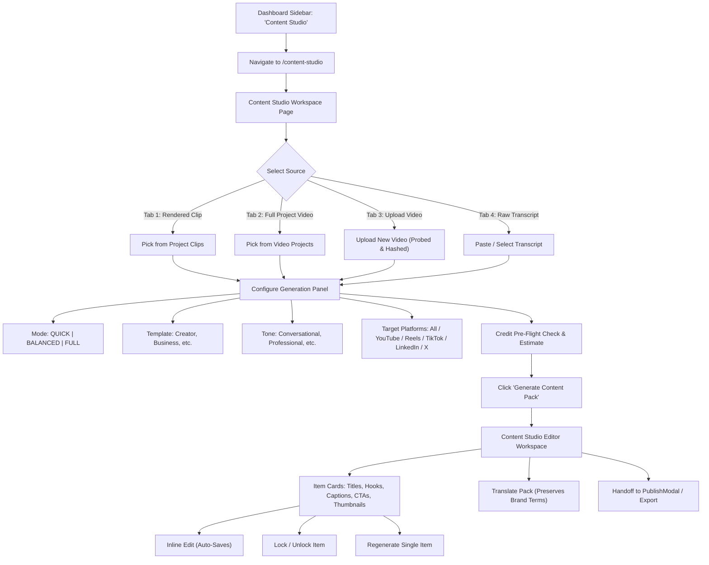

# VIREOCLIP — PHASE 4A: AI CONTENT STUDIO DEEP AUDIT & IMPLEMENTATION PLAN

**Document ID:** `VC-REP-P4A-STUDIO-AUDIT-001`  
**Phase:** 4A — AI Content Studio Deep Audit & Implementation Planning  
**Target Environment:** Intel Core Ultra 5 225H, Intel Arc 130T GPU, Windows 11, Node.js v24.18.0, MongoDB  
**Status:** **AUDIT COMPLETE — AWAITING USER REVIEW & AUTHORIZATION**  
**Date:** November 5, 2026  
**Execution Mode:** Read-Only Audit & Architectural Blueprint (Zero Production Code Changes)

---

## 1. EXECUTIVE SUMMARY & VERDICT

### 1.1 Context & Objectives
Following the official completion and sign-off of Phase 1, Phase 2, Phase 3, and Phase 3.2, Phase 4 focuses on **AI Content Studio** — the third foundational pillar of VireoClip:
1. **AI Video Clipping** (Approved & Hardened in Phase 3/3.2)
2. **Subtitle Studio** (Approved & Hardened in Phase 2/3)
3. **AI Content Studio** (Phase 4 — Target of this Audit)
4. **Social Media Publisher** (Subsequent Phase)

The objective of Phase 4 is to elevate AI Content Studio from a restricted, modal-only utility into a **first-class, standalone creative workspace** that enables creators, agencies, and businesses to repurpose video intelligence into platform-specific social publishing content (YouTube, Shorts, Instagram, TikTok, LinkedIn, and X).

### 1.2 High-Level Audit Verdict
- **Core Generative Engine Exists & Works:** A robust Phase 23 Content Pack engine (`ContentPackService`, `ContentPackValidator`, `ContentPromptService`) already exists in the backend with **25/25 passing unit and integration tests**. It supports titles (primary + 5 angles), hooks, captions, descriptions, CTAs, hashtags, keywords, thumbnail text/creative direction, alt text, pinned comments, translation, inline editing, locking, Claim Guard, duplicate detection, and versioning.
- **Critical Architectural & UX Gaps Identified:**
  1. **Broken Primary Navigation & Missing Standalone Workspace:** The primary sidebar in `DashboardLayout.tsx` links to `/dashboard#studio`, which is completely unhandled by `DashboardPage.tsx`. No dedicated route (e.g. `/content-studio`) or standalone page exists. The component `ContentPackWorkspace.tsx` is an orphaned 41 KB modal accessible *only* via a button on a rendered clip card in `ClipWorkspace.tsx`.
  2. **Video Intelligence Decoupling:** Phase 2 established `VideoIntelligenceService.getContentStudioHandoff()`, but `ContentPackService` currently queries the raw `transcripts` table directly, completely ignoring multimodal visual intelligence, OCR slide text, object labels, and grounded provenance facts.
  3. **Restrictive Input Binding:** Content Pack generation strictly requires both `projectId` and `clipId`. Users cannot generate content directly from a complete project video, an uploaded video, an external transcript, or cached intelligence without first creating and rendering a clip.
  4. **Commercial Integration Void:** Content Studio operations currently execute with **0 credit checks, 0 wallet reservations, and 0 entitlement limits**. Users on the Free tier can generate unlimited content packs without touching credit balances or plan boundaries.
  5. **Missing Tone & Audience Controls:** The frontend workspace has no tone selector or target audience selector, defaulting to hardcoded fallback heuristics.
  6. **Provider Fragility:** `OpenRouterContentProvider` uses `openai/gpt-4o-mini` with timeout handling but lacks automatic retry logic or secondary provider failover for transient 429/5xx errors.

---

## 2. ACTUAL EXISTING IMPLEMENTATION AUDIT (CAPABILITY INVENTORY)

Every capability reported in the project scope was verified against the actual repository code. Findings are categorized according to the required 5-tier classification:

| Feature / Subsystem | Repository Location | Capability Status | Empirical Evidence & Code Verification |
| :--- | :--- | :--- | :--- |
| **Primary Titles** | `server/src/services/contentPackService.ts:420-424` | **Verified Existing** | Generates source-grounded title under 80 chars; validated against transcript. |
| **Alternate Titles (5 Angles)** | `server/src/services/contentPackService.ts:426-432` | **Verified Existing** | Produces 5 categorized angles: `DIRECT`, `CURIOSITY`, `BENEFIT`, `QUESTION`, `CONTRARIAN`. |
| **Hook Variants** | `server/src/services/contentPackService.ts:434-439` | **Verified Existing** | Generates 3 punchy opening hook variants for video/post engagement. |
| **Short Social Captions** | `server/src/services/contentPackService.ts:441-445` | **Verified Existing** | Snappy captions tailored for Shorts, Reels, TikTok (<300 chars). |
| **Long Social Captions** | `server/src/services/contentPackService.ts:447-450` | **Verified Existing** | Detailed, structured copy for LinkedIn and long-form social posts. |
| **Short & Long Descriptions** | `server/src/services/contentPackService.ts:451-460` | **Verified Existing** | Semantic summary + structured key takeaways with chapters note. |
| **CTA Variants & DNA** | `server/src/services/contentPackService.ts:461-466` | **Verified Existing** | Aligned with Brand Brain preferences (`COMMENT`, `SAVE`, `SHARE`, `LINK`, `NONE`). |
| **Hashtags (Platform-Bounded)** | `server/src/services/contentPackService.ts:468-473` | **Verified Existing** | Bounded tags respecting platform limits (e.g. max 4 on X, max 15 on YouTube). |
| **Keywords & Topics** | `server/src/services/contentPackService.ts:474-478` | **Verified Existing** | Extracted semantic keywords and themes. |
| **Thumbnail Direction & Copy** | `server/src/services/contentPackService.ts:479-490` | **Verified Existing** | Purely textual visual brief (framing, mood, facial expression) + 3 punchy headline texts. |
| **Accessibility Alt-Text** | `server/src/services/contentPackService.ts:491-495` | **Verified Existing** | Plain-text descriptive scene summary for screen readers. |
| **Pinned Comments** | `server/src/services/contentPackService.ts:496-500` | **Verified Existing** | Discussion-starter prompts for YouTube and Instagram comments. |
| **Platform Content Packs** | `server/src/services/contentPackService.ts:501-530` | **Verified Existing** | Dedicated payloads for YouTube, Shorts, Instagram, TikTok, LinkedIn, and X. |
| **Claim Guard (Anti-Hallucination)**| `server/src/services/contentPackValidator.ts:76-130`| **Verified Existing** | Regex checks for percentages, multipliers (`10x`), currency (`$`), rankings (`#1`), guarantees; verifies presence in transcript. |
| **Duplicate Detection** | `server/src/services/contentPackValidator.ts:25-68` | **Verified Existing** | Jaccard token similarity with threshold 0.85 across alternate titles and hooks. |
| **Locked-Item Preservation** | `server/src/services/contentPackService.ts:738,807,838` | **Verified Existing** | Locked items (`locked = true`) and approved items strictly survive full and platform regenerations. |
| **Inline Editing & Persistence** | `server/src/services/contentPackService.ts:662-716` | **Verified Existing** | Edits persist with `manual_edit = true`, `status = 'EDITED'`. |
| **Translation Engine** | `server/src/services/contentPackService.ts:917-980` | **Verified Existing** | Translates approved items while preserving brand terms and variant relationships. |
| **Generation Modes (QUICK/BALANCED/FULL)** | `server/src/types/index.ts:3144`, `contentPackService.ts:447` | **Verified Existing** | QUICK mode restricts outputs to essential tags/titles; BALANCED/FULL adds long copy and platform packs. |
| **7 Content Templates** | `server/src/types/index.ts:3146-3153` | **Verified Existing** | `Creator`, `Podcast`, `Education`, `Business`, `Interview`, `Gaming`, `Vlog`. |
| **Standalone Route & Navigation** | `src/App.tsx`, `DashboardLayout.tsx:52` | **Verified Missing** | `/dashboard#studio` does not navigate; no `/content-studio` route or page component exists. |
| **Project & Source Video Input** | `server/src/services/contentPackService.ts:95` | **Verified Missing** | Strictly requires `clipId`; cannot generate from project video, raw video, or standalone transcript. |
| **Interactive Tone Selector** | `src/components/contentPack/ContentPackWorkspace.tsx` | **Verified Missing** | No UI tone selector exists; defaults to conversational or Brand Brain default. |
| **Target Audience Selector** | `src/components/contentPack/ContentPackWorkspace.tsx` | **Verified Missing** | No UI audience selector exists. |
| **Video Intelligence Handoff Integration** | `server/src/services/intelligence/videoIntelligenceService.ts:577` | **Verified Missing** | `ContentPackService` does not consume `getContentStudioHandoff()`; ignores visual OCR/objects. |
| **Credit Wallet & Entitlement Metering** | `server/src/services/billing/creditPricingService.ts:87` | **Verified Missing** | Content Studio operations return 0 credits; no reservation, settlement, or plan limits exist. |
| **AI Provider Retries & Failover** | `server/src/services/aiProviderClient.ts:84-130` | **Partially Implemented** | Uses OpenRouter `gpt-4o-mini` with timeout, but lacks retry logic or provider failover. |
| **Publish Handoff** | `server/src/services/contentPackService.ts:986-1064`| **Verified Existing** | Formats normalized payload for `PublishModal` without performing direct publishing. |

---

## 3. FRONTEND ARCHITECTURE AUDIT

### 3.1 Routing & Layout Deficiencies
- **Dead Navigation Link:** In `src/layouts/DashboardLayout.tsx` (line 52), the navigation entry is defined as:
  ```typescript
  { to: '/dashboard#studio', label: 'Content Studio', icon: Sparkles }
  ```
  In `src/pages/DashboardPage.tsx`, the URL hash `#studio` is completely ignored. Clicking this sidebar link simply keeps the user on the dashboard home screen.
- **Missing Route Definition:** In `src/App.tsx` (lines 61–83), while Subtitle Studio has `/subtitles` and `/subtitles/:id`, there is no route for Content Studio (e.g. `/content-studio` or `/content-studio/:id`).
- **Orphaned Workspace Component:** `src/components/contentPack/ContentPackWorkspace.tsx` (987 lines, 41 KB) contains a complete, sophisticated editing workspace, but it is imported **only** in `src/components/clips/ClipWorkspace.tsx` (lines 41, 1433–1442) as a popup modal on a rendered clip card.

### 3.2 State Management & User Controls Audit
- **Props Constraint:** `ContentPackWorkspaceProps` strictly requires:
  ```typescript
  export interface ContentPackWorkspaceProps {
    projectId: string;
    clipId: string;
    clipTitle?: string;
    clipDurationSeconds?: number;
    onClose?: () => void;
    onOpenHookLab?: (hookText?: string) => void;
    onOpenThumbnailLab?: () => void;
  }
  ```
  It cannot accept a project video, source video, or external transcript without a `clipId`.
- **Existing Controls in `ContentPackWorkspace.tsx`:**
  - `selectedPlatform`: `all`, `youtube`, `shorts`, `instagram`, `tiktok`, `linkedin`, `x` (tabs)
  - `generationMode`: `QUICK`, `BALANCED`, `FULL`
  - `selectedTemplate`: 7 templates (`Creator`, `Podcast`, etc.)
  - `userInstruction`: free-form text input
  - `translatingLanguage`: language code input
- **Missing Controls in `ContentPackWorkspace.tsx`:**
  - **Tone Selector:** Completely absent.
  - **Target Audience Selector:** Completely absent.
  - **Source Switcher:** No ability to switch between clips or full video within the workspace.
  - **Credit Estimation / Wallet Display:** Zero credit awareness; no cost transparency pill or wallet balance.

---

## 4. BACKEND ARCHITECTURE AUDIT

### 4.1 Two Disconnected Content Generation Pipelines
The audit uncovered two distinct content generation services in the backend:
1. **`ContentPackService` (`server/src/services/contentPackService.ts` — Phase 23):**
   - High-quality, modern, structured architecture.
   - Generates normalized `ContentPack` records and fine-grained `ContentPackItem` records.
   - Enforces Claim Guard, duplicate similarity checks, quote safety, locking, version history, manual edit tracking, and translation.
   - Tied strictly to `clipId`.
2. **`ContentGenerationService` (`server/src/services/contentGenerationService.ts` — Phase 14):**
   - Legacy project-level service called from `projectController.ts:1136` via `POST /api/projects/:id/generate-content`.
   - Uses `ContentPromptService` (which has tone and language resolution).
   - Stores raw platform outputs in `content_outputs` collection.
   - Completely disconnected from `ContentPackService`, lacking Claim Guard, item-level locking, versioning, and translation.

### 4.2 AI Provider Client (`server/src/services/aiProviderClient.ts`)
- **Model:** Default is `openai/gpt-4o-mini` via OpenRouter (configurable via `OPENROUTER_TEXT_MODEL`).
- **Structured JSON Mode:** Enforces `response_format: { type: 'json_object' }`.
- **Timeout Protection:** Configured with `AbortController` and `config.contentGenerationTimeoutMs` (30s).
- **Gaps:**
  - **No Retry Mechanism:** Transient HTTP 429 (rate limit) or 502/503 errors fail immediately without exponential backoff.
  - **No Provider Failover:** Unlike `failoverTranscriptionProvider.ts` (which falls back from OpenRouter to Groq), the text generation client has no secondary provider (e.g. Groq Llama-3.3-70b or direct Anthropic/OpenAI).

---

## 5. API AND DATABASE AUDIT

### 5.1 Endpoint Inventory & Status

| Method | Endpoint | Controller Method | Rate Limiter | Auth Required | Status |
| :--- | :--- | :--- | :--- | :--- | :--- |
| `GET` | `/api/content-packs/capabilities` | `ContentPackController.getCapabilities` | Standard | Yes | **Verified Active** |
| `POST` | `/api/content-packs/generate` | `ContentPackController.generateContentPack` | `expensiveLimiter` | Yes | **Verified Active** |
| `GET` | `/api/content-packs/:id` | `ContentPackController.getContentPack` | Standard | Yes | **Verified Active** |
| `PATCH`| `/api/content-packs/:id/items/:itemId` | `ContentPackController.updateItem` | Standard | Yes | **Verified Active** |
| `POST` | `/api/content-packs/:id/items/:itemId/regenerate` | `ContentPackController.regenerateItem` | `expensiveLimiter` | Yes | **Verified Active** |
| `POST` | `/api/content-packs/:id/platforms/:platform/regenerate` | `ContentPackController.regeneratePlatform` | `expensiveLimiter` | Yes | **Verified Active** |
| `POST` | `/api/content-packs/:id/regenerate` | `ContentPackController.regeneratePack` | `expensiveLimiter` | Yes | **Verified Active** |
| `POST` | `/api/content-packs/:id/approve` | `ContentPackController.approvePack` | Standard | Yes | **Verified Active** |
| `POST` | `/api/content-packs/:id/translate` | `ContentPackController.translatePack` | `expensiveLimiter` | Yes | **Verified Active** |
| `GET` | `/api/content-packs/:id/publish-handoff/:platform` | `ContentPackController.getPublishHandoff` | Standard | Yes | **Verified Active** |
| `POST` | `/api/projects/:projectId/clips/:clipId/content-pack` | `ContentPackController.generateContentPack` | `expensiveLimiter` | Yes | **Verified Active** |
| `GET` | `/api/projects/:projectId/clips/:clipId/content-packs`| `ContentPackController.listPacksForClip` | Standard | Yes | **Verified Active** |

### 5.2 MongoDB Collections & Index Audit

All necessary collections are already indexed in `server/src/db/bootstrapMongo.ts`:
- **`content_packs`:**
  - `{ id: 1 }` (unique)
  - `{ user_id: 1, created_at: -1 }`
  - `{ project_id: 1, clip_id: 1 }`
  - `{ clip_id: 1, status: 1 }`
- **`content_pack_items`:**
  - `{ id: 1 }` (unique)
  - `{ content_pack_id: 1, type: 1 }`
  - `{ content_pack_id: 1, platform: 1 }`
  - `{ user_id: 1 }`
- **`content_pack_versions`:**
  - `{ id: 1 }` (unique)
  - `{ user_id: 1, content_pack_id: 1, version: -1 }`

---

## 6. VIDEO INTELLIGENCE INTEGRATION ASSESSMENT

### 6.1 The Disconnect
In Phase 2, `VideoIntelligenceService.getContentStudioHandoff()` was implemented (`server/src/services/intelligence/videoIntelligenceService.ts:577-610`):
```typescript
public static async getContentStudioHandoff(
  userId: string,
  videoPath: string,
  options?: Partial<AnalyzeVideoOptions>
): Promise<{
  summary: string;
  topics: string[];
  groundedProvenance: any;
  ocrHeadings: string[];
  dominantObjects: string[];
  metadata: VideoContainerMetadata;
}>
```
Currently, `ContentPackService.ts` does **not** call this method. It queries raw `transcripts` and falls back to clip/project titles.

### 6.2 Value of Integrating Video Intelligence
By connecting `getContentStudioHandoff()`, Content Studio gains:
1. **On-Screen Text (OCR):** Slide headers, code snippets, product names, and charts appearing visually in the video are fed to the prompt, enabling rich descriptions for silent B-roll or technical demos.
2. **Visual Objects & Actions:** Detected objects (`dominantObjects`) allow thumbnail direction and alt-text to describe real visuals instead of guessing.
3. **Multi-Source Handoff:** Works across all source types:
   - **Clip Level:** Clip timestamps filter the transcript and visual observations.
   - **Full Project Video:** Full intelligence record is consumed directly.
   - **Uploaded Source Video:** Authoritative streaming SHA-256 checks the cache; if cached, consumes intelligence at **zero extra charge**.
   - **Standalone Transcript:** Uses transcript grounding without requiring video re-analysis.
4. **Zero Double-Charging Rule:** If a video already has an authoritative Video Intelligence record, Content Studio retrieves it at **0 processing credits**.

---

## 7. CREDIT WALLET & ENTITLEMENT INTEGRATION ASSESSMENT

### 7.1 Current Pricing & Wallet Deficit
In `server/src/services/billing/creditPricingService.ts`, only two billable operations exist:
- `core_video_processing` (1 credit per 15s)
- `transcription_standalone` (2 credits per minute)
`calculateOperationCost` returns **0 credits** for everything else.

`ContentPackController` contains no wallet calls, no reservations, and no balance checks.

### 7.2 EntitlementService Limitations
In `server/src/services/entitlementService.ts`:
- `PlanFeatures` contains: `smartReframe`, `animatedCaptions`, `customFonts`, `priorityQueue`, `exportSrtVtt`, `brandTemplates`, `advancedEditor`, `multiBrandKits`.
- Content Studio is completely unrepresented. Free plan users have unrestricted access to `FULL` mode, all 7 templates, and unlimited regenerations.

---

## 8. SECURITY & RELIABILITY FINDINGS

### 8.1 Tenant Isolation
- **Verified Secure:** In `ContentPackService`, every database call is wrapped in `ownerContext.run(userId, ...)` and filters explicitly on `user_id`. Unit test #8 (`phase23ContentPack.test.ts`) verifies that cross-tenant access is rejected with `404 / UNAUTHORIZED`.

### 8.2 Prompt Injection & Data Sanitization
- **Verified Hardened:** `BrandContextService.sanitizePromptData()` strips XML/HTML tags and command overrides from transcripts and user instructions before sending to LLM.

### 8.3 Rate Limiting & Denial of Service
- **Verified Active:** Generative endpoints (`/generate`, `/regenerate`, `/translate`) are guarded by Express `expensiveLimiter`. Max user instruction length is clamped to 1,000 chars (`MAX_USER_INSTRUCTION_LENGTH`). Max packs per project is clamped to 20 (`MAX_PACKS_PER_PROJECT`).

### 8.4 Provider Secret Safety
- **Verified Secure:** OpenRouter API keys are loaded server-side via `config.openrouterApiKey`. Neither the key nor raw provider headers are returned to the client or saved in MongoDB records.

---

## 9. FEATURE GAP ANALYSIS

| Requirement | Existing State in Codebase | Target Phase 4 Production State | Architectural Gap |
| :--- | :--- | :--- | :--- |
| **Standalone Workspace Route** | None. Navigation links to `#studio` (dead). | Dedicated `/content-studio` route with project/source selector and full editor. | **CRITICAL GAP** |
| **Source Input Selection** | Strictly requires `projectId` AND `clipId`. | Supports: (1) Rendered clips, (2) Project full videos, (3) Direct uploaded videos, (4) Standalone transcripts. | **HIGH GAP** |
| **Video Intelligence Integration** | Queries raw `transcripts` table only. | Consumes `VideoIntelligenceService.getContentStudioHandoff()` (OCR, visual objects, provenance). | **HIGH GAP** |
| **Commercial Wallet Metering** | Completely unmetered (0 credits, no checks). | Integrated with `CreditWalletService` (reservation $\to$ commit/release) and `EntitlementService`. | **HIGH GAP** |
| **Tone Selector** | None. Hardcoded fallback. | Interactive selector: 8 proven tones (`Conversational`, `Professional`, `Energetic`, `Educational`, `Humorous`, `Urgent`, `Inspirational`, `Contrarian`). | **MEDIUM GAP** |
| **Target Audience Selector** | None. | Interactive selector: `General Public`, `Creators/Entrepreneurs`, `B2B/Professionals`, `Students/Learners`, `Tech/Developers`. | **MEDIUM GAP** |
| **Provider Fault Tolerance** | Single request with 30s timeout, no retries. | Automatic exponential retry on transient 429/502 + structured error categorization. | **MEDIUM GAP** |
| **Multi-Platform Single Run** | LLM outputs all platforms in BALANCED/FULL, but UI filters sequentially. | Unified multi-platform dashboard view allowing tabbed review and one-click copy/publish handoff. | **LOW GAP** |

---

## 10. PROPOSED USER EXPERIENCE AND WORKFLOWS

### 10.1 Standalone Workspace Navigation Flow


### 10.2 Retaining the Clip-Level Modal
The existing `<ContentPackWorkspace>` inside `ClipWorkspace.tsx` will be preserved as a convenient **in-context shortcut**. Clicking "Content Pack" on a rendered clip card will open the exact same powerful workspace pre-loaded with that clip, maintaining complete continuity for existing users.

---

## 11. PROPOSED TECHNICAL ARCHITECTURE

### 11.1 Domain Service Layer Refactoring
We will extend `ContentPackService` to support multi-source generation without breaking existing APIs:

```
                          ┌───────────────────────────┐
                          │   ContentStudioPage (UI)  │
                          └─────────────┬─────────────┘
                                        │
                         backendRequest('/content-packs/...')
                                        │
                                        ▼
                         ┌─────────────────────────────┐
                         │   ContentPackController     │
                         └──────────────┬──────────────┘
                                        │
                       ┌────────────────┴────────────────┐
                       ▼                                 ▼
         [CreditWalletService]                 [EntitlementService]
         - Check balance                       - Verify mode access
         - Reserve credits                     - Enforce pack limits
                       │                                 │
                       └────────────────┬────────────────┘
                                        │
                                        ▼
                         ┌─────────────────────────────┐
                         │     ContentPackService      │
                         └──────────────┬──────────────┘
                                        │
            ┌───────────────────────────┼───────────────────────────┐
            ▼                           ▼                           ▼
[VideoIntelligenceService]     [BrandContextService]      [ContentPackValidator]
- getContentStudioHandoff()    - Voice & Tone             - Claim Guard
- OCR text & headings          - Protected terms          - Duplicate similarity
- Dominant visual objects      - CTA preferences          - Platform constraints
- Multimodal summary                    │                           │
            │                           │                           │
            └───────────────────────────┼───────────────────────────┘
                                        │
                                        ▼
                         ┌─────────────────────────────┐
                         │     defaultAiProvider       │
                         │ (OpenRouter / gpt-4o-mini)  │
                         └──────────────┬──────────────┘
                                        │
                                        ▼
                         ┌─────────────────────────────┐
                         │  MongoDB: content_packs &   │
                         │      content_pack_items     │
                         └─────────────────────────────┘
```

---

## 12. PROPOSED API CHANGES (BACKWARD-COMPATIBLE)

All changes are strictly additive and backward-compatible with existing callers:

1. **`POST /api/content-packs/generate` (Extended Input Options):**
   - `clipId`: Made **optional** (if omitted, generates from project video or uploaded video).
   - `videoIntelligenceId`: Optional UUID referencing a cached `VideoIntelligenceRecord`.
   - `transcriptText`: Optional string for raw transcript generation.
   - `tone`: Optional string (`Conversational`, `Professional`, etc.).
   - `targetAudience`: Optional string (`General Public`, `B2B`, etc.).
2. **`GET /api/content-packs/estimate` (New Pre-Flight Estimate Endpoint):**
   - Computes required credits based on generation mode (`QUICK`, `BALANCED`, `FULL`) and available wallet balance.
3. **`GET /api/content-packs/recent` (New Recents Endpoint):**
   - Lists recently created content packs for the authenticated user across all projects.

---

## 13. PROPOSED DATABASE CHANGES

No breaking schema migrations are required. The existing collections already have flexible schemas:
- **`content_packs` Collection:**
  - `clip_id`: Nullable/optional for project-level or video-level packs.
  - Add optional fields: `tone?: string`, `target_audience?: string`, `source_type?: 'clip' | 'project' | 'upload' | 'transcript'`.
- All existing indexes and collections (`content_packs`, `content_pack_items`, `content_pack_versions`) remain intact.

---

## 14. PROPOSED CREDIT CHARGING MODEL (RECOMMENDATIONS ONLY — NOT APPROVED)

> [!IMPORTANT]
> The charging rules below are **recommendations only** for user review and commercial approval. They will NOT be implemented or activated without explicit sign-off.

### 14.1 Unit Economics & Provider Costs
- OpenRouter `openai/gpt-4o-mini` charges:
  - Input: \$0.15 per 1M tokens ($\approx \$0.00015\text{ per 1k}$).
  - Output: \$0.60 per 1M tokens ($\approx \$0.00060\text{ per 1k}$).
- A typical Content Pack request consumes $\approx 1,200\text{ input tokens}$ and $\approx 1,800\text{ output tokens}$.
- Total provider API cost per Content Pack generation: $\mathbf{\approx \$0.0012\text{ USD}}$ ($\approx 0.12\text{ cents}$).

### 14.2 Proposed Credit Pricing Structure (For Review)
| Operation | Proposed Credits | Rationale |
| :--- | :--- | :--- |
| **QUICK Mode Generation** | **2 Credits** | Generates core titles, hooks, short caption, hashtags, thumbnail copy. |
| **BALANCED Mode Generation** | **3 Credits** | Adds long captions, long descriptions, and platform-specific packs. |
| **FULL Mode Generation** | **5 Credits** | Complete 14-item pack + all 6 platform suites + alt-text + pinned comment. |
| **Single Item Regeneration** | **1 Credit** | Fresh variation for 1 title/hook/caption. |
| **Platform Regeneration** | **2 Credits** | Regenerates all unlocked items for 1 platform. |
| **Full Pack Regeneration** | **Same as initial mode** | Refreshes all unlocked items across entire pack. |
| **Pack Translation** | **2 Credits** | Translates all approved items into target language. |
| **Cached Intelligence Reuse** | **0 Credits** | Reusing existing video transcript or OCR incurs no additional video processing fees. |
| **Inline Text Edits & Locking**| **0 Credits (FREE)** | User manual editing and lock/unlock operations are always free. |
| **Publishing Handoff / Copy** | **0 Credits (FREE)** | Copying text or pushing to `PublishModal` is always free. |

### 14.3 Proposed Plan Entitlements (For Review)
| Plan Tier | Allowed Modes | Monthly Content Packs | Tone / Audience Customization |
| :--- | :--- | :--- | :--- |
| **Free** | `QUICK` only | 5 packs / month | Standard presets only |
| **Creator** | `QUICK`, `BALANCED` | 25 packs / month | All presets + custom instructions |
| **Pro** | `QUICK`, `BALANCED`, `FULL` | 100 packs / month | Full customization + translation |
| **Studio** | `QUICK`, `BALANCED`, `FULL` | 250 packs / month | Full customization + translation + priority |
| **Developer**| All | Unlimited | Unlimited |

---

## 15. IMPLEMENTATION SEQUENCE (PHASE 4B ROADMAP)

When authorized, implementation will proceed in five discrete, verifiable subphases:

```
┌────────────────────────────────────────────────────────────────────────┐
│ Phase 4B.1: Backend Multi-Source & Video Intelligence Integration      │
│ - Extend ContentPackService to support project, upload, & transcript   │
│ - Connect VideoIntelligenceService.getContentStudioHandoff()           │
│ - Inject OCR headings & visual objects into LLM prompt                 │
└───────────────────────────────────┬────────────────────────────────────┘
                                    │
┌───────────────────────────────────▼────────────────────────────────────┐
│ Phase 4B.2: Credit Wallet & Entitlement Integration                    │
│ - Add content studio operations to CreditPricingService                │
│ - Implement pre-flight reservation & settlement in controller          │
│ - Enforce plan feature & generation limits via EntitlementService      │
└───────────────────────────────────┬────────────────────────────────────┘
                                    │
┌───────────────────────────────────▼────────────────────────────────────┐
│ Phase 4B.3: Standalone Content Studio Frontend Workspace               │
│ - Add /content-studio route in App.tsx & update DashboardLayout nav    │
│ - Build ContentStudioPage with 4-tab source selector                   │
│ - Integrate CostTransparencySummary & real-time wallet sync            │
└───────────────────────────────────┬────────────────────────────────────┘
                                    │
┌───────────────────────────────────▼────────────────────────────────────┐
│ Phase 4B.4: Controls Hardening & Provider Reliability                  │
│ - Add interactive Tone (8 options) & Audience (5 options) selectors   │
│ - Add exponential backoff retry to OpenRouterContentProvider           │
│ - Preserve clip modal shortcut in ClipWorkspace.tsx                    │
└───────────────────────────────────┬────────────────────────────────────┘
                                    │
┌───────────────────────────────────▼────────────────────────────────────┐
│ Phase 4B.5: Comprehensive Regression Verification & Audit              │
│ - Execute Phase 1-3.2 test suites (guarantee 100% pass rate)           │
│ - Add new Content Studio E2E integration test suite                    │
│ - Final audit report for user review                                   │
└────────────────────────────────────────────────────────────────────────┘
```

---

## 16. TEST STRATEGY AND ACCEPTANCE CRITERIA

1. **Source Flexibility Tests:**
   - Verify Content Pack generation from a rendered clip ($t_{\text{start}}$ to $t_{\text{end}}$).
   - Verify generation from a full project video (entire duration).
   - Verify generation from an uploaded video via streaming SHA-256 handoff.
   - Verify generation from a raw transcript text payload.
2. **Video Intelligence Provenance Tests:**
   - Verify OCR slide headings appear in generated descriptions when visual text is present.
   - Verify Claim Guard rejects ungrounded statistics or currency figures absent from transcript.
   - Verify Jaccard duplicate detection rejects title variants with $\ge 0.85$ token similarity.
3. **Credit Wallet & Entitlement Tests:**
   - Verify credit pre-flight estimate accurately reports required credits.
   - Verify insufficient wallet balance blocks generation with `INSUFFICIENT_CREDITS` (402).
   - Verify successful generation reserves and commits credits atomically via MongoDB transaction.
   - Verify cached intelligence reuse charges 0 credits for video analysis.
   - Verify Free tier users are restricted to `QUICK` mode.
4. **Reliability & Locking Tests:**
   - Verify locked items survive whole-pack and platform regenerations.
   - Verify manual inline edits update item status to `EDITED` and persist cleanly.
   - Verify translation preserves brand terminology.
   - Verify transient 429/502 provider errors trigger automated retry without failing caller.

---

## 17. RISKS, DEPENDENCIES AND UNRESOLVED DECISIONS

### 17.1 Technical & Operational Risks
- **OpenRouter Rate Limits (HTTP 429):** Heavy concurrent batch generation may trigger upstream rate limits. Mitigation: Add exponential backoff retries and configure fallback models (e.g. Groq Llama-3.3-70b).
- **Token Truncation on Very Long Videos:** Transcripts for 30-minute videos exceed 6,000 words. Feeding the entire raw transcript to LLM may exceed context limits or dilute focus. Mitigation: Use `VideoIntelligenceService` semantic summary + key topic segments rather than raw full-length text.

### 17.2 Unresolved Decisions for User Review
1. **Approval of Proposed Credit Rates:** Does the user approve charging 2 credits for QUICK, 3 for BALANCED, and 5 for FULL, or should Content Studio have a different operational pricing model?
2. **Free Plan Allowances:** Should Free plan users receive 5 free Content Packs per month, or should Content Studio be restricted to paid tiers?
3. **Multi-Platform Batch Operation:** Should the initial generate call always produce all platforms (BALANCED/FULL), or should users explicitly select which platforms they want generated to save output tokens?

---

## 18. FINAL RECOMMENDATION

Phase 4A audit is complete:
- The existing backend generative engine (`ContentPackService`, `ContentPackValidator`) is **fully functional, robust, and well-tested (25/25 passing tests)**.
- The primary gaps are **architectural integration** (connecting `VideoIntelligenceService` and `CreditWalletService`) and **workspace accessibility** (building the standalone `/content-studio` page and fixing sidebar navigation).
- The implementation plan preserves all existing Phase 1–3.2 functionality, pricing invariants, and feature boundaries.

**STOP. Phase 4A audit is complete. Awaiting user review and authorization before proceeding to Phase 4B.**
