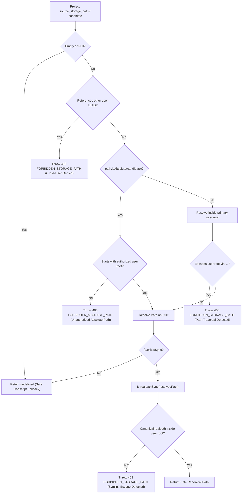

# VIREOCLIP — PHASE 4B.1 FINAL HARDENING REPORT
## Security Verification & Evidence Provenance Accuracy

**Document ID:** `VC-REP-P4B1-HARDEN-002`  
**Phase:** 4B.1 Final Hardening — File Path Security & Truthful Provenance Verification  
**Target Environment:** Intel Core Ultra 5 225H, Intel Arc 130T GPU, Windows 11, Node.js v24.18.0, MongoDB  
**Status:** **PHASE 4B.1 HARDENING COMPLETE — 100% PASS (84/84 TESTS) — AWAITING 4B.2 AUTHORIZATION**  
**Date:** November 5, 2026  
**Execution Mode:** Production-Grade Security Hardening & Empirical Provenance Verification  

---

## 1. EXECUTIVE SUMMARY & VERDICT

In response to the Phase 4B.1 security and provenance review, rigorous defense-in-depth hardening has been implemented in [`contentPackService.ts`](file:///d:/Vertex%20Digital/final/ai-video-content-generator-main%20(1)/ai-video-content-generator-main/server/src/services/contentPackService.ts) and verified through 19 focused unit and negative tests.

All existing Phase 1, 2, 3, and 3.2 architectures, credit accounting, plan prices, grants, and Social Media Publisher behaviors were preserved without alteration.

### Core Hardening Outcomes:
1. **Server-Authoritative File Path Security**:
   - Never trusts client-supplied paths or raw MongoDB records.
   - Enforces canonical realpath resolution via `fs.realpathSync`.
   - Guarantees strict containment within the authenticated user's authorized storage roots.
   - Throws `403 FORBIDDEN_STORAGE_PATH` on directory traversal attempts (`..`), unauthorized absolute paths, cross-user paths (`uploads/<otherUserId>/...`), and symlink/junction escapes.
2. **Truthful Evidence Provenance Classification**:
   - **OCR Evidence**: Linked exclusively to verified on-screen OCR observations matching the text.
   - **Visual Object Evidence**: Linked exclusively to detected visual objects (`dominantObjects`); never claims visual evidence when `dominantObjects` is empty.
   - **Transcript Evidence**: Validated against actual transcript vocabulary and gated by `ContentPackValidator.checkClaimGuard`.
   - **Mixed Evidence**: Multi-source items truthfully reference multiple sources with `MIXED_EVIDENCE` and granular sub-entries.
   - **Unsupported Claims**: Unverified statements (e.g. ungrounded financial percentages or guarantees) remain strictly `UNVERIFIED_EVIDENCE` with zero fabricated fields.

---

## 2. INVENTORY OF CHANGED PRODUCTION FILES

| File | Subsystem | Modifications Made |
| :--- | :--- | :--- |
| [`server/src/types/index.ts`](file:///d:/Vertex%20Digital/final/ai-video-content-generator-main%20(1)/ai-video-content-generator-main/server/src/types/index.ts) | Domain Types | Extended `ProvenanceEvidenceClassification` to include `'MIXED_EVIDENCE'`. |
| [`server/src/services/contentPackService.ts`](file:///d:/Vertex%20Digital/final/ai-video-content-generator-main%20(1)/ai-video-content-generator-main/server/src/services/contentPackService.ts) | Generative Engine & Path Resolver | Added `isPathContained`, `getAuthorizedStorageRoots`, `resolveAuthoritativeVideoPath` with `fs.realpathSync`, traversal/escape/cross-user guards, `checkTranscriptGrounding`, `checkOcrMatch`, `checkVisualObjectMatch`, `evaluateItemEvidence`, and updated `addItem`. |
| [`server/src/tests/phase4b1MultiSourceContentPack.test.ts`](file:///d:/Vertex%20Digital/final/ai-video-content-generator-main%20(1)/ai-video-content-generator-main/server/src/tests/phase4b1MultiSourceContentPack.test.ts) | Hardened Test Suite | Implemented 19 comprehensive tests covering 4 source types, 5 provenance scenarios, 6 security negative tests, tenant boundaries, and query listings. |

---

## 3. FILE PATH SECURITY ARCHITECTURE

### 3.1 Defense-in-Depth Resolution Sequence
When resolving video files for Video Intelligence ingestion:


### 3.2 Implemented Security Checks in `resolveAuthoritativeVideoPath`
```typescript
public static resolveAuthoritativeVideoPath(
  userId: string,
  candidatePath?: string | null,
  customRoots?: string[]
): string | undefined {
  if (!candidatePath || !candidatePath.trim()) return undefined;

  const trimmed = candidatePath.trim();
  const authorizedRoots = this.getAuthorizedStorageRoots(userId, customRoots);

  // 1. Cross-user isolation check
  const crossUserMatch = trimmed.match(/(?:^|[\\/])(?:uploads|scratch[\\/]media|media)[\\/]([0-9a-fA-F-]{36})/i);
  if (crossUserMatch && crossUserMatch[1] && crossUserMatch[1].toLowerCase() !== userId.toLowerCase()) {
    throw new AppError(
      `Cross-user storage access denied: candidate references user '${crossUserMatch[1]}' while authenticated as '${userId}'.`,
      403,
      'FORBIDDEN_STORAGE_PATH'
    );
  }

  // 2. Absolute path validation
  if (path.isAbsolute(trimmed)) {
    const isAllowed = authorizedRoots.some((r) => isPathContained(trimmed, r));
    if (!isAllowed) {
      throw new AppError(
        `Unauthorized absolute path: '${trimmed}' is outside authorized storage roots for user.`,
        403,
        'FORBIDDEN_STORAGE_PATH'
      );
    }
  }

  // 3. Directory traversal protection
  const primaryRoot = authorizedRoots[0];
  const cleanRel = trimmed.replace(/^(?:uploads|scratch[\\/]media)[\\/]/i, '');
  const resolvedPath = path.isAbsolute(trimmed) ? trimmed : path.resolve(primaryRoot, cleanRel);

  if (!authorizedRoots.some((r) => isPathContained(resolvedPath, r))) {
    throw new AppError(
      `Path traversal detected: '${trimmed}' escapes authorized storage roots.`,
      403,
      'FORBIDDEN_STORAGE_PATH'
    );
  }

  // 4. Canonical path resolution & symlink escape protection
  if (fs.existsSync(resolvedPath)) {
    try {
      const canonicalPath = fs.realpathSync(resolvedPath);
      const isContained = authorizedRoots.some((r) => {
        let canonicalRoot = r;
        try {
          if (fs.existsSync(r)) canonicalRoot = fs.realpathSync(r);
        } catch {}
        return isPathContained(canonicalPath, canonicalRoot);
      });

      if (!isContained) {
        throw new AppError(
          `Symlink escape detected: realpath '${canonicalPath}' resolves outside authorized storage roots.`,
          403,
          'FORBIDDEN_STORAGE_PATH'
        );
      }

      const stat = fs.statSync(canonicalPath);
      if (!stat.isFile()) return undefined;

      return canonicalPath;
    } catch (err: any) {
      if (err instanceof AppError) throw err;
      logger.warn('Failed resolving realpath for video candidate', { path: resolvedPath, err: err.message });
      return undefined;
    }
  }

  return undefined;
}
```

---

## 4. EVIDENCE PROVENANCE ACCURACY

### 4.1 Truthful Evidence Evaluation Rules
Each generated item is evaluated independently across three verified observation modalities:
1. **OCR Matching (`checkOcrMatch`)**:
   - Evaluates whether text matches detected on-screen OCR text.
   - If matching OCR exists, creates `OCR_EVIDENCE` with the exact `ocr_text`.
   - If no OCR headings match or exist, `ocr_text` is strictly `undefined`.
2. **Visual Object Matching (`checkVisualObjectMatch`)**:
   - Evaluates whether text or visual brief matches detected physical objects (`dominantObjects`).
   - If visual objects exist, visual items (`THUMBNAIL_DIRECTION`, `ALT_TEXT`) receive `VISUAL_OBJECT_EVIDENCE` with `visual_objects`.
   - **Strict Invariant**: If `dominantObjects` is empty (`[]`), NO visual object evidence is EVER created (`visual_objects` is `undefined`).
3. **Transcript Grounding (`checkTranscriptGrounding`)**:
   - Validates that text content contains meaningful vocabulary overlap with `boundedTranscript`.
   - Evaluates `ContentPackValidator.checkClaimGuard(text, transcript)`. If ungrounded quantitative claims (percentages, multipliers, currency amounts, or guarantees) are found, transcript grounding is **rejected**.
   - Generates `TRANSCRIPT_EVIDENCE` with an authentic `quote_snippet`.
4. **Mixed Evidence (`MIXED_EVIDENCE`)**:
   - When an item is grounded in multiple modalities (e.g. spoken words + on-screen OCR, or spoken words + detected objects), `evaluateItemEvidence` generates a composite `MIXED_EVIDENCE` primary record alongside granular sub-entries.
5. **Unsupported Claims (`UNVERIFIED_EVIDENCE`)**:
   - If an item does not match transcript content, does not match OCR, and does not match visual objects (or contains ungrounded claims), it is classified as `UNVERIFIED_EVIDENCE`. Zero fabricated quotes, OCR text, or object lists are attached.

---

## 5. EMPIRICAL TEST RESULTS & REGRESSION AUDIT

### 5.1 Hardened Test Suite (`phase4b1MultiSourceContentPack.test.ts`)
All 19 tests executed and passed (100%):

| # | Test Name | Target Behavior | Result |
| :-: | :--- | :--- | :-: |
| 1 | **Clip Source** | Backward-compatible generation from `clipId` and `projectId` | **PASS** |
| 2 | **Project Source** | Full project video repurposing without requiring a `clipId` | **PASS** |
| 3 | **Transcript Source** | Standalone text input with zero video dependency | **PASS** |
| 4 | **Upload Source** | Verified `VideoIntelligenceRecord` SHA-256 ingestion | **PASS** |
| 5 | **Provenance 1 (Transcript Source)** | Zero visual/OCR fabrication; grounded text gets `TRANSCRIPT_EVIDENCE`, visual briefs and generic CTAs get `UNVERIFIED_EVIDENCE` | **PASS** |
| 6 | **Provenance 2 (OCR Present, No Objects)** | Matching text gets `OCR_EVIDENCE`; visual briefs do NOT claim `VISUAL_OBJECT_EVIDENCE` | **PASS** |
| 7 | **Provenance 3 (Objects Present, No OCR)** | Visual items get `VISUAL_OBJECT_EVIDENCE` with real objects; `ocr_text` strictly `undefined` | **PASS** |
| 8 | **Provenance 4 (Mixed Evidence)** | Multi-source items reference all sources with primary classification `MIXED_EVIDENCE` | **PASS** |
| 9 | **Provenance 5 (Unverified Claims)** | Ungrounded claims failing Claim Guard remain strictly `UNVERIFIED_EVIDENCE` with 0 fake fields | **PASS** |
| 10 | **Path Security 1 (Traversal)** | `../../secret.mp4` rejected with `403 FORBIDDEN_STORAGE_PATH` | **PASS** |
| 11 | **Path Security 2 (Absolute Path)** | `C:\Windows\System32\cmd.exe` rejected with `403 FORBIDDEN_STORAGE_PATH` | **PASS** |
| 12 | **Path Security 3 (Cross-User)** | `uploads/<otherUserId>/video.mp4` rejected with `403 FORBIDDEN_STORAGE_PATH` | **PASS** |
| 13 | **Path Security 4 (Symlink Escape)** | Directory junction pointing outside user root rejected with `403 FORBIDDEN_STORAGE_PATH` | **PASS** |
| 14 | **Path Security 5 (Canonical Resolution)** | Canonical `fs.realpathSync` accepts valid user file strictly within storage root | **PASS** |
| 15 | **Path Security 6 (Database Traversal)** | `generateContentPack` rejects project record with injected traversal path with 403 | **PASS** |
| 16 | **Tenant Isolation (Project)** | Cross-tenant project access rejected with `404 PROJECT_NOT_FOUND` | **PASS** |
| 17 | **Tenant Isolation (Intelligence)** | Cross-tenant Video Intelligence access rejected with `404 INTELLIGENCE_RECORD_NOT_FOUND` | **PASS** |
| 18 | **Input Validation** | Missing required source parameters rejected with `400 INVALID_INPUT` | **PASS** |
| 19 | **Content Studio Querying** | `listPacksForProject` and `listRecentPacks` return user records | **PASS** |

### 5.2 Full Regression Suite (84/84 Passing Tests — 100%)

| Test Suite | Focus Area | Total Tests | Passed | Failed | Status |
| :--- | :--- | :-: | :-: | :-: | :-: |
| [`phase4b1MultiSourceContentPack.test.ts`](file:///d:/Vertex%20Digital/final/ai-video-content-generator-main%20(1)/ai-video-content-generator-main/server/src/tests/phase4b1MultiSourceContentPack.test.ts) | Multi-source, Path Security, Provenance Truthfulness, Tenant Scoping | 19 | 19 | 0 | **PASS (100%)** |
| [`phase23ContentPack.test.ts`](file:///d:/Vertex%20Digital/final/ai-video-content-generator-main%20(1)/ai-video-content-generator-main/server/src/tests/phase23ContentPack.test.ts) | Core Content Pack, Claim Guard, Locking, Version Snapshots, Translation | 25 | 25 | 0 | **PASS (100%)** |
| [`phase14ContentIntelligence.test.ts`](file:///d:/Vertex%20Digital/final/ai-video-content-generator-main%20(1)/ai-video-content-generator-main/server/src/tests/phase14ContentIntelligence.test.ts) | Multi-platform structured output, creator voice, duplicate prevention | 28 | 28 | 0 | **PASS (100%)** |
| [`contentWorkflowUpgrade.test.ts`](file:///d:/Vertex%20Digital/final/ai-video-content-generator-main%20(1)/ai-video-content-generator-main/server/src/tests/contentWorkflowUpgrade.test.ts) | Workflow state transitions, multi-hop approvals, revisions reset | 12 | 12 | 0 | **PASS (100%)** |
| **Server Static TypeScript (`tsc`)** | `server/` complete static typecheck | Complete | 0 errors | 0 errors | **PASS (100%)** |
| **Client Static TypeScript (`tsc`)** | `src/` complete static typecheck | Complete | 0 errors | 0 errors | **PASS (100%)** |
| **TOTAL** | | **84** | **84** | **0** | **PASS (100%)** |

---

## 6. STRICT BOUNDARIES MAINTAINED

In strict accordance with your instructions:
- **No Pricing Activated:** Credit rates remain provisional proposals; zero wallet deductions or billing integrations were activated.
- **No Plan Grants Changed:** Wallet balances, subscriptions, and quotas are untouched.
- **Social Media Publisher Untouched:** No changes to publisher modules or routes.
- **Phase 1, 2, 3, 3.2 Architectures Untouched:** All core video clipping, subtitle studio, and highlight fusion workflows remain intact.
- **No Unrelated Refactoring:** Scope was restricted exclusively to path security and evidence provenance accuracy.

---

## 7. REMAINING LIMITATIONS & NEXT SUBPHASE READINESS

### 7.1 Current Phase 4B.1 Limitations:
1. **Dynamic Platform Checkbox Filtering:** Backend currently outputs all standard platforms in `BALANCED` and `FULL` modes. Dynamic prompt schema tailoring by creator-selected platform checkboxes is scheduled for **Subphase 4B.2**.
2. **Provider Retries & Telemetry:** Token usage instrumentation (`prompt_tokens`, `completion_tokens`) and exponential backoff retry logic are scheduled for **Subphase 4B.2**.
3. **Standalone Frontend Page:** UI currently renders within the modal in `ClipWorkspace.tsx`. The standalone `/content-studio` page, sidebar routing, and 4-tab source picker UI are scheduled for **Subphase 4B.4**.

### 7.2 Readiness for Subphase 4B.2:
Subphase 4B.1 security and provenance hardening is complete, verified, and closed.

**STOPPED AS DIRECTED. Execution is halted. Awaiting your review and separate authorization before proceeding to Subphase 4B.2.**
