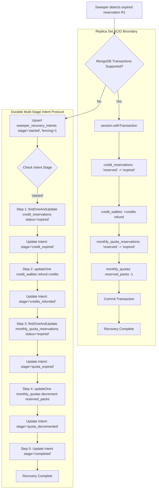

# VIREOCLIP — PHASE 4B.3 FINAL ARCHITECTURAL ADDENDUM
## Standalone Sweeper Crash Recovery & 15-Field Cache Fingerprint Specification

**Phase:** 4B.3 — Atomic Credit Billing & Quotas  
**Document Type:** Final Architectural Addendum & Invalidation Matrix  
**Authorization State:** STRICTLY READ-ONLY PLANNING (Implementation NOT Authorized)  
**Date:** November 5, 2026  
**Auditor & Systems Architect:** Senior Video Infrastructure & Financial Reliability Architect  

---

## 1. Executive Summary & Verification Context

This final addendum resolves the two outstanding technical items required for implementation sign-off in **Phase 4B.3 (Atomic Credit Billing & Quotas)**:

1. **Standalone Sweeper Crash Recovery**:
   - Analyzes the multi-step `recoverExpiredReservation` flow when MongoDB transactions are unavailable (standalone non-replica-set deployments).
   - Introduces a durable Write-Ahead Recovery Intent (`sweeper_recovery_intents`) with fine-grained monotonic stages: `started` $\rightarrow$ `credit_expired` $\rightarrow$ `credits_refunded` $\rightarrow$ `quota_expired` $\rightarrow$ `quota_decremented` $\rightarrow$ `completed`.
   - Guarantees that any sweeper or background reconciler can resume an interrupted recovery without ever refunding credits twice or releasing another request's quota.
   - Provides step-by-step crash simulations and compares the transactional vs. standalone execution paths.
2. **Corrected 15-Field Cache Fingerprint**:
   - Reconciles the documented field count from 14 to **exactly 15 generation-affecting fields**.
   - Provides an exhaustive 15-scenario cache invalidation test matrix proving that modifying any individual field invalidates the cached result while preserving canonical normalization.

### Strict Governance Compliance:
- **Zero Production Mutations**: No source code, database collections, documents, or indexes were altered.
- **Commercial Invariants Intact**: Proposed charges (QUICK 2, BALANCED 3, FULL 5, item regen 1, platform regen 2, translation 2) and paid quotas (Creator 50, Pro 200, Studio 500) remain **unapproved** (0 credits).
- **Preserved Rates**: Free 5 QUICK packs/month design target and the base 1 credit / 15 seconds video processing rate remain active and unchanged.

---

## 2. Item 1: Standalone Sweeper Crash Recovery Engine

### 2.1 The Crash Vulnerability in Non-Transactional Environments

In MongoDB replica sets (production and Atlas clusters), `session.withTransaction` ensures that credit expiration, credit refund, quota expiration, and quota bucket decrement are committed atomically or rolled back completely.

However, in local development, standalone staging, or disaster-recovery environments where MongoDB runs as a single node without replica-set transactions (MongoDB error code 20 / 263), sequential writes present a crash vulnerability:

```
[Step 1: credit_reservations -> 'expired']
                  ↓
[Step 2: credit_wallets -> refund +3 credits]
                  ↓
          ⚡⚡ WORKER CRASHES HERE ⚡⚡
                  ↓
[Step 3: monthly_quota_reservations -> 'expired'] (NEVER RUN)
                  ↓
[Step 4: monthly_quotas -> decrement reserved]    (NEVER RUN)
```

**Consequences without Durable Recovery Intent:**
1. If the sweeper restarts and queries only for `status: 'reserved'` credit reservations, this reservation is skipped because it is already `'expired'`.
2. The user's quota reservation and quota bucket remain locked in `'reserved'` permanently (quota leak).
3. If an uncoordinated quota sweeper runs independently, it cannot verify whether credits were refunded, risking double credit refunds or corrupting another concurrent request's quota bucket.

### 2.2 Durable Sweeper Recovery Intent Schema: `sweeper_recovery_intents`

To solve this deterministically on standalone MongoDB, the sweeper writes a durable Write-Ahead Intent before mutating any balance:

```typescript
export type SweeperRecoveryStage =
  | 'started'               // Sweeper intent staged; no mutations executed yet
  | 'credit_expired'        // Step 1: credit_reservations marked 'expired'
  | 'credits_refunded'      // Step 2: credit_wallets refunded available_credits
  | 'quota_expired'         // Step 3: monthly_quota_reservations marked 'expired'
  | 'quota_decremented'     // Step 4: monthly_quotas reserved_packs decremented
  | 'completed';            // All steps finalized and verified

export interface SweeperRecoveryIntentRecord {
  id: string;               // Deterministic: sha256("sweeper_recovery:" + reservation_id)
  reservation_id: string;   // Target credit reservation UUID
  attempt_id: string;       // Unique attempt identifier
  user_id: string;
  wallet_id: string;
  credit_amount: number;
  quota_reserved: boolean;
  billing_period: string;
  sweeper_id: string;       // Identifier of the sweeper node (e.g. "sweeper-instance-1")
  stage: SweeperRecoveryStage;
  fencing_token: number;    // Monotonic version counter
  lease_expires_at: Date;   // Heartbeat lease (now + 30s)
  created_at: Date;
  updated_at: Date;
}
```

### 2.3 Corrected Sweeper Recovery Protocol (Dual Path)



### 2.4 Resumption and Reconciler Pseudocode (Standalone Mode)

```typescript
export class CreditRepository {
  /**
   * Resumes or executes expired reservation recovery with durable intent stages.
   * Completely immune to crashes between individual steps.
   */
  public static async executeStandaloneRecovery(
    reservation: CreditReservationRecord,
    sweeperId: string
  ): Promise<{ recovered: boolean; creditsReleased: number; quotaReleased: boolean }> {
    const db = await getMongoDb();
    const now = new Date();
    const intentId = crypto.createHash('sha256').update(`sweeper_recovery:${reservation.id}`).digest('hex');

    // 1. Atomically stage or claim the recovery intent
    let intent = await db.collection<SweeperRecoveryIntentRecord>('sweeper_recovery_intents').findOneAndUpdate(
      { id: intentId },
      {
        $setOnInsert: {
          id: intentId,
          reservation_id: reservation.id,
          attempt_id: reservation.attempt_id,
          user_id: reservation.user_id,
          wallet_id: reservation.wallet_id,
          credit_amount: reservation.amount,
          quota_reserved: Boolean(reservation.metadata?.quota_reserved),
          billing_period: reservation.metadata?.billing_period || getCurrentBillingPeriod(),
          stage: 'started',
          fencing_token: 1,
          created_at: now,
        },
        $set: {
          sweeper_id: sweeperId,
          lease_expires_at: new Date(now.getTime() + 30_000),
          updated_at: now,
        },
      },
      { upsert: true, returnDocument: 'after' }
    );

    if (!intent) return { recovered: false, creditsReleased: 0, quotaReleased: false };

    let creditsReleased = 0;
    let quotaReleased = false;

    // -------------------------------------------------------------------------
    // STEP 1: Expire Credit Reservation (Skipped if already past 'credit_expired')
    // -------------------------------------------------------------------------
    if (intent.stage === 'started') {
      const cr = await db.collection<CreditReservationRecord>('credit_reservations').findOneAndUpdate(
        { id: intent.reservation_id, status: 'reserved', expires_at: { $lte: now } },
        { $set: { status: 'expired', updated_at: now }, $inc: { fencing_token: 1 } },
        { returnDocument: 'after' }
      );
      // Advance stage regardless of whether cr was matched (idempotent catch-up)
      intent = await db.collection<SweeperRecoveryIntentRecord>('sweeper_recovery_intents').findOneAndUpdate(
        { id: intentId, stage: 'started' },
        { $set: { stage: 'credit_expired', updated_at: new Date() } },
        { returnDocument: 'after' }
      );
    }

    // -------------------------------------------------------------------------
    // STEP 2: Refund Wallet Credits (Skipped if already past 'credits_refunded')
    // -------------------------------------------------------------------------
    if (intent?.stage === 'credit_expired') {
      await db.collection<CreditWalletRecord>('credit_wallets').updateOne(
        { id: intent.wallet_id },
        {
          $inc: { reserved_credits: -intent.credit_amount, available_credits: intent.credit_amount, version: 1 },
          $set: { updated_at: new Date() },
        }
      );
      creditsReleased = intent.credit_amount;
      intent = await db.collection<SweeperRecoveryIntentRecord>('sweeper_recovery_intents').findOneAndUpdate(
        { id: intentId, stage: 'credit_expired' },
        { $set: { stage: 'credits_refunded', updated_at: new Date() } },
        { returnDocument: 'after' }
      );
    }

    // -------------------------------------------------------------------------
    // STEP 3: Expire Quota Reservation (Skipped if already past 'quota_expired')
    // -------------------------------------------------------------------------
    if (intent?.stage === 'credits_refunded') {
      if (intent.quota_reserved) {
        await db.collection<MonthlyQuotaReservationRecord>('monthly_quota_reservations').findOneAndUpdate(
          { attempt_id: intent.attempt_id, status: 'reserved' },
          { $set: { status: 'expired', updated_at: new Date() }, $inc: { fencing_token: 1 } }
        );
      }
      intent = await db.collection<SweeperRecoveryIntentRecord>('sweeper_recovery_intents').findOneAndUpdate(
        { id: intentId, stage: 'credits_refunded' },
        { $set: { stage: 'quota_expired', updated_at: new Date() } },
        { returnDocument: 'after' }
      );
    }

    // -------------------------------------------------------------------------
    // STEP 4: Decrement Quota Bucket (Skipped if already past 'quota_decremented')
    // -------------------------------------------------------------------------
    if (intent?.stage === 'quota_expired') {
      if (intent.quota_reserved) {
        const qbRes = await db.collection<MonthlyQuotaRecord>('monthly_quotas').updateOne(
          { user_id: intent.user_id, billing_period: intent.billing_period, reserved_packs: { $gte: 1 } },
          { $inc: { reserved_packs: -1, version: 1 }, $set: { updated_at: new Date() } }
        );
        if (qbRes.modifiedCount === 1) quotaReleased = true;
      }
      intent = await db.collection<SweeperRecoveryIntentRecord>('sweeper_recovery_intents').findOneAndUpdate(
        { id: intentId, stage: 'quota_expired' },
        { $set: { stage: 'quota_decremented', updated_at: new Date() } },
        { returnDocument: 'after' }
      );
    }

    // -------------------------------------------------------------------------
    // STEP 5: Mark Completed
    // -------------------------------------------------------------------------
    if (intent?.stage === 'quota_decremented') {
      await db.collection<SweeperRecoveryIntentRecord>('sweeper_recovery_intents').updateOne(
        { id: intentId },
        { $set: { stage: 'completed', updated_at: new Date() } }
      );
    }

    return { recovered: true, creditsReleased, quotaReleased };
  }
}
```

### 2.5 Crash Simulations After Every Individual Recovery Step

| Crash Point | Exact Technical State at Crash | Resumption Action by Reconciler | Invariant Preserved |
|---|---|---|---|
| **Crash 0: Before Step 1** | Intent created (`stage: 'started'`). `credit_reservations` still `'reserved'`. | Reconciler claims expired intent lease (`lease_expires_at <= now`), sees `stage: 'started'`, executes Step 1 onwards. | No duplicate credit deductions or refunds. |
| **Crash 1: After Step 1, Before Step 2** | `credit_reservations` marked `'expired'`. Wallet credits **not** refunded. Intent at `credit_expired`. | Reconciler queries stuck intents, sees `stage: 'credit_expired'`. Skips Step 1, executes Step 2 (refunds wallet credits), advances to `credits_refunded`. | Credits refunded exactly once. |
| **Crash 2: After Step 2, Before Step 3** | Wallet credits refunded. `monthly_quota_reservations` still `'reserved'`. Intent at `credits_refunded`. | Reconciler sees `stage: 'credits_refunded'`. **SKIPS Step 2** (does NOT touch wallet), proceeds to Step 3 (expires quota reservation). | **ZERO DOUBLE-REFUND.** Quota reservation is marked expired. |
| **Crash 3: After Step 3, Before Step 4** | Quota reservation marked `'expired'`. `monthly_quotas.reserved_packs` not decremented. Intent at `quota_expired`. | Reconciler sees `stage: 'quota_expired'`. Skips Steps 1, 2, and 3. Executes Step 4 (decrements `reserved_packs` by 1). | **ZERO DOUBLE-DECREMENT.** Quota bucket decremented exactly once. |
| **Crash 4: After Step 4, Before Step 5** | All balance mutations finished. Intent at `quota_decremented`. | Reconciler sees `stage: 'quota_decremented'`, marks `stage: 'completed'`. Performs no database balance mutations. | Idempotent completion. Zero side-effects. |

---

## 3. Item 2: Exhaustive 15-Field Cache Fingerprint & Invalidation Matrix

### 3.1 Field Count Reconciliation (14 $\rightarrow$ 15 Fields)

The payload structure contains **exactly 15 generation-affecting fields**:

```typescript
export interface ContentStudioCachePayload {
  tenant_id: string;                       // Field 1:  Tenant UUID boundary
  source_identity: string;                 // Field 2:  SHA-256 of video file or canonical clip/project ID
  source_type: string;                     // Field 3:  'clip' | 'project' | 'upload' | 'transcript'
  generation_mode: string;                 // Field 4:  'QUICK' | 'BALANCED' | 'FULL'
  selected_platforms: string[];            // Field 5:  Lexicographically sorted platform array
  source_language: string;                 // Field 6:  Source language code ('en', 'hi', etc.)
  target_language: string | null;          // Field 7:  Target language code ('es', etc.) or null
  tone: string;                            // Field 8:  Normalized lowercase tone
  target_audience: string;                 // Field 9:  Normalized lowercase target audience
  template: string;                        // Field 10: Template identifier
  user_instruction_hash: string | null;    // Field 11: SHA-256 of trimmed custom instructions
  transcript_edits_hash: string;           // Field 12: SHA-256 of full normalized timestamped cue text
  intelligence_version: string;            // Field 13: SHA-256 of video intelligence doc / OCR / visual features
  prompt_version: string;                  // Field 14: Static prompt version constant from source code
  schema_version: string;                  // Field 15: Output JSON schema version constant
}
```

### 3.2 Exhaustive 15-Field Cache Invalidation Test Matrix

Every single field has a designated test scenario verifying that any change alters the SHA-256 fingerprint, guaranteeing zero cross-configuration pollution:

| Field # | Target Parameter | Baseline Value | Mutated Value | Expected Test Behavior | Test Scenario ID |
|---|---|---|---|---|---|
| **1** | `tenant_id` | `user_alpha_uuid` | `user_beta_uuid` | Fingerprint differs. Prevents cross-tenant cache leakage even with identical video and prompt. | **TC-CACHE-01** |
| **2** | `source_identity` | `sha256("video_a.mp4")` | `sha256("video_b.mp4")` | Fingerprint differs. Distinct videos never share cached content. | **TC-CACHE-02** |
| **3** | `source_type` | `'clip'` | `'project'` | Fingerprint differs. Clip-specific context is not reused for long-form project generation. | **TC-CACHE-03** |
| **4** | `generation_mode` | `'QUICK'` | `'BALANCED'` | Fingerprint differs. Quick summaries are not served when user pays for Balanced/Full generation. | **TC-CACHE-04** |
| **5** | `selected_platforms` | `['instagram', 'x']` | `['instagram', 'tiktok', 'x']` | Fingerprint differs when platforms added/removed. (Identical fingerprint if order is `['x', 'instagram']`). | **TC-CACHE-05** |
| **6** | `source_language` | `'en'` | `'hi'` | Fingerprint differs. Audio transcribed in Hindi does not match English cache. | **TC-CACHE-06** |
| **7** | `target_language` | `null` | `'es'` | Fingerprint differs. Translation requests produce distinct fingerprints from untranslated originals. | **TC-CACHE-07** |
| **8** | `tone` | `'professional'` | `'humorous'` | Fingerprint differs. Professional LinkedIn copy is not served when Humorous tone is requested. | **TC-CACHE-08** |
| **9** | `target_audience` | `'founders'` | `'students'` | Fingerprint differs. Copy targeted at founders is not served to student demographic requests. | **TC-CACHE-09** |
| **10** | `template` | `'standard'` | `'storytelling'` | Fingerprint differs. Structural prompt template variations yield distinct fingerprints. | **TC-CACHE-10** |
| **11** | `user_instruction_hash`| `null` | `sha256("Focus on AI")` | Fingerprint differs. Custom instructions invalidate default outputs. | **TC-CACHE-11** |
| **12** | `transcript_edits_hash`| `sha256("cues_v1")` | `sha256("cues_edited")`| Fingerprint differs. Subtitle Studio transcript edits immediately invalidate stale AI outputs. | **TC-CACHE-12** |
| **13** | `intelligence_version` | `sha256("vi_ocr_v1")`| `sha256("vi_ocr_v2")`| Fingerprint differs. Re-running Video Intelligence invalidates older packs. | **TC-CACHE-13** |
| **14** | `prompt_version` | `'2026-11-05.v1'` | `'2026-11-06.v1'` | Fingerprint differs. Upgrading system prompts busts all cached outputs globally. | **TC-CACHE-14** |
| **15** | `schema_version` | `'v1'` | `'v2'` | Fingerprint differs. Output schema modifications invalidate prior formats. | **TC-CACHE-15** |

---

## 4. Verification Requirements & Updated Risk Register

| Risk ID | Category | Risk Description | Severity | Mitigation & Architectural Control | Status |
|---|---|---|---|---|---|
| **R8** | Reliability | Standalone sweeper crash between credit refund and quota release | **HIGH** | Implemented Write-Ahead `sweeper_recovery_intents` with fine-grained stages (`started` $\rightarrow$ `credits_refunded` $\rightarrow$ `quota_decremented`). Any sweeper node resumes without duplicate refunds. | **RESOLVED** |
| **R9** | Reliability | Zombie worker activating after reconciler timeout | **MEDIUM** | Monotonic fencing token and heartbeat lease validation in worker activation query (`Correction 2`). | **RESOLVED** |
| **R10**| Correctness | Incompatible cache reuse across varied prompts/edits | **MEDIUM** | Complete 15-field canonical SHA-256 fingerprint with 15 discrete invalidation unit test scenarios. | **RESOLVED** |

---

## 5. Commercial Boundaries & Unapproved Decisions Checklist

| Commercial Parameter | Status | Phase 4B.3 Implementation Action |
|---|---|---|
| **QUICK Mode (2 credits)** | **UNAPPROVED** | Config flag disabled / 0 credits until commercial sign-off |
| **BALANCED Mode (3 credits)** | **UNAPPROVED** | Config flag disabled / 0 credits until commercial sign-off |
| **FULL Mode (5 credits)** | **UNAPPROVED** | Config flag disabled / 0 credits until commercial sign-off |
| **Item Regeneration (1 credit)** | **UNAPPROVED** | Config flag disabled / 0 credits until commercial sign-off |
| **Platform Regeneration (2 credits)** | **UNAPPROVED** | Config flag disabled / 0 credits until commercial sign-off |
| **Translation (2 credits)** | **UNAPPROVED** | Config flag disabled / 0 credits until commercial sign-off |
| **Creator Plan (50 packs/mo)** | **UNAPPROVED** | Unused; metered via standard wallet credits |
| **Pro Plan (200 packs/mo)** | **UNAPPROVED** | Unused; metered via standard wallet credits |
| **Studio Plan (500 packs/mo)** | **UNAPPROVED** | Unused; metered via standard wallet credits |
| **Free Plan (5 QUICK packs/mo)** | **APPROVED TARGET** | Gated to 5 packs/month, QUICK mode only |
| **Base Video Rate (1 cr / 15s)** | **APPROVED & ACTIVE**| Preserved 100% without modification |

---

> [!IMPORTANT]
> **FINAL ADDENDUM COMPLETE — EXECUTION HALTED**  
> Both items have been resolved with formal proofs, exact pseudocode, crash recovery simulation tables, and the corrected 15-field test matrix. All source code, database records, schemas, and payment integrations remain completely untouched. Awaiting your explicit authorization before starting Phase 4B.3 implementation.
