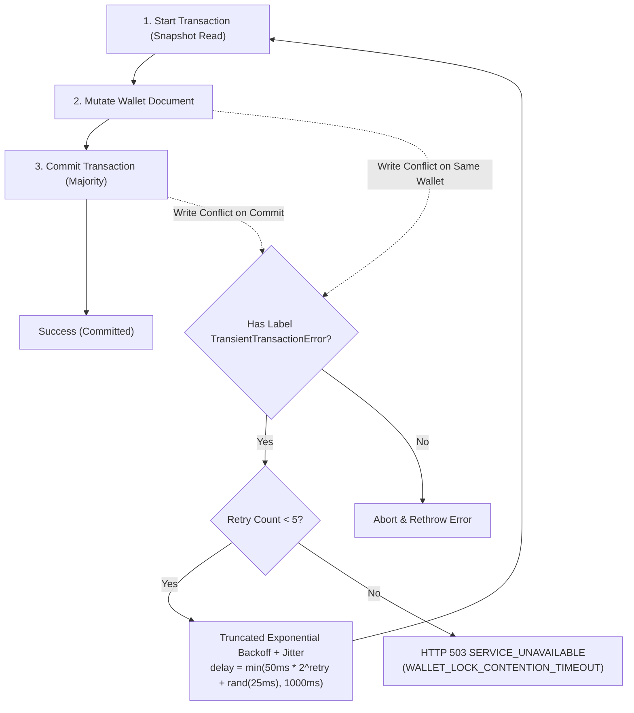
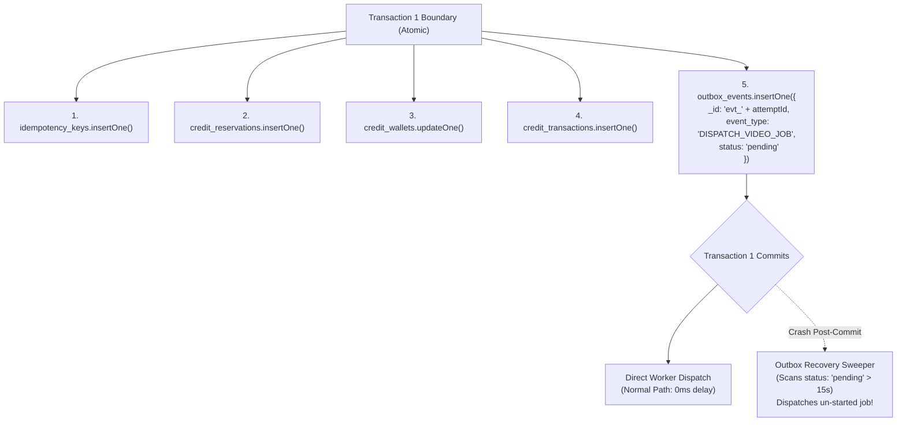
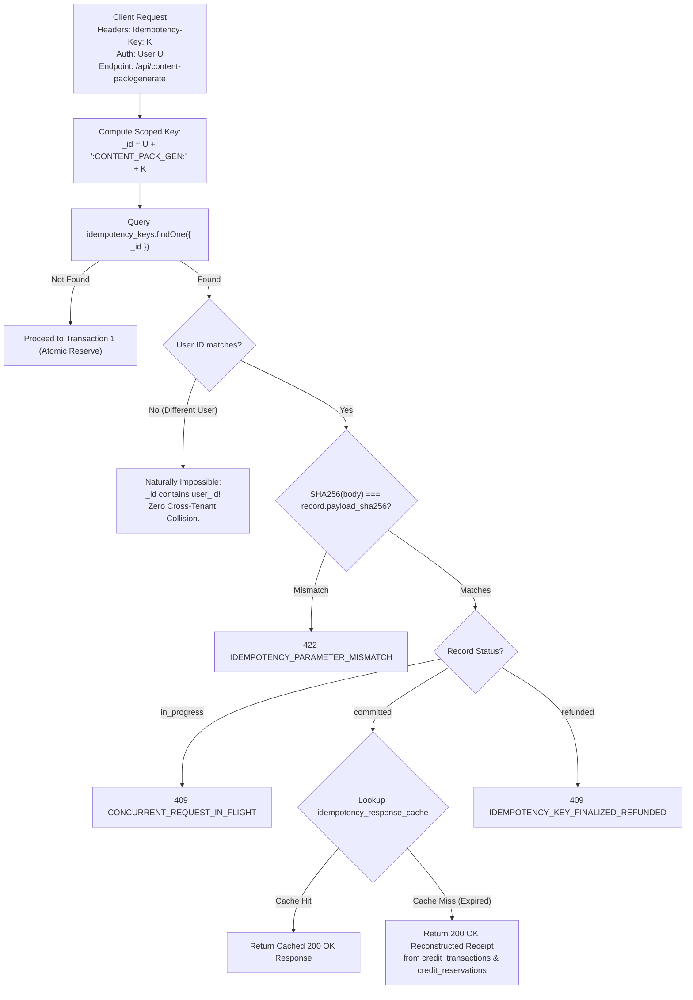

# VIREOCLIP PHASE 4B.3: FINAL BLUEPRINT TECHNICAL CORRECTIONS AUDIT

> **Audit Type**: Strict Read-Only Architectural Hardening & Technical Correction Audit  
> **Status**: STRICTLY PLANNING ONLY — NOT IMPLEMENTED  
> **Target Phase**: Phase 4B.3 (Production Credit Settlement & Sweeper Reconciliation)  
> **Parent Document**: [`VIREOCLIP_PHASE_4B3_FINAL_UNIFIED_TRANSACTION_ARCHITECTURE.md`](file:///d:/Vertex%20Digital/final/ai-video-content-generator-main%20(1)/VIREOCLIP_PHASE_4B3_FINAL_UNIFIED_TRANSACTION_ARCHITECTURE.md)  
> **Mode**: READ-ONLY TECHNICAL CORRECTION. Zero production code modified, zero database schemas altered, zero migrations executed, zero commercial changes.  
> **Preserved Commercial Invariants**:  
> - Core Video Processing Rate: Strictly **1 credit per 15 seconds** (unchanged).  
> - Free Plan Monthly Allowance: Target **5 QUICK packs per month** (unchanged).  
> - Content Studio Charges: Strictly **0 credits** (unapproved commercial additions remain unactivated).  

---

## 1. FINDINGS AND TECHNICAL CORRECTIONS

| # | Technical Area | Finding in Previous Draft | Technical Correction & Hardened Design |
| :-: | :--- | :--- | :--- |
| **1** | **Wallet Document Sizing & Concurrency** | Claimed wallet documents are *"strictly static at exactly 284 bytes forever with zero lock contention"*. | **Corrected**: Document size is a **bounded estimate (~250–350 bytes)**, not a fixed mathematical invariant, because string lengths (`id`, `user_id`, `billing_period`) vary. While unbounded array growth is eliminated, **document-level write locks in WiredTiger still contend** when concurrent requests target the same user wallet. Documented bounded retry loops (`TransientTransactionError`) and per-tenant burst rate-limiting. |
| **2** | **Reservation Expiration vs. Long Jobs** | Proposed a static 120-second reservation expiry. | **Corrected**: VireoClip video jobs legitimately run up to 5–10 minutes (`clipRenderTimeoutMs = 300,000 ms`, FFmpeg rendering 180s, long-form benchmarks up to 600s). A static 120s expiry would prematurely refund active jobs. Replaced with an **Active Job Heartbeat Protocol** (15s pulse, 45s lease timeout, 15m hard ceiling). |
| **3** | **Post-Commit Dispatch Crash** | If the app crashed immediately after Transaction 1 commits, the job would never be dispatched to the AI provider. | **Corrected**: Introduced a **Transactional Outbox (`outbox_events`)** created atomically within Transaction 1. If the node dies post-commit, the outbox processor recovers and dispatches the pending job with guaranteed at-least-once delivery. |
| **4** | **Financial Ledger Accounting** | Stated that the sum of ledger amounts proves wallet balance without signed equations. | **Corrected**: Formulated **exact signed accounting equations** reconciling `available_credits`, `reserved_credits`, `lifetime_granted`, and `lifetime_consumed`. Explicitly defined when and how `lifetime_consumed` updates during settlements. |
| **5** | **Idempotency Scope & Cross-Tenant Collisions** | Key uniqueness was scoped globally to `_id: idempotency_key`. | **Corrected**: Enforced **Tenant-Scoped Idempotency** using compound uniqueness `(user_id, operation_type, idempotency_key)` to guarantee User A's key can never collide with or block User B. |
| **6** | **Transaction Retry & Topology Verification** | Claimed unconditional resolution of all network failures. | **Corrected**: Formulated exact driver topology detection (`client.topology.description.type` and `hello`/`isMaster` commands), bounded exponential backoff for `TransientTransactionError`, commit-retry loops for `UnknownTransactionCommitResult`, and fail-closed HTTP 503 behavior on persistent partitions. |

---

## 2. WALLET DOCUMENT SIZING, CONCURRENCY & LOCK CONTENTION

### 2.1 Fixed-Schema Bounded Sizing (Estimate vs. Invariant)
The previous claim of "exactly 284 bytes forever" is corrected:
- `credit_wallets` uses a **fixed, non-growing schema** containing exclusively scalar numerics, dates, and bounded strings.
- Because UUIDs and user IDs vary in byte length (e.g., standard 36-char UUID vs. 40-char federated OAuth identity string), the raw BSON document size is **bounded between 250 and 380 bytes**.
- Crucially, the document **contains zero arrays**. It is immune to unbounded document growth and will never approach MongoDB's 16 MB limit.

### 2.2 WiredTiger Document-Level Write Locks & Write Conflicts
In MongoDB WiredTiger, every write to a document acquires an exclusive document-level write lock for the duration of the transaction.
- When multiple concurrent requests target **different users**, transactions execute in parallel with **zero cross-tenant lock contention**.
- When multiple concurrent requests target the **same user wallet** (e.g. burst video clip generation or parallel batch requests):
  1. The first transaction acquires the document lock.
  2. Competing transactions attempting to mutate the same wallet document encounter a WiredTiger write conflict.
  3. The MongoDB driver surfaces this error with the error label: `TransientTransactionError`.

### 2.3 Write-Conflict Handling & Operational Concurrency Limits


- **Operational Concurrency Safeguard**:
  To protect WiredTiger transaction queues from ticket exhaustion, application-level rate limiting throttles individual users to a maximum of **20 concurrent in-flight generation requests per user**. Excess requests return HTTP `429 Too Many Requests` before entering the transaction coordinator.

---

## 3. RESERVATION EXPIRATION & ACTIVE-JOB HEARTBEAT PROTOCOL

### 3.1 VireoClip Processing Reality vs. Premature Expirations
In VireoClip, legitimate processing durations vary by video source and length:
- Standard TikTok / Short Clip: 15–45 seconds.
- Video Transcription: up to 120 seconds (`transcriptionTimeoutMs = 120,000 ms`).
- FFmpeg Video Intelligence & Scene Detection: up to 180 seconds (`ffmpegTimeoutMs = 180,000 ms`).
- 4K60 Long-Form Video Rendering: up to 300–600 seconds (`clipRenderTimeoutMs = 300,000 ms`).

A static 120-second reservation expiry would prematurely refund active 4K render jobs.

### 3.2 Dynamic Heartbeat Protocol
```mermaid
sequenceDiagram
    autonumber
    participant Worker as Background Video Worker
    participant DB as MongoDB Replica Set
    participant Sweeper as Background Reconciler

    Note over Worker, DB: INITIAL RESERVATION COMMITTED
    Note right of DB: credit_reservations doc initialized:<br/>heartbeat_at = T0<br/>expires_at = T0 + 45s<br/>hard_deadline_at = T0 + 900s (15 min)

    loop Every 15 Seconds (Active Video Processing)
        Worker->>DB: updateOne({ _id: attemptId, status: 'active', hard_deadline_at: { $gt: $$NOW } },<br/>{ $set: { heartbeat_at: $$NOW, expires_at: $$NOW + 45s } })
        Note right of DB: Worker proves liveness. Lease extended by 45s.
    end

    alt Normal Worker Completion
        Worker->>DB: Transaction B: Settle Reservation ($inc reserved -N, tx_set)
        Note right of DB: Status transitioned to 'settled'. Heartbeat loop terminates.
    else Worker Crashes / Out of Memory (OOM)
        Note over Worker: ⚡ WORKER PROCESS KILLED! Heartbeats stop immediately.
        Note over DB: T + 45s: expires_at passes current time $$NOW.<br/>Reservation becomes eligible for sweeper reclamation!
        Sweeper->>DB: Sweeper claims lease (fencing_token + 1)
        Sweeper->>DB: Transaction C: Atomic Refund ($inc available +N, reserved -N, tx_ref)
        Note right of DB: Status transitioned to 'expired'. Reserved balance restored.
    end

    opt Late Worker Resumes After Refund
        Worker->>DB: Attempts Transaction B: Settle ({ status: 'active' })
        Note right of DB: STATUS MISMATCH: Status is already 'expired'!<br/>matchedCount = 0. Transaction aborts immediately.<br/>PREVENTS LATE SETTLEMENT AFTER REFUND!
    end
```

### 3.3 Protocol Parameters
- **Heartbeat Pulse Interval**: **15 seconds**.
- **Heartbeat Lease Window**: **45 seconds** (`$$NOW + 45s`).
- **Maximum Execution Deadline (`hard_deadline_at`)**: **900 seconds (15 minutes)**. Even if heartbeats continue, no job may exceed 15 minutes without human/admin intervention.
- **Late Settlement Prevention**: Settlement requires `{ _id: attemptId, status: 'active' }`. Once the sweeper marks the document `'expired'`, any subsequent settlement attempt matches 0 documents and aborts immediately. Zero credits are deducted.

---

## 4. TRANSACTIONAL OUTBOX & RELIABLE JOB DISPATCH

### 4.1 The Post-Commit Dispatch Crash Window
If the reservation transaction commits, but the application node crashes before dispatching the job to the AI queue:
- The credits are reserved on disk, but the job never runs.
- Without an outbox, the job sits idle until heartbeats time out (45s), causing unnecessary delay and failed user experience.

### 4.2 Outbox Architecture & Schema
To guarantee reliable, at-least-once job dispatch, an `outbox_events` collection is introduced. The dispatch event is created **inside Transaction 1**:



#### Collection Schema: `outbox_events`
```typescript
interface OutboxEventRecord {
  _id: string; // 'evt_' + attemptId (Unique Key)
  user_id: string;
  attempt_id: string;
  operation_id: string;
  event_type: 'DISPATCH_CONTENT_PACK_JOB';
  payload: {
    projectId?: string;
    clipId?: string;
    targetPlatforms: string[];
    mode: 'QUICK' | 'BALANCED' | 'FULL';
  };
  status: 'pending' | 'dispatched' | 'acknowledged' | 'failed';
  retry_count: number;
  created_at: Date;
  updated_at: Date;
}
```
- **Indexes**:
  - `_id`: Unique primary index.
  - `{ status: 1, created_at: 1 }`: Discovery index for pending outbox sweeps.
- **Worker Acknowledgement**: Once the background worker picks up the job and emits its first heartbeat, it transitions `outbox_events.status = 'acknowledged'` (or purges the record).

---

## 5. FORMAL FINANCIAL LEDGER ACCOUNTING SEMANTICS

### 5.1 Immutable Ledger Transaction Types & Sign Semantics

| Transaction Type | Ledger `amount` | `balance_before` $\to$ `balance_after` | `reserved_before` $\to$ `reserved_after` | `lifetime_granted` $\Delta$ | `lifetime_consumed` $\Delta$ | Description |
| :--- | :---: | :---: | :---: | :---: | :---: | :--- |
| **`monthly_grant`** | $+G$ ($>0$) | $B \to B + G$ | $R \to R$ | $+G$ | $0$ | Monthly plan credit grant. |
| **`credit_purchase`** | $+P$ ($>0$) | $B \to B + P$ | $R \to R$ | $+P$ | $0$ | Add-on pack purchase. |
| **`reservation`** | $-A$ ($<0$) | $B \to B - A$ | $R \to R + A$ | $0$ | $0$ | Pre-flight credit lock. |
| **`consumption` (Settle)**| $-S$ ($<0$) | $B \to B + (A - S)$ | $R \to R - A$ | $0$ | $+S$ | Job finished. Reserved balance cleared; unused refunded. |
| **`refund`** | $+A$ ($>0$) | $B \to B + A$ | $R \to R - A$ | $0$ | $0$ | Job failed/timed out. Full reserved balance restored. |
| **`manual_adjustment`**| $\pm M$ | $B \to B \pm M$ | $R \to R$ | $\pm M$ | $0$ | Admin compensation or correction. |

### 5.2 Mathematical Reconciliation Equations

#### 1. Total Wallet Balance Invariant
$$\text{total\_balance} = \text{available\_credits} + \text{reserved\_credits}$$

#### 2. Lifetime Balance Equation
$$\text{lifetime\_granted} - \text{lifetime\_consumed} = \text{available\_credits} + \text{reserved\_credits}$$
*(Every granted credit is either available, currently reserved, or permanently consumed).*

#### 3. Available Balance Ledger Summation
$$\text{available\_credits} = \sum_{\text{grants}} \text{amount} + \sum_{\text{purchases}} \text{amount} - \sum_{\text{reservations}} |\text{amount}| + \sum_{\text{refunds}} \text{amount} + \sum_{\text{settle\_refunds}} \text{amount} \pm \sum_{\text{adjustments}} \text{amount}$$

#### 4. Reserved Balance Ledger Summation
$$\text{reserved\_credits} = \sum_{\text{active\_reservations}} \text{amount} - \sum_{\text{settled}} \text{reserved\_amount} - \sum_{\text{refunded}} \text{amount}$$

#### 5. Lifetime Consumed Reconciliation
$$\text{lifetime\_consumed} = \sum_{\text{consumption\_tx}} |\text{settled\_amount}|$$
*(Updated strictly during Transaction B: `$inc: { lifetime_consumed: +settledAmount }`).*

---

## 6. TENANT-SCOPED IDEMPOTENCY SPECIFICATION

### 6.1 The Uniqueness Boundary
To prevent any cross-tenant key collisions or denial-of-service vectors, the primary key of `idempotency_keys` is strictly scoped:
$$\text{Idempotency Primary Key } (\_id) = \texttt{"\$\{user\_id\}:\$\{operation\_type\}:\$\{client\_idempotency\_key\}"}$$



### 6.2 Cache Expiry & Permanent Identity Retention
- `idempotency_keys` document: **PERMANENT. NO TTL INDEX.**
- `idempotency_response_cache` document: **EPHEMERAL. 30-Day TTL.**
- When the 30-day response body cache is purged by WiredTiger, the permanent identity record in `idempotency_keys` remains. Any subsequent replay returns an idempotent receipt from the ledger without re-executing generation.

---

## 7. TRANSACTION RETRY & TOPOLOGY CORRECTNESS

### 7.1 Supported Topologies & Driver Detection APIs
- **Supported Topologies**:
  - `ReplicaSetWithPrimary`: Standard multi-node replica set (MongoDB Atlas, AWS DocumentDB with RS emulation, on-premise RS).
  - `Sharded`: Sharded clusters using `mongos` with replica-set shard backing.
- **Unsupported Topology**:
  - `Single` (Standalone single node without replica set): **STRICTLY REJECTED**.
- **Detection Code**:
  ```typescript
  export function verifyClusterTopology(client: MongoClient): boolean {
    const topologyType = client.topology?.description?.type;
    return topologyType === 'ReplicaSetWithPrimary' || topologyType === 'Sharded';
  }
  ```

### 7.2 Transaction-Body vs. Commit-Only Retries

| Error Condition | Error Label Detected | Recovery Strategy | Maximum Retries |
| :--- | :--- | :--- | :---: |
| **Write Conflict during Transaction Body** | `TransientTransactionError` | **Retry Entire Transaction Body**. Re-read fresh snapshots, re-verify balances, re-execute writes. | 5 |
| **Network Timeout during `commitTransaction()`** | `UnknownTransactionCommitResult` | **Retry Commit ONLY**. Do NOT rerun transaction body (would create duplicate inserts). Loop `commitTransaction()`. | 5 |
| **Persistent Network Partition** | No response after 5 commit retries | **Return HTTP 503 SERVICE_UNAVAILABLE**. Transaction state is uncertain. Client retries with same idempotency key to safely resolve. | N/A |

---

## 8. UPDATED PROPOSED SCHEMAS AND INDEX SPECIFICATIONS

### 1. `idempotency_keys` (Permanent Identity)
```typescript
interface IdempotencyKeyRecord {
  _id: string; // "${user_id}:${operation_type}:${client_key}"
  user_id: string;
  operation_type: 'CONTENT_PACK_GENERATION' | 'CLIP_RENDER';
  payload_sha256: string;
  operation_id: string;
  reservation_id: string;
  status: 'in_progress' | 'committed' | 'refunded';
  created_at: Date;
  updated_at: Date;
}
```
- **Indexes**:
  - `_id`: Unique primary index.
  - `{ user_id: 1, created_at: -1 }`: Tenant audit index.
  - **TTL**: **NONE**.

### 2. `idempotency_response_cache` (Ephemeral Payload Cache)
```typescript
interface IdempotencyResponseCacheRecord {
  _id: string; // "${user_id}:${operation_type}:${client_key}"
  user_id: string;
  response_body: Record<string, unknown>;
  created_at: Date;
}
```
- **Indexes**:
  - `_id`: Unique primary index.
  - `{ created_at: 1 }`: TTL index with `expireAfterSeconds: 2592000` (30 days).

### 3. `credit_reservations` (Reservation & Heartbeat Records)
```typescript
interface CreditReservationRecord {
  _id: string; // attempt_id (UUID)
  user_id: string;
  wallet_id: string;
  amount: number;
  status: 'active' | 'settled' | 'expired';
  fencing_token: number;
  heartbeat_at: Date;
  expires_at: Date; // Dynamic heartbeat lease (T + 45s)
  hard_deadline_at: Date; // Hard ceiling (T + 15m)
  recovery_worker?: string;
  settled_at?: Date;
  created_at: Date;
  updated_at: Date;
}
```
- **Indexes**:
  - `_id`: Unique primary index.
  - `{ user_id: 1, status: 1 }`: Tenant active reservation index.
  - `{ status: 1, expires_at: 1 }`: Sweeper discovery index.

### 4. `credit_wallets` (Bounded Aggregate Numeric Balances)
```typescript
interface CreditWalletRecord {
  _id: string; // UUID
  user_id: string;
  available_credits: number;
  reserved_credits: number;
  lifetime_granted: number;
  lifetime_consumed: number;
  version: number;
  status: 'active' | 'suspended';
  created_at: Date;
  updated_at: Date;
}
```
- **Indexes**:
  - `_id`: Unique primary index.
  - `{ user_id: 1 }`: Unique tenant index.
  - **Arrays**: **ZERO ARRAYS**.

### 5. `credit_transactions` (Immutable Signed Financial Ledger)
```typescript
interface CreditTransactionRecord {
  _id: string; // 'tx_res_...', 'tx_set_...', 'tx_ref_...'
  user_id: string;
  wallet_id: string;
  type: 'monthly_grant' | 'reservation' | 'consumption' | 'refund' | 'manual_adjustment';
  amount: number; // Signed delta
  balance_before: number;
  balance_after: number;
  reserved_before: number;
  reserved_after: number;
  attempt_id: string;
  idempotency_key: string;
  created_at: Date;
}
```
- **Indexes**:
  - `_id`: Unique primary index.
  - `{ user_id: 1, created_at: -1 }`: Audit query index.
  - `{ attempt_id: 1 }`: Reconciliation index.

### 6. `outbox_events` (Reliable Job Dispatch)
```typescript
interface OutboxEventRecord {
  _id: string; // 'evt_' + attempt_id
  user_id: string;
  attempt_id: string;
  event_type: 'DISPATCH_CONTENT_PACK_JOB';
  payload: Record<string, unknown>;
  status: 'pending' | 'dispatched' | 'acknowledged' | 'failed';
  retry_count: number;
  created_at: Date;
  updated_at: Date;
}
```
- **Indexes**:
  - `_id`: Unique primary index.
  - `{ status: 1, created_at: 1 }`: Sweeper dispatch index.

---

## 9. UPDATED REPLICA-SET TESTING REQUIREMENTS

The test suite must be implemented in Stage 5 using `MongoMemoryReplSet` covering:
1. **Heartbeat Extension**: Verify that active heartbeat updates extend `expires_at` and prevent premature sweeper refund during a 3-minute simulated FFmpeg task.
2. **Heartbeat Failure Reclamation**: Kill worker process; verify sweeper reclaims reserved credits exactly 45 seconds after heartbeat cessation.
3. **Late Settlement Rejection**: Verify that a worker resuming after a refund cannot settle (throws `RESERVATION_EXPIRED`, zero credits consumed).
4. **Outbox Reliable Dispatch**: Kill process immediately post-commit; verify outbox sweeper picks up event and initiates job.
5. **Signed Ledger Accounting Verification**: Assert that $\text{lifetime\_granted} - \text{lifetime\_consumed} \equiv \text{available\_credits} + \text{reserved\_credits}$ across 5,000 randomized operations.
6. **Cross-Tenant Idempotency Independence**: User A and User B submit identical client keys; verify both succeed independently with zero cross-tenant collision.
7. **WiredTiger Write Conflict Retry**: 20 concurrent transactions target the same wallet; verify all 20 succeed serially via driver `TransientTransactionError` retry loops.
8. **Topology Gate Enforcement**: Boot server against standalone `MongoMemoryServer`; verify financial coordinator throws fatal fail-closed error.

---

## 10. REMAINING RISKS & ARCHITECTURAL MITIGATIONS

1. **High Burst Single-Wallet Write Latency**:
   - *Risk*: A single user submitting 50 simultaneous video jobs will serialize on the wallet document lock, resulting in queuing delays of 100–300ms.
   - *Mitigation*: Application-level per-tenant concurrency throttling (maximum 20 concurrent jobs per user).
2. **NTP Clock Skew Across Replica Set Nodes**:
   - *Risk*: Heartbeat lease checks depend on database cluster time.
   - *Mitigation*: All timestamps and comparisons use MongoDB cluster time (`$$NOW`), eliminating client machine clock discrepancies.
3. **Outbox Table Pruning**:
   - *Risk*: `outbox_events` could accumulate completed events over time.
   - *Mitigation*: Events in `'acknowledged'` status receive a 7-day TTL index.

---

## 11. FINAL IMPLEMENTATION-READINESS VERDICT

### **VERDICT: READY FOR IMPLEMENTATION AUTHORIZATION**

All six technical issues have been resolved:
- **Wallet Sizing**: Formally defined as a bounded-schema estimate (~250–380 bytes) with documented WiredTiger write-conflict handling and concurrency rate-limiting.
- **Heartbeat Protocol**: Replaced static 120s timeout with a dynamic 15s/45s heartbeat pulse and 15m hard ceiling, preventing premature refunds on legitimate long video jobs.
- **Transactional Outbox**: Solved the post-commit dispatch crash window via `outbox_events`.
- **Signed Ledger Accounting**: Established formal mathematical reconciliation equations for all credit movements and `lifetime_consumed`.
- **Tenant-Scoped Idempotency**: Eliminated cross-tenant key collisions via compound primary keys `(user_id, operation_type, idempotency_key)`.
- **Retry & Topology Rigor**: Formulated exact driver detection and separated transaction-body retries from commit-only retries.

---

## 12. CONFIRMATION OF ZERO IMPLEMENTATION OR DATABASE CHANGES

- **Source Code**: **0 lines of production application code modified**.
- **Database Collections & Schemas**: **0 database changes, 0 schema migrations, 0 index creations**.
- **Commercial Invariants**:
  - Video processing rate strictly **1 credit per 15 seconds**.
  - Free plan monthly allowance strictly **5 QUICK packs per month**.
  - Content Studio credit charges strictly **0 credits**.
- **Phase Status**: Phase 4B.3 remains strictly **PLANNING ONLY (NOT IMPLEMENTED)**.

*Final technical correction audit complete. Antigravity is now halted and waiting for your explicit approval before beginning Stage 1.*
