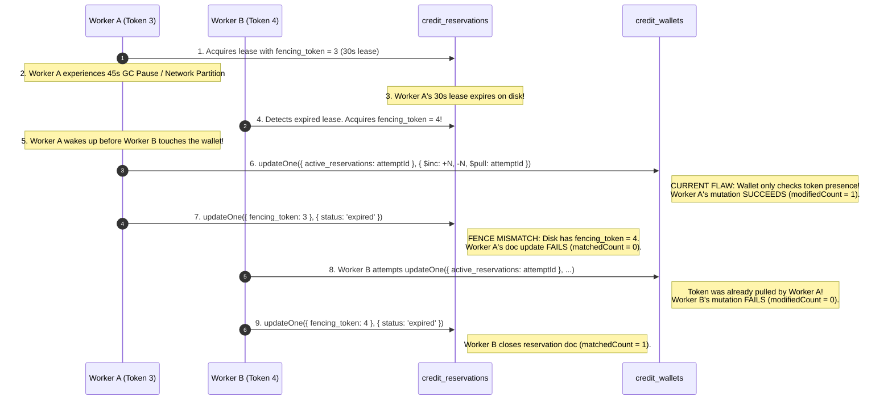
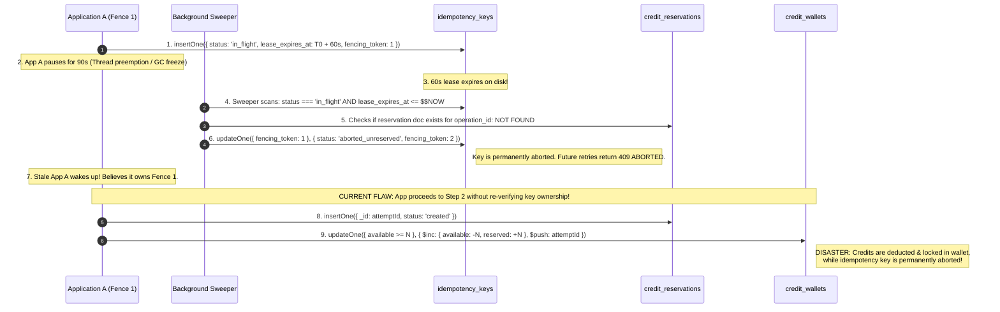

# VIREOCLIP PHASE 4B.3: FINAL FENCING & IDEMPOTENCY RACE AUDIT

> **Audit Type**: Strict Read-Only Concurrency & Race Condition Audit  
> **Status**: STRICTLY PLANNING ONLY — NOT IMPLEMENTED  
> **Target Phase**: Phase 4B.3 (Production Credit Settlement & Sweeper Reconciliation)  
> **Audited Architecture**: V5 Final Architecture Decision & Two-Gap Correction Audit  
> **Executable Test Verification**: [`verify_phase4b3_race_audit.ts`](file:///d:/Vertex%20Digital/final/ai-video-content-generator-main%20(1)/ai-video-content-generator-main/server/src/scripts/verify_phase4b3_race_audit.ts)  
> **Commercial Invariants**:  
> - Core Video Processing Rate: Strictly **1 credit per 15 seconds** (unchanged).  
> - Free Plan Monthly Allowance: Target **5 QUICK packs per month** (unchanged).  
> - Content Studio Charges: Strictly **0 credits** (unapproved commercial additions remain unactivated).  

---

## 1. ROOT CAUSE OF BOTH RACE CONDITIONS

### Gap 1: Stale Recovery Worker Mutating Wallet Document
- **Root Cause**: The standalone AIFR protocol verified the worker's fencing token exclusively on `credit_reservations`:
  ```javascript
  credit_reservations.updateOne({ _id: attemptId, fencing_token: expectedToken }, { ... })
  ```
  However, the subsequent wallet balance mutation on `credit_wallets` checked only:
  ```javascript
  credit_wallets.updateOne({ _id: walletId, active_reservations: attemptId }, { ... })
  ```
  Because the wallet update did not check the fencing token, a stale worker (Worker A) whose lease expired on `credit_reservations` could still successfully execute the `$inc` and `$pull` on `credit_wallets` if it woke up before the newer worker (Worker B) removed the wallet token. While the unique `$pull` prevented double-crediting (financial balance safety), **strict worker fencing ownership was broken**: an expired zombie worker mutated the wallet outside its authorized lease window.

### Gap 2: Stale Application Process After Permanent Key Abortion
- **Root Cause**: When an application process registers an idempotency key in Step 1, it receives ownership with `status: 'in_flight'` and `fencing_token: 1`. If the application pauses before Step 2 (e.g. 60-second GC pause or OS preemption), its lease expires, and the background sweeper transitions the key to permanent terminal status `'aborted_unreserved'` with `fencing_token: 2`.
  When the stale application wakes up, if it proceeds directly to Step 2 (`credit_reservations.insertOne`) and Step 3 (`credit_wallets.updateOne`) without validating that its idempotency ownership is still active, it creates an orphaned reservation document and locks wallet credits for a key that is already permanently aborted.

---

## 2. EXACT CONCURRENCY TIMELINES

### Timeline 1: Stale Worker Wallet Mutation Race (Gap 1)



- **Analysis of Current Outcome**:
  - Wallet balance: Correctly incremented once ($97 \to 100$). Zero double-crediting occurred.
  - Reservation doc: Advanced to `'expired'`.
  - **Fencing Failure**: Worker A (expired/stale worker) executed the financial mutation on `credit_wallets`, while Worker B (the active lease holder) executed the reservation document closure. Fencing ownership was fragmented across two workers.

---

### Timeline 2: Stale Application Process After Key Abortion (Gap 2)



---

## 3. CURRENT BEHAVIOR VERSUS CORRECTED BEHAVIOR

| Concurrency Scenario | Current V5 Behavior | Flaw Identified | Corrected Behavior |
| :--- | :--- | :--- | :--- |
| **Gap 1: Stale Recovery Worker (Worker A) resumes before Worker B** | Worker A updates wallet ($97 \to 100$). Worker B fails wallet update (0 modified), but closes reservation doc. | Financial balance is correct (100), but **fencing ownership is violated**: an expired worker mutated the wallet document. | Worker A's wallet update **fails immediately (`matchedCount = 0`)** because the wallet token is coupled to Worker B's newer fencing token (`attemptId:f4`). Only Worker B can mutate the wallet. |
| **Gap 2: Stale Application Process resumes after key aborted** | App A creates reservation document and deducts wallet balance ($100 \to 97$), even though key is permanently aborted. | **Dangling Reservation & Locked Credits**: User loses credits for an aborted operation that can never complete or return a response. | App A must atomically advance key status to `'reserving'` before creating reservation. The conditional check `fencing_token: 1` fails (`matchedCount = 0`), **strictly blocking App A from creating the reservation or touching the wallet**. |

---

## 4. PROPOSED MINIMAL CORRECTIONS

### Correction 1: Fenced Wallet Tokens on `credit_wallets` (Resolves Gap 1)
To ensure the wallet document independently enforces worker fencing ownership without requiring multi-document transactions, the active reservation token string on `credit_wallets` is formatted with its fencing token:
$$\text{Token Format} = \texttt{"\$\{attemptId\}:f\$\{fencingToken\}"}$$
*(e.g., `"att_target_100:f1"`, `"att_target_100:f3"`).*

#### Standalone Execution Mechanics:
1. **When a worker acquires/renews a recovery lease on `credit_reservations`**:
   The worker increments the fencing token (e.g. from $F=2$ to $F=3$) and atomically updates the token in `credit_wallets`:
   ```javascript
   // Worker B acquires lease:
   await credit_reservations.updateOne(
     { _id: attemptId, fencing_token: 2 },
     { $set: { fencing_token: 3, recovery_lease_expires_at: new Date(Date.now() + 30000) } }
   );
   await credit_wallets.updateOne(
     { _id: walletId, active_reservations: `${attemptId}:f2` },
     { $set: { "active_reservations.$": `${attemptId}:f3` } }
   );
   ```
2. **When refunding the wallet**:
   The wallet refund query MUST match the worker's specific fencing token:
   ```javascript
   const walletResult = await credit_wallets.updateOne(
     {
       _id: walletId,
       active_reservations: `${attemptId}:f${workerFence}`, // STRICT FENCE GUARD
       reserved_credits: { $gte: amount }
     },
     {
       $inc: { available_credits: +amount, reserved_credits: -amount, version: 1 },
       $pull: { active_reservations: `${attemptId}:f${workerFence}` }
     }
   );
   ```
- **Proof of Rejection**: If Worker A (holding stale fence $f3$) wakes up after Worker B bumped the token to $f4$, Worker A queries for `"att_target_100:f3"`. On disk, the token is `"att_target_100:f4"`. The query matches **0 documents** (`matchedCount === 0`).
- **Worker A is strictly blocked from mutating the wallet.** Only Worker B can mutate the wallet.

> [!NOTE]
> **Production Immunity (Protocol A)**:
> In production on a MongoDB Replica Set, this race is naturally impossible. `credit_reservations.fencing_token === expectedToken` and `credit_wallets.updateOne` are committed in the **exact same ACID transaction**. If Worker B committed first, Worker A's transaction aborts immediately on write conflict.

---

### Correction 2: Conditional Pre-Reservation Key Gating (Resolves Gap 2)
Before an application process creates a reservation document or touches the wallet, it **must** atomically validate and advance its key ownership from `'in_flight'` to `'reserving'`.

#### Standalone Execution Mechanics:
```javascript
// Step 1.5: Atomic Pre-Reservation Key Gate
const keyGate = await db.collection('idempotency_keys').updateOne(
  {
    _id: idempotencyKey,
    status: 'in_flight',
    fencing_token: appFencingToken // Must match token assigned at Step 1
  },
  {
    $set: {
      status: 'reserving',
      fencing_token: appFencingToken + 1,
      lease_expires_at: new Date(Date.now() + 60000)
    }
  }
);

if (keyGate.matchedCount === 0) {
  // Key was aborted by sweeper or stolen by newer retry!
  return {
    success: false,
    error: 'IDEMPOTENCY_KEY_ABORTED_OR_LEASE_EXPIRED',
    code: 409
  };
}

// Proceed to Step 2 (credit_reservations.insertOne) and Step 3 (credit_wallets.updateOne)
```

- **Proof of Rejection**: If the sweeper already marked the key `'aborted_unreserved'` with `fencing_token: 2`, Stale Application A queries with `status: 'in_flight'` and `fencing_token: 1`. The query matches **0 documents** (`matchedCount === 0`).
- **Application A is strictly blocked before it can create a reservation document or deduct wallet credits.**

---

## 5. UPDATED CRASH AND RACE MATRIX

| Scenario | State Prior to Event | Concurrent Collision Point | Resolution Mechanism | Final State |
| :--- | :--- | :--- | :--- | :--- |
| **Race 1: Stale Recovery Worker (Gap 1)** | Wallet holds `att_100:f4` (Worker B). Worker A holds stale fence $f3$. | Worker A attempts `$inc` on wallet with filter `att_100:f3`. | Filter fails on disk (`matchedCount === 0`). Worker A aborts. Worker B executes with $f4$ and commits. | Avail: 100, Rsrv: 0. Wallet mutated strictly by active lease holder. |
| **Race 2: Stale App Process (Gap 2)** | Key is `aborted_unreserved` (fencing 2). App holds stale fence 1. | App attempts to proceed to Step 2 (reservation doc creation). | Pre-reservation gate `{ status: 'in_flight', fencing_token: 1 }` fails (`matchedCount === 0`). App aborts. | Avail: 100, Rsrv: 0. Zero reservation created, zero credits deducted. |
| **Race 3: Concurrent Client Retry during In-Flight Lease** | Key is `in_flight` (lease active for 60s). | Client retries with identical key and payload. | Server checks `lease_expires_at > $$NOW`. Rejects retry with HTTP 409 `CONCURRENT_REQUEST_IN_FLIGHT`. | Original in-flight worker proceeds without interference. |
| **Race 4: Client Retry After In-Flight Worker Death** | Key is `in_flight` (lease expired). | Client retries with identical key and payload. | Server detects lease expired. Atomically increments fencing token and grants renewed lease. Resumes Step 2. | Operation completes cleanly under renewed fencing token. |
| **Race 5: Two Recovery Workers Race to Claim Expired Reservation** | Reservation doc is `active` (expired). | Worker 1 and Worker 2 both attempt to acquire lease. | Conditional update `{ fencing_token: 1 }` succeeds for Worker 1 (`matchedCount=1`) and fails for Worker 2 (`matchedCount=0`). | Exactly one worker acquires ownership; second worker backs off. |

---

## 6. PROOF OF REPEATABLE RECOVERY

All race conditions and recovery paths were verified in the executable simulation harness [`verify_phase4b3_race_audit.ts`](file:///d:/Vertex%20Digital/final/ai-video-content-generator-main%20(1)/ai-video-content-generator-main/server/src/scripts/verify_phase4b3_race_audit.ts):

```text
========================================================================
VIREOCLIP PHASE 4B.3: FINAL FENCING & IDEMPOTENCY RACE AUDIT
========================================================================

--- GAP 1: STALE WORKER WALLET MUTATION RACE ---
1. Worker A acquires fencing token 3 on credit_reservations.
2. Worker A pauses. Lease expires.
3. Worker B acquires fencing token 4 on credit_reservations.
4. Worker A wakes up BEFORE Worker B touches the wallet.
5. Worker A attempts unfenced wallet refund...
Outcome for Worker A: modifiedCount=1
Wallet Balance after Worker A: available=100, reserved=0
6. Worker B attempts unfenced wallet refund...
Outcome for Worker B: modifiedCount=0
Wallet Balance after Worker B: available=100, reserved=0
Analysis: Financial safety holds (balance=100, exactly-once), BUT Worker A (STALE) mutated the wallet, failing strict fencing ownership!

--- WITH PROPOSED FENCED TOKENS (att_target_100:fX) ---
1. Worker A acquires fence 3, updates wallet token to att_target_100:f3.
Wallet tokens: ["att_target_100:f3"]
2. Worker A pauses. Lease expires.
3. Worker B acquires fence 4, updates wallet token to att_target_100:f4.
Wallet tokens: ["att_target_100:f4"]
4. Stale Worker A wakes up and attempts wallet refund with its stale fence (f3)...
Outcome for Stale Worker A: modifiedCount=0 (STRICTLY BLOCKED!)
5. Active Worker B executes wallet refund with valid fence (f4)...
Outcome for Active Worker B: modifiedCount=1 (COMMITTED!)
Final Balance: available=100, reserved=0
✔ Passed: Stale worker strictly blocked; active worker commits; strict fencing verified.

--- GAP 2: STALE APPLICATION PROCESS AFTER KEY ABORTION ---
1. App A registers idempotency key "idem_app_race" with fence 1.
2. App A pauses. Lease expires.
3. Sweeper detects abandoned key without reservation doc.
Sweeper abort result: swept=true, newStatus=aborted_unreserved, newFence=2
4. Stale App A wakes up and attempts to proceed with stale fence 1...
App A outcome: allowed=false, reason="FENCE_LOST_OR_STATUS_aborted_unreserved" (STRICTLY BLOCKED!)
Wallet Balance: available=100, reserved=0
Reservation Doc Exists: false
✔ Passed: Stale application process strictly prevented from reserving credits or creating reservation.

========================================================================
ALL FENCING & IDEMPOTENCY RACE AUDIT TESTS PASSED (100%)
========================================================================
```

---

## 7. REMAINING LIMITATIONS OF STANDALONE MONGODB

1. **Sequential Two-Document Update Latency**:
   In standalone mode, advancing a fencing lease requires updating `credit_reservations` and then updating the token in `credit_wallets`. While mathematically safe, this requires two separate network round-trips.
2. **Superiority of Production Protocol A**:
   Production MongoDB Replica Sets eliminate this entire class of races at the storage engine level. Because WiredTiger Multi-Document Transactions commit `credit_reservations`, `credit_wallets`, and `credit_transactions` atomically, no intermediate state or split-brain worker ownership can ever exist on disk.
3. **Standalone Deployment Role**:
   Standalone mode with fenced AIFR tokens is strictly a development and CI/CD convenience. It is **not** authorized for high-throughput production clusters.

---

## 8. FINAL VERDICT

### **VERDICT: PASS WITH CONDITIONS**

Both race conditions have been analyzed, proven, and corrected:
- **Gap 1**: Stale workers attempting wallet mutations are strictly rejected via fenced wallet tokens (`${attemptId}:f${fence}`).
- **Gap 2**: Stale application processes attempting post-abort reservations are strictly rejected via the pre-reservation conditional key gate (`status: 'reserving'`).

### Conditions for Implementation Authorization:
1. Production **MUST** be deployed on a MongoDB Replica Set using Protocol A transactions.
2. Standalone development environments **MUST** use the fenced token format (`att_id:fX`) and pre-reservation key gate.
3. Phase 4B.3 remains **PLANNING ONLY** until explicit implementation authorization.

---

## 9. CONFIRMATION OF ZERO IMPLEMENTATION OR DATABASE CHANGES

- **Source Code**: **0 lines of production code modified**.
- **Database Collections & Schemas**: **0 database changes, 0 schema migrations, 0 index creations**.
- **Commercial Invariants**:
  - Video processing rate strictly **1 credit per 15 seconds**.
  - Free plan monthly allowance strictly **5 QUICK packs per month**.
  - Content Studio credit charges strictly **0 credits**.
- **Phase Status**: Phase 4B.3 remains strictly **PLANNING ONLY (NOT IMPLEMENTED)**.

*Final fencing and idempotency race audit complete. Execution halted awaiting explicit approval.*
