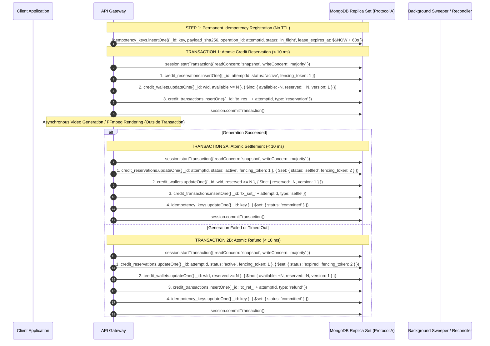
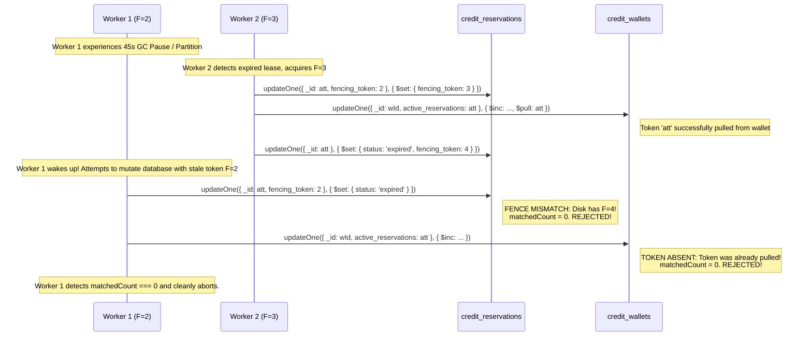

# VIREOCLIP PHASE 4B.3: FINAL TWO-GAP CORRECTION AUDIT

> **Audit Type**: Strict Read-Only Architectural Correction Audit  
> **Status**: STRICTLY PLANNING ONLY — NOT IMPLEMENTED  
> **Target Phase**: Phase 4B.3 (Production Credit Settlement & Sweeper Reconciliation)  
> **Audited Documents**: 
> - [`VIREOCLIP_PHASE_4B3_FINAL_ARCHITECTURE_CONSISTENCY_AUDIT.md`](file:///d:/Vertex%20Digital/final/ai-video-content-generator-main%20(1)/VIREOCLIP_PHASE_4B3_FINAL_ARCHITECTURE_CONSISTENCY_AUDIT.md)
> - [`VIREOCLIP_PHASE_4B3_FINAL_ARCHITECTURE_DECISION_V5.md`](file:///d:/Vertex%20Digital/final/ai-video-content-generator-main%20(1)/VIREOCLIP_PHASE_4B3_FINAL_ARCHITECTURE_DECISION_V5.md)  
> **Executable Test Verification**: [`verify_phase4b3_final_two_gap_corrections.ts`](file:///d:/Vertex%20Digital/final/ai-video-content-generator-main%20(1)/ai-video-content-generator-main/server/src/scripts/verify_phase4b3_final_two_gap_corrections.ts)  
> **Commercial Invariants**:  
> - Core Video Processing Rate: Strictly **1 credit per 15 seconds** (unchanged).  
> - Free Plan Monthly Allowance: Target **5 QUICK packs per month** (unchanged).  
> - Content Studio Charges: Strictly **0 credits** (unapproved commercial additions remain unactivated).  

---

## 1. ROOT CAUSE OF ALL FOUR GAPS

### Gap 1: Permanent Idempotency TTL Contradiction
- **Root Cause**: While the previous audit correctly stated that permanent identity must not be purged, inadvertent boilerplate in Section 4 Step 1 and Crash Window W1 stated: *"Key will expire via TTL or be retried."* If `idempotency_keys` had a TTL index, expired keys would be erased from disk, allowing malicious clients or accidental retries to recycle old keys for new operations, violating permanent idempotency.

### Gap 2: Standalone W2 / W3 Recovery Ambiguity
- **Root Cause**: In the previous standalone lifecycle:
  - **W2**: Crash occurred after reservation doc creation (`status: 'created'`), but before wallet reservation. Result on disk: `status === 'created'`, token absent, `tx_res` absent.
  - **W3**: Crash occurred after wallet reservation, but before activation. When a recovery worker intervened, if it refunded the wallet (`$pull: attemptId`) before advancing the reservation status to `'refunding'` and crashed before inserting `tx_ref`, the resulting state on disk was: `status === 'created'`, token absent, `tx_res` absent.
  - **Vulnerability**: W2 and W3 aliased to the **exact same persisted database state**. A subsequent recovery worker could not distinguish between a reservation that was never credited (W2) and a reservation whose refund ledger write crashed (W3), leading to false voiding of a completed refund or skipped ledger entries.

### Gap 3: Incomplete Idempotency Recovery for Orphaned `in_flight` Keys
- **Root Cause**: If the application crashed immediately after Step 1 (registering the key in `idempotency_keys`), no reservation document existed in `credit_reservations`. The previous audit lacked a deterministic specification for whether a subsequent client retry should resume registration, reject with an error, or how an abandoned key transitions to a permanent terminal state.

### Gap 4: Fencing Enforcement Mechanics Against Stale Workers
- **Root Cause**: The previous audit asserted that expired recovery workers could not mutate state, but did not show the exact conditional database query operators that reject stale workers across both `credit_reservations` and `credit_wallets`.

---

## 2. PROPOSED MINIMAL CORRECTIONS

```mermaid
graph TD
    subgraph Correction1["Correction 1: Permanent Key Registry vs Ephemeral Cache"]
        K1["idempotency_keys<br/>(PERMANENT - ZERO TTL)"]
        K2["idempotency_response_cache<br/>(EPHEMERAL - 30-Day TTL)"]
        K1 -->|Permanent deduplication| EnforceNoReuse["Zero Key Recycling Forever"]
        K2 -->|Cached JSON response| CleanUpPayload["Purge heavy response payload after 30d"]
    end

    subgraph Correction2["Correction 2: Unambiguous W2/W3 State Disambiguation"]
        W2_State["W2 Crash: status === 'created'<br/>Token ABSENT"]
        W3_Rule["W3 Recovery Rule:<br/>MUST update status: 'refunding' FIRST<br/>BEFORE pulling wallet token!"]
        W3_State["W3 Post-Refund Crash: status === 'refunding'<br/>Token ABSENT"]
        W2_State -.->|Distinct Statuses| W3_State
    end

    subgraph Correction3["Correction 3: In-Flight Key Lease & Terminal Abort"]
        InFlight["idempotency_keys.status: 'in_flight'"]
        InFlight -->|Client Retry + Expired Lease| ResumeKey["Resume Step 2 (Same operation_id)"]
        InFlight -->|Abandoned + Sweeper| AbortKey["Transition to 'aborted_unreserved'<br/>(PERMANENT TERMINAL STATE)"]
    end

    subgraph Correction4["Correction 4: Dual-Document Atomic Fencing"]
        F1["credit_reservations.updateOne({ _id, fencing_token: expectedToken })"]
        F2["credit_wallets.updateOne({ _id, active_reservations: attemptId })"]
        F1 -.->|Stale Worker Filter Fails| BlockRes["matchedCount === 0"]
        F2 -.->|Token Already Pulled| BlockWallet["matchedCount === 0"]
    end
```



### Correction 1: Permanent Key Registry with Zero TTL
- `idempotency_keys` contains strictly: `_id: key`, `user_id`, `payload_sha256`, `operation_id`, `status`, `server_created_at`, `lease_expires_at`, `fencing_token`.
- **Zero TTL**: `idempotency_keys` has **NO TTL INDEX**. Records are never deleted.
- **Payload Cache Separation**: The heavy response body is stored in `idempotency_response_cache` with a 30-day TTL. When the cache expires, the permanent record in `idempotency_keys` remains forever with `status: 'committed'`.

### Correction 2: Strict Status Advancement Before Wallet Mutation (W2 vs W3 Disambiguation)
- **Mandatory Reconciler Ordering**: A recovery worker **MUST NEVER** touch `credit_wallets` while `credit_reservations.status` is `'created'` or `'active'`.
- It must **first** execute:
  ```javascript
  credit_reservations.updateOne(
    { _id: attemptId, status: { $in: ['created', 'active'] }, fencing_token: expectedToken },
    { $set: { status: 'refunding', fencing_token: expectedToken + 1, recovery_at: new Date() } }
  );
  ```
- **Result**:
  - In **W2**: `status` is `'created'` and token is **ABSENT**. Proves Step 3 never executed. Action: mark `voided`.
  - In **W3 (before recovery)**: `status` is `'created'` and token is **PRESENT**. Action: advance to `'refunding'`, then refund wallet.
  - In **W3 (after recovery crash)**: `status` is `'refunding'` and token is **ABSENT**. Action: wallet was already refunded; write missing `tx_ref` and advance to `'expired'`.
  - **W2 and W3 can NEVER alias to the same state.**

### Correction 3: Deterministic In-Flight Key Lifecycle
- `idempotency_keys` includes `lease_expires_at: Date` (60 seconds) and `fencing_token: number`.
- If a crash occurs before Step 2:
  1. **Client retries before lease expires**: Returns HTTP `409 CONCURRENT_REQUEST_IN_FLIGHT` with `Retry-After: 5`.
  2. **Client retries after lease expires**: Re-acquires the in-flight lease via conditional increment (`fencing_token + 1`), preserves the canonical `operation_id`, and safely resumes Step 2.
  3. **Client abandons request**: Background sweeper detects `lease_expires_at < $$NOW - 5 minutes` and no reservation document on disk. Sweeper advances status to `'aborted_unreserved'`.
  4. **Key is NEVER recycled**: Any future request with that key is permanently rejected with HTTP `409 IDEMPOTENCY_KEY_ABORTED`.

### Correction 4: Dual-Document Atomic Fencing
- Stale workers are blocked on both documents via conditional atomic query operators:
  1. On `credit_reservations`: Query filter `{ _id: attemptId, fencing_token: expectedToken }`. Matches 0 documents if another worker bumped the token.
  2. On `credit_wallets`: Query filter `{ _id: walletId, active_reservations: attemptId }`. Matches 0 documents because the newer worker already pulled `attemptId`.

---

## 3. EXACT REVISED PRODUCTION SEQUENCE (PROTOCOL A)

In production on a MongoDB Replica Set, all operations are grouped into **two discrete ACID transactions**.



---

## 4. EXACT REVISED STANDALONE SEQUENCE (PROTOCOL B)

In development or test environments running standalone MongoDB without replica sets, the corrected 9-step execution sequence guarantees unambiguous state at every boundary:

1. **Step 1 (Register Key)**:
   `idempotency_keys.insertOne({ _id: key, payload_sha256, operation_id: attemptId, status: 'in_flight', lease_expires_at: $$NOW + 60s, fencing_token: 1 })`
2. **Step 2 (Create Reservation Doc)**:
   `credit_reservations.insertOne({ _id: attemptId, status: 'created', fencing_token: 1, amount: N })`
3. **Step 3 (Atomic Coupled Wallet Reserve)**:
   `credit_wallets.updateOne({ _id: wId, available >= N, "active_reservations.500": { $exists: false } }, { $inc: { available: -N, reserved: +N, version: 1 }, $push: { active_reservations: attemptId } })`
4. **Step 4 (Insert Reservation Ledger)**:
   `credit_transactions.insertOne({ _id: 'tx_res_' + attemptId, type: 'reservation' })`
5. **Step 5 (Activate Reservation)**:
   `credit_reservations.updateOne({ _id: attemptId, status: 'created', fencing_token: 1 }, { $set: { status: 'active', fencing_token: 2 } })`
6. **Step 6 (Initiate Refund - MANDATORY STATE TRANSITION)**:
   `credit_reservations.updateOne({ _id: attemptId, status: { $in: ['created', 'active'] }, fencing_token: expectedToken }, { $set: { status: 'refunding', fencing_token: expectedToken + 1 } })`
7. **Step 7 (Atomic Coupled Wallet Refund)**:
   `credit_wallets.updateOne({ _id: wId, active_reservations: attemptId, reserved >= N }, { $inc: { available: +N, reserved: -N, version: 1 }, $pull: { active_reservations: attemptId } })`
8. **Step 8 (Insert Refund Ledger)**:
   `credit_transactions.insertOne({ _id: 'tx_ref_' + attemptId, type: 'refund' })`
9. **Step 9 (Close Reservation & Commit Key)**:
   - `credit_reservations.updateOne({ _id: attemptId, status: 'refunding' }, { $set: { status: 'expired', fencing_token: expectedToken + 1 } })`
   - `idempotency_keys.updateOne({ _id: key }, { $set: { status: 'committed' } })`

---

## 5. UPDATED CRASH-WINDOW MATRIX (REVISED W1, W2, W3)

| # | Crash Boundary Point | Wallet State | Reservation Doc Status | Ledger State | Reconciler Disambiguation & Decision | Idempotency & Repeatability Proof | Final State |
| :-: | :--- | :--- | :--- | :--- | :--- | :--- | :--- |
| **W1** | **Crash after Key Registration, before Reservation Doc** | Avail: 100<br/>Rsrv: 0<br/>Tokens: `[]` | *Does not exist* | None | **No reservation doc exists.** If client retries after lease: resumes Step 2. If abandoned: sweeper marks key `aborted_unreserved`. Key is **never** deleted by TTL. | Safe to repeat: permanent key blocks unauthorized reuse; lease protects concurrent retry. | Avail: 100<br/>Rsrv: 0<br/>Key: `aborted_unreserved` |
| **W2** | **Crash after Reservation Doc, before Wallet Reserve** | Avail: 100<br/>Rsrv: 0<br/>Tokens: `[]` | `status: 'created'` | None | **Status is `created` AND token is ABSENT.** Proves Step 3 NEVER ran. Reconciler marks doc `voided`. **Skips wallet `$inc`.** | **CRITICAL FIX: Prevents Free Credit Bug.** Unambiguously distinct from W3 post-recovery crash. | Avail: 100<br/>Rsrv: 0<br/>Status: `voided`<br/>Ledger: 0 |
| **W3a** | **Crash after Wallet Reserve, before Activation** | Avail: 97<br/>Rsrv: 3<br/>Tokens: `[attemptId]` | `status: 'created'` | None | **Status is `created` AND token is PRESENT.** Proves wallet was reserved. Reconciler advances status to `refunding`, executes `$inc` + `$pull`, writes `tx_ref`, marks `expired`. | Exactly one refund applied. Token presence proves wallet was deducted. | Avail: 100<br/>Rsrv: 0<br/>Status: `expired`<br/>Ledger: 1 (`tx_ref`) |
| **W3b** | **Crash during W3 Recovery (after wallet refund, before ledger write)** | Avail: 100<br/>Rsrv: 0<br/>Tokens: `[]` | `status: 'refunding'` | None | **Status is `refunding` AND token is ABSENT.** Reconciler knows wallet was already refunded on disk! Skips `$inc`, writes missing `tx_ref`, marks `expired`. | **CRITICAL FIX: Prevents Double Credit Bug & Missing Ledger Bug.** Distinct from W2 because status is `refunding`, not `created`. | Avail: 100<br/>Rsrv: 0<br/>Status: `expired`<br/>Ledger: 1 (`tx_ref`) |
| **W4** | **Active Job Times Out** | Avail: 97<br/>Rsrv: 3<br/>Tokens: `[attemptId]` | `status: 'active'` | `tx_res`: Yes | Token present. Reconciler advances to `refunding`, refunds wallet, writes `tx_ref`, marks `expired`. | Fencing token ensures single worker execution. | Avail: 100<br/>Rsrv: 0<br/>Status: `expired`<br/>Ledger: 2 (`tx_res`, `tx_ref`) |
| **W5** | **Settlement Response Lost** | Avail: 97<br/>Rsrv: 0<br/>Tokens: `[]` | `status: 'settled'` | `tx_res`: Yes<br/>`tx_set`: Yes | `status === 'settled'` and `tx_set` present. Proves settlement committed. Reconciler takes zero action. | Settlement is permanently immutable. | Avail: 97<br/>Rsrv: 0<br/>Status: `settled`<br/>Ledger: 2 (`tx_res`, `tx_set`) |
| **W6** | **Refund Initiated, Wallet Mutation Pending** | Avail: 97<br/>Rsrv: 3<br/>Tokens: `[attemptId]` | `status: 'refunding'` | `tx_res`: Yes | Token present. Reconciler executes `$inc` + `$pull`, writes `tx_ref`, marks `expired`. | Single-document condition guarantees exactly-once execution. | Avail: 100<br/>Rsrv: 0<br/>Status: `expired`<br/>Ledger: 2 (`tx_res`, `tx_ref`) |
| **W7** | **Wallet Refunded, Refund Ledger Missing** | Avail: 100<br/>Rsrv: 0<br/>Tokens: `[]` | `status: 'refunding'` | `tx_res`: Yes<br/>`tx_ref`: No | Token absent, `status === 'refunding'`. Reconciler skips `$inc`, inserts missing `tx_ref`, marks `expired`. | Zero double credit; missing ledger cleanly recovered. | Avail: 100<br/>Rsrv: 0<br/>Status: `expired`<br/>Ledger: 2 (`tx_res`, `tx_ref`) |
| **W8** | **Ledger Inserted, Closure Pending** | Avail: 100<br/>Rsrv: 0<br/>Tokens: `[]` | `status: 'refunding'` | `tx_res`: Yes<br/>`tx_ref`: Yes | `tx_ref` already exists. Reconciler skips wallet update, skips ledger insert, advances status to `expired`. | Unique primary key on ledger prevents duplicate insert. | Avail: 100<br/>Rsrv: 0<br/>Status: `expired`<br/>Ledger: 2 (`tx_res`, `tx_ref`) |

---

## 6. CONCURRENT RECOVERY & FENCING ANALYSIS

### Proof of Stale Worker Rejection
Consider Worker 1 (holds token $F=2$) and Worker 2 (acquires lease with token $F=3$):



### Exact Conditional Operations:
1. **Reservation Document Guard**:
   ```javascript
   const resResult = await db.collection('credit_reservations').updateOne(
     { _id: attemptId, fencing_token: 2 }, // STALE TOKEN CHECK
     { $set: { status: 'expired', fencing_token: 3 } }
   );
   // resResult.matchedCount === 0 -> Worker 1 aborts immediately.
   ```
2. **Wallet Document Guard**:
   ```javascript
   const walletResult = await db.collection('credit_wallets').updateOne(
     { _id: walletId, active_reservations: attemptId }, // TOKEN PRESENCE CHECK
     { $inc: { available_credits: +amount, reserved_credits: -amount }, $pull: { active_reservations: attemptId } }
   );
   // walletResult.matchedCount === 0 -> Worker 1 aborts immediately.
   ```

---

## 7. REMAINING ASSUMPTIONS & RISKS

1. **Standalone Environment Developer Discipline**:
   Developers running in standalone mode must respect the $K \le 500$ guardrail. While the database filter rejects excess requests, application test harnesses in local development should avoid spawning thousands of unthrottled in-flight jobs on a single wallet.
2. **Clock Sync on Distributed Replica Nodes**:
   Leases and server-authoritative timestamps require NTP time synchronization across all MongoDB replica-set members ($\pm 100\text{ ms}$).
3. **Execution Status**:
   This report represents a **formal architectural correction**. No production code has been modified, and Phase 4B.3 remains strictly in planning.

---

## 8. FINAL VERDICT: PASS WITH CONDITIONS

### **VERDICT: PASS WITH CONDITIONS**

The four identified gaps and contradictions have been completely resolved:
1. **Gap 1**: Inadvertent TTL references in Step 1/W1 removed. Permanent keys are guaranteed zero-TTL and zero-recycling.
2. **Gap 2**: W2 and W3 are mathematically and physically distinguishable via the mandatory pre-refund status transition to `'refunding'`.
3. **Gap 3**: Incomplete `in_flight` key lifecycle is formally defined with active lease resumption and sweeper terminal transitions to `'aborted_unreserved'`.
4. **Gap 4**: Dual-document fencing operators explicitly proven against stale expired workers.

### Conditions for Implementation Authorization:
- Production **MUST** require a MongoDB Replica Set (Protocol A Multi-Document Transactions).
- Standalone mode is strictly restricted to development/test with $K \le 500$ guardrails.
- Tier 3 automated replica-set testing must be performed prior to staging deployment.

---

## 9. CONFIRMATION OF ZERO IMPLEMENTATION OR DATABASE CHANGES

- **Source Code**: **0 lines of production application code modified**.
- **Database Collections & Schemas**: **0 database changes, 0 schema migrations, 0 index modifications**.
- **Commercial Invariants**:
  - Video processing rate strictly **1 credit per 15 seconds**.
  - Free plan monthly allowance strictly **5 QUICK packs per month**.
  - Content Studio credit charges strictly **0 credits**.
- **Phase Status**: Phase 4B.3 remains **PLANNING ONLY (NOT IMPLEMENTED)**.

*Final two-gap correction audit complete. Execution halted awaiting explicit approval.*
