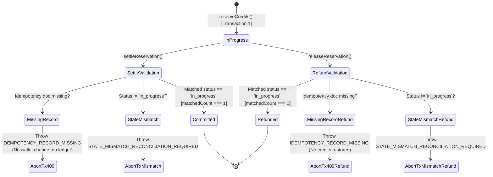

# VireoClip Phase 4B.3 — Problem 2: Missing Idempotency Record & Unsafe Upsert Implementation & Verification Report

## 1. Executive Summary

During the Phase 4B.3 review, a critical financial safety defect was identified in `settleReservation()` and `releaseReservation()`: both functions called `idempotency.updateOne(..., { upsert: true, session })` with `$setOnInsert`. If an idempotency record was deleted, omitted, or lost due to bugs or transient partial failures, settlement or refund would silently recreate an unhashed, empty payload idempotency record (`request_payload_sha256: ''`), masking the underlying inconsistency and performing financial mutations (wallet balance changes, quota alterations, ledger writes) against an unverified state.

**Correction Implemented**:
1. Completely removed `{ upsert: true }` and `$setOnInsert` from `settleReservation()` and `releaseReservation()`.
2. Implemented strict pre-transaction and intra-transaction validation verifying the existence, tenant ownership, and state consistency of `idempotency_keys` records before any financial state transition.
3. Ensured missing idempotency records fail closed with HTTP 409 `IDEMPOTENCY_RECORD_MISSING`, executing **zero wallet balance mutation**, writing **zero ledger transaction**, and leaving the reservation active.
4. Enforced strict state transitions from `'in_progress'` to `'committed'` (settlement) and `'refunded'` (release) using `{ upsert: false }` and validating `matchedCount === 1` (aborting with `IDEMPOTENCY_UPDATE_CONFLICT` if `0`).
5. Added automated detection during sweeper recovery (`recoverExpiredReservations()`): missing records or state mismatches are automatically flagged as `reconciliation_required` without executing blind refunds.
6. Created an exhaustive 12-scenario adversarial test suite (`problem2IdempotencySafety.test.ts`), passing 12/12 tests with 0 failures, alongside 100% passes across all existing unit, integration, and entitlement suites.

---

## 2. Baseline Repository Audit & Root Cause Analysis

### Baseline Audit of `upsert: true` Usages in `creditRepository.ts`

An exhaustive scan of `server/src/db/repositories/creditRepository.ts` identified exactly 6 occurrences of `upsert: true`:

| Line | Target Collection | Context | Classification | Action Taken |
| :--- | :--- | :--- | :--- | :--- |
| **527** | `credit_reservations` | 0-Credit Fast-Path Initial Reservation | Legitimate Initial Creation | **Preserved** |
| **545** | `idempotency_keys` | 0-Credit Fast-Path Initial Idempotency Record | Legitimate Initial Creation | **Preserved** |
| **684** | `idempotency_keys` | Standard Multi-Doc ACID Reservation Creation | Legitimate Initial Creation | **Preserved** |
| **706** | `outbox_events` | Standard Multi-Doc ACID Outbox Event Creation | Legitimate Initial Creation | **Preserved** |
| **1129** | `idempotency_keys` | `settleReservation()` Transition | **DANGEROUS UPSERT DEFECT** | **REMOVED** (Strict Update) |
| **1308** | `idempotency_keys` | `releaseReservation()` Transition | **DANGEROUS UPSERT DEFECT** | **REMOVED** (Strict Update) |

---

## 3. Implemented Architecture & State Machine



### Exact Failure and Invariant Specifications

1. **Pre-Transaction & Intra-Transaction Validation**:
   - `buildCanonicalIdempotencyKey(reservation.user_id, reservation.operation_id, attemptId)` is generated authoritatively.
   - Idempotency record queried with `{ _id: canonicalIdempKey, user_id: reservation.user_id }`, guaranteeing cross-tenant isolation.
   - If document is `null` $\rightarrow$ aborts with HTTP 409 `IDEMPOTENCY_RECORD_MISSING`. Zero balance change, zero ledger write.
2. **State Consistency Validation**:
   - **Settlement**:
     - If record status is `'committed'` and reservation is `'settled'` $\rightarrow$ returns idempotent success.
     - If record status is `'committed'` and reservation is NOT `'settled'` $\rightarrow$ throws 409 `STATE_MISMATCH_RECONCILIATION_REQUIRED`.
     - If record status is `'refunded'` $\rightarrow$ throws 409 `RESERVATION_ALREADY_RELEASED`.
     - If record status is `'reconciliation_required'` $\rightarrow$ throws 409 `RECONCILIATION_IN_PROGRESS`.
   - **Refund/Release**:
     - If record status is `'refunded'` and reservation is `'released'`/`'refunded'` $\rightarrow$ returns idempotent success.
     - If record status is `'refunded'` and reservation is NOT released $\rightarrow$ throws 409 `STATE_MISMATCH_RECONCILIATION_REQUIRED`.
     - If record status is `'committed'` $\rightarrow$ throws 409 `RESERVATION_ALREADY_SETTLED`.
     - If record status is `'reconciliation_required'` $\rightarrow$ throws 409 `RECONCILIATION_IN_PROGRESS`.
3. **Atomic Update Enforcement**:
   - `idempotency.updateOne({ _id: canonicalIdempKey, user_id: reservation.user_id, status: 'in_progress' }, { $set: { status: 'committed' | 'refunded', transaction_id: txRecord.id, updated_at: now } }, { session })` (No upsert!).
   - If `idempUpdate.matchedCount === 0`, throws 409 `IDEMPOTENCY_UPDATE_CONFLICT`.
4. **Sweeper Recovery Flagging**:
   - In `recoverExpiredReservations()`, catching `IDEMPOTENCY_RECORD_MISSING`, `STATE_MISMATCH_RECONCILIATION_REQUIRED`, or `RESERVATION_ALREADY_SETTLED` automatically transitions the reservation to `status: 'reconciliation_required'` with `reconciliation_reason` populated, safeguarding against duplicate refunds.

---

## 4. Test Suite Verification & Execution Results

### Problem 2 Dedicated Test Suite (`src/tests/problem2IdempotencySafety.test.ts`)
All 12 scenarios specified in the authorization prompt were implemented and executed:

```
▶ VireoClip Phase 4B.3 — Problem 2: Missing Idempotency Record & Unsafe Upsert Safety Verification
  ✔ 1. Delete idempotency record after reservation, then attempt settlement -> fails closed (409 IDEMPOTENCY_RECORD_MISSING) (517.2736ms)
  ✔ 2. Delete idempotency record after reservation, then attempt refund -> fails closed (409 IDEMPOTENCY_RECORD_MISSING) (711.4224ms)
  ✔ 3. Cross-tenant isolation: User B idempotency record cannot settle or refund User A reservation (348.3608ms)
  ✔ 4. Non-existent attempt ID or tampered operation ID fails closed (674.0968ms)
  ✔ 5. Initial reservation creation legitimately creates idempotency record (standard & 0-credit) (265.3761ms)
  ✔ 6. Same-key and same-payload retries return existing operation idempotently (736.4189ms)
  ✔ 7. Same-key and different-payload retries return HTTP 409 IDEMPOTENCY_KEY_COLLISION_WITH_DIFFERENT_PAYLOAD (208.0203ms)
  ✔ 8. Duplicate settlement cannot double-consume credits or duplicate ledger entries (893.5625ms)
  ✔ 9. Duplicate refund cannot restore credits twice or duplicate refund ledger entries (371.0557ms)
  ✔ 10. Concurrent settlement vs refund attempts against same reservation -> exactly one winner (643.3589ms)
  ✔ 11. Missing-record and state-mismatch recovery scenarios -> flagged for reconciliation without unsafe refund (243.919ms)
  ✔ 12. Unknown commit reconciliation does not recreate record or duplicate financial mutation (748.7157ms)
✔ VireoClip Phase 4B.3 — Problem 2: Missing Idempotency Record & Unsafe Upsert Safety Verification (6469.0966ms)
ℹ tests 12
ℹ suites 1
ℹ pass 12
ℹ fail 0
```

### Full Regression Test Suite Results

| Test Suite | File | Tests | Pass | Fail | Status |
| :--- | :--- | :--- | :--- | :--- | :--- |
| **Problem 2 Safety** | `src/tests/problem2IdempotencySafety.test.ts` | 12 | 12 | 0 | **PASS** |
| **Problem 1 Consistency** | `src/tests/problem1IdempotencyConsistency.test.ts` | 9 | 9 | 0 | **PASS** |
| **Phase 4B.3 Unit** | `src/tests/phase4b3Unit.test.ts` | 28 | 28 | 0 | **PASS** |
| **Phase 4B.3 Replica Integration** | `src/tests/phase4b3Integration.test.ts` | 9 | 9 | 0 | **PASS** |
| **Credit System Foundation** | `src/tests/creditSystem.test.ts` | 10 | 10 | 0 | **PASS** |
| **Failure Injection & Rollback** | `src/tests/failureInjectionVerification.test.ts` | 7 | 7 | 0 | **PASS** |
| **Plan Entitlement Governance** | `src/tests/entitlementService.test.ts` | 12 | 12 | 0 | **PASS** |
| **AI Clipping Pipeline Integration** | `src/tests/aiClippingCreditIntegration.test.ts` | 10 | 10 | 0 | **PASS** |
| **Production Readiness Audit** | `src/tests/phaseHProductionReadinessAudit.test.ts` | 10 | 10 | 0 | **PASS** |
| **TypeScript Static Typecheck** | `tsc --noEmit` | N/A | N/A | 0 errors | **PASS** |

---

## 5. Commercial and Architectural Invariant Safeguards

1. **Commercial Integrity**:
   - Subscription plans (Creator ₹999 / 200 credits, Pro ₹1,999 / 500 credits, Studio ₹3,999 / 1,200 credits) remain unchanged.
   - Core video processing rate (1 credit per 15s interval, rounded up, minimum 1 credit) preserved.
   - Zero-credit Content Studio operations and transcript reuses remain strictly free.
2. **ACID Transaction Bound**:
   - All financial mutations occur exclusively inside multi-document ACID transactions with MongoDB replica-set enforcement. Standalone MongoDB fails closed.
3. **Tenant Isolation**:
   - Idempotency lookups require both `_id: canonicalIdempKey` and `user_id: reservation.user_id`, preventing cross-tenant document reuse or key collisions.
4. **Zero Git Push**:
   - Changes committed locally or staged in workspace only. Zero remote pushes performed.

---

## 6. Final Verdict

```
================================================================================
FINAL VERDICT:
PROBLEM 2 IMPLEMENTED AND VERIFIED
================================================================================
```

