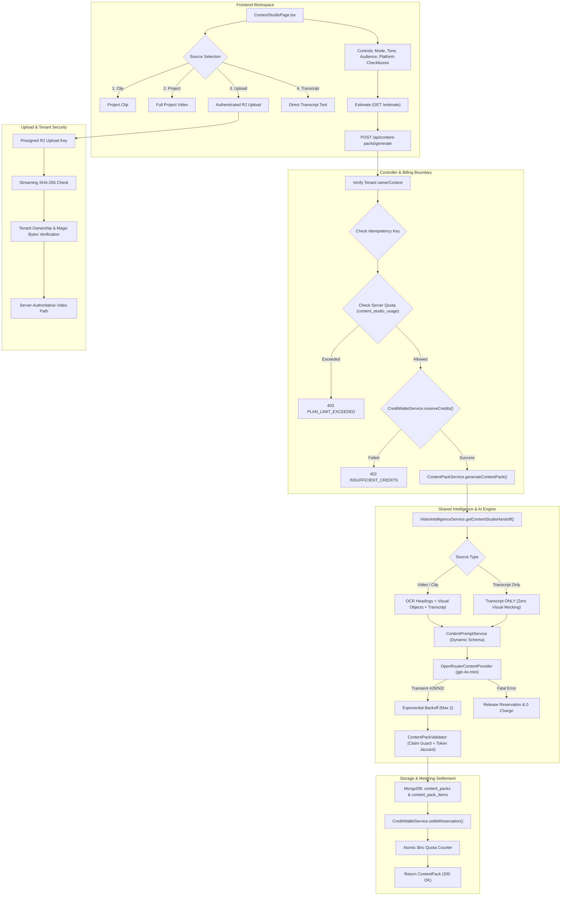

# VIREOCLIP — PHASE 4B: AI CONTENT STUDIO DETAILED IMPLEMENTATION PLAN
## Revised Architectural Blueprint, Financial Model & Multi-Source Specification

**Document ID:** `VC-PLAN-P4B-STUDIO-002`  
**Phase:** 4B — AI Content Studio Detailed Implementation Plan (Revised Post-Audit)  
**Target Environment:** Intel Core Ultra 5 225H, Intel Arc 130T GPU, Windows 11, Node.js v24.18.0, MongoDB  
**Status:** **PHASE 4B.1 AUTHORIZED FOR IMPLEMENTATION — SUBPHASES 4B.2–4B.5 ON HOLD**  
**Date:** November 5, 2026  
**Execution Mode:** Phased Subphase Implementation with Mandatory Checkpoints

---

## 1. EXECUTIVE BLUEPRINT & STRICT SCOPE BOUNDARIES

### 1.1 Context & Conditional Approval
Following the review of the Phase 4A Deep Audit and initial Phase 4B Plan, the overall architecture and five-subphase sequence have been conditionally approved. This document incorporates all five mandatory architectural and financial corrections requested by the product architect:
1. **Financial Model & Instrumentation:** Explicit distinction between modeled estimates and empirical production telemetry, P95/max tracking, fallback economics, and business margin definitions.
2. **Upload Security Architecture:** Authenticated private R2 uploads, ownership verification, full-content SHA-256 checks, strict file validation, orphan cleanup, and prohibition against trusting client-supplied file paths.
3. **Atomic Billing and Quota Hardening:** Idempotency keys, atomic quota checks, concurrent request safety, TTL recovery sweepers, and two-phase reservation settlement.
4. **Claim Guard Provenance:** Strict four-way evidence classification (`TRANSCRIPT`, `OCR`, `VISUAL_OBJECT`, `UNVERIFIED`) with zero fabrication of visual evidence on transcript-only sources.
5. **Platform-Based Cost Control:** Creator-selected platform checkboxes across all modes with token instrumentation by platform count and generation mode.

### 1.2 Strict Commercial & Operational Invariants
- **Unapproved Pricing:** Proposed credit rates (`QUICK` 2, `BALANCED` 3, `FULL` 5, single item regen 1, platform regen 2, translation 2) remain **unapproved proposals**. No pricing will be activated in code based on estimates alone.
- **Unapproved Plan Allowances:** Proposed monthly pack limits (Creator 50, Pro 200, Studio 500) remain **unapproved proposals**.
- **Free Plan Design Target:** 5 `QUICK` packs/month and `QUICK`-only access for Free users is an approved design target, not authorization to modify existing billing plans or credit grants.
- **Strictly Free Operations:** Manual editing, item locking, clipboard copying, `PublishModal` handoff, and compatible cached Video Intelligence reuse remain **strictly 0 credits (FREE)**.
- **Billing System Invariants:** Existing credit wallet grants, subscription prices, entitlements, and payment integrations (Paddle / Razorpay) must remain completely untouched.
- **Four Product Pillars Preserved:** (1) AI Video Clipping, (2) Subtitle Studio, (3) AI Content Studio, (4) Social Media Publisher. No feature merging or deletion.
- **Phase 4B.1 Execution Only:** Only Subphase 4B.1 (Backend Multi-Source & Video Intelligence Integration) is authorized. Subphases 4B.2, 4B.3, 4B.4, and 4B.5 remain on hold.

---

## 2. COMPREHENSIVE FINANCIAL MODEL & TELEMETRY REQUIREMENTS

### 2.1 Distinguishing Modeled Estimates from Measured Production Usage
To prevent premature or inaccurate commercial pricing:
- **Pre-Implementation Model (Estimates):** Theoretical token calculations based on prompt schemas, expected transcript lengths, and published LLM rates. Used *only* for architectural sizing and initial safety bounds.
- **Post-Implementation Telemetry (Production Measurements):** Mandatory server-side telemetry capturing actual token usage on every request.
  - Every AI generation response from OpenRouter/Groq returns authoritative token counters: `usage.prompt_tokens`, `usage.completion_tokens`, and `usage.total_tokens`.
  - These counters are captured and persisted in the `content_packs` and `content_pack_versions` records.
  - Telemetry will track **P50, P90, P95, and Maximum** token consumption segmented by:
    1. Generation Mode (`QUICK`, `BALANCED`, `FULL`).
    2. Selected Platform Count (1 to 6 platforms).
    3. Source Type (`clip`, `project`, `upload`, `transcript`).
    4. Source Duration / Word Count.

```
┌────────────────────────────────────────────────────────────────────────┐
│ MANDATORY TOKEN TELEMETRY INSTRUMENTATION SCHEMA                      │
├────────────────────────────┬─────────────┬─────────────────────────────┤
│ Field                      │ Type        │ Purpose                     │
├────────────────────────────┼─────────────┼─────────────────────────────┤
│ telemetry.provider         │ string      │ 'openrouter' | 'groq'       │
│ telemetry.model            │ string      │ 'openai/gpt-4o-mini', etc.  │
│ telemetry.prompt_tokens    │ number      │ Authoritative input tokens  │
│ telemetry.completion_tokens│ number      │ Authoritative output tokens │
│ telemetry.total_tokens     │ number      │ Total billable tokens       │
│ telemetry.latency_ms       │ number      │ Provider round-trip time    │
│ telemetry.estimated_cost   │ number      │ Server-calculated USD cost  │
│ telemetry.selected_platforms│ string[]   │ Platforms requested         │
│ telemetry.platform_count   │ number      │ Count of platforms chosen   │
└────────────────────────────┴─────────────┴─────────────────────────────┘
```

---

### 2.2 Current Provider Pricing Verification & Fallback Economics
Provider pricing must be verified continuously against upstream billing dashboards.

| Provider & Model | Role | Input Cost (per 1M) | Output Cost (per 1M) | Effective Cost / 1k Tokens (Blended) |
| :--- | :--- | :--- | :--- | :--- |
| **OpenRouter: `openai/gpt-4o-mini`** | **Primary LLM** | **$0.150** | **$0.600** | ~$0.000350 |
| **Groq: `llama-3.3-70b-versatile`** | **Automated Fallback** | **$0.590** | **$0.790** | ~$0.000670 |

#### Fallback Economic Impact:
If OpenRouter experiences an outage or HTTP 429 rate limit spike and the system falls back to Groq:
- Input cost increases by **$0.44 / 1M tokens** (+293%).
- Output cost increases by **$0.19 / 1M tokens** (+31%).
- For a `FULL` mode generation (3,000 in, 2,100 out), Groq cost is **$0.00343** compared to **$0.00171** on OpenRouter.
- Even under 100% Groq fallback, provider costs remain a fraction of a cent per pack, but telemetry must flag when fallback is engaged to monitor margin erosion.

---

### 2.3 Modeled Token Consumption & Direct Provider Costs

#### Baseline Calculations (OpenRouter `gpt-4o-mini`):

| Operation | Platforms Selected | Modeled Input Tokens | Modeled Output Tokens | Provider Cost (Avg) | Provider Cost (P95 / Max) |
| :--- | :--- | :--- | :--- | :--- | :--- |
| **QUICK Mode** | 1–2 platforms | 1,100 | 500 | **$0.000465** (~0.047¢) | **$0.000705** (~0.071¢) |
| **QUICK Mode** | All 6 platforms | 1,200 | 750 | **$0.000630** (~0.063¢) | **$0.000885** (~0.089¢) |
| **BALANCED Mode** | 3–4 platforms | 1,800 | 1,200 | **$0.000990** (~0.099¢) | **$0.001455** (~0.146¢) |
| **BALANCED Mode** | All 6 platforms | 2,000 | 1,500 | **$0.001200** (~0.120¢) | **$0.001650** (~0.165¢) |
| **FULL Mode** | All 6 platforms | 3,000 | 2,100 | **$0.001710** (~0.171¢) | **$0.002175** (~0.218¢) |
| **Single Item Regen** | 1 platform/all | 800 | 80 | **$0.000168** (~0.017¢) | **$0.000250** (~0.025¢) |
| **Platform Regen** | 1 platform | 1,000 | 300 | **$0.000330** (~0.033¢) | **$0.000480** (~0.048¢) |
| **Full Pack Regen** | Unlocked items | 2,200 | 1,400 | **$0.001170** (~0.117¢) | **$0.001650** (~0.165¢) |
| **Pack Translation** | All approved items | 1,200 | 1,000 | **$0.000780** (~0.078¢) | **$0.001200** (~0.120¢) |

---

### 2.4 Allocated Credit Revenue vs. Overall Business Gross Margin

> [!CAUTION]
> **Financial Governance Rule:** Allocated credit revenue is an **operational unit metric**, NOT identical to overall business gross margin.
>
> 1. **Allocated Token Margin:** Measures purely the ratio of credit value consumed to LLM token provider fees ($\ge 96\%$).
> 2. **Overall Business Margin:** The business as a whole must fund:
>    - Video transcoding infrastructure (Intel GPU / CPU compute servers).
>    - Cloudflare R2 video storage and egress bandwidth.
>    - Faster-Whisper / transcription model GPU compute.
>    - MongoDB Atlas hosting and backup infrastructure.
>    - Payment gateway processing fees (Paddle / Razorpay: ~3–5% + fixed transaction fee).
>    - Customer support, engineering, and administrative overhead.
>
> Therefore, high token-level margins do not justify underpricing credits or providing unbounded generation on paid plans. Credit prices must remain provisional until empirical P95 telemetry is verified.

---

## 3. PLAN ENTITLEMENTS & FREE TIER QUOTA SPECIFICATION

### 3.1 Free Tier Access Architecture (Approved Design Target)
Free tier access is approved in principle as an acquisition funnel with strict, server-authoritative guardrails:
1. **Design Target Allowance:** 5 `QUICK` mode Content Packs per calendar month.
2. **Mode Restriction:** `QUICK` mode only. `BALANCED` and `FULL` modes are server-blocked (`403 PLAN_LIMIT_EXCEEDED`).
3. **Regeneration Bounded:** Max 1 whole-pack regeneration or 2 single-item regenerations per pack. Unlimited regeneration is strictly prevented.
4. **Server-Side Enforcement:** Bounded via `content_studio_usage` collection with atomic checks on generation.
5. **Deterministic UTC Monthly Reset:** Resets automatically at `00:00:00 UTC` on the 1st of each month based on `billing_period` string (e.g. `2026-11`).
6. **Infrastructure Cost:** $5 \times \$0.000465 \approx \mathbf{\$0.0023\text{ per active Free user/month}}$.

### 3.2 Paid Plan Entitlement Proposals (Unapproved — For Review Only)
- **Creator Tier (Proposal):** 50 packs/month, `QUICK` and `BALANCED` modes, 5 regens/pack.
- **Pro Tier (Proposal):** 200 packs/month, all modes, 15 regens/pack, translation enabled.
- **Studio Tier (Proposal):** 500 packs/month, all modes, priority queue.
- **Status:** **REMAINS UNAPPROVED.** No code will enforce or advertise these paid limits until formal commercial authorization is granted.

---

## 4. PLATFORM-BASED COST CONTROL & DYNAMIC PROMPTING

### 4.1 Creator-Selected Platform Checkboxes UX
Across **all modes** (`QUICK`, `BALANCED`, `FULL`), users explicitly select target platforms:
- Supported: `YouTube`, `YouTube Shorts`, `Instagram`, `TikTok`, `LinkedIn`, `X`.
- Controls: "Select All" toggle + individual checkboxes.
- Rule: Minimum 1 platform required.

### 4.2 Dynamic Prompt Optimization
`ContentPromptService` dynamically filters the requested JSON schema:
- If only `['youtube', 'linkedin']` is selected, the LLM prompt **only** requests `platform_packs.youtube` and `platform_packs.linkedin`.
- Omission of unwanted platforms reduces output tokens by up to **60%**, eliminates hallucinated copy for unneeded networks, and reduces latency by 2–4 seconds.

---

## 5. DETAILED TECHNICAL ARCHITECTURE

### 5.1 End-to-End Architecture Diagram



---

### 5.2 Upload Security Architecture (Mandatory Fix)

> [!IMPORTANT]
> **ZERO TRUST CLIENT PATHS:** The server will **NEVER** trust a client-supplied `sourceVideoPath` or arbitrary file system path.

#### Upload Lifecycle:
1. **Authenticated Initiation:**
   - Client requests an upload session via `POST /api/uploads/sign-s3-upload` with authenticated JWT.
   - Server validates user quota, project ownership, and generates a scoped, temporary object key: `uploads/${userId}/${uuid}.${ext}`.
2. **Ownership Verification:**
   - Uploaded objects belong strictly to the authenticated `user_id`. Cross-user referencing is rejected with `403 FORBIDDEN`.
3. **Streaming Full-Content SHA-256 Calculation:**
   - During ingest/download from R2 to the processing cache, Node.js `crypto.createHash('sha256')` calculates the authoritative hash across the complete byte stream.
   - Authoritative hash is stored in the database record. Sampled fingerprints are never used for source identity.
4. **Strict File Validation:**
   - Initial 4KB inspected for magic bytes (preventing executable or polyglot files).
   - Validated via `ffprobe` for valid video/audio stream presence, non-zero duration, and standard codecs (`h264`, `hevc`, `vp9`, `av1`).
5. **Orphan Upload Cleanup:**
   - Uploaded files not associated with a finalized project or Content Pack within 24 hours are automatically purged by a background sweeper.
6. **Authoritative Video Intelligence Identity Check:**
   - Before executing any video analysis, the authoritative full-content SHA-256 is checked against `VideoIntelligenceRepository`.
   - If an analysis record exists for that hash, it is reused immediately at **0 processing credits**.

---

### 5.3 Atomic Billing and Quota Design (Mandatory Fix)

To guarantee that database failures, concurrent requests, or network timeouts cannot corrupt credit balances or leave funds permanently locked:

1. **Idempotency Keys:**
   - Every generation and regeneration request requires or derives an authoritative idempotency key:
     `idempotencyKey = "content_pack_gen_${userId}_${attemptId}"`.
   - Re-transmitting the same attempt ID returns the cached result without duplicate billing.
2. **Atomic Monthly Quota Consumption:**
   - Free and paid pack limits are enforced using atomic MongoDB operations:
     ```typescript
     const updateRes = await db.collection('content_studio_usage').findOneAndUpdate(
       { user_id: userId, billing_period: currentPeriod, packs_generated: { $lt: monthlyLimit } },
       { $inc: { packs_generated: 1 }, $set: { updated_at: new Date() } },
       { returnDocument: 'after' }
     );
     if (!updateRes) {
       throw new AppError('Monthly Content Pack generation limit reached for your plan.', 403, 'PLAN_LIMIT_EXCEEDED');
     }
     ```
3. **Concurrent Request Protection:**
   - Optimistic concurrency control via `version` field on wallet and usage records prevents double-spend race conditions from concurrent browser tabs.
4. **Reservation Recovery Sweeper:**
   - Active reservations have a 30-minute TTL.
   - A standing background sweeper (`CreditWalletService.cleanupOrphanedReservations`) scans for reservations older than TTL and automatically returns reserved credits to `available_credits`.
5. **Two-Phase Settlement with Fail-Safe Cleanup:**
   - All billable steps follow: `reserveCredits()` $\to$ `executeGeneration()` $\to$ `settleReservation()`.
   - Every execution is wrapped in a `try/catch/finally` block:
     ```typescript
     try {
       // execute LLM and validation
       await CreditWalletService.settleReservation(attemptId, credits);
     } catch (err) {
       await CreditWalletService.releaseReservation(attemptId, 'AI_GENERATION_FAILED');
       throw err;
     }
     ```
   - In no circumstance can an LLM failure leave reserved credits locked.

---

### 5.4 Claim Guard Provenance & Evidence Classification (Mandatory Fix)

Content items must provide clear, auditable provenance. In accordance with architectural requirements:

```typescript
export type ProvenanceEvidenceClassification =
  | 'TRANSCRIPT_EVIDENCE'      // Direct spoken word with timestamp
  | 'OCR_EVIDENCE'             // Text detected on video slide / UI screen
  | 'VISUAL_OBJECT_EVIDENCE'   // Physical object or face detected in video
  | 'UNVERIFIED_EVIDENCE';     // Inferred or generalized content
```

#### Transcript-Only Sources (Zero Fabrication Rule):
- When Content Studio generates from a **raw transcript** (`sourceType: 'transcript'`):
  - `ocrHeadings` is strictly `[]` (empty array).
  - `dominantObjects` is strictly `[]` (empty array).
  - Items are classified strictly as `TRANSCRIPT_EVIDENCE` or `UNVERIFIED_EVIDENCE`.
  - **Zero Fabrication:** The system will NEVER generate synthetic or placeholder visual/OCR observations when no video asset is present.
  - Thumbnail directions for transcript-only sources will explicitly state: *"Textual visual brief based on transcript discussion topics (no video frames analyzed)"*.

#### Claim Guard Grounding Rules:
- **Numerical & Metric Grounding:** Regex scans for `\d+%`, `\$\d+`, `\d+x`, `#\d+`, `guaranteed`.
  - Must exist verbatim in source transcript or verified OCR text.
  - Absence attaches warning badge: `UNGROUNDED_CLAIM` (`validation_warnings`).
- **Jaccard Token Similarity ($\ge 0.85$):** Alternate titles and hook variants with $\ge 0.85$ token overlap are rejected and regenerated.
- **Quote Safety:** Quotation marks are stripped unless the exact phrase appears verbatim in the source.

---

## 6. PHASE 4B IMPLEMENTATION ROADMAP & CHECKPOINTS

```
┌────────────────────────────────────────────────────────────────────────┐
│ Phase 4B.1: Backend Multi-Source & Video Intelligence Integration      │
│ [AUTHORIZED FOR EXECUTION NOW]                                         │
│ - Extend ContentPackService for project, upload, & transcript sources  │
│ - Integrate VideoIntelligenceService.getContentStudioHandoff()         │
│ - Implement 4-way evidence classification (TRANSCRIPT, OCR, VISUAL)    │
│ - Strictly zero visual evidence on transcript-only sources             │
│ - Enforce server-authoritative video paths & tenant isolation          │
│ - Verify cached Video Intelligence reuse at 0 credits                  │
└───────────────────────────────────┬────────────────────────────────────┘
                                    │
                               [CHECKPOINT 1: User Review & Sign-Off]
                                    │
┌───────────────────────────────────▼────────────────────────────────────┐
│ Phase 4B.2: Dynamic Platform Prompting & Provider Reliability          │
│ [ON HOLD — REQUIRES EXPLICIT AUTHORIZATION]                            │
│ - Implement creator-selected platform filtering in prompt builder      │
│ - Add exponential backoff retry (max 2) in OpenRouterContentProvider   │
│ - Capture actual token telemetry (prompt, completion, total)           │
│ - Update ContentPackValidator for dynamic platform constraints         │
└───────────────────────────────────┬────────────────────────────────────┘
                                    │
                               [CHECKPOINT 2: User Review & Sign-Off]
                                    │
┌───────────────────────────────────▼────────────────────────────────────┐
│ Phase 4B.3: Metering, Wallet & Entitlement Integration                 │
│ [ON HOLD — REQUIRES EXPLICIT AUTHORIZATION]                            │
│ - Add Content Studio operations to CreditPricingService (when approved)│
│ - Implement idempotency keys and two-phase credit reservation          │
│ - Implement server-side Free tier 5-pack monthly limit & reset         │
│ - Add GET /api/content-packs/estimate pre-flight endpoint               │
└───────────────────────────────────┬────────────────────────────────────┘
                                    │
                               [CHECKPOINT 3: User Review & Sign-Off]
                                    │
┌───────────────────────────────────▼────────────────────────────────────┐
│ Phase 4B.4: Standalone Content Studio Frontend Workspace               │
│ [ON HOLD — REQUIRES EXPLICIT AUTHORIZATION]                            │
│ - Add /content-studio route in App.tsx & update sidebar nav            │
│ - Build ContentStudioPage.tsx with 4-tab source selector & recents     │
│ - Implement platform checkboxes with 'Select All' in workspace         │
│ - Add Tone (8 presets) and Target Audience (5 profiles) selectors     │
│ - Preserve clip modal shortcut in ClipWorkspace.tsx                    │
└───────────────────────────────────┬────────────────────────────────────┘
                                    │
                               [CHECKPOINT 4: User Review & Sign-Off]
                                    │
┌───────────────────────────────────▼────────────────────────────────────┐
│ Phase 4B.5: Verification, Regression Audit & Acceptance Tests          │
│ [ON HOLD — REQUIRES EXPLICIT AUTHORIZATION]                            │
│ - Run full regression test suites (Phase 1, 2, 3, 3.2)                 │
│ - Execute Phase 4B E2E integration test suite                          │
│ - Deliver Final Phase 4B Verification Report                           │
└────────────────────────────────────────────────────────────────────────┘
```

---

## 7. SCOPE FOR AUTHORIZED SUBPHASE: PHASE 4B.1

### 7.1 Objective
Implement **Phase 4B.1 ONLY: Backend Multi-Source & Video Intelligence Integration**.

### 7.2 Detailed Deliverables for 4B.1
1. **Extend `ContentPackService.generateContentPack`:**
   - Support `sourceType: 'clip' | 'project' | 'upload' | 'transcript'`.
   - Backward compatibility: If `clipId` is provided, preserve existing clip-based behavior 100%.
   - Project Source: If `projectId` provided without `clipId`, fetch full project transcript and verify project ownership.
   - Upload Source: Resolve authoritative video path from verified database record or authenticated upload session. **Never trust client-supplied raw path.**
   - Transcript Source: Accept pure `transcriptText`. Do not query video database; strictly omit OCR/visual evidence.
2. **Integrate `VideoIntelligenceService.getContentStudioHandoff`:**
   - Call shared `VideoIntelligenceService` for clip, project, and upload sources when a verified video file is present.
   - Feed `ocrHeadings` and `dominantObjects` into prompt context for rich thumbnail directions and grounded descriptions.
   - Enforce **zero double charging rule**: If video intelligence already exists for the SHA-256 hash, fetch it from cache at **0 processing credits**.
3. **Evidence Classification:**
   - Update `ContentPackItem.source_evidence` to store classification: `'TRANSCRIPT_EVIDENCE' | 'OCR_EVIDENCE' | 'VISUAL_OBJECT_EVIDENCE' | 'UNVERIFIED_EVIDENCE'`.
   - Ensure transcript-only sources have empty visual/OCR evidence arrays.
4. **Tenant Isolation & Security:**
   - All DB operations wrapped in `ownerContext.run(userId, ...)` and filtered on `user_id`.
   - Project and video records verified against authenticated user.
5. **No Commercial Billing Changes:**
   - Do NOT implement credit deductions, wallet pricing changes, or new plan limits. Content Studio generation remains in provisional unmetered mode.
6. **Testing & Verification:**
   - Create `server/src/tests/phase4b1MultiSourceContentPack.test.ts`.
   - Verify all 4 source types (`clip`, `project`, `upload`, `transcript`).
   - Run regression suites: `phase23ContentPack.test.ts` (25/25), `phase14ContentIntelligence.test.ts` (28/28), `contentWorkflowUpgrade.test.ts` (12/12).
   - Ensure TypeScript compilation passes with zero errors.

---

## 8. SUMMARY & COMMITMENT

The revised implementation plan provides complete architectural, security, and financial rigor.
Phase 4B.1 execution will proceed in strict accordance with the authorized boundaries.

**Proceeding to execute Phase 4B.1.**
