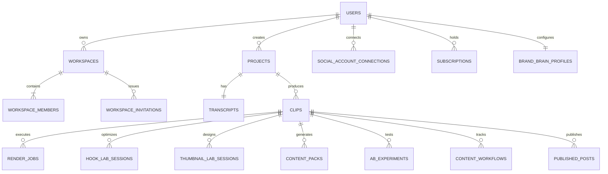

# Vireo — Data Model & Database Architecture

**Document Version**: 1.0.0  
**Last Updated**: October 10, 2026  
**Audited Commit**: `9d8fce3f01df41925c8679685215c59d5e5d2d4a`  
**Primary Persistence**: MongoDB Atlas (Application Database)  
**Authentication Authority**: Supabase Auth (PostgreSQL `auth.users`)  
**Object Storage**: Cloudflare R2 (Private S3-Compatible Buckets)  

---

## 1. Architectural Tenant Isolation & Scoping Model

Vireo enforces multi-tenancy at two complementary layers:

1. **User Scoped (`ownerContext`)**:
   - High-throughput creative workflows (Clips, Content Packs, Hook Lab, Thumbnail Lab, Autopilot, A/B Experiments, Brand Brain, Workflows) are isolated by `user_id`.
   - Node `AsyncLocalStorage` populates `ownerContext` upon token verification in `server/src/middleware/authMiddleware.ts`.
   - All repository queries and mutations in `dataRepository.ts` automatically inject `{ user_id: currentUserId }`.
2. **Workspace Scoped (RBAC Collaboration)**:
   - Team entities (`workspaces`, `workspace_members`, `workspace_invitations`) are scoped by `workspace_id`.
   - Express middleware `requireWorkspaceRole` (`server/src/middleware/workspaceMiddleware.ts`) verifies membership and enforces role authority:
     - `OWNER` (Weight 4): Workspace creator, full billing control, can transfer ownership and delete workspace.
     - `ADMIN` (Weight 3): Can manage invitations and assign `EDITOR` / `VIEWER` roles.
     - `EDITOR` (Weight 2): Can edit, create, and modify projects within workspace context.
     - `VIEWER` (Weight 1): Read-only access to workspace assets and reports.
   - Database uniqueness: Each user has exactly one personal workspace guaranteed by a partial unique index: `{ owner_id: 1, is_personal: 1 }` with `{ partialFilterExpression: { is_personal: true } }`.

---

## 2. Master Entity Catalog (MongoDB Collections)

All application entities use UUIDv4 strings for primary identifiers (`id`).

### 2.1 Identity & User Profiles
1. **`profiles`**:
   - `id`: UUID (Primary Key)
   - `user_id`: UUID (Foreign Key -> Supabase `auth.users.id`, Unique Index)
   - `email`: String (Index)
   - `display_name`: String
   - `avatar_url`: String (optional)
   - `created_at`: Date
   - `updated_at`: Date
2. **`creator_profiles`**:
   - `id`: UUID
   - `user_id`: UUID (Unique Index)
   - `primary_niche`: String (e.g. "Technology", "Finance", "Fitness")
   - `brand_tone`: String ("Authoritative", "Energetic", "Conversational", etc.)
   - `hook_style`: String ("Contrarian", "Curiosity", "Data-Driven")
   - `target_platforms`: Array of Strings (`['youtube_shorts', 'tiktok', 'instagram_reels']`)
   - `call_to_action`: String
   - `forbidden_words`: Array of Strings
   - `created_at`: Date, `updated_at`: Date

### 2.2 Team Workspaces & Memberships
3. **`workspaces`**:
   - `id`: UUID (Unique Index)
   - `owner_id`: UUID (Index)
   - `name`: String
   - `is_personal`: Boolean (Partial Unique Index on `{ owner_id: 1, is_personal: true }`)
   - `created_at`: Date, `updated_at`: Date
4. **`workspace_members`**:
   - `id`: UUID
   - `workspace_id`: UUID (Compound Unique Index with `user_id`)
   - `user_id`: UUID
   - `role`: Enum (`'OWNER'`, `'ADMIN'`, `'EDITOR'`, `'VIEWER'`)
   - `joined_at`: Date, `created_at`: Date, `updated_at`: Date
5. **`workspace_invitations`**:
   - `id`: UUID
   - `workspace_id`: UUID (Index)
   - `invited_email`: String (lowercase)
   - `role`: Enum (`'ADMIN'`, `'EDITOR'`, `'VIEWER'`)
   - `token_hash`: String (SHA-256 hash of 256-bit entropy token; Unique Index)
   - `invited_by`: UUID
   - `status`: Enum (`'PENDING'`, `'ACCEPTED'`, `'DECLINED'`, `'REVOKED'`)
   - `expires_at`: Date (7-day TTL Index)
   - `created_at`: Date, `updated_at`: Date

### 2.3 Projects, Transcripts & Clips
6. **`projects`**:
   - `id`: UUID (Unique Index)
   - `user_id`: UUID (Index)
   - `title`: String
   - `status`: Enum (`'CREATED'`, `'UPLOADING'`, `'UPLOADED'`, `'PROCESSING'`, `'COMPLETED'`, `'FAILED'`)
   - `source_video_r2_key`: String (Path in `vireo-source-videos`)
   - `duration_seconds`: Number
   - `width`: Number, `height`: Number, `fps`: Number
   - `created_at`: Date (Compound Index `{ user_id: 1, created_at: -1 }`), `updated_at`: Date
7. **`transcripts`**:
   - `id`: UUID
   - `project_id`: UUID (Unique Index)
   - `user_id`: UUID (Compound Index `{ user_id: 1, project_id: 1 }`)
   - `provider`: Enum (`'groq'`, `'openrouter'`)
   - `model`: String (e.g. `'whisper-large-v3'`)
   - `language`: String
   - `full_text`: String
   - `segments`: Array of Objects (`{ id, start_ms, end_ms, text, words: [{ word, start_ms, end_ms }] }`)
   - `created_at`: Date
8. **`clip_candidates`**:
   - `id`: UUID
   - `project_id`: UUID (Compound Index `{ project_id: 1, engagement_score: -1 }`)
   - `start_time_seconds`: Number, `end_time_seconds`: Number
   - `start_segment_index`: Number, `end_segment_index`: Number (Unique Index with `project_id`)
   - `title`: String, `hook_text`: String
   - `engagement_score`: Number (0–100)
   - `reasoning`: String
   - `status`: Enum (`'SUGGESTED'`, `'ACCEPTED'`, `'REJECTED'`)
9. **`clips`**:
   - `id`: UUID (Unique Index)
   - `project_id`: UUID (Compound Index `{ project_id: 1, user_id: 1, render_status: 1 }`)
   - `user_id`: UUID
   - `title`: String
   - `start_time_seconds`: Number, `end_time_seconds`: Number
   - `render_status`: Enum (`'DRAFT'`, `'QUEUED'`, `'RENDERING'`, `'COMPLETED'`, `'FAILED'`)
   - `rendered_video_r2_key`: String (Path in `vireo-rendered-clips`)
   - `aspect_ratio`: Enum (`'9:16'`, `'1:1'`, `'16:9'`)
   - `caption_style`: Object (font, color, highlight, position)
   - `created_at`: Date, `updated_at`: Date
10. **`render_jobs`**:
    - `id`: UUID
    - `clip_id`: UUID (Compound Index `{ clip_id: 1, user_id: 1, status: 1 }`)
    - `user_id`: UUID
    - `status`: Enum (`'QUEUED'`, `'PROCESSING'`, `'COMPLETED'`, `'FAILED'`)
    - `worker_id`: String (Distributed lease fencing token)
    - `locked_at`: Date (Lease recovery index `{ status: 1, locked_at: 1 }`)
    - `attempt_count`: Number
    - `next_retry_at`: Date (Index)
    - `error_message`: String (Sanitized of all secrets)
    - `created_at`: Date, `completed_at`: Date

### 2.4 Creative Studios (Hook Lab, Thumbnail Lab, Content Pack)
11. **`hook_lab_sessions`**:
    - `id`: UUID, `user_id`: UUID, `clip_id`: UUID, `project_id`: UUID
    - `status`: Enum (`'READY'`, `'GENERATING'`, `'COMPLETED'`)
12. **`hook_candidates`**:
    - `id`: UUID, `hook_lab_session_id`: UUID, `user_id`: UUID
    - `hook_type`: Enum (`'CURIOSITY'`, `'CONTRARIAN'`, `'QUESTION'`, `'STORY'`, `'STATISTIC'`)
    - `text`: String, `ctr_score`: Number, `locked`: Boolean, `status`: Enum
13. **`thumbnail_lab_sessions`**:
    - `id`: UUID, `user_id`: UUID, `clip_id`: UUID, `project_id`: UUID
    - `aspect_ratio`: Enum (`'16:9'`, `'9:16'`, `'1:1'`)
    - `status`: Enum (`'READY'`, `'GENERATING'`, `'APPROVED'`, `'EXPORTED'`)
14. **`thumbnail_concepts`**:
    - `id`: UUID, `thumbnail_session_id`: UUID, `user_id`: UUID, `variant_index`: Number
    - `style_direction`: Enum (8 style directions)
    - `headline`: String, `text_layer`: Object, `composition`: Object
    - `diagnostics`: Object (6-factor score breakdown: Readability, Contrast, Safe Area, etc.)
    - `locked`: Boolean, `approved`: Boolean, `status`: Enum
15. **`thumbnail_versions`**:
    - `id`: UUID, `thumbnail_session_id`: UUID, `concept_id`: UUID, `version`: Number, `snapshot`: Object
16. **`content_packs`**:
    - `id`: UUID, `user_id`: UUID, `project_id`: UUID, `clip_id`: UUID, `status`: Enum
17. **`content_pack_items`**:
    - `id`: UUID, `content_pack_id`: UUID, `user_id`: UUID
    - `platform`: Enum (`'linkedin'`, `'x'`, `'instagram'`, `'youtube_community'`, `'newsletter'`)
    - `content`: String, `hashtags`: Array of Strings
18. **`content_pack_versions`**:
    - Snapshot versions for content packs.

### 2.5 Experimentation & Workflows
19. **`ab_experiments`**:
    - `id`: UUID, `user_id`: UUID, `clip_id`: UUID, `project_id`: UUID
    - `dimension`: Enum (`'THUMBNAIL_ONLY'`, `'TITLE_ONLY'`, `'HOOK_LINE'`)
    - `status`: Enum (`'DRAFT'`, `'RUNNING'`, `'PAUSED'`, `'CONCLUDED'`)
    - `variants`: Array of Objects (`{ variant_id, label, payload, sample_size, conversions }`)
    - `winner_variant_id`: UUID (optional)
    - `statistical_report`: Object (Z-score, p-value, Wilson score intervals, confidence level)
20. **`ab_observation_logs`**:
    - `id`: UUID, `experiment_id`: UUID, `variant_id`: UUID, `user_id`: UUID
    - `idempotency_key`: String (Unique Index preventing duplicate ingestion)
    - `impressions`: Number, `clicks`: Number, `conversions`: Number, `source`: String
21. **`content_workflows`**:
    - `id`: UUID, `user_id`: UUID, `clip_id`: UUID, `project_id`: UUID
    - `current_state`: Enum (`'PLANNED'`, `'IN_PREPARATION'`, `'READY_FOR_REVIEW'`, `'AWAITING_APPROVAL'`, `'APPROVED'`, `'PUBLISHED'`)
    - `readiness_score`: Number (0–100)
    - `audit_trail`: Array of Objects (`{ from_state, to_state, transitioned_by, timestamp, notes }`)
22. **`autopilot_runs`**:
    - `id`: UUID, `user_id`: UUID, `clip_id`: UUID, `status`: Enum
    - `stages`: Array of Objects (progress, execution logs, failure backoff)
    - `execution_lock`: String (fencing lease)

### 2.6 Social Connections & Publishing
23. **`social_account_connections`**:
    - `id`: UUID, `user_id`: UUID
    - `provider`: Enum (`'youtube'`, `'instagram'`, `'tiktok'`, `'linkedin'`, `'x'`)
    - `provider_account_id`: String (Unique Index per provider)
    - `encrypted_access_token`: String (AES-256-GCM ciphertext)
    - `encrypted_refresh_token`: String (AES-256-GCM ciphertext)
    - `iv`: String (Hexadecimal 12-byte initialization vector)
    - `auth_tag`: String (Hexadecimal 16-byte authentication tag)
    - `expires_at`: Date, `status`: Enum (`'ACTIVE'`, `'EXPIRED'`, `'REVOKED'`)
24. **`oauth_states`**:
    - `id`: UUID, `user_id`: UUID, `state_hash`: String (Unique Index)
    - `expires_at`: Date (TTL Index: 15 minutes)
25. **`published_posts`**:
    - `id`: UUID, `user_id`: UUID, `clip_id`: UUID
    - `status`: Enum (`'SCHEDULED'`, `'PUBLISHING'`, `'PUBLISHED'`, `'FAILED'`, `'CANCELLED'`)
    - `request_fingerprint`: String (Unique Index preventing duplicate posting)
    - `scheduled_for`: Date (Index)
26. **`publish_jobs`**:
    - Distributed queue tracking post dispatch, worker leases, and retries.

### 2.7 Billing & Usage
27. **`billing_customers`**:
    - `id`: UUID, `user_id`: UUID (Unique per provider), `provider`: Enum, `provider_customer_id`: String
28. **`subscriptions`**:
    - `id`: UUID, `user_id`: UUID, `provider`: Enum
    - `provider_subscription_id`: String (Unique Index)
    - `plan_id`: Enum (`'free'`, `'creator'`, `'pro'`, `'studio'`)
    - `status`: Enum (`'active'`, `'trialing'`, `'past_due'`, `'paused'`, `'canceled'`)
    - `current_period_end`: Date
29. **`billing_events`**:
    - `id`: UUID, `provider`: Enum, `provider_event_id`: String (Unique Index; idempotent webhooks)
    - `processed_at`: Date
30. **`usage_events`**:
    - `id`: UUID, `user_id`: UUID, `billing_period`: String (`'YYYY-MM'`)
    - `processing_attempt_id`: UUID (Unique Index; double-charge prevention)
    - `minutes_deducted`: Number, `status`: Enum (`'RESERVED'`, `'SETTLED'`, `'RELEASED'`)

---

## 3. Object Storage Hierarchy (Cloudflare R2)

Private S3-compatible buckets with presigned URL access controls:

1. **`vireo-source-videos`**:
   - `projects/{projectId}/source/{filename}`: Raw imported video files (MP4/MOV/WebM).
   - Lifecycle rule: Preserved for duration of project; purged upon project deletion.
2. **`vireo-rendered-clips`**:
   - `clips/{clipId}/rendered.mp4`: Final vertical 9:16 rendered video with burned-in subtitles.
   - `clips/{clipId}/thumbnails/{thumbnailId}.png`: Generated or exported high-res thumbnail.
   - `clips/{clipId}/subtitles/{lang}.srt`: Subtitle tracks.
   - Lifecycle rule: Accessible via signed download/streaming URLs (expires in 3600s).

---

*End of Data Model Reference. See [MASTER_PRD.md](file:///d:/Vertex%20Digital/final/ai-video-content-generator-main%20%281%29/ai-video-content-generator-main/docs/MASTER_PRD.md) for master architecture and workflow requirements.*
