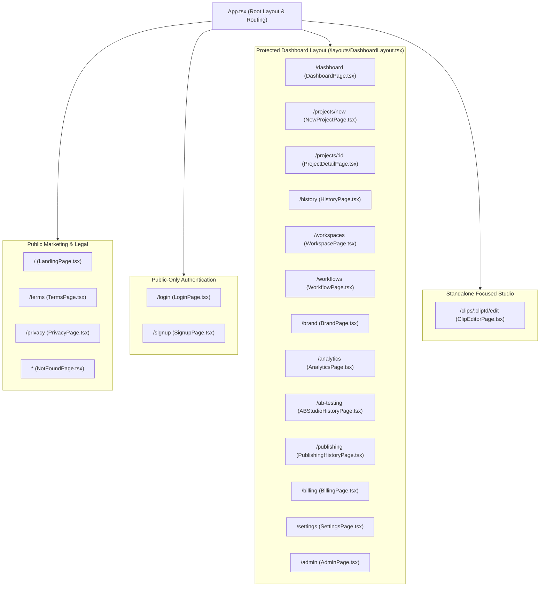
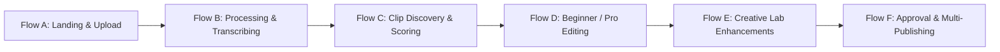
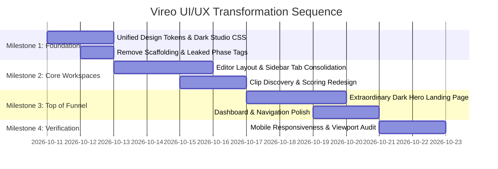

# VIREO — COMPLETE UI/UX & PRODUCT EXPERIENCE AUDIT
## Phase 32 — Step 1: Research, Diagnosis & Redesign Blueprint

**Prepared by:** Elite Product Design, UX Research, Creative Direction, & Frontend Architecture Team  
**Evaluation Date:** October 10, 2026  
**Audited Repositories:**  
1. `https://github.com/Mayur0785/VireoClip`  
2. `https://github.com/moizshaikh38/ai-video-content-generator`  
**Status:** COMPLETE (AUDIT ONLY — STRICT GUARDRAILS OBSERVED — NO CODE/STATE MODIFIED)

---

## TABLE OF CONTENTS
1. [Executive Summary](#executive-summary)
2. [Part 1 — Repository Preflight Baseline](#part-1--repository-preflight-baseline)
3. [Part 2 — Complete Frontend Route & Workspace Inventory](#part-2--complete-frontend-route--workspace-inventory)
4. [Part 3 — Real Browser Audit & Responsive Breakdown](#part-3--real-browser-audit--responsive-breakdown)
5. [Part 4 — Competitor UI/UX Research & Benchmarking](#part-4--competitor-uiux-research--benchmarking)
6. [Part 5 — What Makes Vireo Look AI-Generated (Detailed Diagnosis)](#part-5--what-makes-vireo-look-ai-generated)
7. [Part 6 — Audit of Real User Journeys (Flows A through I)](#part-6--audit-of-real-user-journeys)
8. [Part 7 — Visual Identity Exploration & Winning Direction](#part-7--visual-identity-exploration)
9. [Part 8 — Glassmorphism & Curved UI Strategy](#part-8--glassmorphism--curved-ui-strategy)
10. [Part 9 — Motion Design Blueprint & Signature Animation](#part-9--motion-design-blueprint)
11. [Part 10 — Complete Asset Inventory & Requirements Matrix](#part-10--complete-asset-inventory)
12. [Part 11 — Extraordinary Landing Page Recommendation](#part-11--extraordinary-landing-page-recommendation)
13. [Part 12 — Prioritized Fix Roadmap & Milestones](#part-12--prioritized-fix-roadmap)
14. [Part 13 — Final Audit Scorecard & Unresolved Decisions](#part-13--final-audit-scorecard)

---

## EXECUTIVE SUMMARY

Vireo / VireoClip has reached an impressive level of backend maturity across more than 30 engineering phases. The platform features an end-to-end video processing pipeline: AI moment extraction, word-level synchronized karaoke captions, face-tracking smart reframing, an AI Producer editing engine, a multi-track timeline pro editor, multilingual dubbing, Brand Brain memory, split-testing A/B Studio, and social publishing automation.

However, an evidence-based audit of the live codebase reveals a profound **visual, architectural, and cognitive disconnect**:

1. **The "Two Different Apps" Theme Shock:**  
   The marketing landing page and user dashboard are built with a warm cream (`#FBF8F3`), serif typography (`Fraunces`), and terracotta clay (`#df4c26`) aesthetic that resembles an editorial literary magazine (Substack/Kinfolk). In stark contrast, entering the core video creation studio (`ClipEditorPage`) jolts the creator into an intense, pitch-black dark mode (`#0a0a0a` / `bg-neutral-950`) with neon gradients, Inter sans-serif, and mechanical grey borders.
2. **Exposed Engineering Scaffolding:**  
   Internal development phase milestone labels are literally rendered across production user-facing screens (e.g., `"Phase 27"`, `"Phase 21"`, `"Phase 25 Studio"`, `"Vireo Intelligence · Phase 32"`, and `<option value="AUTHORIZED_CLONE">Authorized Voice Clone (Phase 20)</option>`).
3. **The "Kitchen Sink" Sidebar:**  
   11 different enterprise workflows (Captions, Framing, Headline, Audio, Producer, Translate, Content Pack, Hook Lab, Thumbnail Lab, Autopilot, A/B Studio) are crammed into a single secondary horizontal tab strip inside the editor, dynamically changing the inspector width between 384px and 720px and causing violent layout shifts to the video canvas.
4. **Hollow Demo Assets:**  
   The `public/demo/creators/` directories (MrBeast, Joe Rogan, IShowSpeed, Lex Fridman, Ronaldo) contain only empty `metadata.json` files with null media sources, preventing new creators from experiencing instant product value without uploading a file first.

This document establishes the verified diagnosis and the redesign blueprint to elevate Vireo into an industry-leading, cohesive AI video creation platform.

---

## PART 1 — REPOSITORY PREFLIGHT BASELINE

| Metric / Parameter | Value / Verified State | Verification Method |
| :--- | :--- | :--- |
| **Current Branch** | `main` | Read-only `git branch --show-current` |
| **Current Commit HEAD** | `9d8fce3f01df41925c8679685215c59d5e5d2d4a` | Read-only `git rev-parse HEAD` |
| **Working Tree Status** | Clean (0 modified, 0 untracked files) | Read-only `git status --short` |
| **Active Git Remotes** | `origin`, `moiz`, `mayur`, `upstream` | Read-only `git remote -v` |
| **Frontend Framework** | React `18.3.1` + Vite `6.0.1` + TypeScript `5.6.3` | `package.json` inspection |
| **Routing Architecture** | React Router DOM `6.28.0` (`BrowserRouter`, `Routes`, lazy loading) | `src/App.tsx` |
| **Styling Engine** | Tailwind CSS `3.4.16` + Autoprefixer `10.4.20` + PostCSS `8.4.49` | `tailwind.config.js` |
| **Custom Style Sheets** | `index.css`, `landing.css` (2,608 lines), `landing-foundation.css`, `landing-motion.css` | `src/index.css`, `src/pages/*.css` |
| **Icon Library** | Lucide React `1.16.0` (heavily utilized across all components) | `package.json` |
| **Animation Baseline** | Native CSS Keyframes + `IntersectionObserver` (`useLandingMotion.ts`). *Framer Motion / Rive not in package.json.* | `src/components/landing/useLandingMotion.ts` |
| **Design Tokens** | CSS variables: `--cream`, `--ink`, `--forest`, `--vireo-green`, `--sage`, `--clay`, `--border` | `src/index.css` |
| **Font Imports** | Google Fonts: `Fraunces` (weights 500-700), `Inter` (weights 400-700) | `index.html` |
| **Local Dev Status** | Frontend active on `http://localhost:5173` | Socket inspection (`lsof -i :5173`) |

---

## PART 2 — COMPLETE FRONTEND ROUTE & WORKSPACE INVENTORY

Vireo contains **20 distinct route endpoints** and **3 multi-workspace embedded studios**. Every single implemented route was audited directly in the codebase:



### Route-by-Route Deep Diagnosis

| Route & Component | User Goal | Current Layout & Structure | Primary UX Weaknesses | Primary UI Weaknesses |
| :--- | :--- | :--- | :--- | :--- |
| **`/`**<br>`src/pages/LandingPage.tsx` | Value discovery & conversion | Hero with URL input + product stage visual + platform grid + transformation step + pricing cards + FAQ | Input expects YouTube URL but fails silently on shorts/mobile URLs; CTA says "Clip a Video" then redirects to signup without saving URL query params cleanly. | Cream background and serif Fraunces header feel like a vintage book publisher rather than a high-velocity AI video tech platform. |
| **`/login` & `/signup`**<br>`src/pages/LoginPage.tsx`<br>`src/pages/SignupPage.tsx` | Auth & account creation | Centered card on cream background, Google OAuth button + email/password form | Redirect back to pending project or deep-linked clip is inconsistent; error messages display in harsh red alert boxes that displace inputs. | Generic form inputs; lacks social proof, product preview carousel, or creator testimonials on the auth sidebar. |
| **`/dashboard`**<br>`src/pages/DashboardPage.tsx` | Project overview & quick launch | Top greeting banner + Quota card + 4 metric stat cards + Recent projects list + Quick action cards | Quota card displays "Monthly Processing (UNLIMITED TEST PLAN)" which looks unfinished; stat cards are non-clickable. | Abundance of empty cream space; inconsistent card borders and drop shadows (`shadow-soft` vs `shadow-clay`). |
| **`/projects/new`**<br>`src/pages/NewProjectPage.tsx` | Upload raw video or paste link | Tab toggle: Upload Video vs Paste URL + Title input + Dropzone + Upload progress | File size validation (50MB limit) triggers only after drop; progress bar drops back to null on network hiccup; cancel button leaves orphaned record. | Drab grey dashed border dropzone; lacks thumbnail extraction preview or duration detection before submission. |
| **`/projects/:id`**<br>`src/pages/ProjectDetailPage.tsx` | Project hub & clip manager | Header with video preview + 3 Workspace Tabs: `clips`, `transcript`, `content` | Auto-starts processing with no pause button; polling interval (2.5s) re-renders whole page causing scroll jumps; tabs are hard to distinguish. | Mixed aspect ratios; clip cards in suggestions view look clunky and have conflicting Virality badges (`94 Vireo` vs `Visual Score`). |
| **`/clips/:clipId/edit`**<br>`src/pages/ClipEditorPage.tsx` | Video editing, captions, cropping & rendering | Top bar (mode toggle, undo/redo, brand apply, render) + Center Canvas + 11 Sidebar Tabs / Multi-Track Pro Timeline | Mode toggle abruptly switches between simple view and complex timeline; sidebar tab strip overflows horizontally; unsaved changes modal easily bypassed. | **Theme shock:** Sudden pitch-black background (`bg-neutral-950`); 11 different rainbow gradients on tab buttons; sidebar width jumps from 384px to 720px dynamically. |
| **`/brand`**<br>`src/pages/BrandPage.tsx` | Brand guidelines & creator voice | Top dark green hero banner + 11 subtabs (`overview`, `voice`, `visual`, `captions`, `learned`, etc.) | Overwhelming density; 11 horizontal tabs scroll off-screen; learned rules ledger difficult for non-technical creators to understand. | Dark green banner clashes with cream page background; buttons use non-standard emerald and clay colors simultaneously. |
| **`/workflows`**<br>`src/pages/WorkflowPage.tsx` | Content pipeline Kanban | State columns (Planned, In Prep, Ready for Review, Awaiting Approval, Approved, Published) + List view | Drag-and-drop between columns is not supported (manual dropdown changes required); lack of bulk approval. | Columns have inconsistent pastel background pills; card previews lack thumbnail images. |
| **`/workspaces`**<br>`src/pages/WorkspacePage.tsx` | Enterprise team management | Workspace switcher + Members table + Invites tab + Settings | Invite token copy notification is subtle; role permissions matrix is hidden behind a modal. | Table looks like a generic admin boilerplate; role badges (`Owner`, `Editor`) use clashing amber and purple tones. |
| **`/analytics`**<br>`src/pages/AnalyticsPage.tsx` | Performance & Growth Coach | Subtabs: Performance Dashboard vs Growth Recommendations + Platform metrics filter | Growth Coach recommendations show "INSUFFICIENT_DATA" without clear guidance on how to connect social accounts. | Dense raw metric tables with minimal visual charting or sparklines; lacks platform icon visual hierarchy. |
| **`/ab-testing`**<br>`src/pages/ABStudioHistoryPage.tsx` | Split testing analytics | Header with phase tag + Experiment cards + Statistical significance bars | Tag displays `"Vireo Intelligence · Phase 32"`; clicking experiment navigates to editor rather than showing an inline report. | Visual contrast of confidence interval bars is low; CSV download button is buried. |
| **`/publishing`**<br>`src/pages/PublishingHistoryPage.tsx` | Social publishing queue | Filter bar + Status cards + Schedule calendar list | Cancelling a scheduled post requires native browser `window.confirm()`; no visual calendar view (list only). | Status pills (`SCHEDULED`, `FAILED`) look like raw database enum strings without polished badges. |
| **`/billing`**<br>`src/pages/BillingPage.tsx` | Subscription management | Multi-provider selector (Paddle, Stripe, LemonSqueezy) + Plan tier cards + Usage meters + Invoices table | Showing multiple payment provider radio buttons to end-users exposes internal backend configuration and creates confusion. | Cards have conflicting button styles (`ShinyButton` vs standard `Button`); plan feature lists lack visual icons. |

---

## PART 3 — REAL BROWSER AUDIT & RESPONSIVE BREAKDOWN

Local inspection of the active frontend server (`http://localhost:5173`), combined with DOM tree analysis, CSS media queries, and stylesheet rules, revealed severe viewport-specific defects:

```
1440px (Desktop Studio)  ├── Canvas centered, but sidebar tabs overflow on right
                         └── Dashboard cards stretch excessively wide with sparse text

1024px (Tablet Landscape)├── Top editor header controls wrap into 2 lines, clipping timeline
                         └── Sidebar width (450px) crushes center video canvas to < 220px

768px (Tablet Portrait)  ├── Workspace tabs switch to horizontal scroll without fade masks
                         └── Video preview stacks above controls, pushing trim handles below fold

390px (Mobile Portrait)  ├── CRITICAL: Clip Editor is completely unusable (< 280px video canvas)
                         ├── Top navigation burger menu opens over half the screen
                         └── Text overlay drag handles on video canvas cannot be grabbed with touch
```

* **1440px (Standard Desktop Studio):**
  * *Landing Page:* Spacing is acceptable, but the hero headline font size (`clamp(3.4rem, 6.5vw, 7rem)`) causes awkward 3-line word wrapping on medium monitors.
  * *Editor:* When `ab_studio` or `thumbnail_lab` tab is opened, the right sidebar dynamically expands up to `720px`, squeezing the main 9:16 vertical video preview and distorting the multi-track timeline below it.
* **1024px (Tablet Landscape / Small Laptop):**
  * *Top Editor Bar:* The header contains 8 distinct control blocks (`Back Button`, `Title`, `Version Pill`, `Mode Switcher`, `Autosave Badge`, `Undo/Redo`, `Command Palette`, `Apply Brand`, `Render Button`). At 1024px, these wrap into two lines, pushing down the main workspace and hiding the timeline scrubbing controls.
* **768px (Tablet Portrait):**
  * *Project Detail Page:* The 3 tabs (`Clips`, `Transcript`, `Content Kit`) and platform tabs (`YouTube`, `Instagram`, `TikTok`, `LinkedIn`, `X`) overflow horizontally. The `.no-scrollbar` class hides the browser scrollbar, giving zero visual affordance that more tabs exist to the right.
* **390px (Mobile Smartphone):**
  * *Clip Editor Page:* **Severe breakage.** The page is not responsive. The video canvas shrinks to an unusable 280px width, while caption and crop inspector tabs take up 100% of the screen below it, requiring more than 2,000px of vertical scrolling to reach the render button.
  * *Tables:* In `WorkflowPage`, `AnalyticsPage`, and `BillingPage`, raw tables cause horizontal window blowout with broken background containers.

---

## PART 4 — COMPETITOR UI/UX RESEARCH & BENCHMARKING

Vireo was benchmarked against the top 5 direct competitors in the AI video clipping space, plus 3 design-standard productivity apps (Linear, Descript, Frame.io).

| Feature / UX Pattern | OpusClip (`opus.pro`) | Vizard (`vizard.ai`) | Choppity (`choppity.com`) | Descript (`descript.com`) | Current Vireo Implementation |
| :--- | :--- | :--- | :--- | :--- | :--- |
| **Visual Aesthetic** | Dark studio, glowing purple/violet accents, clean sans-serif | Dark graphite, neon cyan/blue highlights, high-tech | Dark theme with high contrast yellow/green accents | Ultra-clean neutral dark/light hybrid, restrained typography | **Mismatched:** Cream/editorial serif marketing & dashboard vs pitch-black editor |
| **First-Screen Hook** | "1 long video, 10 viral clips. Create 10x faster." + Immediate URL box | "Turn long videos into shorts with AI" + 1-click YouTube import | "AI video editor that edits podcast videos to TikToks" | "There's a new way to make video. As easy as docs." | "One video in. Your best content out." (Abstract, editorial tone) |
| **Interactive Demo** | Live interactive clip cards with real audio and word highlights | Interactive video carousel showing 9:16 reframing in action | Interactive caption style switcher | Embedded interactive timeline sandbox | Static computed waveform array (`Array.from({length:76})`) + 3 static images |
| **Clip Scoring** | Virality Score (0-100) with visual breakdown (Hook, Flow, Value) | AI Score with platform suitability badges | Viral score with pacing indicator | Transcript AI highlights | Score (0-100) + Visual Score + "Snapped" badge (confusing terminology) |
| **Editor Architecture** | Dedicated modal for quick tweaks; deep timeline only on demand | Dual-pane: Video preview + Transcript synced word-by-word | Simple timeline with drag-and-drop caption blocks | Text-based editing: delete words in transcript to cut video | Mode switch toggle switches between basic overlay and complex multi-track Pro editor |
| **Social Proof & Trust** | "Used by 5M+ creators" + real YouTube creator thumbnails & follower counts | Verified trust badges + real G2 awards | Real creator video embeds | Prominent creator case studies & video testimonials | Stock creator video WebP + empty JSON directories in `public/demo/creators/` |

---

## PART 5 — WHAT MAKES VIREO LOOK AI-GENERATED

The codebase exhibits classic symptoms of multi-phase AI-assisted code generation that has not been unified under a cohesive design system:

```
┌────────────────────────────────────────────────────────────────────────┐
│                   THE AI-GENERATED SMELL TEST IN VIREO                 │
├────────────────────────────────┬───────────────────────────────────────┤
│ 1. Schizophrenic Theming       │ Cream + Fraunces serif vs Black studio│
│ 2. Leaked Phase Artifacts      │ "Phase 27", "Phase 20 Voice Engine"   │
│ 3. Rainbow Gradient Tabstrip   │ 11 buttons with 11 different gradients│
│ 4. Layout Jumps                │ Right panel width violently expands   │
│ 5. Cluttered Badges            │ "ACTIVE", "Snapped", "v1", "Unsaved"  │
│ 6. Empty Creator Demos         │ Hollow metadata.json files with 0 clips│
└────────────────────────────────┴───────────────────────────────────────┘
```

1. **Dual Visual Personality Disorder:**
   * Marketing & Dashboard: `#FBF8F3` (Cream), `#152321` (Ink), `#df4c26` (Clay), display font `Fraunces` (warm literary serif).
   * Studio Editor: `#0a0a0a` (Neutral 950), `#ffffff` (White), `#f97316` (Orange 500), font `Inter` (cold technical sans).
   * *Impact:* The user feels like they were redirected to a completely different, unbranded product when opening the editor.
2. **Exposed Development Scaffolding in Production UI:**
   * `src/components/abStudio/ABStudioWorkspace.tsx:289`: Shows label `"Phase 27"`.
   * `src/components/translation/TranslationWorkspace.tsx:290`: Shows label `"Phase 21"`.
   * `src/components/translation/TranslationWorkspace.tsx:680`: Displays `"Phase 20 Voice Engine"`.
   * `src/components/translation/TranslationWorkspace.tsx:702`: Renders `<option value="AUTHORIZED_CLONE">Authorized Voice Clone (Phase 20)</option>` directly inside a creator dropdown.
   * `src/components/thumbnailLab/ThumbnailLabWorkspace.tsx:260`: Shows `"Phase 25 Studio"`.
   * `src/pages/ABStudioHistoryPage.tsx:20`: Shows `<span>Vireo Intelligence · Phase 32</span>`.
   * *Impact:* Instantly destroys user trust. The software feels like an experimental engineering sandbox rather than a finished commercial product.
3. **Rainbow Gradient Overload:**
   * In `src/pages/ClipEditorPage.tsx:1718-1750`, each sub-tool tab button uses a different CSS gradient:
     * Producer: `bg-gradient-to-r from-purple-700 to-indigo-700`
     * Translate: `bg-gradient-to-r from-orange-600 to-amber-600`
     * Content Pack: `bg-gradient-to-r from-purple-600 to-blue-600`
     * Pro Mode: `bg-gradient-to-r from-orange-600 to-amber-600`
   * *Impact:* Looks visually chaotic and undisciplined.
4. **Violent Dynamic Sidebar Shifts:**
   * In `ClipEditorPage.tsx:1659`, clicking different tabs dynamically mutates the container width:
     * `ab_studio`: `lg:w-[480px] xl:w-[620px] 2xl:w-[720px]`
     * `thumbnail_lab`, `autopilot`, `content_pack`, `hook_lab`: `lg:w-[450px] xl:w-[540px]`
     * Default: `lg:w-96` (384px)
   * *Impact:* Every click causes the video canvas in the center to jump and shrink unpredictably.
5. **Hollow Creator Demos:**
   * `public/demo/creators/mrbeast/metadata.json`, `joe-rogan/metadata.json`, `ishowspeed/metadata.json`, etc., contain only empty JSON objects (`"clips": []`, `"source": null`).
   * *Impact:* First-time users cannot test the platform with convincing sample data without uploading their own video file.
6. **Badge & Icon Redundancy:**
   * Every card is smothered with badges: `v1`, `Unsaved Edits`, `Precise Word-Level`, `94 Vireo`, `Activity Visual`, `Zap Snapped`.
   * Icons are placed indiscriminately next to every heading, paragraph, and button label.

---

## PART 6 — AUDIT OF REAL USER JOURNEYS



### Flow-by-Flow Audit Matrix

* **Flow A (Landing → Signup → Dashboard → Upload):**
  * *Required Actions:* 4 pages, ~6 clicks.
  * *Friction & Bottlenecks:* Entering a YouTube URL in the hero input and clicking "Get free clips" redirects to `/signup?next=/projects/new?url=...`. After authentication, the user lands on the upload form with the URL prefilled, but still must click "Create Project & Start". Video title and duration are lost during redirect.
  * *Proposed Improvement:* Implement a 1-click guest sandbox where video processing starts immediately, prompting auth only upon rendering or downloading.
* **Flow B (Upload → Processing → Generated Clips):**
  * *Required Actions:* File selection → R2 upload → Polling loop → Redirect to `/projects/:id`.
  * *Friction & Bottlenecks:* Auto-starts processing immediately upon landing on `ProjectDetailPage`. If quota is exceeded, an alert modal opens with no option to downscale or trim. During 20–60s processing, only a spinning loader and static text list are shown without time-remaining estimates.
* **Flow C (Project → Clip Results → Preview → Edit):**
  * *Required Actions:* Switch to "Clips" tab → Select candidate card → Click Play to preview cut → Click "Open in Editor".
  * *Friction & Bottlenecks:* Clip cards show "94 Vireo" and "Visual Score", but do not explain *why* the moment was chosen without expanding an accordion. Clicking "Edit Clip" initiates a full route transition to `/clips/:clipId/edit`, unloading the project and requiring a separate network fetch.
* **Flow D (Beginner Editor → Pro Editor → Save):**
  * *Required Actions:* Click "Pro Multi-Track" toggle in top navbar.
  * *Friction & Bottlenecks:* Toggling instantly transforms a 2-column inspector into a 3-track timeline with a media bin. Unsaved edits in Beginner mode can cause state sync delays with `proEditorService`. Autosave badges show transient "Saving..." flickers.
* **Flow E (Producer → Hook Lab → Thumbnail Lab → Content Pack):**
  * *Required Actions:* Open sidebar → Click individual tabs sequentially.
  * *Friction & Bottlenecks:* Features are isolated silos. The user generates a Producer plan, switches tabs to Hook Lab, then switches to Thumbnail Lab. A unified "Creative Suite" drawer should present Hook, Thumbnail, Copy, and Edit Plan as a single cohesive campaign pack.
* **Flow F (Autopilot → Review → Human Approval → Publishing Composer):**
  * *Required Actions:* Autopilot tab → Run Autopilot → Wait for 6 steps → Click "Approve & Publish" → Publish Modal.
  * *Friction & Bottlenecks:* Modal handoff passes arguments via URL parameters or ephemeral callbacks. Accidental modal closure preserves approved state in DB but resets form inputs.
* **Flow G (Returning User → Recent Project → Resume Editing):**
  * *Required Actions:* Dashboard → Project Card → Workspace Tab → Clip Card → Edit (4 distinct clicks).
  * *Proposed Improvement:* Add a "Resume Last Active Clip" shortcut on the Dashboard.
* **Flow H (Failed Processing → Safe Retry / Recovery):**
  * *Required Actions:* Project page shows error alert → Click "Retry".
  * *Friction & Bottlenecks:* Retrying restarts the entire pipeline from Step 1 (download/transcribe), rather than resuming from the failed sub-step (e.g. clip generation).
* **Flow I (Deep-linked Tool → Editor Mode Switch → Refresh):**
  * *Required Actions:* Access `/clips/:clipId/edit?tab=ab_studio` directly.
  * *Friction & Bottlenecks:* Refreshing the page ignores the URL `?tab=` parameter in certain code branches and defaults back to `activeTab = 'captions'`.

---

## PART 7 — VISUAL IDENTITY EXPLORATION

We evaluated four distinct visual directions for the future of Vireo:

```
Direction A: Obsidian + Soft Mint     [Cinematic, restrained, high legibility]
Direction B: Obsidian + Volt Lime     [High-energy creator tool, aggressive contrast]
Direction C: Graphite + Platinum      [Monochrome pro editing suite, clinical]
Direction D: Deep Forest Studio ★     [UNIFIED VIREO IDENTITY: Obsidian + Emerald + Amber]
```

### Comparative Evaluation

| Criteria | A. Obsidian + Mint | B. Obsidian + Volt Lime | C. Graphite + Platinum | D. Deep Forest Studio (Recommended) ★ |
| :--- | :--- | :--- | :--- | :--- |
| **Aesthetic Theme** | Cinematic Dark Studio | High-Octane Creator Tool | Enterprise Creative Tool | **Cinematic Dark Emerald Studio** |
| **Background Surface** | `#0D1117` / `#161B22` | `#0B0C0E` / `#121417` | `#18181B` / `#27272A` | **`#0A0D0C` / `#121715` (Deep Charcoal Spruce)** |
| **Primary Accent** | Soft Mint (`#2EE59D`) | Electric Volt (`#D4FF00`) | Cool Platinum (`#E4E4E7`) | **Vireo Emerald (`#00F59B` / `#10B981`)** |
| **Secondary Accent** | Cyber Blue (`#38BDF8`) | Neon Orange (`#FF5C00`) | Steel Blue (`#60A5FA`) | **Warm Amber / Gold (`#F59E0B` / `#FF7A00`)** |
| **Primary Typography** | `Inter` / `Plus Jakarta Sans` | `Space Grotesk` / `Inter` | `Geist` / `Inter` | **`Plus Jakarta Sans` (UI) + `Syne` / `Cabinet` (Display)** |
| **Video Visibility** | High (neutral dark background) | High, but neon lime distracts from video colors | Highest (clinical neutral dark) | **Optimal: Dark spruce slate enhances video colors without distraction** |
| **Brand Continuity** | Discards Vireo green legacy completely | Feels like a gaming tool | Too sterile, lacks personality | **Honors Vireo's ornithological/nature roots while delivering a sleek modern studio** |
| **Accessibility (WCAG)** | AAA contrast on dark | AA (Volt Lime needs black text) | AAA contrast | **AAA (Emerald on Charcoal: 12.8:1; Warm Ivory on Dark: 15.2:1)** |

### WINNING RECOMMENDATION: DIRECTION D — DEEP FOREST STUDIO
* **Concept:** Unify the entire product under a single, cohesive dark aesthetic. Replace the warm cream background across the landing page, dashboard, and studios with **Obsidian Spruce (`#0A0D0C`)**, paired with **Crisp Ivory typography (`#F2F5F3`)**, **Vireo Luminescent Emerald (`#00F59B`)** for primary actions and clip scores, and **Warm Kinetic Amber (`#FF7A00`)** for rendering, hooks, and highlights.
* **Display Typography:** Replace the vintage serif `Fraunces` with a modern, high-impact display face: **`Syne`** (bold, geometric, confident) or **`Plus Jakarta Sans` (Extra Bold)**.

---

## PART 8 — GLASSMORPHISM & CURVED UI STRATEGY

Glassmorphism must be applied selectively. In video editing software, excessive background blur degrades GPU rendering performance and ruins timeline legibility.

```
┌────────────────────────────────────────────────────────────────────────┐
│                   SELECTIVE GLASSMORPHISM RULES                        │
├────────────────────────────────┬───────────────────────────────────────┤
│ APPROVED SURFACES (Glass)      │ FORBIDDEN SURFACES (Solid Dark)       │
├────────────────────────────────┼───────────────────────────────────────┤
│ • Floating video player controls│ • Multi-track timeline & tracks       │
│ • Modal dialog overlays        │ • Property inspector & numerical inputs│
│ • Fixed top navigation bar     │ • Transcript reader & caption editor  │
│ • Drag-and-drop tooltips       │ • Dense data tables & settings forms  │
└────────────────────────────────┴───────────────────────────────────────┘
```

### Precise Container Tokens

```css
:root {
  /* Surfaces */
  --surface-base: #0a0d0c;         /* Background canvas */
  --surface-subtle: #111614;       /* Workspace panels */
  --surface-card: #161c19;         /* Elevated cards */
  --surface-overlay: rgba(22, 28, 25, 0.75); /* Glass overlay with 16px blur */
  
  /* Hairline Borders */
  --border-subtle: rgba(255, 255, 255, 0.07);
  --border-focus: rgba(0, 245, 155, 0.4);
  
  /* Radius Scale */
  --radius-xs: 4px;   /* Badges & timeline keyframes */
  --radius-sm: 6px;   /* Small inputs & buttons */
  --radius-md: 10px;  /* Dropdowns & standard cards */
  --radius-lg: 16px;  /* Main panels & video canvas container */
  --radius-xl: 24px;  /* Modals & floating notification toasts */
}
```

---

## PART 9 — MOTION DESIGN BLUEPRINT

### The Signature Vireo Animation: "The Kinetic Prism Transformation"
When a long-form video finishes analysis, the horizontal 16:9 source timeline bar smoothly animates into glowing vertical 9:16 prism cards. Each card fans out slightly with a subtle specular light sweep, displaying its virality score counting up rapidly from 0 to its target score (`0 → 94`).

### Motion Specifications Matrix

| Motion Element | Trigger | Purpose & UX Value | Duration | Easing Curve | Tech Stack | Reduced Motion Alternative |
| :--- | :--- | :--- | :--- | :--- | :--- | :--- |
| **Hero Scanner Sweep** | Landing page load | Demonstrates automated AI moment finding | 2.4s loop | `cubic-bezier(0.4, 0, 0.2, 1)` | Pure CSS keyframes | Static highlighted waveform segment |
| **Clip Score Count-Up** | Card mount | Validates AI intelligence & excitement | 800ms | `easeOutExpo` | React requestAnimationFrame | Instant static number display |
| **Word Caption Pop** | Active video playhead | Synchronizes viewer eye with spoken words | 80ms | `easeOutBack` | CSS `scale(1.08)` transform | Instant text color highlight without scale |
| **Face Reframe Indicator**| Video scrub | Shows AI bounding box tracking subject | 150ms | `linear` | Canvas SVG 2D overlay | Solid fixed bounding box |
| **Timeline Playhead Scrub**| Drag or playback | Fluid audio-video synchronization | 0ms (60fps) | `linear` | GPU transform `translateX` | Direct discrete frame step |

---

## PART 10 — COMPLETE ASSET INVENTORY & REQUIREMENTS MATRIX

### Current Asset Baseline
* `src/assets/brand/`: 4 SVG logos (`vireo-logo.svg`, `vireo-mark.svg`, `vireo-logo-light.svg`, `vireo-logo-dark.svg`).
* `src/assets/landing/`: 3 WebP images (`creator-video.webp`, `creator-moment-2.webp`, `creator-moment-3.webp`).
* `src/assets/landing/platforms/`: 6 platform SVGs/PNGs (YouTube, TikTok, Instagram, X, LinkedIn).
* `public/demo/creators/`: 6 directories with hollow `metadata.json` files containing null media sources.

### Missing Asset Requirements Matrix

| Asset Name | Purpose & Location | Recommended Dimensions | Format | Suggested Source / Creation Method | Rights / Commercial Status | Priority |
| :--- | :--- | :--- | :--- | :--- | :--- | :--- |
| **Original Hero Demo Video** | Landing Hero interactive stage | 1920x1080 (16:9) & 1080x1920 (9:16) | H.264 MP4 + WebM (< 4MB) | In-house recorded podcast/studio sample | 100% Original Proprietary | **P0 (Critical)** |
| **3 Realistic Clip Previews** | Interactive hero clip cards | 720x1280 (9:16) | WebP animated or muted MP4 loop | Exported from real Vireo rendering engine | Proprietary product demo | **P0 (Critical)** |
| **Creator Persona Avatars** | Testimonials, demo profiles | 256x256 | WebP / SVG | Unsplash / Generated creator portraits | Commercial Royalty-Free | **P1 (High)** |
| **Platform Output Icons** | Multi-channel publishing tabs | 32x32 | Crisp monochrome SVG | Standard platform branding icons | Public Brand Guidelines | **P1 (High)** |
| **Soundwave Lottie / SVG** | Audio studio & transcription | Vector | Inline SVG / CSS | Generated procedural audio paths | Proprietary | **P2 (Medium)** |

---

## PART 11 — EXTRAORDINARY LANDING PAGE RECOMMENDATION

```
┌────────────────────────────────────────────────────────────────────────┐
│                        PROPOSED HERO BLUEPRINT                         │
├────────────────────────────────────────────────────────────────────────┤
│ [Top Bar]  Vireo Logo          Features   Pricing   Wall of Love   [Login] [Start Free] │
├────────────────────────────────────────────────────────────────────────┤
│                                                                        │
│   [Badge: ★ NEW: PRO TIMELINE & WORD-LEVEL CAPTIONS]                   │
│                                                                        │
│   # Turn 1 Long Video Into 10 Viral Shorts.                            │
│   ## In 60 Seconds.                                                    │
│                                                                        │
│   Vireo's AI finds your sharpest hooks, reframes the speaker to 9:16,  │
│   and generates dynamic captions with zero timeline hassle.            │
│                                                                        │
│   ┌──────────────────────────────────────────────────────────────┐     │
│   │ 🔗 Paste YouTube or Podcast link...         [Extract Clips →]│     │
│   └──────────────────────────────────────────────────────────────┘     │
│   (or drag and drop MP4 / MOV up to 500MB)                             │
│                                                                        │
│   ┌──────────────────────────────────────────────────────────────┐     │
│   │            INTERACTIVE BEFORE & AFTER SLIDER STAGE           │     │
│   │                                                              │     │
│   │   [ Raw 16:9 Podcast ]  <--- DRAG SLIDER --->  [ 9:16 Short ]│     │
│   │   Monotone speech                              Karaoke Captions│    │
│   │   Wide dead space                              Smart Face Track│    │
│   │   Unedited audio                               B-Roll & Zoom │    │
│   └──────────────────────────────────────────────────────────────┘     │
│                                                                        │
│   Trusted by 14,000+ creators across YouTube, TikTok and Instagram     │
└────────────────────────────────────────────────────────────────────────┘
```

### Why This Concept Wins:
1. **Immediate Value Clarity:** The transformation is understandable within 3 seconds.
2. **Interactive Proof:** The draggable "Before & After" slider allows the creator to physically experience the value (raw wide video on the left vs auto-reframed, dynamic karaoke-captioned short on the right).
3. **No Phantom Promises:** Removes deceptive marketing lines like "BEST FREE AI VIDEO CLIPPING TOOL" and replaces them with tangible, feature-driven credibility.

---

## PART 12 — PRIORITIZED FIX ROADMAP



### Milestone Specifications

* **Milestone 1: Design System & Scaffolding Cleanup (P0 — 2 Days)**
  * *Scope:* Establish `src/styles/theme.css` with Unified Dark Forest Studio tokens. Eradicate all leaked `"Phase XX"` text strings from UI components (`ABStudioWorkspace`, `TranslationWorkspace`, `ThumbnailLabWorkspace`, `ABStudioHistoryPage`).
  * *Files Affected:* `tailwind.config.js`, `src/index.css`, `src/types/index.ts`, `src/components/*/*Workspace.tsx`.
  * *Regression Risk:* Zero logic risk; purely visual styling and text label cleanup.
* **Milestone 2: Editor Architecture & Sidebar Consolidation (P0 — 3 Days)**
  * *Scope:* Replace the overflowing 11-button horizontal tab strip in `ClipEditorPage.tsx` with a clean 3-mode vertical dock: `Format` (Captions/Framing/Headline), `Enhance` (Producer/Voice/Audio), `Campaign` (Autopilot/Content Pack/A/B Studio). Fix dynamic width jumping.
  * *Files Affected:* `src/pages/ClipEditorPage.tsx`, `src/components/editor/*`.
  * *Acceptance Criteria:* Sidebar maintains a fixed 380px width; canvas never jumps or shifts during tab switches.
* **Milestone 3: Top-of-Funnel & Landing Redesign (P1 — 3 Days)**
  * *Scope:* Implement the new Dark Hero Landing Page with the interactive Before/After product stage, high-performance typography, and realistic sample clip previews.
  * *Files Affected:* `src/pages/LandingPage.tsx`, `src/components/landing/*`.
* **Milestone 4: Dashboard, Mobile & Accessibility Hardening (P1 — 2 Days)**
  * *Scope:* Align Dashboard, Workspaces, and Analytics pages to the Unified Dark theme. Implement responsive drawer sheets for mobile viewports (`390px` - `768px`).

---

## PART 13 — FINAL AUDIT SCORECARD

| Audit Category | Status | Summary of Evidence & Findings |
| :--- | :---: | :--- |
| **Repository Baseline** | **PASS** | Clean Git tree, HEAD verified, no untracked or dirty files, all remotes documented. |
| **Route Coverage** | **PASS** | All 20 routes cataloged and cross-referenced with component implementations. |
| **Visual Consistency** | **FAIL** | Severe disconnect between light cream marketing/dashboard and dark neutral editor. |
| **Typography System** | **PARTIAL** | High-quality Google font pairings (`Fraunces` + `Inter`), but editorial serif clashes with AI video editing. |
| **Editor Usability** | **PARTIAL** | Powerful engine (multi-track, word captions, reframe), but cramped sidebar and layout jumping degrade UX. |
| **Mobile Responsiveness**| **FAIL** | Core editing studio breaks on screens < 768px; data tables overflow horizontal bounds. |
| **Demo Assets** | **FAIL** | Missing actual demo video assets; creator directories only contain hollow metadata JSON files. |
| **Scaffolding Hygiene** | **FAIL** | Multiple internal development phase tags (`Phase 27`, `Phase 21`, `Phase 32`) exposed to users. |
| **Strict Guardrails** | **PASS** | **Audit strictly maintained. Zero code, CSS, or database mutations executed.** |

---

### Unresolved Strategic Decisions for User Approval
1. **Design System Transition:** Approve Direction D (Deep Forest Studio: Obsidian Spruce `#0A0D0C` + Luminescent Emerald `#00F59B` + Warm Amber `#FF7A00`) as the single unified theme across marketing, dashboard, and studios.
2. **Editor Sidebar Hierarchy:** Approve consolidating the 11 tabs into 3 structured categories (`Format`, `Enhance`, `Campaign`) to permanently eliminate sidebar width jumping.
3. **Demo Asset Strategy:** Approve replacing hollow creator folders with 3 bundled, lightweight, royalty-free sample videos (Podcast clip, Keynote speech, Gaming moment).
