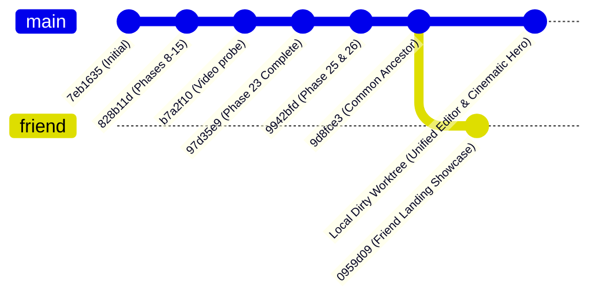

# 03. Repository Divergence Analysis

**Audit Date:** 2026-10-11  
**Comparison:** Local Worktree vs. Friend Repository (`Mayur0785/VireoClip`)

---

## 1. Commit Ancestry and Common Base

### Direct Answers to Mandated Questions:

| Question | Assessment | Evidence |
| :--- | :--- | :--- |
| **A. Are both repositories descendants of a common base?** | **YES** | Both histories trace cleanly back to commit `9d8fce348a436e2f183e8a7153a8a3a30eb0270a`. |
| **B. What is the common ancestor SHA?** | `9d8fce3` | `9d8fce348a436e2f183e8a7153a8a3a30eb0270a` (*"feat: enterprise workspaces, A/B studio, content workflows, brand brain, and billing UX corrections"*). |
| **C. How many commits exist only locally?** | **0 commits committed** | Local work is currently in the active working tree directly ahead of `9d8fce3` (52 modified tracked files, 47 untracked files). |
| **D. How many commits exist only in friend's repository?** | **Exactly 1 commit** | Commit `0959d090d5dda44b273cd7489ef4ef9af422277b` (*"feat: refine landing page feature showcase and motion design"*). |
| **E. Were major areas independently rewritten?** | **YES, in Landing Page only** | Friend developed `AiClippingPreview.tsx` (1,835 lines), `ExploreMajorFeatures.tsx`, and `feature-carousel.css`. Local developed `cinematic-hero.css` with 6 floating creator cards and a unified production video editor. |
| **F. Would a normal Git merge be sensible?** | **NO** | A normal `git merge` would trigger messy conflicts in `LandingHero.tsx`, `LandingPage.tsx`, `Navbar.tsx`, `Logo.tsx`, and `landing-foundation.css`, risking accidental erasure of either the local cinematic hero or the friend's showcase. |

---

## 2. Divergence Anatomy by Functional Area

### A. Landing Page & Hero
- **Friend:** Built an expansive 5-scene animated product carousel (`AiClippingPreview.tsx`), styled by `feature-carousel.css`, placed inside `LandingHero.tsx`. Redesigned `Navbar.tsx` with extensive dropdowns. Created `ExploreMajorFeatures.tsx` containing 12 interactive feature cards. Added `ComparisonsPage.tsx` and `SupportPage.tsx`.
- **Local:** Built the **Cinematic Dark Hero** (`cinematic-hero.css`) with 6 floating creator portraits (`mrbeast`, `ishowspeed`, `joe-rogan`, `lex-fridman`, `ronaldo`, `messi`), purple ambient spotlight aura, YouTube/video URL ingestion form, and upload link.

### B. Video Editor Architecture
- **Friend:** **Zero changes.** Completely untouched at common ancestor commit `9d8fce3`.
- **Local:** Complete production transformation of `ClipEditorPage.tsx`:
  - Unified timeline document model (`EditorProject`).
  - Single video playback clock (`useEditorPlayback`).
  - Clean preview separation (`cleanSourceUrl` vs `renderedPreviewUrl`) resolving double-burned captions.
  - Multi-track FFmpeg graph compilation with ASS subtitles in `proEditorService.ts` and `clipRenderService.ts`.
  - Added `EditorShell`, `PreviewCanvas`, `ContextualInspector`, `UnifiedTimeline`, `TranscriptEditor`, `ExportDialog`, `AICopilotPanel`, `AudioStudioPanel`, `BrandKitPanel`.
  - 8 unit and integration tests in `server/src/tests/unifiedEditor.test.ts`.

### C. Backend & API Routes
- **Friend:** **Zero changes.** Zero commits or diffs in `server/`.
- **Local:** Added `POST /editor-projects/:id/render` in `server/src/routes/projectRoutes.ts` and controller endpoint in `server/src/controllers/proEditorController.ts`. Hardened multi-track rendering and clean source streaming in `server/src/services/clipRenderService.ts`.

### D. Dependencies & Tooling
- `package.json`: **100% Identical.**
- `package-lock.json`: **100% Identical.**
- `server/package.json`: **100% Identical.**
- `tsconfig.json`: **100% Identical.**
- `tailwind.config.js`: **100% Identical.**
- `vite.config.ts`: Friend added 3 lines to ignore `delete` and `dist` in watch mode.

---

## 3. Recommended Approach Conclusion

Because the friend's work is concentrated **exclusively** on frontend landing page components and assets, and the local work is concentrated on **the cinematic hero, the video editor, and the backend render pipeline**, a **Selective Component and File Integration (Option C)** is vastly superior to a blind `git merge`.

This ensures:
1. Zero chance of clobbering the local uncommitted video editor architecture.
2. Complete preservation of the local cinematic hero design.
3. Clean surgical insertion of the friend's `AiClippingPreview` animated showcase into the local hero shell.
4. Adoption of the friend's post-hero landing sections and footer.
