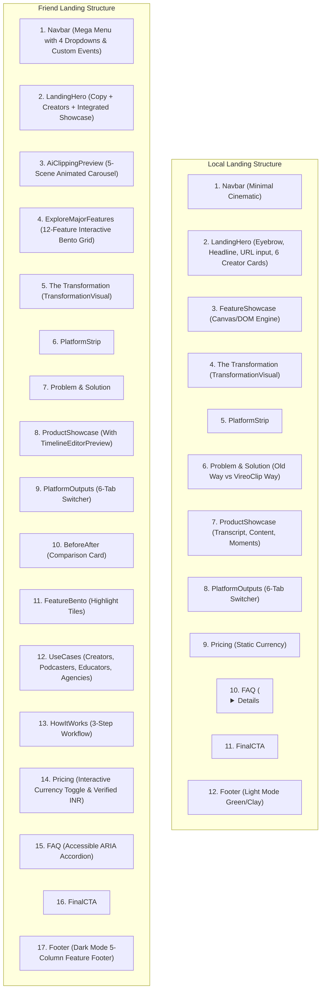

# 05. Landing Page Structure Comparison

**Audit Date:** 2026-10-11  
**Scope:** Side-by-side architectural section mapping of Local Landing Page vs. Friend Landing Page.

---

## 1. Structural Hierarchy Overview

---

## 2. Section-by-Section Technical Comparison

### 1. Navigation Bar
| Attribute | Local Implementation | Friend Implementation |
| :--- | :--- | :--- |
| **Component File** | [`src/components/Navbar.tsx`](file:///Users/moizshaikh/ai-video-content-generator/src/components/Navbar.tsx) | [`src/components/Navbar.tsx`](file:///Users/moizshaikh/VireoClip-friend-audit/src/components/Navbar.tsx) |
| **Line Count** | 77 lines | 583 lines |
| **Styling** | `landing-foundation.css` | Tailwind + Inline backdrop classes |
| **Menu Structure** | Minimal flat links: Product, Solutions, Resources, Pricing | 4 Multi-column dropdowns with badge indicators and descriptions |
| **Logo Component** | `<Logo size="sm" />` (Vector SVGs) | `import vireoLogo from '...png'` (Static raster) |
| **Event System** | Standard anchor links (`/#product`) | Dispatches `vireo:goto-slide` custom event to control carousel |
| **Recommendation** | **KEEP LOCAL NAVBAR** or merge with friend dropdowns while preserving local `<Logo />`. |

### 2. Hero Section
| Attribute | Local Implementation (KEEP LOCAL SOURCE OF TRUTH) | Friend Implementation |
| :--- | :--- | :--- |
| **Component File** | [`src/components/landing/LandingHero.tsx`](file:///Users/moizshaikh/ai-video-content-generator/src/components/landing/LandingHero.tsx) | [`src/components/landing/LandingHero.tsx`](file:///Users/moizshaikh/VireoClip-friend-audit/src/components/landing/LandingHero.tsx) |
| **Styling** | [`cinematic-hero.css`](file:///Users/moizshaikh/ai-video-content-generator/src/components/landing/cinematic-hero.css) (`.vc-hero`, `.vc-hero-orbit`, `.vc-creators`) | Tailwind + `Spotlight.tsx` + `ParticlesBackground.tsx` |
| **Headline & Copy** | *"One video in. Your best clips out."* with purple glow | *"Turn Long Videos Into Viral Shorts In Minutes"* |
| **Creator Portraits** | 6 Curated floating cards (`mrbeast`, `ishowspeed`, `joe-rogan`, `lex-fridman`, `ronaldo`, `messi`) with glint animations and play cues | 6 Generic creator cards (`CreatorShowcaseCard.tsx`) |
| **Input & CTA** | Ingestion input supporting direct URL parsing and routing to `/projects/new?url=...` | Direct URL form with client validation |
| **Showcase Placement** | Dedicated container `
` | `<AiClippingPreview />` placed at bottom of hero (`mt-8 lg:mt-12`) |
| **Recommendation** | **KEEP LOCAL HERO AS SOURCE OF TRUTH.** |

### 3. Product Demonstration / Animated Showcase
| Attribute | Local Implementation | Friend Implementation (TAKE FRIEND) |
| :--- | :--- | :--- |
| **Component File** | [`src/components/landing/FeatureShowcase.tsx`](file:///Users/moizshaikh/ai-video-content-generator/src/components/landing/FeatureShowcase.tsx) | [`src/components/reactbits/AiClippingPreview.tsx`](file:///Users/moizshaikh/VireoClip-friend-audit/src/components/reactbits/AiClippingPreview.tsx) |
| **Styling** | `FeatureShowcase.css` | [`src/styles/feature-carousel.css`](file:///Users/moizshaikh/VireoClip-friend-audit/src/styles/feature-carousel.css) (2,044 lines) |
| **Architecture** | Custom DOM/Canvas imperative mounting engine (`featureShowcaseEngine.js`) | Pure React component with 5 interactive animated slides (`clipping`, `captions`, `reframe`, `broll`, `audio`) |
| **AI Clipping Scene** | Static video poster preview | Dynamic grid of 6 generated clips with virality scores (97, 99, 94, 98, 96, 92) and platform tags |
| **Captions Scene** | Poster image | Kinetic word highlight subtitle simulation |
| **Smart Reframe Scene**| 16:9 → 9:16 crop comparison | Animated cycling through 5 reframe layouts (Podcast, Split, ScreenShare, Fill, Speaker) |
| **External Control** | None | Listens for `vireo:goto-slide` custom events |
| **Recommendation** | **TAKE FRIEND'S `AiClippingPreview` AND EMBED INSIDE LOCAL'S `vc-showcase-shell`.** |

### 4. Major Features Section
| Attribute | Local Implementation | Friend Implementation (TAKE FRIEND) |
| :--- | :--- | :--- |
| **Component File** | *Not present locally* | [`src/components/landing/ExploreMajorFeatures.tsx`](file:///Users/moizshaikh/VireoClip-friend-audit/src/components/landing/ExploreMajorFeatures.tsx) (721 lines) |
| **Content** | N/A | 12 Interactive Feature Cards covering Clipping, Reframe, Captions, B-Roll, Voice, Brand Brain, Pro Editor, Hook Lab, Thumbnail Lab, Autopilot, Publisher, Workspaces |
| **Interactivity** | N/A | Live toggle buttons for Aspect Ratios, Caption Styles (Hormozi, Beast, Neon), Brand Tones, Queue Status |
| **Styling** | N/A | Dark cards (`#0D131F/90`), border glows, jade accents (`#20E3A2`) |
| **Recommendation** | **TAKE FRIEND AS FIRST POST-HERO SECTION.** |

### 5. Content Transformation Section
| Attribute | Local Implementation | Friend Implementation |
| :--- | :--- | :--- |
| **Component File** | `TransformationVisual` in `ProductVisuals.tsx` | Same component wrapped in `.lv-transformation` |
| **Recommendation** | **TAKE FRIEND.** |

### 6. Supporting Landing Sections
| Section | Local Status | Friend Status | Proposed Action |
| :--- | :--- | :--- | :--- |
| **PlatformStrip** | Present | Present with dark styling | **TAKE FRIEND** |
| **ProblemAndSolution** | Present (Light/Neutral) | Present (Refined dark styling) | **TAKE FRIEND** |
| **ProductShowcase** | 3 Rows (Transcript, Content, Moments) | Enhanced with `TimelineEditorPreview` | **TAKE FRIEND** |
| **PlatformOutputs** | 6 Platform tabs | Present with refined copy | **TAKE FRIEND** |
| **BeforeAfter** | *Not present* | Interactive Before vs. After comparison card | **TAKE FRIEND** |
| **FeatureBento** | *Not present* | Fast clipping, multi-platform, brand consistency bento | **TAKE FRIEND** |
| **UseCases** | *Not present* | 4 Audience cards (Creators, Podcasters, Educators, Agencies) | **TAKE FRIEND** |
| **HowItWorks** | *Not present* | 3-Step workflow illustration | **TAKE FRIEND** |
| **Pricing** | Static rates | Interactive currency toggle (`CurrencyContext`), verified INR annual pricing logic | **TAKE FRIEND** |
| **FAQ** | `
` tags | Accessible `<button>` accordion with ARIA attributes and smooth animation | **TAKE FRIEND** |
| **FinalCTA** | Present | Present with dark gradient styling | **TAKE FRIEND** |
| **Footer** | Light mode green/clay | Dark 5-column comprehensive feature footer with Vertex Digitals copyright | **TAKE FRIEND** |
