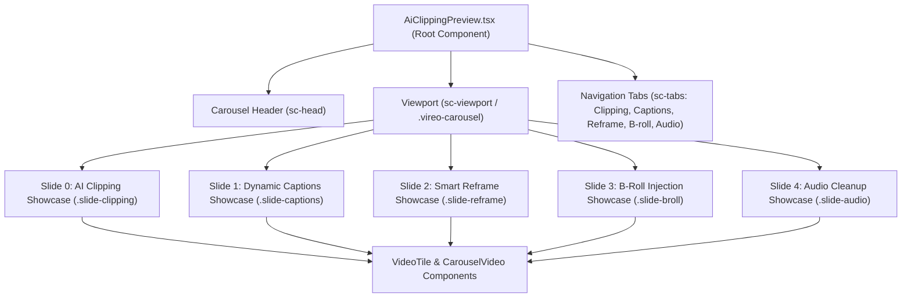

# 06. Friend Showcase Dependency Map & Portability Analysis

**Audit Date:** 2026-10-11  
**Target:** [`src/components/reactbits/AiClippingPreview.tsx`](file:///Users/moizshaikh/VireoClip-friend-audit/src/components/reactbits/AiClippingPreview.tsx) (Friend's Animated Showcase)

---

## 1. Component Hierarchy & Internal Architecture



---

## 2. Technical Dependency Inventory

### A. Root & Child Components
- **Root File:** [`src/components/reactbits/AiClippingPreview.tsx`](file:///Users/moizshaikh/VireoClip-friend-audit/src/components/reactbits/AiClippingPreview.tsx) (1,835 lines).
- **Internal Helper Components:**
  - `CarouselVideo`: React.memo wrapper managing HTML5 `<video>` lifecycle. When `shouldLoad` is false, unmounts video and frees media decoders; when `shouldPlay` is true, initiates muted loop playback; handles fallback poster display.
  - `VideoTile`: Renders responsive position-based video tiles with aspect ratios, transform origin, and glint overlays.

### B. Stylesheets & CSS Classes
- **Primary Stylesheet:** [`src/styles/feature-carousel.css`](file:///Users/moizshaikh/VireoClip-friend-audit/src/styles/feature-carousel.css) (2,044 lines).
  - Scope: Wrapped inside `.vireo-showcase` and `.vireo-carousel`.
  - Defines `.slide`, `.tl`, `.vf`, `.p`, `.hasvid`, `.sc-head`, `.sc-tabs`, virality score badges, and layout preview classes.
- **Secondary Stylesheet:** [`src/styles/cinematic-motion.css`](file:///Users/moizshaikh/VireoClip-friend-audit/src/styles/cinematic-motion.css) (231 lines).
  - Defines `@keyframes` for pulse, glow, slide transforms, and shimmer animations.

### C. JavaScript / TypeScript Dependencies
- **Animation Engine:** Pure React state management + CSS transitions and `@keyframes`. (No heavy external runtime libraries like GSAP or Framer Motion!).
- **Icons:** `Sparkles`, `Loader2`, `AlertCircle` from `lucide-react`.
- **Contexts & Services:**
  - `useAuth` from `../../context/AuthContext` (for conditional link routing).
  - `useCinematicScrollReveal` from `../../hooks/useCinematicScrollReveal`.
  - `projectService` and `clipService` (for optional live preview data fetching).

### D. Asset Dependencies
- **Creator Portrait Images:**
  - `src/assets/creators/creator-1.jpg`
  - `src/assets/creators/creator-2.jpg`
  - `src/assets/creators/creator-3.jpg`
  - `src/assets/creators/creator-4.jpg`
- **Poster & Thumbnail Images:**
  - `src/assets/landing/creator-video.webp` (Present in local)
  - `src/assets/landing/creator-moment-2.webp` (Present in local)
  - `src/assets/landing/creator-moment-3.webp` (Present in local)
  - `public/demo/thumbnails/clip-1-hook.jpg`
  - `public/demo/thumbnails/clip-2-reaction.jpg`
  - `public/demo/thumbnails/clip-3-challenge.jpg`
- **Video Source URLs:**
  - References `/demo/showcase/v0.mp4` through `/demo/showcase/v9.mp4`. Handled gracefully with fallback posters when MP4 files are not present.

### E. Timers and Event Listeners
1. **Reframe Layout Cycle Timer:** `reframeTimerRef` (`setInterval` every 2,400ms) toggles among 5 layouts (`Podcast`, `Split`, `ScreenShare`, `Fill`, `Speaker`).
2. **Auto-Advance Carousel Timer:** Automatically advances slides unless user is hovering or dragging.
3. **External Event Listener:** Listens on `window` for `vireo:goto-slide` custom events with `{ detail: { slideId: string } }` to allow Navbar or external buttons to seek directly to any scene.

---

## 3. Portability Classification

### **Classification: B. PORTABLE WITH CSS ISOLATION**

### Detailed Evaluation:
- **Can it be mounted into Local Hero?** **YES.**
- In local `LandingHero.tsx`, there is already a dedicated showcase slot:
  ```tsx
  <div className="vc-showcase-shell">
    {/* Current: <FeatureShowcase /> */}
    {/* Target: <AiClippingPreview /> */}
  </div>
  ```
- **Coupling Assessment:**
  - It does **not** rely on friend's `LandingHero` DOM structure.
  - It does **not** rely on friend's `Navbar`.
  - Its styles in `feature-carousel.css` are scoped under `.vireo-showcase`.
  - It does not conflict with local `.vc-hero` CSS rules because local hero styles use the `.vc-` prefix exclusively.

---

## 4. Required Extraction Steps (Future Porting Plan)

1. **Copy Component:** Copy `src/components/reactbits/AiClippingPreview.tsx` into local `src/components/reactbits/`.
2. **Copy Stylesheets:** Copy `src/styles/feature-carousel.css` and `src/styles/cinematic-motion.css` into local `src/styles/` and import them in `src/index.css`.
3. **Copy Assets:**
   - Copy `src/assets/creators/creator-1.jpg` through `creator-6.jpg`.
   - Copy `public/demo/thumbnails/clip-1-hook.jpg`, `clip-2-reaction.jpg`, `clip-3-challenge.jpg`.
4. **Mount in Local Hero:** In `src/components/landing/LandingHero.tsx`:
   ```tsx
   import { AiClippingPreview } from '../reactbits/AiClippingPreview';
   
   // Inside LandingHero component:
   <div className="vc-showcase-shell">
     <AiClippingPreview
       onViewAllClips={() => navigate(creationPath(isAuthenticated, '/dashboard'))}
       onClipSelect={() => {}}
     />
   </div>
   ```
5. **Verify Viewport Constraints:** Ensure `.vc-showcase-shell` in `cinematic-hero.css` sets appropriate max-width (`max-w-7xl` / `1320px`) and overflow containment so the carousel slides render with optical precision.
