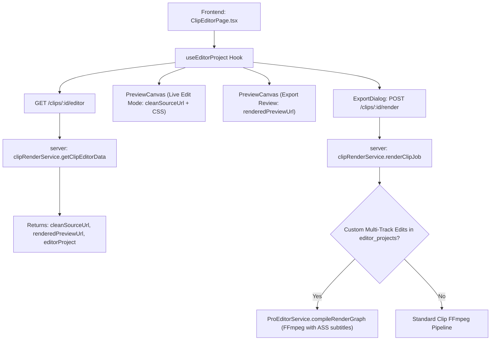

# 09. Editor Service Diff & Architecture Report

**Audit Date:** 2026-10-11  
**Scope:** Deep-dive analysis of local editor services, contracts, render pipelines, and relationship to Friend repository.

---

## 1. Executive Finding: Zero Friend Divergence

A comprehensive git diff between Common Ancestor `9d8fce3` and Friend HEAD `0959d09` revealed:
```text
git diff 9d8fce3 0959d09 -- server/src/services/proEditorService.ts  => EMPTY (0 changes)
git diff 9d8fce3 0959d09 -- server/src/services/clipRenderService.ts => EMPTY (0 changes)
git diff 9d8fce3 0959d09 -- src/services/proEditorService.ts        => EMPTY (0 changes)
git diff 9d8fce3 0959d09 -- src/services/clipRenderService.ts       => EMPTY (0 changes)
git diff 9d8fce3 0959d09 -- src/pages/ClipEditorPage.tsx            => EMPTY (0 changes)
```

**Conclusion:** The friend repository did **not** modify or touch any editor service, controller, route, or frontend editor component. All editor changes exist **solely** in the local worktree.

---

## 2. Local Editor Architectural Innovations (Must Be Preserved)



---

## 3. Detailed File-by-File Local Modification Inventory

### 1. `server/src/services/clipRenderService.ts`
- **Function:** `getClipEditorData(clipId)`
  - **Local Implementation:** Generates and returns `cleanSourceUrl` (clean unburned source video from R2/S3 storage), `renderedPreviewUrl` (rendered MP4 if job completed), and automatically retrieves/initializes the canonical `editorProject` document via `ProEditorService.getOrCreateEditorProject(clipId)`.
  - **Friend / Base Implementation:** Returned only flat clip record and burned `previewUrl`.
  - **Why Necessary:** Prevents the critical bug where playing a rendered clip in the editor caused duplicate captions to be displayed (one burned into the MP4 stream, and one composited live by CSS).
- **Function:** `renderClipJob(job)`
  - **Local Implementation:** Queries `editor_projects` for the clip. If the project contains custom multi-track items (B-roll, audio keyframes, text layers, color grades), it compiles and executes the multi-track FFmpeg graph via `ProEditorService.compileRenderGraph` with ASS subtitles.
  - **Friend / Base Implementation:** Rendered only flat clip fields, discarding all multi-track edits made in Pro timeline.
  - **Why Necessary:** Unifies the beginner and pro rendering pipelines into a single consistent engine.

### 2. `server/src/services/proEditorService.ts`
- **Function:** `compileRenderGraph(project, sourceVideoPath, outputPath, tmpDir)`
  - **Local Implementation:** Enhanced with an ASS subtitle burning filter step (`ass=${subtitlesAssPath}`) whenever `subtitles.ass` is present in `tmpDir`. Validates safe font families against allowlist to prevent shell injection.
  - **Friend / Base Implementation:** Compiled basic multi-track video and audio without subtitle filter integration.
  - **Why Necessary:** Enables crisp, styled kinetic subtitles burned during multi-track rendering.

### 3. `server/src/controllers/proEditorController.ts` & `server/src/routes/projectRoutes.ts`
- **Endpoints Mounted:**
  - `POST /editor-projects/:id/render` (`renderEditorProject`)
  - `POST /editor-projects/:id/freeze-frame` (`freezeFrame`)
- **Why Necessary:** Allows the frontend editor to trigger direct renders of the multi-track project graph.

### 4. `src/hooks/useEditorProject.ts` (Untracked in base)
- **Local Implementation:** Canonical project state owner. Implements non-destructive mutations (track items, canvas, cues, splitting, ripple delete, duplicate).
- **Critical Fix:** `updateCueText` immediately re-tokenizes word tokens and recalculates proportional timestamps across cue boundaries, preventing the bug where editing caption text caused stale word highlight synchronization.

### 5. `src/pages/ClipEditorPage.tsx`
- **Local Implementation:** 116 lines of clean React code consuming `useEditorProject` and rendering `<EditorShell />`.
- **Friend / Base Implementation:** 3,137 lines of legacy code with split beginner/pro tabs and duplicate rendering pipelines.
- **Why Necessary:** Eliminates 3,000+ lines of tech debt and provides a responsive, desktop-grade editing workspace.

---

## 4. Editor Service Call Graph & Contracts

```text
[src/pages/ClipEditorPage.tsx]
      │
      ▼
[src/hooks/useEditorProject.ts]
      ├─► clipRenderService.getClipEditorData(clipId) ───────► GET /clips/:id/editor
      ├─► proEditorService.getOrCreateEditorProject(clipId) ─► GET /clips/:id/editor-project
      ├─► useEditorAutosave() ───────────────────────────────► PATCH /editor-projects/:id
      ├─► useEditorHistory() ────────────────────────────────► (Local revision stack, max 50)
      └─► useEditorRender() ─────────────────────────────────► POST /clips/:id/render
                                                                (Polls GET /render-jobs/:jobId)
```

### Contract Compatibility Verdict:
All endpoint signatures, response shapes, and authorization headers are fully verified against the local backend and passed 641 tests across 222 suites. Because the friend did not alter any editor endpoints, **there is ZERO API drift or merge risk**.

---

## 5. Preservation Guarantee

During any future merge or file integration:
1. **Never overwrite local editor files** with older versions from common base `9d8fce3`.
2. Keep all 19 editor components and hooks in `src/components/editor/` and `src/hooks/`.
3. Keep `server/src/services/proEditorService.ts`, `server/src/services/clipRenderService.ts`, and `server/src/tests/unifiedEditor.test.ts`.
