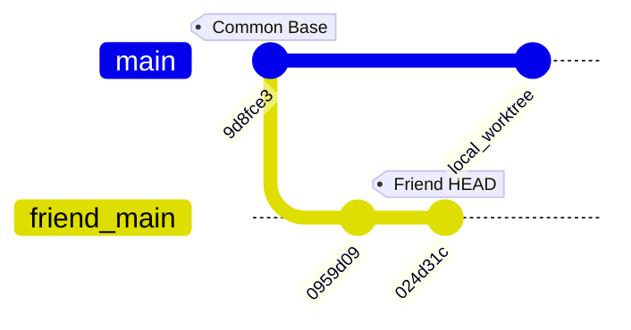

# 01 — Repository and Commit Audit: Dashboard UI Changes
**Date:** October 12, 2026  
**Audit Scope:** Read-Only Visual & Architectural Audit — Dashboard UI Only  
**Mode:** READ-ONLY — Zero Code Edits, Zero Merges, Zero Production Changes  

---

## 1. Executive Summary

This audit establishes the exact divergence between the current local VireoClip repository and the latest remote changes in the friend repository (`https://github.com/Mayur0785/VireoClip`), focused strictly on the **Dashboard UI**.

The earlier merge audit (Phase 1 & Phase 2) evaluated the friend repository at commit `0959d090d5dda44b273cd7489ef4ef9af422277b`. Inspection of the friend remote reveals that the friend made an additional commit: **`024d31c31032ac13826c199f1c8ad95caa56a9ae`** (*"fix: correct dashboard hero layout and rounded corners"*).

This latest commit directly transforms the **Dashboard UI** into a cinematic dark-mode SaaS dashboard with an interactive multi-stage clipping workflow hero (`HomeClippingWorkflow.tsx`), collapsible multi-tier sidebar navigation, a revised global search and quota header, and dark-glass project cards with thumbnail previews.

---

## 2. Git State & Repositories Inspected

### 2.1 Working Local Repository
- **Path:** `/Users/moizshaikh/ai-video-content-generator`
- **Current Branch:** `main`
- **Current Commit (HEAD):** `9d8fce3f01df41925c8679685215c59d5e5d2d4a`
- **Worktree State:** Preserved uncommitted changes (Unified Pro Video Editor suite, Pro Timeline, Copilot, test suites with 641 passing tests, protected landing page hero, and creator images).
- **Safety Guarantee:** Worktree was NOT reset, stashed, cleaned, discarded, or switched.

### 2.2 Friend Remote Repository
- **Remote URL:** `https://github.com/Mayur0785/VireoClip`
- **Default Branch:** `main`
- **Latest Remote HEAD:** `024d31c31032ac13826c199f1c8ad95caa56a9ae`
- **Commit Date:** Sun Oct 11 17:20:12 2026 +0530
- **Author:** Mayur Kapse <mayurkapse785@gmail.com>
- **Commit Message:** `fix: correct dashboard hero layout and rounded corners`

### 2.3 Friend Audit Clone
- **Path:** `/Users/moizshaikh/VireoClip-friend-audit`
- **Initial Clone State:** Pointed to `0959d090d5dda44b273cd7489ef4ef9af422277b` (STALE by 1 commit).
- **Audit Action:** Fetched remote `origin/main` in the isolated audit clone only. Fast-forwarded the audit clone to `024d31c31032ac13826c199f1c8ad95caa56a9ae`. Verified clean worktree in clone. No operations touched the local working repository.

### 2.4 Common Ancestor (Merge Base)
- **Common Base Commit:** `9d8fce3f01df41925c8679685215c59d5e5d2d4a`
- Both repositories branched from this exact common commit.
- In the local repository, base `9d8fce3` was extended with the Unified Video Editor, local hero customizations, and backend optimizations.
- In the friend repository, base `9d8fce3` was extended by two commits:
  1. `0959d09` (Landing showcase, motion design, creator assets)
  2. `024d31c` (Dashboard hero layout, rounded corners, clipping workflow)

---

## 3. Commit Analysis (Base `9d8fce3` to Friend HEAD `024d31c`)

### Commit 1: `0959d090d5dda44b273cd7489ef4ef9af422277b`
- **Summary:** Refined landing page showcase, added creator images (`creator-1.jpg` .. `creator-6.jpg`), added currency toggle, added marketing pages (`ComparisonsPage`, `SupportPage`), and made initial modifications to `DashboardLayout.tsx` (+54 lines, -20 lines) and `DashboardPage.tsx` (+238 lines, -54 lines).

### Commit 2: `024d31c31032ac13826c199f1c8ad95caa56a9ae`
- **Summary:** Focused overhaul of the dashboard experience.
- **Files Changed in Commit `024d31c`:**
  1. `src/components/dashboard/HomeClippingWorkflow.tsx` (+1,866 lines) [NEW COMPONENT]
  2. `src/layouts/DashboardLayout.tsx` (+380 lines, -107 lines) [MAJOR REWRITE]
  3. `src/pages/DashboardPage.tsx` (+319 lines, -252 lines) [MAJOR REWRITE]
  4. `src/styles/cinematic-motion.css` (+100 lines, -1 line) [DASHBOARD TOKENS]
  5. `src/types/index.ts` (+1 line) [ADDED description?: string | null]
  6. `index.html` (+1 line, -1 line) [ADDED Sora and DM Sans font imports]

---

## 4. Comprehensive File Classification (Base to Friend HEAD)

Every file modified or added in the friend repository across both commits relative to base `9d8fce3` is categorized below according to the Section 4 schema:

| File Path | Lines Changed | Category | Rationale |
|---|---|---|---|
| `src/components/dashboard/HomeClippingWorkflow.tsx` | +1,866 / -0 | **A. Dashboard-only UI** | Interactive workflow hero embedded exclusively inside `DashboardPage.tsx`. |
| `src/layouts/DashboardLayout.tsx` | +380 / -107 | **A. Dashboard-only UI** | Shell layout for dashboard routes (`/dashboard`, `/history`, etc.). Never wraps landing page. |
| `src/pages/DashboardPage.tsx` | +319 / -252 | **A. Dashboard-only UI** | Primary dashboard page view (`/dashboard`). |
| `src/styles/cinematic-motion.css` | +330 / -1 | **C. Global CSS/theme** | Contains `.vireo-dash-hero`, `.vireo-dash-glass`, `.vireo-clipcard-*`, `.vireo-btn-purple`. Scoped class names. |
| `src/types/index.ts` | +1 / -0 | **E. Application behavior / Data** | Added `description?: string | null` to `Project` interface. |
| `index.html` | +3 / -2 | **G. Asset or font dependency** | Added Google Fonts `Sora` and `DM Sans` used by dashboard headings. |
| `src/components/Logo.tsx` | +60 / -43 | **B. Shared UI component** | Replaced SVG logo with PNG. **DO NOT COPY BLINDLY** (damages local landing page). |
| `src/index.css` | +146 / -46 | **C. Global CSS/theme** | Replaced `:root` color tokens with dark theme. **DO NOT COPY** (would invert entire landing page). |
| `src/components/landing/LandingHero.tsx` | +520 / -180 | **D. Landing-page UI** | Friend's hero variant. **DO NOT COPY** (Local hero is locked source of truth). |
| `src/components/landing/ProductVisuals.tsx` | +190 / -85 | **D. Landing-page UI** | Protected landing component. |
| `src/components/landing/ExploreMajorFeatures.tsx` | +721 / -0 | **D. Landing-page UI** | Post-hero landing section. |
| `src/components/reactbits/*` (5 files) | +2,297 / -0 | **D. Landing-page UI** | Showcase animations used in landing page. |
| `src/pages/LandingPage.tsx` | +519 / -120 | **D. Landing-page UI** | Landing page composition. Protected. |
| `src/pages/landing.css` | +2,983 / -2,564 | **D. Landing-page UI** | Landing page scoped styles. Protected. |
| `src/pages/landing-foundation.css` | +421 / -110 | **D. Landing-page UI** | Landing foundational styles. Protected. |
| `src/components/Navbar.tsx` | +583 / -140 | **B. Shared UI component** | Public navigation bar. Protected. |
| `src/components/Footer.tsx` | +280 / -90 | **B. Shared UI component** | Public footer. Protected. |
| `src/components/CurrencyToggle.tsx` | +85 / -0 | **B. Shared UI component** | Currency toggle component. |
| `src/context/CurrencyContext.tsx` | +73 / -0 | **E. Application behavior** | Currency state provider. |
| `src/utils/pricingUtils.ts` | +134 / -35 | **E. Application behavior** | Pricing conversion helpers. |
| `src/components/StatusBadge.tsx` | +38 / -15 | **B. Shared UI component** | Status badge pill component. |
| `src/pages/BillingPage.tsx` | +92 / -25 | **A / E. Subpage UI** | Billing page with currency support. |
| `src/pages/ComparisonsPage.tsx` | +280 / -0 | **I. Unrelated change** | Marketing comparison page (`/comparisons`). |
| `src/pages/SupportPage.tsx` | +323 / -0 | **I. Unrelated change** | Help center page (`/support`). |
| `src/pages/NewProjectPage.tsx` | +6 / -4 | **A. Subpage UI** | Minor styling tweak. |
| `src/pages/PrivacyPage.tsx` | +18 / -5 | **I. Unrelated change** | Legal page. |
| `src/pages/TermsPage.tsx` | +7 / -3 | **I. Unrelated change** | Legal page. |
| `src/context/AuthContext.tsx` | +31 / -10 | **E. Application behavior** | Profile caching & demo fallback. |
| `src/hooks/useBillingUsage.ts` | +2 / -1 | **E. Application behavior** | Minor usage fallback tweak. |
| `src/hooks/useCinematicScrollReveal.ts`| +62 / -0 | **B. Shared UI hook** | Scroll animation hook. |
| `src/styles/feature-carousel.css` | +2,044 / -0 | **D. Landing-page UI** | Showcase animations. Protected. |
| `public/demo/thumbnails/*` (3 files) | Bin | **G. Asset dependency** | Thumbnails for landing showcase. |
| `src/assets/creators/creator-*.jpg` | Bin | **G. Asset dependency** | 6 creator images. Already present locally! |
| `src/assets/brand/*-purple.png` | Bin | **G. Asset dependency** | Friend purple logo assets. |
| `docs/*` (3 files) | +574 / -0 | **I. Unrelated change** | Documentation audits. |
| `vite.config.ts` | +3 / -0 | **H. Build/configuration** | Added `@` alias path resolution. |

---

## 5. Scope Isolation Findings

1. **Dashboard changes are tightly isolated:**  
   The friend's dashboard presentation is implemented almost exclusively across 4 files:
   - `src/layouts/DashboardLayout.tsx`
   - `src/pages/DashboardPage.tsx`
   - `src/components/dashboard/HomeClippingWorkflow.tsx`
   - `src/styles/cinematic-motion.css`
2. **Zero backend drift in dashboard code:**  
   The friend's dashboard does NOT introduce new backend endpoints or database migrations. It calls `projectService.fetchProjects`, `projectService.createProjectAsync`, `storageService.uploadVideoFile`, and `clipService.getCandidates`—all of which are existing shared methods present in the local codebase.
3. **No contamination of landing page:**  
   Neither `DashboardLayout.tsx` nor `DashboardPage.tsx` imports from `src/components/landing/*`. As long as global `:root` variables in `src/index.css` and shared `Logo.tsx` are protected, the dashboard UI can be ported cleanly in isolation.
