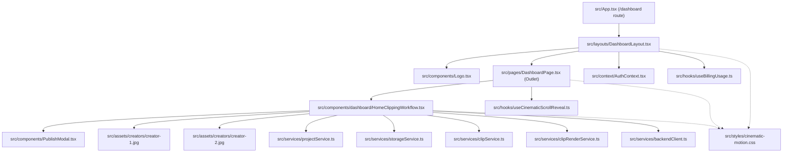

# 04 — Dashboard Component and Asset Map
**Date:** October 12, 2026  
**Audit Scope:** Dependency Tracing, Component Hierarchies, and Asset Inventory  
**Mode:** READ-ONLY Verification  

---

## 1. Dashboard Component Tree & Dependency Graph



---

## 2. Component Inventory & Responsibility Map

### 2.1 `src/layouts/DashboardLayout.tsx`
- **Role:** Main application shell for all logged-in routes. Provides the responsive two-column grid (sidebar + header + main viewport).
- **Direct Child Components:**
  - `Logo` (`src/components/Logo.tsx`)
  - `Outlet` (`react-router-dom`)
  - `NavLink`, `Link` (`react-router-dom`)
- **Direct Hooks:**
  - `useAuth()` (`src/context/AuthContext.tsx`) — retrieves `user`, `profile`, `signOut`.
  - `useBillingUsage()` (`src/hooks/useBillingUsage.ts`) — retrieves quota, usage minutes, tier.
  - `useNavigate()`, `useLocation()` (`react-router-dom`).
- **Lucide Icons Imported:**
  `LayoutDashboard`, `Scissors`, `Video`, `Sparkles`, `FolderClosed`, `Share2`, `TrendingUp`, `FlaskConical`, `Brain`, `Building2`, `GitBranch`, `Settings`, `HelpCircle`, `Shield`, `LogOut`, `Menu`, `X`, `ChevronDown`, `Search`, `Bell`, `Plus`, `Zap`.
- **CSS Dependencies:**
  - Tailwind utilities.
  - `.vireo-btn-purple`, `.vireo-nav-active` from `cinematic-motion.css`.

### 2.2 `src/pages/DashboardPage.tsx`
- **Role:** Main view for `/dashboard`. Houses the clipping workflow hero and recent project gallery.
- **Direct Child Components:**
  - `HomeClippingWorkflow` (`src/components/dashboard/HomeClippingWorkflow.tsx`)
  - `Link` (`react-router-dom`)
- **Direct Hooks:**
  - `useAuth()` — user ID for fetching projects.
  - `useCinematicScrollReveal(pageRef)` — smooth entrance animation.
  - `useState`, `useEffect`, `useRef`.
- **Services:**
  - `projectService.fetchProjects(userId)`
  - `projectService.getProjects()`
- **Lucide Icons Imported:**
  `Video`, `Plus`, `Film`.
- **CSS Dependencies:**
  - `.vireo-dash-glass`, `.vireo-btn-purple` from `cinematic-motion.css`.

### 2.3 `src/components/dashboard/HomeClippingWorkflow.tsx`
- **Role:** Self-contained, multi-stage interactive video clipping cockpit.
- **Props Interface:**
  ```typescript
  interface HomeClippingWorkflowProps {
    existingProjects: Project[];
    onRefreshProjects: () => void;
    onScrollToProjects?: () => void;
  }
  ```
- **Direct Child Components:**
  - `PublishModal` (`src/components/PublishModal.tsx`)
- **Direct Media Assets:**
  - `hookThumbnail` from `../../assets/creators/creator-1.jpg`
  - `momentThumbnail` from `../../assets/creators/creator-2.jpg`
- **Direct Services:**
  - `projectService.createProjectAsync`
  - `storageService.uploadVideoFile`, `validateVideoFile`
  - `clipService.getCandidates`
  - `clipRenderService.renderClipAsync`
  - `backendRequest`
- **Lucide Icons Imported (24 icons):**
  `UploadCloud`, `Link2`, `FolderOpen`, `Play`, `Pause`, `Film`, `Sparkles`, `Check`, `AlertCircle`, `RefreshCw`, `X`, `Download`, `Share2`, `SlidersHorizontal`, `Square`, `Volume2`, `Globe`, `Clock`, `ChevronDown`, `ChevronUp`, `Loader2`, `RotateCcw`, `CheckSquare`, `Search`.
- **CSS Dependencies:**
  - `.vireo-dash-glass`, `.vireo-dash-hero`, `.vireo-clipcard-left`, `.vireo-clipcard-right`, `.vireo-btn-purple`.

---

## 3. Asset Audit Table

| Asset Identifier | Friend Path | Local Equivalent | File Size | Committed to Git? | Status / Verification |
|---|---|---|---|---|---|
| **Creator 1 Photo** (Left hook card) | `src/assets/creators/creator-1.jpg` | `src/assets/creators/creator-1.jpg` | 748,052 bytes | Yes (both repos) | **IDENTICAL.** Already present locally. No download or copy needed. |
| **Creator 2 Photo** (Right moment card) | `src/assets/creators/creator-2.jpg` | `src/assets/creators/creator-2.jpg` | 693,389 bytes | Yes (both repos) | **IDENTICAL.** Already present locally. No download or copy needed. |
| **Sidebar / Header Logo** | `src/assets/brand/vireo-logo-purple.png` | `src/assets/brand/vireoclip-logo-light.svg` | 269 KB vs 4.8 KB | Friend: PNG / Local: SVG | **LOCAL PREFERRED.** Local vector SVG has superior sharpness and zero pixelation on Retina displays. |
| **Sidebar Compact Mark** | `src/assets/brand/vireo-mark-purple.png` | `src/assets/brand/vireoclip-symbol.svg` | 107 KB vs 2.1 KB | Friend: PNG / Local: SVG | **LOCAL PREFERRED.** Local vector symbol SVG integrates cleanly with `Logo compact={true}`. |
| **Project Thumbnails (Dynamic)** | YouTube CDN | YouTube CDN | Variable (Web) | Remote CDN | Resolves `https://img.youtube.com/vi/{id}/hqdefault.jpg`. Safe runtime resolution. |
| **Project Thumbnail Fallback** | CSS Gradient + `<Film />` icon | Same | 0 bytes | Dynamic SVG | Self-contained in React/Tailwind. |
| **Headline Font** (`Sora`) | Google Fonts CDN | Not imported | Web Font | N/A (`index.html`) | Cleanly imported via standard `<link>` in `index.html`. |
| **Body Font** (`DM Sans`) | Google Fonts CDN | Not imported | Web Font | N/A (`index.html`) | Cleanly imported via standard `<link>` in `index.html`. |

---

## 4. Required Package Dependencies

Inspection of `package.json` confirms **100% package parity**:
- `lucide-react`: Version `^1.16.0` present in both. All 24 icons are available.
- `react-router-dom`: Version `^7.9.3` present in both.
- `tailwindcss`: Version `^4.1.13` present in both.
- `@supabase/supabase-js`: Version `^2.49.1` present in both.

**Conclusion:** Zero npm package installations are required to run the friend's dashboard UI.
