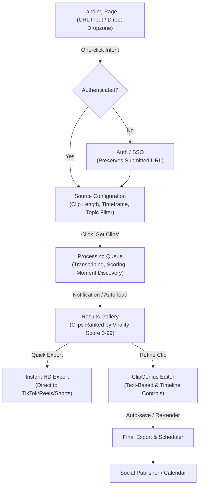

# OpusClip Documented Workflow & Interaction Benchmark Reference

**Document Version:** 1.0.0  
**Audit Target:** VireoClip Product Journey Benchmark  
**Date:** October 11, 2026  
**Status:** COMPLETE REFERENCE BASELINE  

---

## 1. Executive Context & Benchmark Purpose

This document establishes the official interaction architecture, sequencing, discoverability, and clarity baseline of **OpusClip** (the primary short-form AI repurposing market benchmark).

### Critical Rule of Differentiation
- **What We Benchmark:** Interaction logic, step sequencing, cognitive load reduction, discoverability, state transparency, and user efficiency.
- **What We Strictly Avoid Copying:** OpusClip visual styling, trade dress, color accents (yellow/black), typography, component appearance, marketing copywriting, or proprietary branding.
- **VireoClip Target Identity:** Pure Black (`#0a0a0a`), White / Grey, Restrained Violet (`#8B5CF6`), Spatial Glass, Premium Sans Typography (`Inter` / `Plus Jakarta Sans`), and Cinematic Studio Presentation.

---

## 2. Documented vs. Inferred Taxonomy

To maintain strict truth in analysis (Section 96), all findings in this document are categorized as:
- **[OBSERVED / DOCUMENTED]**: Extracted directly from official OpusClip product manuals, help centers, public tutorials, product changelogs, and documented creator workflows.
- **[INFERRED]**: Logical interaction consequences derived from documented features where underlying state machines operate behind the curtain.

---

## 3. High-Level OpusClip Interaction Flow

---

## 4. Stage-by-Stage OpusClip Interaction Map

### Stage 1: Landing Page & Intent Capture
- **[OBSERVED / DOCUMENTED]**: 
  - The hero section features an immediate, high-contrast URL input field prominently labeled for YouTube, Zoom, Google Drive, or podcast links.
  - A secondary "Drop video file" upload CTA sits adjacent to or directly beneath the URL input.
  - Submitting a URL while logged out redirects the user to authentication (`Google SSO` / `Email`), but **persists the submitted URL** in local session storage or URL parameters so the user does not re-paste it after signup.
- **UX Intent**: Zero friction at top-of-funnel; user takes product action before being asked for credentials.

### Stage 2: Source Configuration (Pre-Processing Options)
- **[OBSERVED / DOCUMENTED]**: 
  - Before initiating heavy GPU processing, OpusClip presents a concise configuration modal or pre-processing drawer.
  - **Key Pre-Processing Controls**:
    1. **Clip Length Filter**: Radio/pill selector (`<30s`, `30s–60s`, `60s–90s`, `90s–3m`, or `Auto`).
    2. **Processing Timeframe**: Slider/timecodes allowing creators to process a specific range of a 2-hour video (e.g., minutes 15 to 45) rather than burning quota on the full duration.
    3. **Topic / Prompt Guidance**: An optional natural language text input: *"Focus on discussions about AI startups, omit introductions"*.
    4. **Target Layout / Aspect Ratio**: Default `9:16` vertical, with options for `1:1` square or `16:9` landscape.
    5. **Caption Style Preset**: Allows selecting an animated caption style before initial rendering.
- **[INFERRED]**: By capturing user preference before generation, OpusClip avoids generating 10 clips that the user immediately rejects due to wrong length or wrong topic.

### Stage 3: Processing & System Status Communication
- **[OBSERVED / DOCUMENTED]**:
  - Transparent 4-stage stepper:
    1. *Downloading & Ingesting Media*
    2. *Transcribing Audio & Generating Timestamps*
    3. *Analyzing Multimodal Virality & Speaker Dynamics*
    4. *Compiling & Formatting Clips*
  - **Background Safety**: Explicit copy informs the creator: *"You can safely close this tab. We will email you when your clips are ready."*
  - **Estimated Time**: Shows approximate completion time (e.g., ~4–7 minutes for a 30-minute podcast).
  - **Cancel Action**: Users can cancel pending jobs before quota is committed.

### Stage 4: Results Gallery (The Opus "Clip Feed")
- **[OBSERVED / DOCUMENTED]**:
  - The results surface is a prioritized feed of generated clips, sorted by **Virality Score (0–99)**.
  - **Card Structure**:
    - **Video Thumbnail / Hover Preview**: Immediate playback on hover without loading a full player.
    - **Virality Score Badge**: Visual color-coded metric (Green 80–99, Amber 60–79).
    - **Virality Rationale**: 2–3 qualitative sentences explaining *why* the AI selected this moment:
      - *"Strong hook: begins with a shocking statistic."*
      - *"Self-contained narrative with high emotional payoff."*
      - *"Clear speaker exchange with minimal dead air."*
    - **Clip Title & Timecodes**: Clean headline summarizing the clip content and exact source timestamp range (e.g., `14:22 – 15:18 · 56s`).
    - **Transcript Snippet**: 2-line preview of the opening spoken hook.
    - **Primary Actions**:
      - `Edit Clip` (Enters the ClipGenius editor).
      - `Quick Export / Download` (Downloads the ready MP4 directly without forcing an editor visit).
      - `Share / Schedule` (Direct handoff to social accounts).
- **UX Intent**: The user immediately understands the quality, rationale, and value of the AI's output within 5 seconds of opening the results page.

### Stage 5: Editor Workflow (ClipGenius)
- **[OBSERVED / DOCUMENTED]**:
  - **Two-Column Split Workspace**:
    - **Left / Center**: High-framerate video preview with live CSS caption overlays, safe area guides (TikTok/Instagram Reels boundaries), and timeline scrubber with trim handles.
    - **Right Panel**: Dual-mode editing tabs:
      1. **Text-Based Transcript Editor**: The creator reads the spoken text. Deleting or crossing out words in the transcript automatically ripple-trims the corresponding video segment!
      2. **Caption & Design Controls**: Typography, font size, active word color, karaoke highlight, emojis, and line break adjustments.
  - **Auto Reframe & Layout**:
    - Automatic face detection and speaker tracking for 9:16 vertical video.
    - Multi-speaker layouts: Split screen (speaker top, reaction bottom) or dynamic active-speaker switching.
    - Manual adjustment: Creator can pan or lock the crop box on a specific subject.
  - **B-Roll Integration**:
    - AI analyzes keywords in the transcript and suggests relevant B-roll clips from integrated stock libraries.
    - One-click insertion over the selected time range.
  - **Audio Enhancement**:
    - Background noise removal, speech clarity enhancement, and automatic background music ducking under spoken dialogue.

### Stage 6: Export & Publishing Handoff
- **[OBSERVED / DOCUMENTED]**:
  - **Export Modal**:
    - Resolution selector (`1080p` standard, `4K` if source permits).
    - Watermark removal indicator (gated by plan).
    - Subtitle burn-in vs. separate SRT file download.
    - Professional NLE export option (XML/EDL export for Adobe Premiere Pro / DaVinci Resolve).
  - **Publishing & Scheduling**:
    - Direct API connection to TikTok, YouTube Shorts, Instagram Reels, LinkedIn, and Facebook.
    - Visual calendar scheduler allowing creators to schedule clips across the upcoming week.
    - Auto-generated platform titles and hashtag suggestions.

---

## 5. OpusClip Pattern Evaluation: Adopt, Adapt, Outperform, or Not Relevant

| Workflow Step | OpusClip Pattern | UX Assessment | VireoClip Strategic Classification | Rationale |
| :--- | :--- | :--- | :--- | :--- |
| **Landing URL Input** | Immediate hero input with intent preservation across auth | Exceptional low-friction pattern | **ADOPT** | Brand-new users should paste their URL immediately without navigating multiple empty dashboards. |
| **Pre-Processing Setup** | Clip length, timeframe, topic prompt selector before generation | Prevents wasteful GPU generation and aligns AI output with creator goals | **ADOPT** | Vireo currently jumps straight from upload to full transcription without letting users specify desired clip length or topic focus. |
| **Virality Score** | Numeric 0–99 score with color badges | High gamification, but can feel arbitrary if numbers aren't justified | **ADAPT** | Keep quantitative score, but anchor it with deep qualitative analysis (Hook strength, Story arc, Multimodal intensity). |
| **Results Card Layout** | Thumbnail, title, score, explanation, Edit CTA, Quick Export | Fast scannability and immediate value recognition | **ADOPT** | Creators must be able to export great clips in 1 click without being forced into an editor. |
| **Text-Based Editing** | Deleting transcript words ripple-cuts video footage | Powerful, intuitive editing model for non-professional creators | **ADOPT** | Vireo has word-level caption editing, but deleting transcript words does not currently trim the underlying video. |
| **Auto Reframe** | Speaker face tracking with split-screen presets | Standard requirement for converting 16:9 interviews into 9:16 Shorts | **ADAPT** | Vireo already possesses advanced face tracking and smoothed keyframe reframing; needs cleaner UI controls. |
| **Multi-Track Timeline** | Simplified single-track timeline with basic trim handles | Good for beginners, but severely limits professional editors | **OUTPERFORM** | Vireo's dual-mode architecture (Beginner + Pro Multi-Track NLE with snapping, ripples, and tracks) is a major competitive advantage. |
| **Studio Suite Integration** | Opus is primarily a clipping tool | Creators must use separate tools for thumbnails, hooks, and translation | **OUTPERFORM** | Vireo includes Hook Lab, Thumbnail Lab with A/B testing, Content Pack generator, Multilingual Dubbing, and Autopilot. |
| **Social Publishing** | Built-in social calendar and scheduler | Convenient for creators managing multiple social channels | **ADAPT** | Vireo has social OAuth and post handoffs, but needs a cohesive human-approved review queue. |

---

## 6. Synthesis: The Core Benchmark Standard

OpusClip succeeds because **the first 60 seconds are effortless**:
1. User provides a link.
2. AI does 90% of the work.
3. User receives 5–10 scored, self-contained clips.
4. User can export the best clip in 1 click, or refine captions in 60 seconds.

**VireoClip's Strategic Imperative:** Match OpusClip's effortless top-of-funnel simplicity and 1-click results clarity, while outperforming Opus with VireoClip's deeper pro-editor precision, multi-studio suite, and autonomous Autopilot pipeline.
