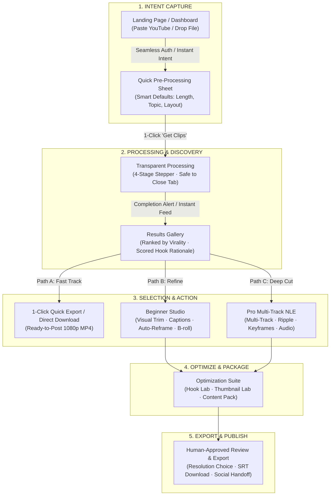

# VireoClip Ideal Interaction Architecture & User Flow Blueprint

**Document Version:** 1.0.0  
**Audit Target:** End-to-End Recommended Creator Experience  
**Date:** October 11, 2026  
**Status:** COMPLETE ARCHITECTURE BLUEPRINT (PROPOSAL ONLY — STRICT NO-IMPLEMENTATION OBSERVED)  

---

## 1. Core Product Philosophy & Design Tenets

VireoClip must solve the fundamental paradox of AI creative tools:
> **How to provide the effortless 60-second magic of OpusClip at the start, while exposing Hollywood-grade NLE editing and multi-platform automation when the creator demands precision—without ever cluttering the screen.**

### Five Foundational Tenets
1. **Simple at the Start, Deep on Demand:** A first-time creator must achieve an exported short in under 3 minutes without learning video engineering jargon.
2. **AI Does the First Pass, Creator Owns the Final Cut:** The AI surfaces ranked moments, generates burned-in captions, tracks speakers, and suggests hooks. The creator always retains final editorial veto.
3. **Intent Preservation Across Boundaries:** User actions taken before authentication or during navigation must never be discarded or re-requested.
4. **Zero Layout Shock:** Fixed, stable tool containers. Toggling between tools must never violently resize the preview canvas.
5. **One Clear Next Action at Every Step:** At any given moment on any screen, the primary action must be unmistakably clear.

---

## 2. Master End-to-End User Flow



---

## 3. Ideal Beginner Flow (The 5-Step Mental Model)

### Target Mental Model
```
1. Add Video  →  2. AI Finds Clips  →  3. Pick Best Clip  →  4. Make It Look Right  →  5. Export
```

### Detailed Beginner Step Progression

#### Step 1: Add Video (Zero Friction)
- Creator pastes YouTube URL or drops a video file on the Landing Hero or Dashboard.
- If unauthenticated: Email or Google SSO completes in 1 click; the pending video begins downloading immediately in the background.
- A lightweight **Pre-Processing Drawer** slides in with smart auto-defaults:
  - *Clip Length:* `30s–60s (Recommended for Shorts/Reels)` (Default selected).
  - *Target Layout:* `9:16 Vertical (Reels, TikTok, Shorts)` (Default selected).
  - *Topic Filter:* Optional write-in: *"Extract funniest moments"* (Empty by default).
- Creator clicks one prominent button: **[Get Clips Now →]**.

#### Step 2: Processing (Transparent Confidence)
- The screen shows a clean 4-stage stepper:
  1. *Video Ingestion & Stream Verification* (✓ Done)
  2. *AI Transcription & Timestamp Sync* (✓ Done)
  3. *Multimodal Virality & Hook Scoring* (⏳ Analyzing...)
  4. *Smart Vertical Reframing* (Pending)
- A friendly note reassures: *"Feel free to close this window. We'll save your clips and notify you when ready."*

#### Step 3: Pick Best Clip (Instant Explainability)
- The Results Gallery opens with 4–8 ranked clips.
- Each clip card features:
  - **Hover Video Preview:** Immediate muted video scrub on mouse hover.
  - **Virality Score Badge:** e.g., `Score 92 · High Hook Potential`.
  - **Why AI Chose This:** 2 simple sentences in plain English: *"Starts with an unexpected question at 01:14. Builds high energy with clear visual reaction."*
  - **Dual CTAs:**
    - `Quick Download` (Downloads polished MP4 with default captions in 1 click).
    - `Customize Clip` (Opens the Beginner Studio).

#### Step 4: Make It Look Right (Beginner Studio)
- Left side: Centered 9:16 vertical video with interactive drag-and-drop captions and safe-area boundaries.
- Bottom: Single visual scrubber with interactive left/right trim handles and audio waveform.
- Right panel (Fixed width 420px): Clean 3-tab layout:
  1. **Style (Captions):** 6 visual thumbnail cards showing exact fonts and highlight animations (Clean, Punchy, Podcast Gold, Karaoke).
  2. **Frame (Layout):** 1-click pills: `Face Track (Auto)` | `Split Screen` | `Fit with Blur`.
  3. **Enhance (B-Roll & Audio):** 1-click switches for `Enhance Voice` and `Suggest B-Roll`.
- No confusing technical jargon (no sample rates, keyframe easing curves, or crop coordinate math).

#### Step 5: Export (Confidence & Speed)
- Creator clicks **[Export Video]**.
- Clean modal options:
  - Format: `1080p MP4 (Optimized for TikTok / Reels / Shorts)`
  - Subtitles: `Burn into video` (Checked by default)
  - Copy: Auto-generated title and hashtags ready with 1-click `Copy to Clipboard`.
- Video downloads directly to creator's device, or offers optional handoff to scheduled social publishing.

---

## 4. Ideal Pro Flow (Precision, Speed & Non-Intrusive Power)

### Target Mental Model
```
Import Source  →  Select Candidate  →  Pro Multi-Track NLE  →  Multi-Studio Refinement  →  NLE / Master Export
```

### Detailed Pro Step Progression

#### 1. Seamless Mode Escalation
- In the editor header, the creator toggles `[Pro Multi-Track]`.
- The layout smoothly transforms without page reload:
  - The video canvas scales proportionally to provide room for a **bottom multi-track timeline**.
  - Tracks appear: `V2: Overlays / Text`, `V1: Main Video / B-Roll`, `A1: Primary Dialogue`, `A2: Background Music / SFX`.
  - All Beginner styling decisions (captions, active trim, framing) are preserved 1:1 on the timeline.

#### 2. Precision Timeline Interactions
- **Snapping & Ripple Delete:**
  - Deleting a clip segment automatically ripples subsequent clips or maintains track alignment depending on the Ripple toggle (`R`).
  - Playhead movement responds to standard NLE shortcuts (`Space` for play/pause, `J/K/L` shuttle scrubbing, `Cmd+B` split at playhead).
- **Text-Based Ripple Trimming:**
  - Pro editors can open the script drawer: highlighting and pressing `Delete` on a sentence in the transcript ripple-splits and trims that exact time range on the video timeline!

#### 3. Deep Non-Intrusive AI Assistance
- AI tools do not interrupt or overwrite manual edits.
- Instead, AI suggestions appear as **Timeline Markers** or **Side Bin Recommendations**:
  - *Hook Lab:* Recommends 3 alternative opening lines that can be dragged directly onto track V2.
  - *Thumbnail Lab:* Recommends optimal high-CTR freeze-frames with text overlay safe zones.
  - *Brand Brain:* 1-click `[Apply Brand Tokens]` updates all text overlays and caption styles to the saved workspace brand palette without affecting track cuts.

#### 4. Export & NLE Handoff
- Supports both direct cloud server rendering and export for external editing suites:
  - `Master 1080p / 4K MP4`
  - `Premiere Pro / DaVinci Resolve XML / EDL`
  - `Individual Split Tracks (WAV Audio + Clean Video + SRT)`

---

## 5. Opus Parity vs. VireoClip Differentiation Matrix

| Interaction Domain | OpusClip Baseline | VireoClip Ideal Experience | Strategic Positioning |
| :--- | :--- | :--- | :--- |
| **Top-of-Funnel Import** | Quick link paste + 3 config pills | Link paste + smart pre-processing drawer | **PARITY (Zero friction)** |
| **Results Surfacing** | 0–99 Virality Score feed | Qualitative Hook + Narrative energy score + Multimodal search | **ADAPTED & ELEVATED** |
| **Beginner Editing** | Transcript text cut + simple preset style | Visual trim scrubber + visual caption cards + safe zones | **MATCHES CLARITY** |
| **Pro Editing** | None (Single track only) | Full Multi-Track NLE (tracks, keyframes, snapping, ripple) | **MASSIVE OUTPERFORM** |
| **Asset Generation** | Clip only | Full Content Pack (Titles, descriptions, hashtags, posts) | **MASSIVE OUTPERFORM** |
| **Packaging & Growth** | Basic scheduling | Hook Lab + Thumbnail Lab + A/B Studio testing | **MASSIVE OUTPERFORM** |
| **Autonomous Mode** | None | Autopilot (Producer → Hook → Thumb → Pack → Approval) | **MASSIVE OUTPERFORM** |

---

## 6. Synthesis: The Non-Intrusive Multi-Studio Architecture

To prevent the 11 specialized studios from cluttering the editor, they must be organized into **Three Clear Creator Phases**:

```
[ PHASE 1: EDIT ]       →   [ PHASE 2: OPTIMIZE ]   →   [ PHASE 3: PACKAGE ]
• Captions (Styles/Cues)    • Hook Lab (CTR)            • Content Pack (Social Copy)
• Framing (Auto Reframe)    • Thumbnail Lab (Visuals)   • Dubbing (Translation)
• Audio (Speech/Music)      • A/B Studio (Testing)      • Publishing Handoff
```

By presenting only Phase 1 (Edit) by default and allowing creators to progress to Phase 2 (Optimize) and Phase 3 (Package) with clear breadcrumb progression, VireoClip eliminates cognitive overload while unlocking enterprise-grade creative power.
