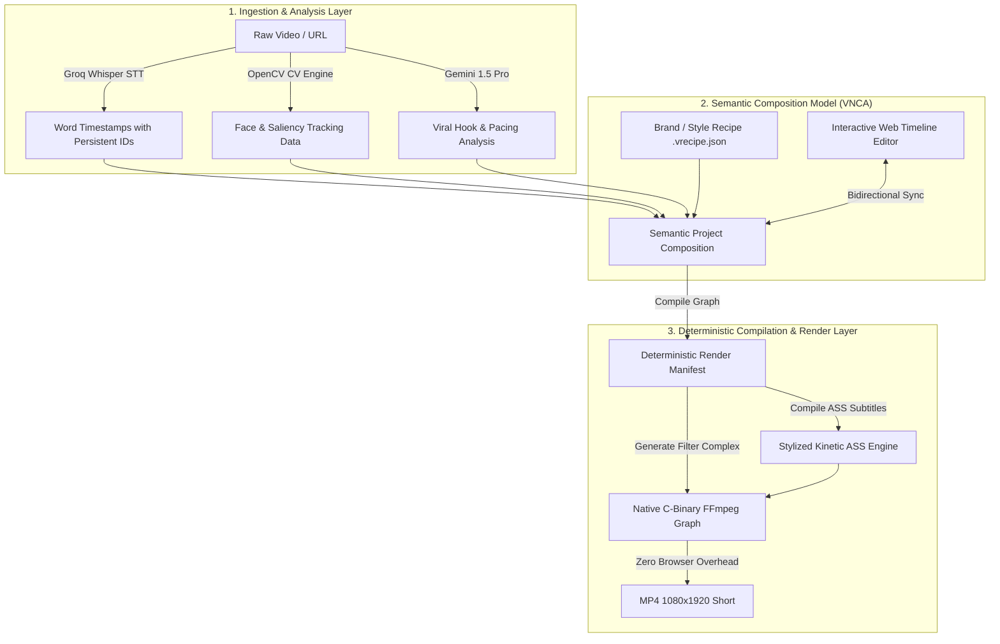
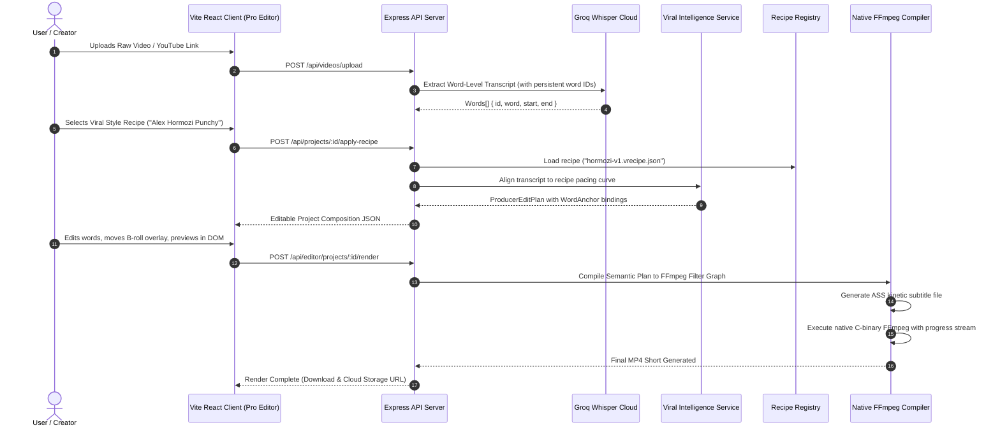

# VireoClip Native Composition Architecture Plan

> **Document Status:** Architectural Design & Integration Blueprint  
> **Target System:** VireoClip Video Creation Platform  
> **Approach:** Incremental Native Evolution (No Rewrite, Strict Backwards Compatibility)  
> **Author:** Principal Software Architect & AI Video Specialist  
> **Date:** October 2026  

---

## 1. Architectural Vision & Core Philosophy

VireoClip's existing architecture is powered by high-performance, deterministic C-binary FFmpeg rendering (`server/src/services/proEditorService.ts`, `captionService.ts`, and `smartReframeService.ts`) coupled with cloud AI services (Groq Whisper, Gemini 1.5 Pro). It is fast (8–12 seconds per 1080p short), cost-efficient ($0.003–$0.012 per export), and highly stable.

However, VireoClip currently exhibits an architectural vulnerability common to early-stage multi-track video editors: **Time-Coordinate Coupling**.
When a user trims, cuts, or edits words in the transcript, secondary assets (B-roll, stickers, captions, and sound effects) scheduled at absolute floating-point timestamps (`startTime: 14.52`) drift out of alignment with the speaker's voice.

Hypit approaches composition through a declarative, semantic markup language (`.svml`) where elements are projected relative to speech boundaries (`<semantic:Projection>`). While Hypit's execution model (headless Chromium browser capture) is unviable for multi-tenant SaaS, its **underlying semantic data abstraction is brilliant**.

This architecture plan outlines the **VireoClip Native Composition Architecture (VNCA)**. Instead of replacing VireoClip's engine with a slow browser renderer or adopting restricted `@hypit/*` code, we introduce:
1. **Semantic Word-Anchored Timeline Binding** (`anchor_word_id`) within the existing `EditorProject` and `ProducerEditPlan`.
2. **Declarative Vireo Style Recipes (`.vrecipe.json`)** to standardize brand visual identity, kinetic captioning presets, and aspect-ratio safe zones.
3. **Reference-Driven Viral Structure Blueprint Engine** to extract and apply viral pacing templates to raw footage.
4. **Deterministic FFmpeg Render Graph Compiler** that maps semantic anchor references directly to frame-accurate FFmpeg filter-complex graphs.



---

## 2. Core Architectural Components

### 2.1 Component 1: Word-Anchored Semantic Timeline

#### Problem Solved:
In the current editor (`src/types/editor.ts` and `server/src/types/producer.ts`), secondary tracks (`broll`, `textOverlays`, `soundEffects`) use absolute time offsets (`startTime: 4.2`, `endTime: 7.8`). If the creator cuts a filler sentence at `00:02.00` in the transcript, every subsequent overlay becomes desynchronized from the spoken subject.

#### Native Architectural Solution:
Extend `TimelineItem` and `BrollOverlay` with an optional `anchor` object that binds the asset directly to word IDs produced during transcription.

#### Data Schema Extension:
```typescript
// server/src/types/producer.ts and src/types/editor.ts

export interface WordAnchor {
  anchorWordId: string;         // e.g., "w_0042" (Globally unique word ID)
  endWordId?: string;           // Optional: binds duration to a phrase
  offsetMs: number;             // Micro-alignment offset relative to anchor word start (+/- ms)
  dockingBehavior: 'lock-to-word' | 'ripple-with-speech' | 'absolute-time';
}

export interface BrollOverlay {
  id: string;
  sourceUrl: string;
  type: 'video' | 'image' | 'sticker';
  startTime: number;            // Fallback absolute timestamp (computed dynamically)
  endTime: number;              // Fallback absolute timestamp
  duration: number;
  anchor?: WordAnchor;          // SEMANTIC ANCHOR BINDING
  volume?: number;
  opacity?: number;
  cropPreset?: 'fill' | 'fit' | 'pip' | 'split';
  transition?: {
    type: 'fade' | 'slide_up' | 'zoom' | 'none';
    durationMs: number;
  };
}
```

#### How Ripple Editing Works:
When words are deleted or re-ordered in the transcript:
1. The client-side timeline manager recalculates word start/end times.
2. Any overlay with `anchor.dockingBehavior === 'ripple-with-speech'` dynamically computes its new `startTime` as:
   $$\text{startTime} = \text{word}(\text{anchorWordId}).start + \text{offsetMs}$$
3. Zero manual re-alignment is required by the creator.

---

### 2.2 Component 2: Declarative Brand & Style Recipes (`.vrecipe.json`)

#### Problem Solved:
Currently, caption styles, font choices, colors, and layout rules are spread across multiple ad-hoc constants (`captionService.ts`, `proEditorService.ts`, and frontend editor components). Users cannot easily export, import, or brand-standardize their video styles across team workspaces.

#### Native Architectural Solution:
Introduce **Vireo Style Recipes** (`.vrecipe.json`), an open, versioned declarative JSON schema inspired by Hypit's `.svs` recipes, but tailored to VireoClip's native ASS and FFmpeg capabilities.

#### Recipe Schema Definition:
```typescript
// server/src/types/recipe.ts

export interface VireoStyleRecipe {
  version: '1.0.0';
  id: string;
  name: string;
  description?: string;
  targetAspectRatio: '9:16' | '16:9' | '1:1' | '4:5';
  
  // Safe Margins for TikTok / IG Reels / YouTube Shorts UI
  safeArea: {
    topInsetPercent: number;     // e.g., 12% (Header / Search / Audio icon)
    bottomInsetPercent: number;  // e.g., 20% (Account tag / caption / CTA bar)
    rightInsetPercent: number;   // e.g., 15% (Like, Comment, Share rail)
    leftInsetPercent: number;    // e.g., 4%
  };

  // Kinetic Caption Typography and Theming
  captions: {
    fontFamily: string;          // e.g., 'Montserrat', 'Inter', 'League Spartan'
    fontSize: number;            // Normalized font size relative to 1080p canvas
    fontWeight: 'normal' | 'bold' | 'black';
    primaryColor: string;        // Hex: #FFFFFF
    highlightColor: string;      // Hex: #FDE047 (Active karaoke word color)
    strokeColor: string;         // Hex: #000000
    strokeWidth: number;
    shadowColor?: string;
    shadowOffset?: number;
    textCase: 'uppercase' | 'lowercase' | 'preserve';
    wordsPerBatch: number;       // 1-3 words (High engagement pacing)
    animationPreset: 'pop' | 'glow' | 'bounce' | 'fade' | 'none';
    verticalPositionPercent: number; // e.g., 72% (within safe zone)
  };

  // Video Reframing & Visual Treatments
  visual: {
    reframingMode: 'smart_crop' | 'blurred_background' | 'split_screen';
    colorGradingPreset?: 'vibrant' | 'cinematic' | 'warm' | 'clean' | 'none';
    zoomIntensity: number;       // 1.0 = none, 1.08 = subtle dynamic zoom on key sentences
  };

  // Audio Mixing Rules
  audio: {
    speechNormalization: 'ebu_r128' | 'peak';
    bgmDuckingDb: number;        // e.g., -18dB reduction during active dialogue
    soundEffectsEnabled: boolean;
  };
}
```

---

### 2.3 Component 3: Viral Structure Blueprint Engine

#### Problem Solved:
VireoClip currently segments video clips using speech silence and AI score thresholds (`segmentationService.ts`, `highlightScoreService.ts`), but lacks the capability to analyze high-performing external viral formats (hook pacing, scene change cadence, B-roll frequency) and apply that structural blueprint to raw footage.

#### Native Architectural Solution:
Build an independent **Viral Intelligence Service** (`server/src/services/viralIntelligenceService.ts`):
1. **Blueprint Ingestion:** Receives a viral reference video URL (via VireoClip's existing `videoService.ts`), transcribes it, and analyzes scene change frequency via OpenCV and audio cadence via FFmpeg silence detection.
2. **Structural Manifest:** Generates a reusable `ViralBlueprint`:
   - Hook Window ($0.0s - 3.2s$): Rapid word pace ($>3.8$ words/sec), immediate visual change at $1.8s$.
   - Body Retention Cycles: New B-roll or dynamic zoom every $2.5s - 4.0s$.
   - Climax / CTA: Call to action placement at the final $3.0s$.
3. **Application to Local Video:** Matches the user's raw transcript to the blueprint's pacing curve to select clip boundaries and overlay timings automatically.

---

### 2.4 Component 4: Unified FFmpeg Render Graph Compiler

#### Problem Solved:
The current renderer constructs FFmpeg filter strings through sequential string concatenation in `proEditorService.ts`. While functional, complex filter graphs involving simultaneous face tracking crops, blurred background underlays, B-roll alpha overlays, audio ducking, and ASS subtitles can become fragile and difficult to test.

#### Native Architectural Solution:
Implement a formal, declarative **FFmpeg Filter Graph Builder** (`server/src/services/ffmpeg/filterGraphBuilder.ts`):
- Models nodes (`ScaleNode`, `CropNode`, `OverlayNode`, `AssSubtitleNode`, `SidechainDuckNode`) as typed graph vertices.
- Performs topological sort and validation before passing the final string to FFmpeg.
- Validates input asset dimensions and audio channels prior to process launch.
- Provides automatic graceful fallback (e.g., if a B-roll clip has corrupted audio or missing frames, the compiler automatically substitutes a black frame or skips the layer without failing the whole render).

---

## 3. Component Interaction & Data Flow



---

## 4. Backwards Compatibility & Migration Strategy

To avoid disrupting any active projects or existing users, the architectural rollout is designed as **purely additive**:

1. **Database Schema:**
   - Add nullable column `recipe_id` to `projects` table.
   - Add JSONB column `semantic_metadata` to `editor_projects` table.
   - Existing records without semantic anchors will continue to render using absolute time offsets without modification.
2. **API Routes:**
   - Existing endpoints (`POST /api/clips/create`, `POST /api/editor/projects/render`) remain 100% functional.
   - New endpoints (`GET /api/recipes`, `POST /api/recipes/apply`, `POST /api/viral/analyze-reference`) are introduced under `/api/v2/`.
3. **Frontend Editor:**
   - The timeline UI will check if an item contains an `anchor`. If present, it binds the item visually to the transcript block. If absent, it renders in standard absolute time mode.

---

## 5. Architectural Comparison: VireoClip Native vs. Hypit

| Architectural Pillar | Hypit Implementation | Recommended VireoClip Native (VNCA) | Verdict & Rationale |
| :--- | :--- | :--- | :--- |
| **Execution Runtime** | Headless Chrome (Puppeteer) + FFmpeg muxer | Native C-binary FFmpeg child process | **VireoClip is vastly superior.** Headless Chrome requires 1.5GB RAM/job and renders 4–6x slower. FFmpeg requires ~200MB RAM and renders in seconds. |
| **Composition Model** | Proprietary XML DSL (`.svml`) | Versioned JSON (`EditorProject` + `ProducerEditPlan`) | **JSON is standard and extensible.** Direct serialization to web frontend without complex XML AST compilation. |
| **Speech Alignment** | Local PyTorch WhisperX | Cloud-hosted Groq Whisper API | **Cloud Whisper is faster and lighter.** Whisper-large-v3 runs in <2s with zero GPU infrastructure maintenance costs. |
| **Asset Anchoring** | Semantic Projection to speech tags | `anchor_word_id` on timeline items | **Direct concept parity with zero license risk.** Enables true ripple editing. |
| **Style Management** | SVS recipe files | `.vrecipe.json` standard schema | **Clean-room schema design.** Fully interoperable with VireoClip's ASS subtitle engine. |
| **License Compliance** | Modified Apache-2.0 (Anti-SaaS) | VireoClip Proprietary / Clean-Room | **Zero legal risk.** Complete commercial freedom. |

---

## 6. Regression & Failure Risk Mitigation

1. **Word ID Stability Risk:**  
   *Risk:* If transcription is re-run, word IDs might change, breaking existing anchors.  
   *Mitigation:* Store immutable word IDs based on hash of word index and timestamp (`w_${index}_${Math.round(start*1000)}`). Never regenerate word IDs unless explicitly triggered by user re-transcription.
2. **FFmpeg Filter Graph Complexity Risk:**  
   *Risk:* Excessive overlays could exceed FFmpeg command-line string length limits.  
   *Mitigation:* Use FFmpeg's `-filter_complex_script` option to pass the filter graph via a temporary script file on disk rather than inline CLI arguments.
3. **Font Rendering Inconsistency:**  
   *Risk:* Custom fonts specified in a Style Recipe might not be installed on the Linux render host.  
   *Mitigation:* Maintain a centralized system fonts directory (`server/assets/fonts/`) pre-loaded with Google Fonts (Montserrat, Inter, League Spartan, Archivo Black) and configure FFmpeg `fontconfig` to prioritize this path.
