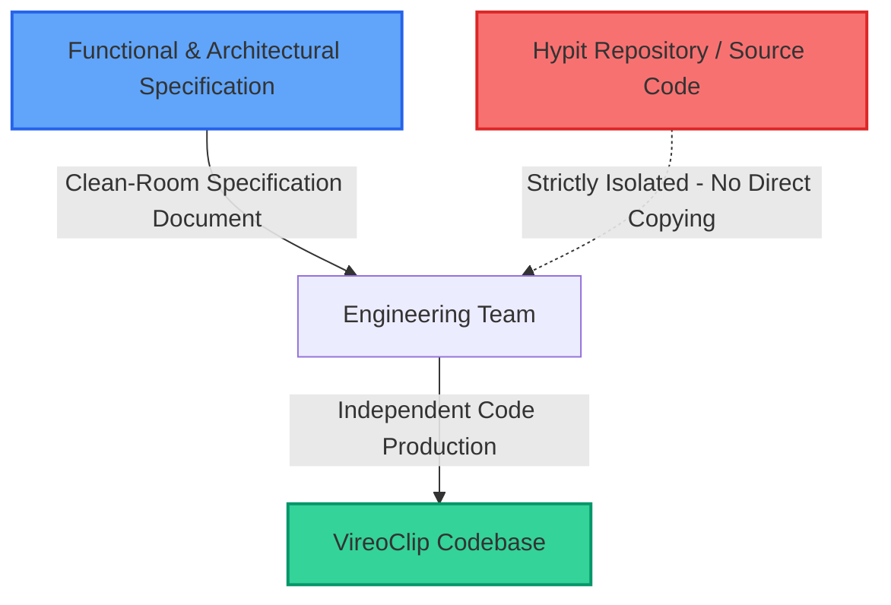

# VireoClip × Hypit: Legal, Licensing & Technical Reuse Audit

> **Document Status:** Comprehensive Audit Completed  
> **Target System:** VireoClip (Commercial Multi-Tenant AI Video SaaS Platform)  
> **Subject Repository:** Hypit (`https://github.com/hypit-ai/hypit`, commit ref v0.3.1)  
> **Auditor Role:** Principal Software Architect & Open-Source Licensing Reviewer  
> **Date:** October 2026  

---

## 1. Executive Summary & Legal Verdict

A thorough, line-by-line inspection of the official Hypit repository (`scratch/hypit/LICENSE`, `package.json`, and monorepo package manifests) reveals that **Hypit is NOT distributed under standard, unrestricted open-source terms.** 

Hypit is published under a **Modified Apache License 2.0 with aggressive non-compete, anti-SaaS, and commercial redistribution restrictions**. 

### The Core Legal Verdict:
1. **Direct Package Inclusion (`@hypit/*`) is Strictly Prohibited in VireoClip SaaS:**  
   Clause 1.a explicitly forbids using Hypit source code or derivative works to operate a multi-tenant environment or hosted Software-as-a-Service (SaaS) platform without prior written authorization from Hypit.AI. Because VireoClip operates as a multi-tenant SaaS with user accounts, team workspaces, billing tiers, and shared render workers, **installing any `@hypit/*` package or copying any Hypit source file into VireoClip's backend or frontend constitutes a direct license violation and creates severe copyright infringement liability.**
2. **Concept Reuse & Clean-Room Independent Implementation is Legally Sound:**  
   Copyright protects the *specific expression* of software code, not abstract ideas, algorithmic procedures, or architectural concepts (17 U.S.C. § 102(b)). VireoClip can freely adopt architectural principles pioneered or illustrated in Hypit—such as **Word-Anchored Semantic Projections**, **Declarative Style/Brand Recipes**, and **Reference Video Structural Blueprints**—provided all data structures, parsers, and engines are **independently authored from scratch (Clean-Room Implementation)** without copying Hypit’s source code, AST definitions, or proprietary grammar.
3. **Producer Unilateral Agreement Alteration Clause (Clause 2.a):**  
   Hypit's license explicitly states that the producer reserves the right to retroactively or prospectively alter the licensing terms to become more strict. Relying on Hypit code creates an existential supply-chain vulnerability.

---

## 2. Line-by-Line Analysis of the Hypit License

The full text from `scratch/hypit/LICENSE` was inspected directly from the repository. Below is the detailed legal breakdown of each clause:

```
Hypit is licensed under a modified version of the Apache License 2.0, with the following additional conditions:

1. Hypit may be utilized commercially for your own organization's purposes, including as a rendering or generation backend for applications your organization operates for itself, and as internal tooling within an enterprise. Should any of the conditions below be met, a commercial license must be obtained from the producer:
```

### Clause 1.a: Multi-Tenant Service Restriction (The "Anti-SaaS" Clause)
> *"Unless explicitly authorized by Hypit.AI in writing, you may not use the Hypit source code, or any derivative work of it, to operate a multi-tenant environment, or to offer Hypit's functionality to third parties as a hosted, managed, or software-as-a-service offering.*  
> *- Tenant Definition: Within the context of Hypit, one tenant corresponds to one workspace — the isolated set of projects, artifacts, credentials, and configuration belonging to a single party. Operating an environment in which two or more parties outside your own organization hold separate workspaces constitutes a multi-tenant service, whether or not a fee is charged."*

* **Analysis for VireoClip:**  
  VireoClip is intrinsically a multi-tenant SaaS. Its database schema (`users`, `projects`, `clips`, `billing_subscriptions`) partitions data by `user_id` and organization workspace. Third-party users sign up, upload footage, and export clips. Hypit’s definition of a tenant explicitly encompasses VireoClip's exact business model ("two or more parties outside your own organization hold separate workspaces... whether or not a fee is charged").
* **Legal Consequence:** Any use of Hypit source code or npm packages within VireoClip's SaaS cluster violates Clause 1.a.

### Clause 1.b: Commercial Redistribution Restriction
> *"Unless explicitly authorized by Hypit.AI in writing, you may not sell, license for a fee, or otherwise supply for commercial gain Hypit or any derivative work of it, whether standalone or as a component of, or bundled with, any product, application, package, or device provided to third parties.*  
> *- Permitted without a commercial license under clauses (a) and (b): obtaining Hypit and running it yourself on your own infrastructure; using it for your own organization's work, including commercial work and work performed for your clients; and single-tenant deployments operated by and for one organization."*

* **Analysis for VireoClip:**  
  VireoClip charges subscription fees (Pro, Team, Enterprise). Bundling Hypit or distributing it as part of VireoClip’s commercial product falls squarely under "supplied for commercial gain... as a component of, or bundled with, any product".
* **Legal Consequence:** Even if deployed on dedicated single-tenant enterprise clusters, if VireoClip packages Hypit into its commercial product sold to clients, Clause 1.b triggers the requirement for a negotiated commercial license from Hypit.AI.

### Clause 1.c: Logo and Copyright Retention Requirement
> *"In the process of using Hypit, you may not remove or modify the name, LOGO, or copyright information presented in the Hypit command-line interface, its generated run reports and manifests, or any user-facing surface derived from them. This restriction is inapplicable to uses of Hypit that do not surface these components to a user."*

* **Analysis for VireoClip:**  
  VireoClip is a white-labeled commercial SaaS product. Retaining Hypit’s logo, name, and watermark on generated manifests or UI surfaces contradicts VireoClip's brand identity.

### Clause 2.a & 2.b: Producer Rights and Contributor IP
> *"2. As a contributor, you should agree that:*  
> *a. The producer can adjust the open-source agreement to be more strict or relaxed as deemed necessary.*  
> *b. Your contributed code may be used for commercial purposes, including but not limited to its cloud business operations."*

* **Analysis for VireoClip:**  
  Clause 2.a is an extraordinary non-standard covenant: Hypit.AI reserves unilateral authority to make the license more restrictive at any time without user recourse. Basing production infrastructure on code governed by such terms introduces unacceptable operational and business risk.

### Clause 3: Ownership of Output
> *"3. Ownership of output: The producer claims no rights in the content you create with Hypit. Videos, audio, images, manifests, and any other artifacts produced through your use of Hypit belong to you, and this license imposes no conditions on their use — including commercial use."*

* **Analysis for VireoClip:**  
  While the outputs of Hypit (videos, rendered assets) are owned by the operator, this does not cure the operational breach of running the software in a multi-tenant environment.

---

## 3. Dependency & Sub-Package License Audit

Hypit utilizes several open-source and third-party dependencies across its 86 packages. We audited their licenses to determine if underlying third-party libraries carry separate risks:

| Package / Technology | Hypit Usage | Governing License | VireoClip Risk Assessment |
| :--- | :--- | :--- | :--- |
| **`koffi`** (`v3.2.1`) | C FFI bindings in `@hypit/media-local` | MIT | Zero risk. Permissive open-source FFI bridge. VireoClip does not need C FFI bindings since it executes native FFmpeg child processes directly. |
| **`linkedom`** (`v0.18.13`) | Server-side DOM parsing in `@hypit/html-program` | MIT | Permissive. VireoClip does not rely on server-side DOM emulation. |
| **`puppeteer`** | Headless Chrome browser capture | Apache 2.0 | Permissive, but Puppeteer rendering in multi-tenant SaaS incurs severe RAM (1.5GB/worker) and performance overhead. |
| **`whisperx`** | PyTorch word-level audio alignment | BSD-2-Clause / GPL elements | Permissive BSD license, but requires CUDA/PyTorch runtime, 4GB GPU VRAM, and complex Python C-extensions. |
| **`yt-dlp`** | YouTube/TikTok media ingestion | Unlicense / Public Domain | Permissive public domain tool, but VireoClip already has a battle-tested native ingestion pipeline in `server/src/services/videoService.ts` utilizing `yt-dlp` with cookie injection and proxy rotation. |
| **`@fontsource/*`** | Montserrat, Inter, League Spartan fonts | SIL Open Font License (OFL 1.1) | Permissive for font bundling and rendering in commercial video projects. Compatible with VireoClip. |

---

## 4. Concept Reuse vs. Code Reuse: Legal Boundaries

Under international copyright law (WIPO Copyright Treaty) and U.S. Copyright Law (17 U.S.C. § 102(b)):
> *"In no case does copyright protection for an original work of authorship extend to any idea, procedure, process, system, method of operation, concept, principle, or discovery, regardless of the form in which it is described, explained, illustrated, or embodied in such work."*

### What VireoClip CANNOT Legally Do:
1. `npm install @hypit/compiler` or any other `@hypit/*` package in `package.json`.
2. Copy-paste TypeScript classes, interfaces, regex grammars, or parser algorithms from `scratch/hypit/packages/*` into VireoClip.
3. Bundle Hypit’s binary executable (`bin/hypit.mjs`) into VireoClip’s backend container.
4. Distribute Hypit’s markup schema (`.svml`) or runtime definitions under Hypit’s copyright.

### What VireoClip CAN Legally & Technically Do:
1. **Design a Native Word-Anchored Data Model:**  
   VireoClip can independently extend its existing `ProducerEditPlan` and `EditorProject` to include an `anchor_word_id` field on timeline overlay tracks. This is an abstract data-binding method, completely independent of Hypit's expression.
2. **Develop a VireoClip Style Recipe Specification (`.vrecipe.json`):**  
   VireoClip can create a structured JSON schema defining brand typography, caption colors, kinetic motion presets, and layout constraints. Declarative styling is an industry-wide concept (used in CSS, Figma, After Effects, Motion Graphics Templates).
3. **Build an External Viral Structure Analyzer:**  
   VireoClip can independently build a Gemini 1.5 Pro prompt that receives a transcript and video metadata, calculates scene pacing and hook velocity, and emits an editing blueprint.
4. **Implement Clean-Room Code Authorship:**  
   All code written for VireoClip must be written independently by developers referencing only VireoClip's architecture and standard public specifications, without accessing Hypit's proprietary source files during code production.

---

## 5. Feature-by-Feature Reuse Strategy

| Feature Area | Hypit Reference Package | Reuse Strategy | Legal & Technical Justification |
| :--- | :--- | :--- | :--- |
| **Word-Anchored Overlays** | `@hypit/markup`, `@hypit/compiler` (`<semantic:Projection>`) | **BUILD NATIVE** (Clean-Room) | Hypit license strictly forbids multi-tenant SaaS package inclusion. VireoClip will natively bind overlays to its existing Whisper word timestamps (`WordTimestamp[]`) in `server/src/types/producer.ts`. |
| **Viral Structure Extractor** | `@hypit/recipe`, `@hypit/narrative-temporal` | **BUILD NATIVE** (Clean-Room) | Concept of parsing viral rhythm is uncopyrightable; VireoClip will build an independent Gemini 1.5 Pro pipeline in `server/src/services/viralIntelligenceService.ts`. |
| **Declarative Style Recipes** | `@hypit/recipe` (`.svs`) | **BUILD NATIVE** (Clean-Room) | Schema designed natively to map directly to VireoClip's existing ASS subtitle styler and Tailwind theme tokens. |
| **AI Stock Fallback Generation** | `@hypit/gpt-image`, `@hypit/pixverse` | **BUILD NATIVE / INTEGRATE** | Replicate / OpenAI APIs are public commercial APIs. VireoClip will integrate them natively via standard SDKs when Pexels/Pixabay stock assets are insufficient. |
| **Browser DOM Video Rendering** | `@hypit/browser-capture` | **REJECT** | Legally prohibited under SaaS terms; technically catastrophic for multi-tenant scalability (high RAM, slow frame rate). VireoClip retains native C-binary FFmpeg. |
| **Audio-Visual Stems & Ducking** | `@hypit/audio-track` | **REUSE EXISTING VIREOCLIP** | VireoClip already has `audioEnhancementService.ts` utilizing native FFmpeg `sidechaincompress`, `loudnorm`, and `highpass/lowpass`. Hypit adds no incremental value here. |
| **OpenCV Video Reframing** | `@hypit/provider-image-opencv-local` | **REUSE EXISTING VIREOCLIP** | VireoClip already has `smartReframeService.ts` running OpenCV face/speaker tracking and multi-speaker split-screen layouts. |

---

## 6. Clean-Room Implementation Protocol

To guarantee zero intellectual property contamination and absolute immunity from copyright or license infringement claims, the VireoClip engineering team must adhere to this strict Clean-Room Protocol:



### Protocol Rules:
1. **Specification Isolation:** Developers writing production code for VireoClip must work exclusively from functional architecture specifications (`docs/vireoclip-hypit-audit/VIREO_COMPOSITION_ARCHITECTURE_PLAN.md` and `VIREO_FEATURE_IMPLEMENTATION_PLAN.md`).
2. **No Code Copying:** Under no circumstances may any code, regex pattern, type declaration, or token definition be copied or translated from Hypit into VireoClip.
3. **No Dependency Infiltration:** The package `@hypit/*` or any repository submodule must never appear in `package.json`.
4. **Independent Schema Naming:** Data models must follow VireoClip’s existing naming conventions (`camelCase`, `TypeScript` interfaces matching `ProducerEditPlan` and `EditorProject`).

---

## 7. Legal & Dependency Risk Register

| Risk ID | Category | Severity | Description | Mitigation Strategy |
| :--- | :--- | :--- | :--- | :--- |
| **RISK-LEG-01** | License Infringement | **CRITICAL** | Direct import of `@hypit/*` packages into VireoClip's SaaS backend violates Hypit Clause 1.a (Anti-SaaS) and 1.b (Commercial Redistribution). | **Strict prohibition:** Zero `@hypit/*` packages in `package.json`. Enforce Clean-Room implementation for all adopted concepts. |
| **RISK-LEG-02** | Unilateral License Change | **HIGH** | Hypit Clause 2.a allows the creator to alter license terms arbitrarily at any time. | By building native VireoClip implementations, VireoClip has zero dependency on Hypit's repository, rendering future license changes irrelevant. |
| **RISK-LEG-03** | Copyright Contamination | **MEDIUM** | Unintentional copying of AST or grammar structures could invite copyright infringement claims. | Follow the Clean-Room Protocol. Ensure all ASTs, data structures, and parser engines are independently architected. |
| **RISK-DEP-01** | Headless Chrome Bloat | **HIGH** | Attempting to adopt Hypit's browser-capture architecture would explode cloud RAM costs and degrade render speeds. | **Reject browser-capture.** Retain VireoClip's lightweight native FFmpeg filter-graph pipeline. |
| **RISK-DEP-02** | Heavy PyTorch Dependency | **MEDIUM** | Hypit's local WhisperX integration requires Python, PyTorch, and 4GB+ GPU VRAM. | VireoClip continues using ultra-fast, cloud-hosted Groq Whisper (Whisper-large-v3, sub-2s turnaround, 100% cloud). |

---

## 8. Summary of Legal & Architectural Recommendations

1. **Do not contact Hypit.AI for a commercial license:** The commercial and technical costs of Hypit's browser-rendering stack are fundamentally mismatched with a high-throughput, multi-tenant video editing SaaS.
2. **Execute Clean-Room Native Development:** Proceed with the native implementation of Word-Anchored Overlays, Viral Structure Blueprints, and Style Recipes within VireoClip's existing Node.js/FFmpeg architecture.
3. **Preserve VireoClip's Core Engine:** VireoClip’s native C-binary FFmpeg pipeline, Groq Whisper STT, and OpenCV computer vision remain superior in speed, cost, and legal safety.
