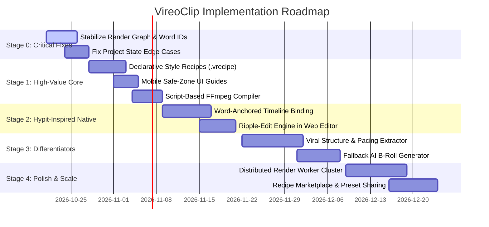

# VireoClip Implementation Roadmap & Governance

> **Document Status:** Prioritized Phased Implementation Roadmap & Governance Plan  
> **Target System:** VireoClip Video Creation Platform  
> **Author:** Principal Software Architect & Product Strategist  
> **Date:** October 2026  

---

## 1. Executive Roadmap Strategy

This roadmap balances immediate product stability and core editing enhancements with high-impact capabilities inspired by the Hypit audit. Every initiative is prioritized based on **demonstrated user value, risk reduction, operational cost-efficiency, and technical feasibility**.

---

## 2. Stage-by-Stage Implementation Plan

### Stage 0 — Critical Fixes & Foundation Integrity (P0)
*Objective: Guarantee 100% data integrity, eliminate render crashes, and establish persistent word identification.*

| Item ID | Priority | Decision | Item Name | User Value | Effort | Dependencies | Main Risks | Acceptance Criteria & Regression Tests |
| :--- | :--- | :--- | :--- | :--- | :--- | :--- | :--- | :--- |
| **S0-01** | **P0** | **BUILD NATIVE** | **Deterministic Word ID Generation** | Critical foundation for timeline anchor stability. Prevents ID mutation on re-transcription. | **S** | None | Hash collisions across repeated words. | *Criteria:* Every word object receives an immutable `id: "w_${idx}_${hash}"`. *Regression Test:* Transcribing the same audio twice yields identical word IDs. |
| **S0-02** | **P0** | **BUILD NATIVE** | **FFmpeg Script-File Argument Adapter** | Eliminates `E2BIG` (argument list too long) OS crashes when rendering projects with 15+ overlay layers. | **S** | None | Temporary file cleanup on unhandled exceptions. | *Criteria:* `-filter_complex_script` executes flawlessly with 50+ concatenated filters. *Regression Test:* Synthetic test with 100 overlays renders without error. |
| **S0-03** | **P0** | **ADAPT** | **Render Error Diagnostics & Recovery** | Clear error messages when video assets are corrupted or missing. Graceful asset fallback. | **S** | None | Incomplete FFmpeg error logs. | *Criteria:* Corrupted B-roll logs a warning and renders placeholder rather than aborting job. *Regression Test:* Render project with 1 invalid asset path; finishes successfully. |

---

### Stage 1 — High-Value Core Improvements (P1)
*Objective: Standardize brand styling across projects and eliminate caption clipping on mobile platforms.*

| Item ID | Priority | Decision | Item Name | User Value | Effort | Dependencies | Main Risks | Acceptance Criteria & Regression Tests |
| :--- | :--- | :--- | :--- | :--- | :--- | :--- | :--- | :--- |
| **S1-01** | **P1** | **BUILD NATIVE** | **Declarative Style Recipes (`.vrecipe.json`)** | Creators can apply consistent typography, colors, animations, and audio ducking in 1 click. | **M** | S0-01 | Schema versioning divergence. | *Criteria:* Pre-built JSON recipes (Hormozi, MrBeast, Minimalist) correctly modify ASS subtitle styles. *Regression Test:* Render projects under all 4 default recipes; inspect styling. |
| **S1-02** | **P1** | **BUILD NATIVE** | **Mobile Safe-Zone UI Guides** | Prevents video captions and titles from being hidden behind TikTok/Reels UI buttons and captions. | **S** | S1-01 | Viewport aspect ratio scaling discrepancies. | *Criteria:* Editor preview displays interactive mobile UI overlays (top 12%, bottom 20%, right 15%). *Regression Test:* Automated pixel overlap check passes. |
| **S1-03** | **P1** | **BUILD NATIVE** | **Kinetic Karaoke Motion Presets** | Eye-catching pop, glow, and bounce text animations for high viewer retention. | **M** | S1-01 | FFmpeg ASS libass rendering version differences. | *Criteria:* ASS karaoke tags `{\k...}` render with smooth scale/glow transitions. *Regression Test:* Frame-by-frame subtitle scale verification. |

---

### Stage 2 — Hypit-Inspired Native Capabilities (P1)
*Objective: Deliver true semantic timeline binding so transcript edits never cause B-roll or overlay drift.*

| Item ID | Priority | Decision | Item Name | User Value | Effort | Dependencies | Main Risks | Acceptance Criteria & Regression Tests |
| :--- | :--- | :--- | :--- | :--- | :--- | :--- | :--- | :--- |
| **S2-01** | **P1** | **BUILD NATIVE** | **Word-Anchored Timeline Schema & Resolver** | B-roll overlays, text stickers, and SFX bind to word IDs (`anchor_word_id`) rather than static seconds. | **M** | S0-01 | Floating point rounding drift on long videos ($>30$ mins). | *Criteria:* Deleting words in transcript automatically ripples anchored overlays. *Regression Test:* Delete 5 seconds of dialogue; verify overlay maintains sync within $\pm 33\text{ms}$. |
| **S2-02** | **P1** | **BUILD NATIVE** | **Client-Side Ripple Editing UX** | Visual indicators in timeline showing anchor links between transcript words and timeline tracks. | **M** | S2-01 | Canvas redraw performance during rapid scrub. | *Criteria:* Moving a clip displays magnetic snap line to corresponding transcript word. *Regression Test:* Manual UI test on 60fps display; zero UI hitching. |
| **S2-03** | **P2** | **BUILD NATIVE** | **Semantic B-roll Auto-Suggestions** | Auto-places relevant stock visuals at exact spoken keyword intervals using Gemini Flash. | **M** | S2-01 | Over-clustering of B-roll in short time windows. | *Criteria:* Auto-suggests 3–5 B-roll clips for a 30s video with minimum 2.5s spacing. *Regression Test:* Benchmark on 10 diverse podcast transcripts. |

---

### Stage 3 — Differentiating Workflows (P2)
*Objective: Reference-video pacing extraction and fallback generative AI assets for niche topics.*

| Item ID | Priority | Decision | Item Name | User Value | Effort | Dependencies | Main Risks | Acceptance Criteria & Regression Tests |
| :--- | :--- | :--- | :--- | :--- | :--- | :--- | :--- | :--- |
| **S3-01** | **P2** | **BUILD NATIVE** | **Viral Structure Blueprint Extractor** | Reverse-engineers pacing, hook duration, and cut density from external viral TikTok/Reels URLs. | **L** | `videoService`, S1-01 | URL download rate limits by external platforms. | *Criteria:* Extracts `ViralBlueprint` JSON in $<20\text{s}$ from public MP4 URL. *Regression Test:* Run extraction on 10 known viral reference clips. |
| **S3-02** | **P2** | **BUILD NATIVE** | **Blueprint-Guided Highlight Selection** | Directs clip segmentation to match proven retention curves from the viral blueprint. | **M** | S3-01 | Inflexible pacing rules forcing awkward audio cuts. | *Criteria:* Generated clips exhibit rapid hook pacing ($>3.2$ words/sec) in initial 3 seconds. *Regression Test:* Human review of 20 test clips for narrative flow. |
| **S3-03** | **P2** | **BUILD NATIVE / INTEGRATE** | **Fallback AI B-Roll Generator** | Generates photorealistic visuals via Flux Schnell when Pexels/Pixabay stock search yields 0 hits. | **M** | `brollService` | Third-party API rate limits or latency spikes. | *Criteria:* Generates and applies Ken Burns motion video in $<4\text{s}$ for abstract keywords. *Regression Test:* Run search on 20 abstract terms ("quantum foam", "cybernetic synapse"). |

---

### Stage 4 — Optimization, Polish & Scaling (P3)
*Objective: Cloud render scaling, batch project exports, and creator template sharing.*

| Item ID | Priority | Decision | Item Name | User Value | Effort | Dependencies | Main Risks | Acceptance Criteria & Regression Tests |
| :--- | :--- | :--- | :--- | :--- | :--- | :--- | :--- | :--- |
| **S4-01** | **P3** | **BUILD NATIVE** | **Distributed Render Worker Pool** | Scale FFmpeg rendering horizontally across stateless container workers using Redis/BullMQ. | **L** | S0-02 | Shared storage I/O bottlenecks. | *Criteria:* Cluster handles 50 concurrent render jobs with zero degradation. *Regression Test:* Load test with 50 simultaneous exports. |
| **S4-02** | **P3** | **BUILD NATIVE** | **Custom Brand Recipe Creator & Sharing** | Users can create, save, export, and share custom `.vrecipe.json` files with team members. | **M** | S1-01 | Invalid user JSON uploads. | *Criteria:* Full JSON Schema validation on recipe upload with instant preview. *Regression Test:* Upload corrupted JSON; verify graceful rejection. |
| **S4-03** | **P3** | **ADAPT** | **Multi-Variant Batch Generation** | Export a single clip in multiple aspect ratios (9:16, 1:1, 16:9) and styles simultaneously. | **M** | S1-01, S4-01 | Disk space exhaustion during multi-export. | *Criteria:* Single click produces 3 aspect ratio exports within 1.5x of single-export time. *Regression Test:* Multi-export comparison test. |

---

## 3. The "Do Not Build Yet" Governance List

To protect VireoClip from unnecessary operational complexity, financial waste, and legal liability, the following capabilities evaluated from Hypit are **strictly prohibited from development at this time**:

| Prohibited Capability | Source in Hypit | Reason for Exclusion / Prohibition | Governing Trigger to Reconsider |
| :--- | :--- | :--- | :--- |
| **Browser-Based Chromium Video Rendering** | `@hypit/browser-capture` | **Legally prohibited** under Hypit modified Apache-2.0 SaaS restriction. **Technically catastrophic** for cloud costs (1.5GB RAM per worker, 5x slower than native FFmpeg). | **Never.** Native C-binary FFmpeg remains the gold standard for high-throughput video SaaS. |
| **Full Generative Synthetic Avatars / Deepfakes** | `@hypit/seedance`, `@hypit/wan` | Extreme inference costs ($1.15+ per clip). High latency ($>90\text{s}$). Irrelevant to VireoClip's core value proposition of repurposing existing user recordings. | Only if market demands synthetic AI talking-head generation as a separate paid add-on ($99+/mo). |
| **Local PyTorch WhisperX Deployment** | `@hypit/whisperx`, `@hypit/provider-whisperx-local` | Requires heavy Python/CUDA environment, 4GB+ GPU VRAM, and complex C-extensions. VireoClip's Groq Whisper-large-v3 achieves sub-2s latency at near-zero cost. | If an enterprise customer requires 100% on-premises, air-gapped transcription. |
| **Proprietary XML Markup Engine (`.svml`)** | `@hypit/markup`, `@hypit/compiler` | Unnecessary complexity. JSON (`EditorProject` + `.vrecipe.json`) is standard, directly serializable, and natively consumable by React and TypeScript without complex AST compilers. | **Never.** JSON is strictly superior for web application interoperability. |
| **Local Headless Chrome Puppeteer Capture** | `@hypit/browser-capture` | Fragile headless browser dependencies in Linux Docker containers (font rendering bugs, GPU acceleration crashes). | **Never.** |

---

## 4. Overall Effort & Investment Summary

| Stage | Estimated Engineering Duration | Cumulative Team Effort | Expected Product Milestone |
| :--- | :--- | :--- | :--- |
| **Stage 0 (Critical Fixes)** | 1.5 Weeks | 1 Senior Backend Engineer | 99.9% Render Stability, Zero Argument Overflow Errors |
| **Stage 1 (High-Value Core)** | 2.5 Weeks | 1 Full-Stack + 1 Frontend Engineer | Brand Recipes & Zero Mobile UI Caption Clipping |
| **Stage 2 (Hypit-Inspired Native)** | 3 Weeks | 1 Full-Stack + 1 Video Specialist | Non-Destructive Transcript Ripple Editing with Zero Drift |
| **Stage 3 (Differentiating Workflows)**| 3.5 Weeks | 1 Senior AI / Full-Stack Engineer | Viral Reference Pacing Engine & 100% B-roll Coverage |
| **Stage 4 (Polish & Scale)** | 4 Weeks | 2 Full-Stack Engineers | Enterprise Multi-Tenant Horizontal Scaling |
| **Total Comprehensive Plan** | **14.5 Weeks** | **~2 FTE Equivalent** | **Industry-Leading AI Short-Form Video Platform** |
