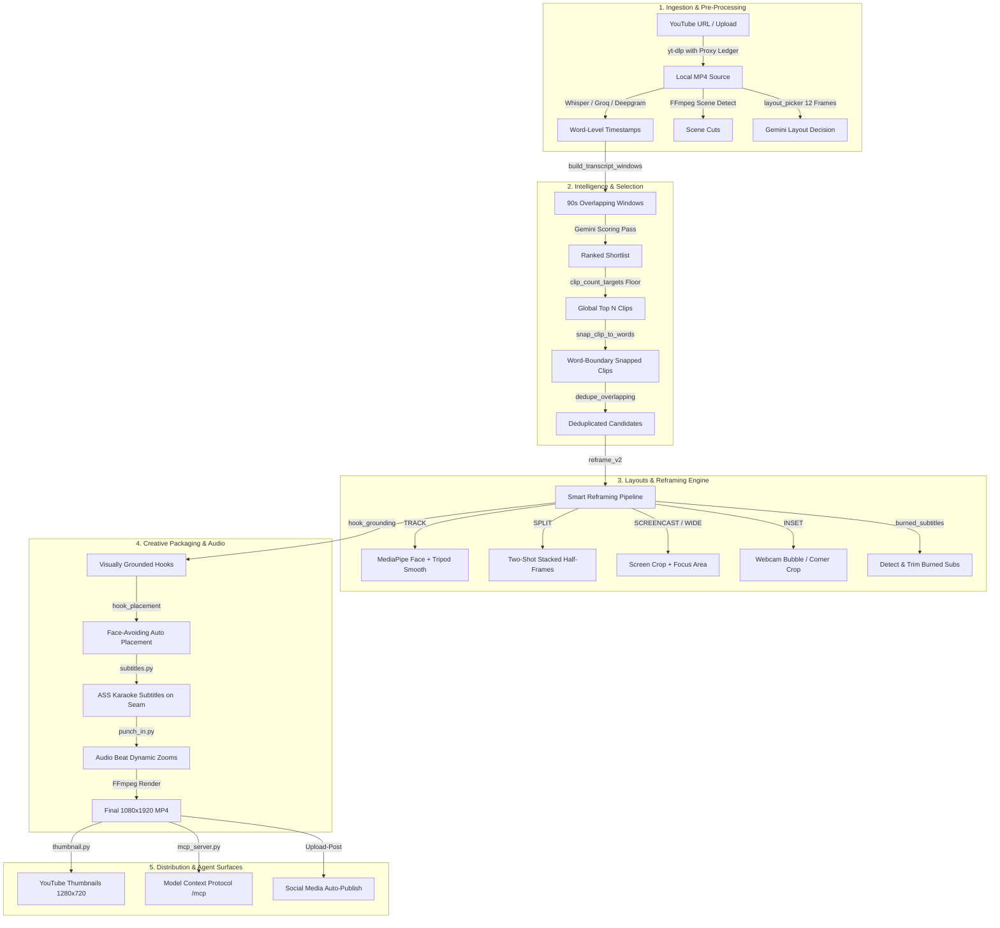

# OpenShorts Deep Technical Audit & Architecture Report

> **Subject Repository:** `https://github.com/mutonby/openshorts` (Cloned & Inspected at Commit HEAD)  
> **Auditor Role:** Principal Software Architect & AI Video Systems Specialist  
> **Date:** October 2026  
> **Audit Objective:** Deep technical decomposition of OpenShorts source code, pipelines, layouts, AI models, rendering, and agent integrations to identify high-impact capabilities for VireoClip.  

---

## 1. Executive Overview & System Architecture

OpenShorts is a specialized, production-oriented vertical video generation system designed to ingest long-form content (YouTube URLs or raw video uploads) and autonomously extract, reframe, subtitle, and style 9:16 short-form clips optimized for TikTok, Instagram Reels, and YouTube Shorts.

Unlike Hypit (which relies on headless Chromium browser-capture rendering and SVML markup), OpenShorts uses a **pure FFmpeg + Python/FastAPI pipeline** with multimodal AI models (Gemini 3.1 Flash-Lite, MediaPipe, YOLOv8, Whisper, and ElevenLabs).

---

## 2. In-Depth Subsystem Inspection & Code Evidence

### 2.1 Highlight Detection & Clip Selection (`clip_selection.py`, `gemini_worker.py`)
* **Core Mechanism:**
  * Uses 90-second scoring windows with 30-second overlaps snapped to Whisper segment boundaries (`build_transcript_windows`, lines 203–259). This guarantees sentences and viral ideas are never bisected mid-window.
  * **Empirical Clip Count Floor (`clip_count_targets`, lines 29–68):** OpenShorts analyzed production user metrics (408 of 429 production jobs) and discovered that users receiving 1–3 clips returned on day 2 only **0.4%** of the time, whereas users receiving 4–9 clips returned **16.1%** of the time! OpenShorts enforces a hard mathematical floor (3 to 6 clips minimum) to prevent the LLM from collapsing to a single clip.
  * **Global Ranking vs. Batch Slicing (`score_batches`, lines 84–130):** The model scores every window, and selection is made on the global top $N$ windows. This prevents filler batches from contributing bad clips while great batches are capped.
  * **Word-Boundary Snapping (`snap_clip_to_words`, lines 303–366):** LLMs cannot calculate millisecond cuts accurately. OpenShorts snaps the AI’s proposed start and end timestamps to the nearest Whisper word boundaries, padding $0.35\text{s}$ leading silence and $0.45\text{s}$ trailing silence so dialogue cuts sound natural.
  * **Overlap Deduplication (`dedupe_overlapping`, lines 261–301):** Drops any clip that overlaps an existing higher-scored clip by $\ge 25\%$, preventing duplicate punchlines.

### 2.2 Layout Picker & Multimodal Classification (`layout_picker.py`, `docs/architecture/layouts-and-reframing.md`)
* **Core Mechanism:**
  * Instead of uploading the full video to Gemini (which would cost ~1.08M tokens / $0.30+ for a 1-hour video), OpenShorts extracts **12 evenly spaced frames at 1024px**.
  * Total token cost is only **~3,000 tokens ($0.0003)** in Gemini 3.1 Flash-Lite.
  * Asks for a **closed choice**: `none` (single person/general), `split` (two people), or `screencast` (software/slides).
  * Evaluated across a 48-clip test corpus: achieves **92–96% accuracy** with zero false positives.

### 2.3 Smart Vertical Reframing & Layout Modes (`reframe_v2.py`, `split_layout.py`, `screencast_layout.py`, `camera_inset.py`)
OpenShorts features five distinct vertical reframing modes:
1. **TRACK (Single Subject):** MediaPipe face detection + YOLOv8 fallback with "Heavy Tripod" stabilization (`SmoothedCameraman`) to eliminate camera jitter while smoothly panning between speakers.
2. **SPLIT (Two-Shot Conversation):** Stacks two speakers in upper and lower half-screens (`split_layout.py`). Crucially, subtitles are placed **directly on the seam (`{\an5}` in ASS)** so neither speaker's face is obscured. It verifies that both speakers appear in the same frame for $\ge 50\%$ of sampled frames to prevent stacking shot/reverse-shot edits.
3. **SCREENCAST / WIDE (`screencast_layout.py`):** For software demos and presentations. Detects content reading area (`focus_crop`) and stacks the screen over the presenter.
4. **INSET (`camera_inset.py`):** Isolates floating webcam bubbles (Loom, OBS, Zoom) and enlarges the presenter in a dedicated frame or circular overlay.
5. **ALTERNATE (`active_speaker.py`):** Hard-cuts between speakers based on normalized mouth motion activity (`normalise_activity`). Normalization is essential to prevent lighting contrast from biasing speaker detection.

### 2.4 Pre-Existing Burned Subtitle Detection (`burned_subtitles.py`)
* **Problem Solved:** When users upload TV clips, anime, or TikTok re-uploads, hardcoded burned subtitles already exist in the lower third. Burning new captions creates double, overlapping illegible text.
* **Mechanism:** OpenShorts inspects the 12 sampled frames. If subtitle text is detected in $\ge 40\%$ of frames below 75% height, it automatically crops the bottom band before reframing.

### 2.5 Hook Grounding & Face-Avoiding Placement (`hook_grounding.py`, `hook_placement.py`)
* **Hook Grounding:** In tutorials and screen demos, transcripts discuss abstract concepts while the screen shows specific actions. OpenShorts sends 3 screen frames to Gemini to rewrite the hook so it describes what is visually occurring.
* **Face-Avoiding Placement:** Rather than placing hook text at a dumb fixed 20% vertical position (which often covers the speaker's eyes or top speaker in a split layout), it samples 6 frames, detects face bounding boxes, and places the text at the vertical coordinate covering the **least face area** while respecting the 6%–80% safe zone.

### 2.6 Punch-In Dynamic Zooms (`punch_in.py`)
* Applies subtle ~12% camera push-ins timed to audio amplitude beats or emphasis keywords in the transcript, enhancing visual retention.

### 2.7 AI UGC & SaaS Shorts Generator (`saasshorts.py`)
* Autonomous pipeline: Scrapes a SaaS URL $\rightarrow$ Conducts web research with Gemini Google Search grounding $\rightarrow$ Writes 4-part UGC script $\rightarrow$ Generates actor portrait (Flux Pro via `fal.ai`) $\rightarrow$ Generates voiceover (ElevenLabs) $\rightarrow$ Generates talking head video (Kling Avatar v2) $\rightarrow$ Renders B-roll (Kling v2.6) $\rightarrow$ Composites with subtitles in FFmpeg.
* *Finding:* Powerful capability, but inference cost is **$0.60–$1.20 per video**, and output is fully synthetic rather than repurposing user footage.

### 2.8 Remote Model Context Protocol (MCP) Server (`mcp_server.py`, `mcp_stdio.py`)
* Out-of-the-box stateless Streamable-HTTP and stdio MCP server exposing `process_video`, `get_job_status`, `list_clips`, `add_subtitles`, `recut_clip`, and `publish_clip` directly to AI coding agents (Claude Code, Cursor, Windsurf).

### 2.9 YouTube Thumbnail Studio (`thumbnail.py`)
* Generates 1280x720 YouTube thumbnails using 10 sampled frames, Anton typography, high-contrast drop shadows, and title text constrained to 50 mobile characters.

---

## 3. Engineering Quality & Test Coverage

* **Test Suite:** Located in `tests/` (`test_clip_selection.py`, `test_layout_picker.py`, `test_hook_placement.py`, `test_subtitles.py`, `test_saasshorts.py`, `test_mcp_server.py`).
* **CI Integration:** GitHub Actions running `pytest tests/ -v` and ESLint checks on `dashboard/`.
* **Modularity:** High decoupling. Core algorithmic helpers (`clip_selection.py`, `hook_placement.py`, `burned_subtitles.py`) rely strictly on standard library and OpenCV/PIL, allowing isolated unit testing without loading full video or GPU stacks.

---

## 4. Key Strengths vs. Weaknesses of OpenShorts

| Domain | Strengths | Weaknesses |
| :--- | :--- | :--- |
| **Pacing & Selection** | Empirical clip count floor, word-boundary snapping, global ranking. | Fixed 90s windowing can miss very brief 10s viral jokes. |
| **Reframing & Layouts** | 12-frame Gemini classification ($0.0003), Split-seam captions, Screencast/Loom inset detection. | Python OpenCV processing is single-threaded per worker; slower than compiled C++ bindings. |
| **Creative Editing** | Face-avoiding hook placement, visually grounded hooks, burned-subtitle detection. | Lacks an interactive multi-track web timeline editor (VireoClip's React editor is far superior). |
| **Licensing** | Core pipeline is MIT licensed (free for commercial SaaS use). | `cloud/` directory is restricted under OpenShorts Commercial License. |
