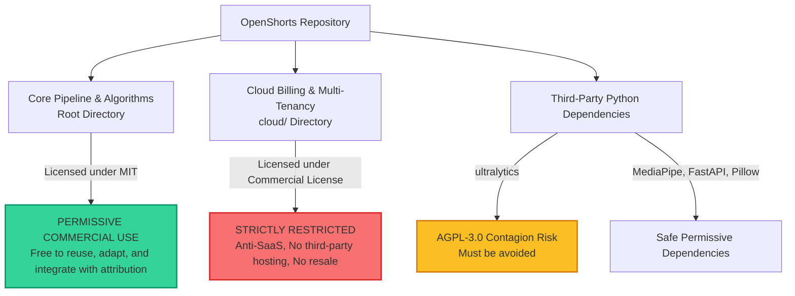

# OpenShorts Legal, Licensing & Code Reuse Audit

> **Document ID:** `VIREO_OPENSHORTS_LICENSE_AUDIT.md`  
> **Target System:** VireoClip (Commercial Multi-Tenant Video SaaS)  
> **Subject Repository:** OpenShorts (`https://github.com/mutonby/openshorts`)  
> **Auditor Role:** Principal Software Architect & Open-Source Licensing Reviewer  
> **Date:** October 2026  

---

## 1. Executive Summary & Dual-Licensing Architecture

A comprehensive legal and architectural audit of the OpenShorts repository reveals a **bifurcated dual-licensing structure**:

1. **Root Directory & Core Application (MIT License):**  
   The entire root repository (`app.py`, `main.py`, `reframe_v2.py`, `clip_selection.py`, `layout_picker.py`, `split_layout.py`, `screencast_layout.py`, `camera_inset.py`, `subtitles.py`, `hooks.py`, `hook_placement.py`, `mcp_server.py`, `thumbnail.py`, `dashboard/`, etc.) is licensed under the standard, permissive **MIT License** (Copyright © 2024 OpenShorts).
2. **The `cloud/` Directory (OpenShorts Commercial License):**  
   The `NOTICE` file explicitly carves out the `cloud/` directory, which is governed by the proprietary **OpenShorts Commercial License** (`cloud/LICENSE`). This license strictly prohibits offering the software as a hosted, managed, or Software-as-a-Service (SaaS) offering to third parties without a commercial agreement.
3. **Crucial Dependency Finding — Ultralytics YOLOv8 (AGPL-3.0 Risk):**  
   OpenShorts includes `ultralytics==8.4.46` in `requirements.txt` for fallback face detection. Ultralytics is licensed under **AGPL-3.0 (GNU Affero General Public License)**, which carries strict network-copyleft contagion. VireoClip **must NOT** import or depend on `ultralytics` to preserve its closed-source commercial SaaS integrity.

---

## 2. Granular Clause Analysis: Root MIT vs. Cloud Commercial License



### 2.1 The Root MIT License (`scratch/openshorts/LICENSE`)
* **Scope:** Covers all algorithmic code, layout logic, Gemini prompt engineering, face tracking routines, subtitle generation, and MCP server endpoints outside `cloud/`.
* **Permitted Rights:** Grants unrestricted rights to use, copy, modify, merge, publish, distribute, sublicense, and sell copies of the software, subject only to including the original copyright notice.
* **Commercial SaaS Viability:** **100% Permitted.** VireoClip can legally adapt, port, or integrate any algorithmic component from OpenShorts' core repository into its commercial multi-tenant SaaS platform.

### 2.2 The OpenShorts Commercial License (`scratch/openshorts/cloud/LICENSE`)
* **Scope:** Applies exclusively to `cloud/` and its subdirectories (`billing.py`, `auth.py`, `autopilot.py`, `metering.py`, `account.py`, `models.py`, etc.).
* **Prohibitions (Section "Prohibited use"):**
  > *"You may NOT, without a separate written commercial agreement with the copyright holder:*  
  > *1. Offer the Commercial Software, or any modified version or derivative of it, to third parties as a hosted, managed, or paid service (including but not limited to Software-as-a-Service, resale, white-labeling, or any offering that competes with the hosted service at openshorts.app).*  
  > *2. Sell, sublicense, or redistribute the Commercial Software, on its own or as part of another product or service, for a fee or other consideration."*
* **Impact on VireoClip:**  
  VireoClip operates as a paid, multi-tenant SaaS. Copying or utilizing any code from `cloud/` would constitute direct copyright infringement.
* **VireoClip Strategy:** **Zero Exposure.** VireoClip already possesses its own robust, multi-tenant Supabase authentication, PostgreSQL database schema, Stripe billing integration (`server/src/services/stripeService.ts`), and project workspaces. VireoClip has **no need** for OpenShorts' cloud billing or auth code.

---

## 3. Dependency License Audit & AGPL-3.0 Contagion Risk

An audit of `scratch/openshorts/requirements.txt` reveals the licensing status of OpenShorts' underlying libraries:

| Package | Version | License | Contagion Risk | VireoClip Reuse Recommendation |
| :--- | :--- | :--- | :--- | :--- |
| **`ultralytics`** | `8.4.46` | **AGPL-3.0** | **CRITICAL** | **DO NOT ADOPT.** AGPL-3.0 requires any networked service utilizing the code to disclose its complete source code. VireoClip uses MediaPipe and native OpenCV C++ bindings, completely bypassing AGPL. |
| **`mediapipe`** | `0.10.14` | Apache-2.0 | None | Safe. Permissive commercial license. |
| **`faster-whisper`** | `1.2.1` | MIT | None | Safe, but VireoClip's Groq Whisper cloud API is faster and lighter. |
| **`scenedetect`** | `0.7` | BSD-3-Clause | None | Safe. Permissive open-source license. |
| **`transnetv2-pytorch`** | `1.0.5` | MIT | None | Safe permissive license. |
| **`google-genai`** | `1.75.0` | Apache-2.0 | None | Official Google Gemini SDK. Safe. |
| **`fastapi`** / **`uvicorn`** | `0.136.1` | MIT | None | Permissive web framework. |
| **`Pillow`** | `12.2.0` | HPND / MIT-like | None | Standard Python imaging library. Safe. |

---

## 4. Feature-by-Feature Reuse & Porting Strategy

| Feature in OpenShorts | File Reference | Governing License | VireoClip Reuse Strategy | Rationale & Legal Justification |
| :--- | :--- | :--- | :--- | :--- |
| **Empirical Clip Count Floor & Windowing** | `clip_selection.py` (lines 29–68, 203–259) | **MIT** | **ADAPT / PORT TO TS** | Permitted under MIT. Port mathematical windowing, segment snapping, and the 4+ clip retention floor into `server/src/services/segmentationService.ts`. |
| **12-Frame Gemini Layout Picker** | `layout_picker.py` | **MIT** | **BUILD NATIVE / PORT** | Permitted under MIT. Implement 12-frame sampling ($0.0003 cost) in Node.js/FFmpeg using `gemini-3.1-flash-lite`. |
| **Pre-Existing Burned Subtitle Detection** | `burned_subtitles.py` | **MIT** | **ADAPT / PORT TO TS** | Permitted under MIT. Port the 12-frame bottom-band subtitle detection and auto-crop before reframing. |
| **Face-Avoiding Hook Placement** | `hook_placement.py` | **MIT** | **BUILD NATIVE / PORT** | Permitted under MIT. Port 6-frame face-area intersection logic to place hook text dynamically without covering faces. |
| **Visually Grounded Hook Rewriting** | `hook_grounding.py` | **MIT** | **ADAPT / PORT TO TS** | Permitted under MIT. Port 3-frame visual inspection prompt to ground tutorial/screencast hooks. |
| **Split-Seam Subtitle Alignment (`{\an5}`)** | `subtitles.py`, `split_layout.py` | **MIT** | **ADAPT TO TS** | Permitted under MIT. Port ASS subtitle seam placement into VireoClip's `captionService.ts`. |
| **Remote MCP Server (`/mcp`)** | `mcp_server.py` | **MIT** | **BUILD NATIVE (TS)** | Permitted under MIT. Implement lightweight Express Streamable-HTTP MCP endpoint exposing VireoClip tools. |
| **Cloud Billing & Metering** | `cloud/billing.py`, `metering.py` | **OpenShorts Commercial** | **REJECT / ISOLATE** | Strictly prohibited in commercial SaaS. VireoClip already uses its own Stripe and Supabase infrastructure. |
| **YOLOv8 Fallback Tracking** | `reframe_v2.py` (`ultralytics`) | **AGPL-3.0** | **REJECT** | Avoid AGPL copyleft liability. VireoClip uses MediaPipe and OpenCV face tracking. |

---

## 5. Clean Integration Protocol & Attribution

To maintain compliance with the MIT License of OpenShorts' core files:
1. **Attribution Notice:** If any algorithmic logic (such as `snap_clip_to_words` or `build_transcript_windows`) is ported from Python into VireoClip’s TypeScript codebase, a header comment must be retained:
   ```typescript
   // Based on algorithmic concepts from OpenShorts (https://github.com/mutonby/openshorts)
   // Copyright (c) 2024 OpenShorts, licensed under the MIT License.
   ```
2. **Zero `cloud/` Code:** No files or functions from `scratch/openshorts/cloud/` may be examined or referenced during TypeScript authoring.
3. **Zero `ultralytics` Dependencies:** `package.json` and backend dependencies must remain completely free of AGPL libraries.

---

## 6. Legal & Dependency Risk Register

| Risk ID | Category | Severity | Description | Mitigation Strategy |
| :--- | :--- | :--- | :--- | :--- |
| **RISK-OS-01** | Commercial License Breach | **HIGH** | Inadvertent inclusion of code from OpenShorts' `cloud/` directory in VireoClip's SaaS backend. | **Strict quarantine:** Completely exclude `cloud/` from any porting or engineering scope. VireoClip relies solely on its existing Stripe/Supabase stack. |
| **RISK-OS-02** | AGPL-3.0 Contagion | **CRITICAL** | Importing `ultralytics` (YOLOv8) could trigger AGPL copyleft obligations across the entire VireoClip proprietary platform. | **Strict rejection:** Forbid any use of `ultralytics`. Use Apache-2.0 MediaPipe and BSD OpenCV for all computer vision tasks. |
| **RISK-OS-03** | Missing MIT Attribution | **LOW** | Porting MIT algorithms without retaining copyright notice violates Section 1 of the MIT license. | Maintain standard open-source attribution notices in ported TypeScript utility headers. |
