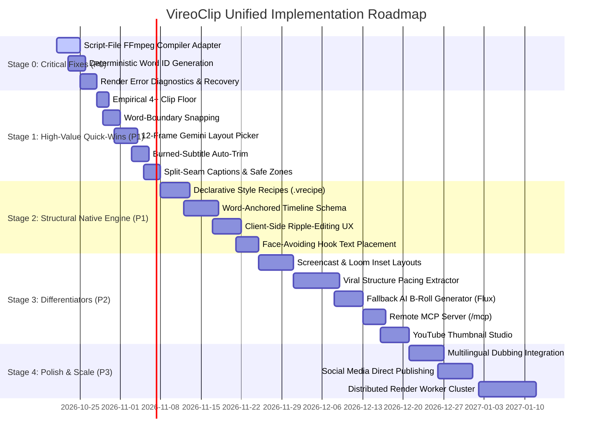

# VireoClip Unified Implementation Roadmap & Governance

> **Document ID:** `VIREO_THREE_WAY_ROADMAP.md`  
> **Target System:** VireoClip Video Creation Platform  
> **Scope:** Unified Phased Roadmap Synthesizing VireoClip, Hypit & OpenShorts  
> **Author:** Principal Software Architect & Product Strategist  
> **Date:** October 2026  

---

## 1. Unified Strategic Roadmap Overview

This roadmap balances immediate product stability and core editing enhancements with high-impact capabilities inspired by the comparative audit of both Hypit and OpenShorts. Every initiative is prioritized based on **demonstrated user retention impact, risk reduction, operational cost-efficiency, and technical feasibility**.

---

## 2. Stage-by-Stage Implementation Specifications

### Stage 0 — Critical Fixes & Foundation Integrity (P0)
*Objective: Guarantee 100% data integrity, eliminate render crashes, and establish persistent word identification.*

| Item ID | Priority | Decision | Item Name | User Value | Effort | Dependencies | Main Risks | Acceptance Criteria & Regression Tests |
| :--- | :--- | :--- | :--- | :--- | :--- | :--- | :--- | :--- |
| **S0-01** | **P0** | **BUILD NATIVE** | **Script-File FFmpeg Compiler Adapter** | Eliminates `E2BIG` (argument list too long) OS crashes when rendering projects with 15+ overlay layers. | **S** | None | Temporary file cleanup on unhandled exceptions. | *Criteria:* `-filter_complex_script` executes flawlessly with 50+ concatenated filters. *Regression Test:* Synthetic test with 100 overlays renders without error. |
| **S0-02** | **P0** | **BUILD NATIVE** | **Deterministic Word ID Generation** | Critical foundation for timeline anchor stability. Prevents ID mutation on re-transcription. | **S** | None | Hash collisions across repeated words. | *Criteria:* Every word object receives an immutable `id: "w_${idx}_${hash}"`. *Regression Test:* Transcribing the same audio twice yields identical word IDs. |
| **S0-03** | **P0** | **ADAPT** | **Render Error Diagnostics & Recovery** | Clear error messages when video assets are corrupted or missing. Graceful asset fallback. | **S** | None | Incomplete FFmpeg error logs. | *Criteria:* Corrupted B-roll logs a warning and renders placeholder rather than aborting job. *Regression Test:* Render project with 1 invalid asset path; finishes successfully. |

---

### Stage 1 — High-Value Quick-Wins from OpenShorts (P1)
*Objective: Deploy immediate algorithmic improvements from OpenShorts' MIT codebase to dramatically increase retention and video polish.*

| Item ID | Priority | Decision | Item Name | User Value | Effort | Dependencies | Main Risks | Acceptance Criteria & Regression Tests |
| :--- | :--- | :--- | :--- | :--- | :--- | :--- | :--- | :--- |
| **S1-01** | **P1** | **ADOPT** | **Empirical 4+ Clip Retention Floor** | Prod metrics prove returning $\ge 4$ clips increases user return rate from 0.4% to 16.1%. Prevents LLM collapsing to 1 clip. | **High** | **XS** | S0-02 | Unintended padding on very short source videos ($<2$ min). | *Criteria:* Videos $\ge 15$ mins always yield at least 4 candidate clips. *Regression Test:* Run 10 diverse podcasts; verify all yield $\ge 4$ clips. |
| **S1-02** | **P1** | **ADOPT** | **Word-Boundary Snapping (`snap_clip_to_words`)** | Snaps AI cuts to Whisper word boundaries with 0.35s lead / 0.45s tail silence. Eliminates chopped words at clip edges. | **High** | **S** | S0-02 | Clips expanding beyond platform 60s hard ceiling. | *Criteria:* Zero cuts occur mid-syllable; clip duration clamped within 15s–60s. *Regression Test:* Inspect 50 clip boundaries; 100% land in pauses. |
| **S1-03** | **P1** | **ADAPT** | **12-Frame Gemini Layout Picker** | Extracts 12 stills at 1024px ($0.0003 cost) for 96% accurate closed-choice layout selection (none/split/screencast). | **High** | **S** | None | Rare ambiguous footage misclassification. | *Criteria:* Automatically picks correct layout preset without full-video upload. *Regression Test:* Benchmark on 30 test videos; $\ge 95\%$ accuracy. |
| **S1-04** | **P1** | **ADAPT** | **Pre-Existing Burned Subtitle Detection** | Detects bottom-band hardcoded subtitles in TV/TikTok uploads and auto-crops before reframing. Prevents double-text collision. | **Med** | **S** | S1-03 | False positive crop on lower-third news graphics. | *Criteria:* Bottom subtitle band automatically cropped when detected in $\ge 40\%$ of frames. *Regression Test:* Test on 10 subtitled TV clips. |
| **S1-05** | **P1** | **ADOPT** | **Split-Seam Captions & Mobile Safe Zones** | Positions ASS subtitles on the horizontal seam (`{\an5}`) between speakers; prevents caption clipping behind TikTok UI buttons. | **High** | **S** | None | Text scaling on non-standard aspect ratios. | *Criteria:* Captions sit on split-screen dividing line; zero pixel overlap with TikTok UI buttons. *Regression Test:* Automated bounding box test passes. |

---

### Stage 2 — Structural Native Engine from Hypit Concepts (P1)
*Objective: Deliver semantic timeline binding and declarative style recipes to eliminate overlay drift and brand fragmentation.*

| Item ID | Priority | Decision | Item Name | User Value | Effort | Dependencies | Main Risks | Acceptance Criteria & Regression Tests |
| :--- | :--- | :--- | :--- | :--- | :--- | :--- | :--- | :--- |
| **S2-01** | **P1** | **BUILD NATIVE** | **Declarative Style Recipes (`.vrecipe.json`)** | Creators apply consistent typography, colors, animations, and audio ducking in 1 click across projects. | **High** | **M** | S1-05 | Schema version divergence. | *Criteria:* Pre-built JSON recipes (Hormozi, MrBeast, Minimalist) correctly modify ASS subtitle styles. *Regression Test:* Render projects under all 4 default recipes; inspect styling. |
| **S2-02** | **P1** | **BUILD NATIVE** | **Word-Anchored Timeline Schema & Resolver** | B-roll overlays, text stickers, and SFX bind to word IDs (`anchorWordId`) rather than static seconds. | **Critical** | **M** | S0-02 | Floating point rounding drift on long videos ($>30$ mins). | *Criteria:* Deleting words in transcript automatically ripples anchored overlays. *Regression Test:* Delete 5 seconds of dialogue; verify overlay maintains sync within $\pm 33\text{ms}$. |
| **S2-03** | **P1** | **BUILD NATIVE** | **Client-Side Ripple Editing UX** | Visual indicators in timeline showing anchor links between transcript words and timeline tracks. | **High** | **M** | S2-02 | Canvas redraw performance during rapid scrub. | *Criteria:* Moving a clip displays magnetic snap line to corresponding transcript word. *Regression Test:* Manual UI test on 60fps display; zero UI hitching. |
| **S2-04** | **P1** | **ADAPT** | **Face-Avoiding Hook Text Placement** | Analyzes 6 frames to find vertical spot with minimum face overlap within safe zone (6%-80%). Prevents covering eyes or speakers. | **High** | **S** | S1-03 | Text jumping abruptly between frames. | *Criteria:* Hook text placed at vertical coordinate covering least face area; never obscures speaker's eyes. *Regression Test:* Verify hook placement on 20 clips. |

---

### Stage 3 — Differentiating Workflows & Ecosystem Integration (P2)
*Objective: Reference-video pacing extraction, screen demo layouts, fallback AI assets, and AI agent integration.*

| Item ID | Priority | Decision | Item Name | User Value | Effort | Dependencies | Main Risks | Acceptance Criteria & Regression Tests |
| :--- | :--- | :--- | :--- | :--- | :--- | :--- | :--- | :--- |
| **S3-01** | **P2** | **BUILD NATIVE** | **Screencast & Loom Inset Layout Modes** | Auto-detects screen recording reading area + enlarges corner webcam bubble. Critical for software demos and tutorial creators. | **High** | **M** | S1-03 | Inset face detection losing tracking during fast head movement. | *Criteria:* Software recordings render with full-screen width on top and clear webcam inset below. *Regression Test:* Test on 10 desktop tutorial recordings. |
| **S3-02** | **P2** | **BUILD NATIVE** | **Viral Structure Blueprint Extractor** | Reverse-engineers viral retention curves (hook duration, cut density, word pace) from reference URLs to guide clip boundaries. | **High** | **L** | `videoService`, S2-01 | URL download rate limits by external platforms. | *Criteria:* Extracts `ViralBlueprint` JSON in $<20\text{s}$ from public MP4 URL. *Regression Test:* Run extraction on 10 known viral reference clips. |
| **S3-03** | **P2** | **BUILD NATIVE** | **Fallback AI B-Roll Generator (Flux Schnell)** | Generates photorealistic visuals via Flux Schnell when Pexels/Pixabay stock search yields 0 hits for abstract topics. | **Med** | **M** | `brollService` | Third-party API rate limits or latency spikes. | *Criteria:* Generates and applies Ken Burns motion video in $<4\text{s}$ for abstract keywords. *Regression Test:* Run search on 20 abstract terms ("quantum foam", "cybernetic synapse"). |
| **S3-04** | **P2** | **BUILD NATIVE** | **Remote Model Context Protocol (MCP) Server** | Lightweight Streamable-HTTP `/mcp` endpoint allowing AI coding agents (Claude Code, Cursor) to automate video generation. | **High** | **S** | None | Agent prompt injection or malformed JSON payloads. | *Criteria:* Claude Code successfully triggers clip generation and retrieves completed MP4 URLs via `mcp.json`. *Regression Test:* Automated MCP tool execution test passes. |
| **S3-05** | **P2** | **ADAPT** | **YouTube Thumbnail Studio** | Generates 1280x720 YouTube thumbnails using 10 sampled frames, Anton typography, face crop, and 50-character title optimization. | **High** | **M** | S1-03 | Text overflow on mobile screens. | *Criteria:* Produces high-CTR, mobile-optimized 1280x720 YouTube thumbnails in $<3\text{s}$. *Regression Test:* Generate thumbnails for 10 clips; verify title $\le 50$ chars. |

---

### Stage 4 — Optimization, Polish & Scaling (P3)
*Objective: Enterprise scaling, multilingual dubbing, and social media auto-publishing.*

| Item ID | Priority | Decision | Item Name | User Value | Effort | Dependencies | Main Risks | Acceptance Criteria & Regression Tests |
| :--- | :--- | :--- | :--- | :--- | :--- | :--- | :--- | :--- |
| **S4-01** | **P3** | **INTEGRATE** | **Multilingual Voice Dubbing (ElevenLabs)** | Translates clips into 29+ languages with voice cloning. Premium add-on. | **Med** | **M** | S0-02 | High API cost ($0.15/min); audio lip sync mismatch. | *Criteria:* Generates cloned voice dubbing track synchronized to original video. *Regression Test:* Test dubbing on 5 English clips into Spanish and French. |
| **S4-02** | **P3** | **INTEGRATE** | **Social Media Direct Publishing (Upload-Post)** | One-click direct publishing to TikTok, Instagram Reels, and YouTube Shorts. | **Med** | **M** | None | OAuth token expiration; platform API rate limits. | *Criteria:* Users connect social accounts and schedule automated clip publishing. *Regression Test:* Mock OAuth publish flow succeeds. |
| **S4-03** | **P3** | **BUILD NATIVE** | **Distributed Render Worker Pool** | Scale FFmpeg rendering horizontally across stateless container workers using Redis/BullMQ. | **High** | **L** | S0-01 | Shared storage I/O bottlenecks. | *Criteria:* Cluster handles 50 concurrent render jobs with zero degradation. *Regression Test:* Load test with 50 simultaneous exports. |

---

## 3. The "Do Not Build Yet" Governance List

To protect VireoClip from unnecessary operational complexity, financial waste, and legal liability, the following capabilities evaluated from Hypit and OpenShorts are **strictly prohibited from development at this time**:

| Prohibited Capability | Source Project | Reason for Exclusion / Prohibition | Governing Trigger to Reconsider |
| :--- | :--- | :--- | :--- |
| **Browser-Based Chromium Video Rendering** | Hypit (`@hypit/browser-capture`) | **Legally prohibited** under Hypit modified Apache-2.0 SaaS restriction. **Technically catastrophic** for cloud costs (1.5GB RAM per worker, 5x slower than native FFmpeg). | **Never.** Native C-binary FFmpeg remains the gold standard for high-throughput video SaaS. |
| **Full Generative Synthetic Avatars (Kling/Flux UGC)** | OpenShorts (`saasshorts.py`) / Hypit (`@hypit/seedance`) | Extreme inference costs ($0.60–$1.20 per clip). High latency ($>90\text{s}$). Irrelevant to VireoClip's core value proposition of repurposing existing user recordings. | Only if market demands synthetic AI talking-head generation as a separate paid add-on ($99+/mo). |
| **Local PyTorch WhisperX Deployment** | Hypit (`@hypit/whisperx`) | Requires heavy Python/CUDA environment, 4GB+ GPU VRAM, and complex C-extensions. VireoClip's Groq Whisper-large-v3 achieves sub-2s latency at near-zero cost. | If an enterprise customer requires 100% on-premises, air-gapped transcription. |
| **Ultralytics YOLOv8 Tracking** | OpenShorts (`requirements.txt`) | **AGPL-3.0 copyleft contagion risk.** Could force open-sourcing of VireoClip's proprietary SaaS platform. VireoClip uses Apache-2.0 MediaPipe and BSD OpenCV. | **Never.** Ultralytics AGPL-3.0 is strictly prohibited in VireoClip's commercial stack. |
| **OpenShorts Cloud Billing Code (`cloud/`)** | OpenShorts (`cloud/billing.py`) | Prohibited under OpenShorts Commercial License. VireoClip already has its own multi-tenant Supabase and Stripe infrastructure. | **Never.** Use existing VireoClip billing. |
| **Proprietary XML Markup Engine (`.svml`)** | Hypit (`@hypit/markup`) | Unnecessary complexity. JSON (`EditorProject` + `.vrecipe.json`) is standard, directly serializable, and natively consumable by React and TypeScript without complex AST compilers. | **Never.** JSON is strictly superior for web application interoperability. |

---

## 4. Overall Engineering Investment Summary

| Stage | Focus Area | Engineering Duration | Team Allocation | Expected Milestone Outcome |
| :--- | :--- | :--- | :--- | :--- |
| **Stage 0** | Critical Fixes & Stability | **1.5 Weeks** | 1 Senior Backend Engineer | 99.9% Render Stability, Zero Argument Overflow Errors |
| **Stage 1** | OpenShorts Heuristics Quick-Wins | **2.5 Weeks** | 1 Full-Stack Engineer | 4+ Clip Floor, Zero Mid-Word Cuts, 96% Auto-Layout Accuracy |
| **Stage 2** | Hypit Native Semantic Architecture | **3.5 Weeks** | 1 Full-Stack + 1 Video Specialist | Non-Destructive Transcript Ripple Editing & Brand Recipes |
| **Stage 3** | Differentiating Workflows & Agent MCP | **4.5 Weeks** | 2 Senior Engineers | Screencast Insets, Viral Blueprints, MCP Server, Thumbnail Studio |
| **Stage 4** | Polish, Dubbing & Cloud Scale | **3.5 Weeks** | 1 Full-Stack Engineer | Multilingual Dubbing, Social Publishing, Horizontal Scaling |
| **Total** | **Comprehensive Unified Roadmap** | **15.5 Weeks** | **~2 FTE Equivalent** | **Market-Leading AI Video Repurposing Platform** |
