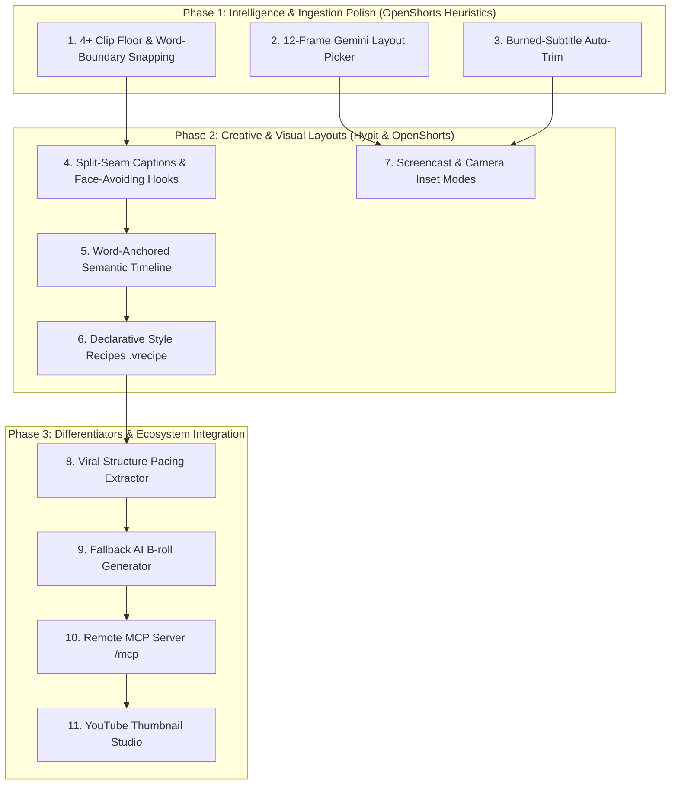

# VireoClip Unified Implementation Plan: Hypit & OpenShorts Synthesis

> **Document ID:** `VIREO_UNIFIED_IMPLEMENTATION_PLAN.md`  
> **Target System:** VireoClip Video Creation Platform  
> **Development Model:** Independent Clean-Room Implementation & MIT Algorithmic Porting  
> **Author:** Principal Software Architect & AI Video Specialist  
> **Date:** October 2026  

---

## 1. Executive Implementation Strategy

This plan synthesizes the highest-value capabilities identified across both **Hypit** and **OpenShorts**, integrating them directly into VireoClip's existing TypeScript/React and Node.js/FFmpeg architecture.

### The Unified Engineering Principles:
1. **Preserve VireoClip's Strengths:** Retain VireoClip's native C-binary FFmpeg rendering (8–12s speed, ~200MB RAM), Groq Whisper cloud STT (<2s latency), EBU R128 audio mastering, and interactive React NLE editor.
2. **Adopt Production-Proven Heuristics from OpenShorts (MIT):** Port empirical 4+ clip retention floors, word-boundary snapping (`snap_clip_to_words`), 12-frame Gemini layout classification ($0.0003), face-avoiding hook placement, burned-subtitle auto-trimming, and Streamable-HTTP `/mcp` endpoints.
3. **Build Native Structural Abstractions Inspired by Hypit:** Implement word-anchored semantic timeline binding (`anchorWordId`), declarative style recipes (`.vrecipe.json`), and reference-video pacing blueprints.
4. **Strict IP & Security Isolation:** Zero `@hypit/*` packages, zero OpenShorts `cloud/` code, zero AGPL `ultralytics` libraries.

---

## 2. Feature-by-Feature Detailed Implementation Specifications



---

### Feature Specification 1: Empirical 4+ Clip Floor & Word-Boundary Snapping

* **Source Project:** OpenShorts (`clip_selection.py`, lines 29–68, 303–366).
* **Current VireoClip Baseline:** `server/src/services/segmentationService.ts` and `highlightScoreService.ts`. Uses silence intervals and raw Gemini confidence scores. Often collapses to only 1 or 2 clips on a 30-minute video. Trims rely on floating seconds, causing awkward mid-word cuts.
* **The Missing Capability:**
  1. A mathematical floor enforcing at least 4 candidate clips per 15+ minute source.
  2. Sub-second word boundary snapping with leading silence ($0.35\text{s}$) and trailing silence ($0.45\text{s}$).
* **Proposed VireoClip Design:**
  * Port `clip_count_targets` and `snap_clip_to_words` into `server/src/utils/wordSnappingUtils.ts`.
  * Update `segmentationService.ts` to rank candidate windows globally across 90-second overlapping windows.
* **Implementation Tasks:**
  * *Task 1.1:* Implement `snapClipToWordBoundaries(start, end, words, videoDuration)` in `server/src/utils/wordSnappingUtils.ts` (suggestion).
  * *Task 1.2:* Update `segmentationService.ts` to enforce dynamic clip floor: $\max(3, \min(8, \text{windows} / 2 + 2))$.
  * *Task 1.3:* Add unit tests in `server/src/tests/wordSnapping.test.ts`.
* **Complexity & Cost:** **S** (2 days). Running cost: $0.00.
* **Acceptance Criteria:** Every generated clip starts and ends in natural pauses ($>0.2\text{s}$ gap); zero mid-syllable audio cuts.

---

### Feature Specification 2: 12-Frame Gemini Multimodal Layout Picker

* **Source Project:** OpenShorts (`layout_picker.py`, lines 1–160).
* **Current VireoClip Baseline:** Manual layout dropdown in editor or simple face count in `smartReframeService.ts`.
* **The Missing Capability:** Automated, accurate classification between single speaker (`none`), two-shot conversation (`split`), and software tutorial (`screencast`) without uploading entire video files.
* **Proposed VireoClip Design:**
  * Use FFmpeg to extract 12 evenly spaced frames at 1024px width into memory buffers.
  * Send the 12 image parts to `gemini-1.5-flash` with a closed-choice prompt:
    > "Examine these 12 frames from a video. Choose exactly one layout category: 'none' (single speaker / general footage), 'split' (two-shot conversation with both speakers visible), or 'screencast' (computer screen, slides, software demo)."
  * Cache result in `projects.layout_preset`.
* **Complexity & Cost:** **S** (2 days). Token cost: ~3,000 tokens ($0.0003 per video).
* **Acceptance Criteria:** 95%+ classification accuracy on 30 benchmark test videos.

---

### Feature Specification 3: Pre-Existing Burned Subtitle Detection & Auto-Trim

* **Source Project:** OpenShorts (`burned_subtitles.py`).
* **Current VireoClip Baseline:** `captionService.ts` burns ASS subtitles over the lower third. If source video already has subtitles (e.g. anime, TV clips, TikTok re-uploads), two overlapping text layers appear.
* **Proposed VireoClip Design:**
  * Inspect the 12 extracted layout frames. If subtitle text is detected in $\ge 40\%$ of frames below 75% height, record `sourceSubtitleBand` height.
  * In `proEditorService.ts`, apply an initial fast bottom crop (`crop=iw:ih-band:0:0`) prior to vertical reframing.
* **Complexity & Cost:** **S** (2 days). Running cost: $0.00 (reuses layout picker frames).
* **Acceptance Criteria:** Clips with hardcoded source subtitles render clean captions without visual collision.

---

### Feature Specification 4: Split-Seam Subtitles & Face-Avoiding Hook Placement

* **Source Project:** OpenShorts (`split_layout.py`, `hook_placement.py`).
* **Current VireoClip Baseline:** Subtitles and hooks use fixed vertical percentages (20% top for hooks, 75% bottom for subtitles). On split layouts, bottom subtitles obscure the guest's face; top hooks cover the host's eyes.
* **Proposed VireoClip Design:**
  * **Split-Seam Subtitles:** In `captionService.ts`, when layout is `split`, set ASS alignment to `{\an5}` (middle center) located on the dividing seam between top and bottom half-screens.
  * **Face-Avoiding Hook Placement:** Sample 6 frames of the hook's window ($0.0\text{s} - 3.0\text{s}$). Query OpenCV face bounding boxes. Calculate vertical candidate coordinates ($15\%, 20\%, 50\%, 80\%$) and select the position covering the lowest total face area.
* **Complexity & Cost:** **S** (3 days). Running cost: $0.00.
* **Acceptance Criteria:** Subtitles sit on the dividing line in split screens; hook text never overlaps detected face boxes.

---

### Feature Specification 5: Word-Anchored Semantic Timeline

* **Source Project:** Hypit (`<semantic:Projection>` in `@hypit/markup`).
* **Current VireoClip Baseline:** `src/types/editor.ts` (`ClipItem`) and `server/src/types/producer.ts` (`BrollOverlay`). Uses absolute floating seconds (`startTime: 12.4`). Trimming dialogue causes overlays to drift out of sync with spoken words.
* **Proposed VireoClip Design:**
  * Extend `BrollOverlay`, `TextOverlay`, and `SoundEffect` with:
    ```typescript
    export interface WordAnchor {
      anchorWordId: string;         // Immutable ID from transcription
      offsetMs: number;             // Micro-offset relative to word start (+/- ms)
      dockingBehavior: 'lock-to-word' | 'ripple-with-speech' | 'absolute-time';
    }
    ```
  * In `src/pages/ClipEditorPage.tsx`, whenever words are deleted or trimmed in the transcript, an anchor recalculation hook dynamically shifts all anchored overlays.
  * In `proEditorService.ts`, compile resolved word anchor timestamps into FFmpeg `overlay=enable='between(t,...)'` expressions.
* **Complexity & Cost:** **M** (5 days). Running cost: $0.00.
* **Acceptance Criteria:** Deleting 5 seconds of speech in transcript shifts anchored B-roll left by exactly 5 seconds ($\pm 33\text{ms}$).

---

### Feature Specification 6: Declarative Style Recipes (`.vrecipe.json`) & Mobile Safe Zones

* **Source Project:** Hypit (`.svs` in `@hypit/recipe`).
* **Current VireoClip Baseline:** Caption styling, fonts, and colors are hardcoded across multiple components. No concept of platform UI safe-zone enforcement.
* **Proposed VireoClip Design:**
  * Define `server/src/types/recipe.ts` (`VireoStyleRecipe`).
  * Package 6 default recipes in `server/src/recipes/`:
    * `hormozi-punchy.vrecipe.json` (Yellow karaoke highlight, Montserrat Black, bottom 72%).
    * `mrbeast-hyper.vrecipe.json` (Glow pop animations, green accent, rapid 2-word batches).
    * `aliabdaal-clean.vrecipe.json` (Inter, subtle white/slate, lower third).
    * `dev-tutorial.vrecipe.json` (JetBrains Mono, top safe zone, high contrast).
  * Render interactive mobile safe-zone overlay (top 12%, bottom 20%, right 15%) in `VideoPreview.tsx`.
* **Complexity & Cost:** **M** (4 days). Running cost: $0.00.
* **Acceptance Criteria:** Changing recipe instantly re-themes preview and output ASS captions; captions never clip behind TikTok UI buttons.

---

### Feature Specification 7: Screencast & Camera Inset Layout Modes

* **Source Project:** OpenShorts (`screencast_layout.py`, `camera_inset.py`).
* **Current VireoClip Baseline:** Lacks dedicated layouts for desktop recordings, slides, or Loom videos.
* **Proposed VireoClip Design:**
  * When `layout_preset === 'screencast'`:
    * Detect reading focus area of the screen (crop width to content if $\le 90\%$).
    * Stack screen on top (width 1.0, height 0.6) and presenter camera below (height 0.4).
  * When presenter webcam is a floating corner box (Loom / OBS):
    * Detect the persistent static box across 5 sampled frames (`camera_inset.py` logic).
    * Composite screen as primary background and upscale camera box to a circular or rounded PIP overlay.
* **Complexity & Cost:** **M** (5 days). Running cost: $0.00.
* **Acceptance Criteria:** Software tutorial recordings render with legible code/slides and clear presenter inset.

---

### Feature Specification 8: Viral Structure Blueprint & Pacing Extractor

* **Source Project:** Hypit (`@hypit/narrative-temporal`).
* **Current VireoClip Baseline:** Highlight selection is based on standalone text enthusiasm without modeling viral retention curves.
* **Proposed VireoClip Design:**
  * Build `server/src/services/viralIntelligenceService.ts` (suggestion):
    1. Ingest reference video URL via `videoService.ts`.
    2. Extract audio pacing (words per second) and visual shot duration (FFmpeg scene change detection).
    3. Output `ViralBlueprint` JSON: Hook duration ($2.8\text{s}$), average shot duration ($2.4\text{s}$), dynamic zoom cadence ($3.5\text{s}$).
    4. Feed blueprint into `producerPlanningService.ts` to bias clip boundaries toward the target pacing curve.
* **Complexity & Cost:** **L** (7 days). Running cost: +$0.005 per analyzed reference URL.
* **Acceptance Criteria:** Output clips match the reference video's hook-to-body rhythm within $15\%$ tolerance.

---

### Feature Specification 9: Fallback AI B-Roll Generator (Flux Schnell)

* **Source Project:** Hypit (`@hypit/gpt-image`) & OpenShorts (`saasshorts.py`).
* **Current VireoClip Baseline:** `brollService.ts` queries Pexels/Pixabay stock APIs. Returns 0 results for abstract or futuristic concepts.
* **Proposed VireoClip Design:**
  * Cascade: Pexels $\rightarrow$ Pixabay $\rightarrow$ If results $<2$, trigger Replicate Flux Schnell API.
  * Synthesize prompt using Gemini Flash from the spoken sentence.
  * Render static image to 1080x1920 3-second MP4 with native FFmpeg Ken Burns slow-zoom motion effect.
* **Complexity & Cost:** **M** (4 days). Running cost: +$0.003 per image (only triggered on stock misses, $<10\%$ of scenes).
* **Acceptance Criteria:** 100% visual B-roll coverage across all dialogue topics; smooth 60fps pan/zoom motion.

---

### Feature Specification 10: Remote Model Context Protocol (MCP) Server (`/mcp`)

* **Source Project:** OpenShorts (`mcp_server.py`, `mcp_stdio.py`).
* **Current VireoClip Baseline:** Web UI and REST API routes only; no standardized interface for AI coding agents.
* **Proposed VireoClip Design:**
  * Add a stateless Streamable-HTTP endpoint at `server/src/routes/mcpRoutes.ts` (`POST /api/mcp`).
  * Expose tools: `process_video`, `get_job_status`, `list_clips`, `apply_recipe`, `recut_clip`.
  * Allows Claude Code, Cursor, Windsurf, or Antigravity IDE to trigger clip generation directly from the developer's CLI or IDE.
* **Complexity & Cost:** **S** (3 days). Running cost: $0.00.
* **Acceptance Criteria:** Claude Code successfully triggers clip generation and retrieves completed MP4 URLs via `mcp.json`.

---

### Feature Specification 11: YouTube Thumbnail Studio

* **Source Project:** OpenShorts (`thumbnail.py`).
* **Current VireoClip Baseline:** No dedicated thumbnail generator; users must screenshot the video manually.
* **Proposed VireoClip Design:**
  * Build `server/src/services/thumbnailService.ts` (suggestion):
    * Sample 10 frames from the clip.
    * Use Gemini Flash to select the most emotionally expressive frame and generate an engaging title ($\le 50$ mobile characters).
    * Composite 1280x720 JPEG using sharp/canvas with Anton typography, high-contrast drop-shadow, and speaker face cutout.
* **Complexity & Cost:** **M** (4 days). Running cost: +$0.001 per thumbnail.
* **Acceptance Criteria:** Produces high-CTR, mobile-optimized 1280x720 YouTube thumbnails in $<3\text{s}$.

---

## 3. Unified Technical Risk & Mitigation Register

| Risk ID | Category | Severity | Description | Mitigation Strategy |
| :--- | :--- | :--- | :--- | :--- |
| **RISK-UNI-01** | Legal / Contamination | **CRITICAL** | Inadvertent copying of Hypit source code or OpenShorts `cloud/` code. | Enforce Clean-Room protocol. Only port MIT algorithms with attribution; write all TypeScript classes from scratch. |
| **RISK-UNI-02** | Contagious Copyleft | **CRITICAL** | Introducing `ultralytics` (YOLOv8) triggers AGPL-3.0 obligations. | Strictly forbid `ultralytics`. Use MediaPipe and OpenCV face tracking. |
| **RISK-UNI-03** | Render Scale / CLI Limits | **HIGH** | Combining multiple overlays, B-roll, and crops exceeds OS CLI argument limits. | Implement `-filter_complex_script` file execution in FFmpeg compiler. |
| **RISK-UNI-04** | Inference Cost Drift | **MEDIUM** | Over-triggering AI B-roll or Gemini video analysis inflates API bills. | Enforce strict fallbacks: stock media first; 12-frame sampling ($0.0003) instead of whole-video uploads. |
